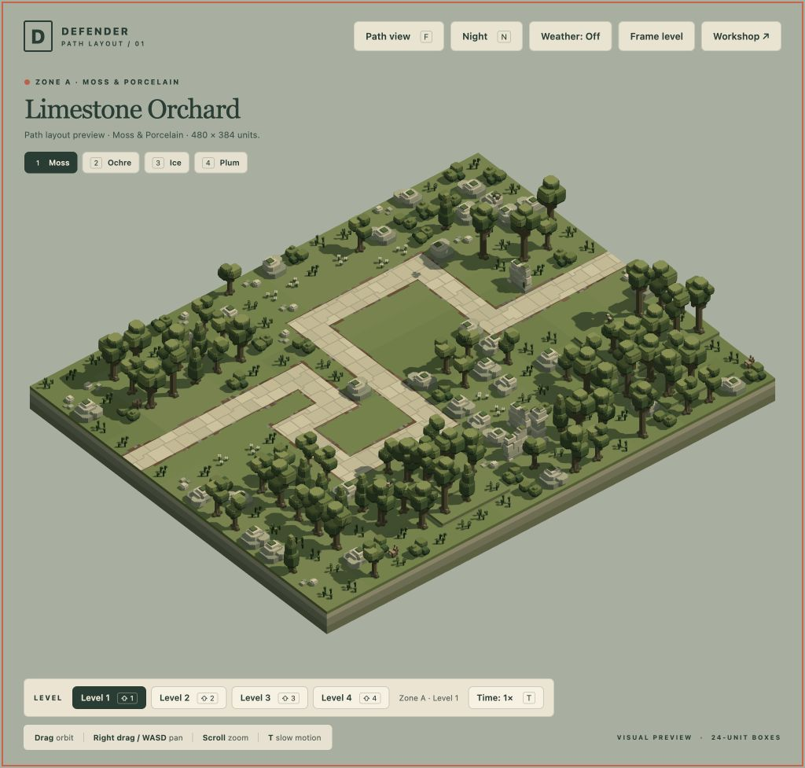
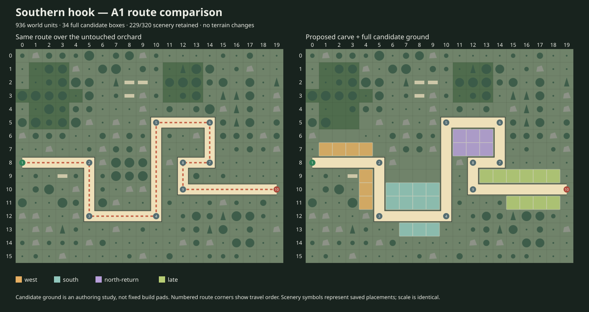

# A1 · Southern Hook

**User-approved and implemented, 18 October 2026.** Southern Hook is now the active route in **Limestone Orchard (`moss-01`)**. The saved source is byte-identical to the proposal the user approved. This is a layout preview with scenery and six cosmetic wildlife actors; it contains no enemies or placed defences. The other fifteen landscapes remain unchanged.

[Open A1](/game/?inspect&level=moss-01) · [Compare the landscape and alternatives](/tools/a1-layout-review.html?view=southern-hook) · [Design doc](../design-doc.md)

## Route and placement choices

The route enters from the west, sweeps through the southern orchard, returns north below the limestone and wooded knoll, then curls into a separate eastern exit approach. Its 40 boxes cover 936 world units. The fixed 20×16 footprint, terrain, all four limestone ruin pieces and three supported bird-perch trees are preserved. Carving removes 91 of the original 320 scenery placements; 229 remain, with none added or moved.

The user's standing rule is enforced: **routes start and end at the level boundary but never run along the level edges.** A1 enters at `[0,8]`, exits at `[19,10]`, and all 38 intermediate boxes are interior. Entry and exit connect directly to the interior.

The authoring study identifies **34 fully visible candidate placement boxes** across western, southern, northern-return and late areas. These are alternatives, not fixed build pads or a player-placement rule:

- 32 have useful opportunities at the existing 48-unit base range. Southern boxes `[7,10]` and `[8,10]` require the 72-unit upgraded range.
- All 34 pass individual base-gun and base/upgrade-1 Arc clearance. The upgrade-1 gun fits 33; at `[17,11]` its rotating head intersects a retained oak canopy. Use another site for that upgrade. The approved scenery is preserved.
- Northern-return `[11,7]` has separated base-gun Dog exposure windows at route distances 414–498 and 702–738. Late `[15,9]` has windows 654–690 and 798–882. These establish genuine return opportunities, not merely a continuous bend.
- The two eastern `[18,9]` / `[18,11]` choices cover the final 870–936 units, beyond the northern court's base coverage. They offer an independent late catch.

Individual-site checks do not certify simultaneous adjacent weapon arrangements. Missile flight, campaign waves, budgets and final balance are not assigned by this layout study.

## Review and verification

Tactician compared Orchard Tour, Northern Traverse and Southern Hook. Artist's independent historical preference was Orchard Tour; the user's explicit approval selects Southern Hook and supersedes that internal recommendation. [Artist review](ARTIST.md), [Tactician rationale and evidence](TACTICIAN.md), [runtime handoff](ENGINEER.md).

The [route/coverage/visibility audit](southern-hook.audit.json) passes: 2,811 canonical Dog/Roller/Moth poses, actual gun muzzle/LOS and Arc probes, and full-ground overview visibility. These actors exist only in offline probes. The [weapon motion study](southern-hook.clearance.json) passes the declared suitability above and records the real upgrade-1 canopy intersection rather than claiming every combination fits. [Final manifest and removal reasons](moss-01.manifest.json).

Twenty affected runtime/schema/world tests pass, including all sixteen source-aware load/animate/unload lifecycles and historical combat compatibility. `bun run check:previews` verifies all sixteen current sources against their factories. [Live browser evidence](browser-review.json) verifies A1, F path-camera entry/return, R without combat, and A1→A2→A1 cleanup; six wildlife actors remain, with zero enemies, weapon activity or browser warnings/errors. No full suite was run and no frame-rate or final-balance claim is made.

[Preservation checks](preservation.json) verify the other fifteen level sources and all 51 referenced scenery/wildlife models unchanged, all 69 frozen backup checksums intact, and the backup archive unchanged. [Rollback instructions](../landscape-reset-2026-10-18/backup.md). The active A1 source and [exact approved proposal](approved-southern-hook.level.json) share SHA-256 `2d0ec71f65d3df765f1def357cfbbf1bf56b30951b9ff424c5c042dd5f0b4c91`.

## Reproducible authoring

`scripts/a1-path-carving.js` derives Southern Hook from the checked frozen A1 baseline and explicit removal inventory. It does not run the offline audits during normal generation. `bun run rebuild:previews` uses the current production wrapper: approved A1 plus the fifteen untouched landscape factories. `bun run check:previews` checks without writing; `bun scripts/current-preview-levels.js --level moss-01 --write` regenerates only A1 when explicitly needed. Never overwrite the frozen backup or use the historical landscape-only writer to erase an approved carve.

Later levels await their own carving request. The subsequent bridge-style note identifies A2 as a candidate only; it does not change A2 in this pass.
