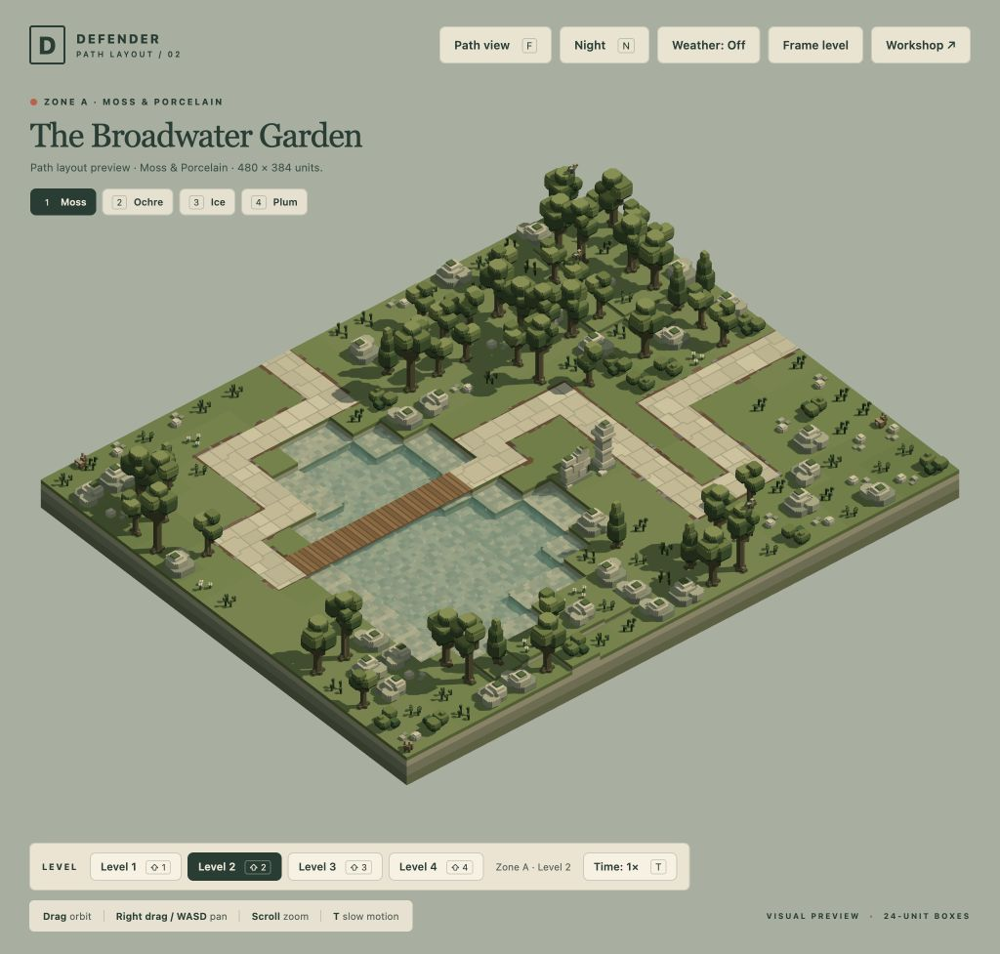
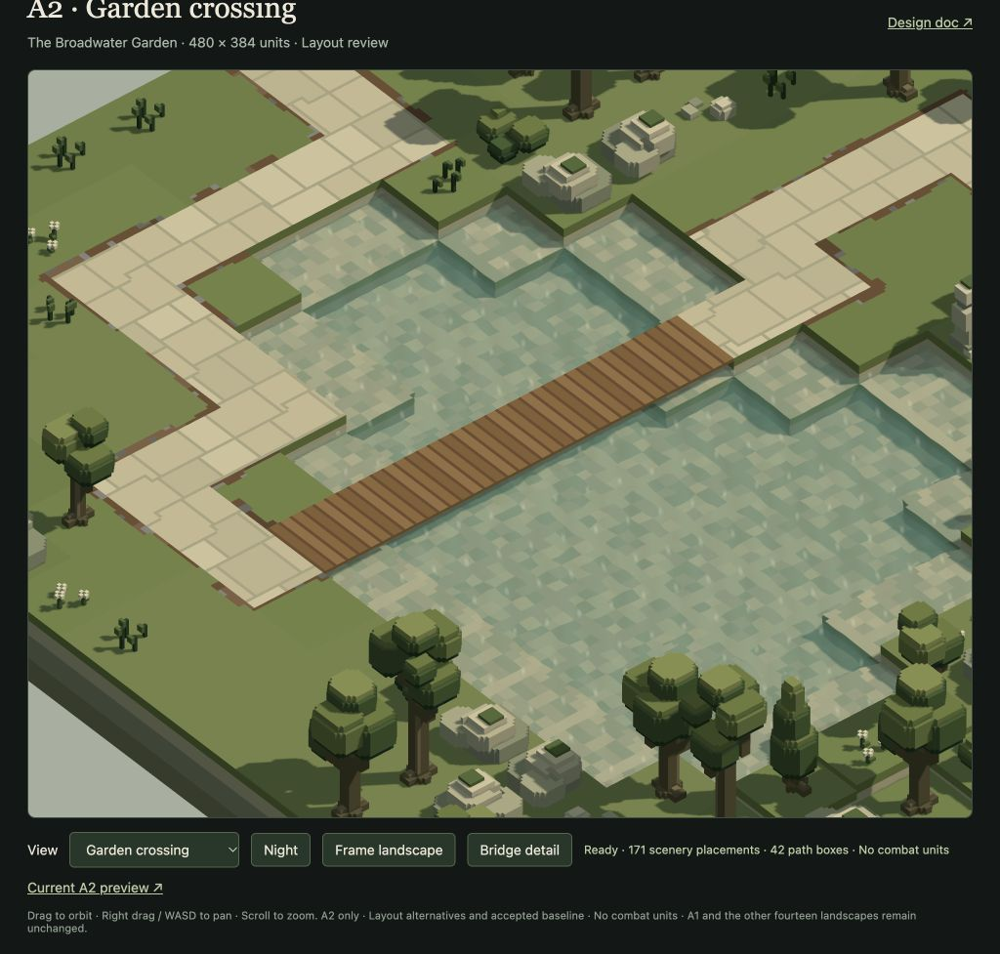

# A2 Garden Crossing · 18 October 2026

**User-approved and implemented.** The user accepted this exact layout on 18 October ("Perfect!") and authorised A3 next. The user authorised Tactician to carve Zone A level 2 next, including a one-unit-high wooden-plank bridge. Garden Crossing is the team's selected layout after comparing three journeys in the actual renderer. A1 Southern Hook remains approved and unchanged. A3 is now authorised for its own carving pass; the other thirteen levels await further authorisation.

[Open A2 in the game](/game/?inspect=&level=moss-02) · [Compare alternatives and inspect the bridge](/tools/a2-layout-review.html?view=garden-crossing) · [Shared design doc](../design-doc.md#current-landscape-composition)



## The selected journey

The 42-box, 984-unit route enters the western garden, folds around a useful return court, passes the limestone landmark, crosses the lake, and turns through a separate southern shoreline court before exiting. Its two endpoints lie on the boundary; all 40 intermediate boxes are interior. No segment follows a level edge.

The bridge spans six original water boxes, `[11,8]` through `[16,8]`: **144 units long, 24 wide and exactly one unit thick**. Its top at Y24 joins both banks without a step; the underside is Y23 and the original water remains Y20. The lake bed and water are preserved. Broad transverse wooden planks have darker flush joints, a continuously supported surface and a thin visible edge. Materials are matte and texture-free. [Bridge geometry and runtime contract](../bridges.md).



There are **32 fully visible dry-ground placement alternatives**, each offering base-range opportunities with guns and Arc Spires against Dog, Roller and Moth. All 32 individually fit the base and first upgrade of both weapons. Western positions provide genuine separated repeat exposure; eastern-bank, southern-turn and final-catch positions give different timings. These are surveyed alternatives, not fixed build pads or a promise that every adjacent arrangement can be occupied simultaneously. This preview contains scenery and six cosmetic wildlife actors, with no enemies or placed defences.

The bridge is a deliberate gap between banks: the union of surveyed bank weapons leaves **84 route units uncovered at base range 48**, or **32 at upgraded range 72**. This limitation applies to all three tested species and both weapon families. It is recorded for future combat balancing; there are no bridge deployment sites or weapon-stat changes. [Actual coverage and site distinctions](TACTICIAN.md#useful-ground-and-actual-coverage).

## Alternatives and scenery

| Option | Route length | Water span | Surveyed sites | Scenery retained | Review conclusion |
| --- | ---: | ---: | ---: | ---: | --- |
| **Garden Crossing** | 984 | 144 | 32 | 171/258 | Clearest central crossing and distinct decisions before and after it. Selected for user review. |
| Lower Arm | 864 | 120 | 34 | 182/258 | Preserves an uninterrupted basin, but later travel and placement read as a narrower bank corridor. |
| Northern Reach | 744 | 144 | 28 | 191/258 | Retains more scenery, but trees partly hide the crossing and the later journey is more linear. |

All three share the original 20×16 landscape, terrain, water and wildlife. Only Garden Crossing received the full production weapon/route audit; rough alternative comparisons do not certify attack opportunities. [Same-scale diagrams and comparison rationale](TACTICIAN.md#compared-journeys), [independent Artist review](ARTIST.md).

Garden Crossing removes 87 of the original 258 placements: 36 for travel, 32 for complete placement ground and 19 for overview visibility. The pillar at `[7,6]`, wall at `[8,6]` and southwest wall at `[4,12]` remain; wall `[7,7]` was removed for useful ground. Both landforms and all three bird-perch trees remain. No models were moved, resized or replaced. [Exact removal manifest](moss-02.manifest.json).

## Verification and preservation

- Route/support, all 32 full-ground visibility checks, 2,955 sampled route poses and all 128 individual weapon/site clearance combinations pass. [Route audit](garden-crossing.audit.json), [independent clearance](garden-crossing.clearance.json), [coverage](coverage.json), [Tactician verification](verification.json).
- Targeted bridge checks cover exact exposed geometry, actual Dog sole support, invalid spans, unchanged water, weather rebuilds, workshop caches, collision/underpass, camera support and disposal. The final current-source runtime group passed 20 tests / 305,643 assertions, including all sixteen scene lifecycles. [Engineer evidence and test scope](ENGINEER.md). No full suite was run.
- The normal game preview loads A2, supports F path view/return and R without introducing combat, and switches weather on/off. A2 → A1 → A3 → A2 releases previous scene assets, buffers and effect references. The returned A2 has six wildlife, no combat state, no light overflow and no browser warnings/errors. The first API load encountered the old validator in a long-running Bun server; restarting that server resolved it. [Browser evidence](browser-review.json), [rain capture](screenshots/moss-02-rain.png), [night comparison](screenshots/garden-crossing-night.png).
- `bun run check:previews` confirms all sixteen active sources match their current factories. A1 is byte-identical to its approved version. Among 84 tracked JSON assets only `assets/levels/moss-02.json` changed; all 66 model sources and other fifteen production levels are untouched. All 69 checksummed backup files and the compressed archive remain unchanged. [Preservation evidence](preservation.json).

The six bridge boxes add 89 ground-mesh quads (17,800 gross vertex/index bytes before bank-face removal) and six static visibility primitives (336 bytes). They reuse existing game draw passes and scene disposal. These are measured storage counts, not frame-rate or GPU timing claims.

## Authoring and handoff

`scripts/a2-path-carving.js` exports deterministic `carveMoss02()` returning the level and manifest. The canonical preview builder preserves approved A1, this A2 review and the other fourteen landscapes. The frozen baseline and backup are never regenerated.

```sh
bun scripts/a2-path-carving.js                       # Read-only summary
bun scripts/a2-path-carving.js --write               # A2-only regeneration
bun run check:previews                              # Current factory/source agreement
bun scripts/a2-path-carving-audit.js garden-crossing
bun scripts/a2-path-carving-clearance.js garden-crossing
bun scripts/a2-path-carving-coverage.js
bun scripts/a2-path-carving-verify.js
```

Tactician used gpt-6-astra/xhigh for route and placement trade-offs; Engineer used gpt-6.1-sol/high for shared support and lifecycle integration; Artist used gpt-6.1-sol/medium for independent appearance review. Lead integrated sources, browser checks and shared records. Internal technical/visual signoff does not establish user acceptance or campaign balance. **A2 is approved. Proceed only with the separately authorised A3 pass.**
