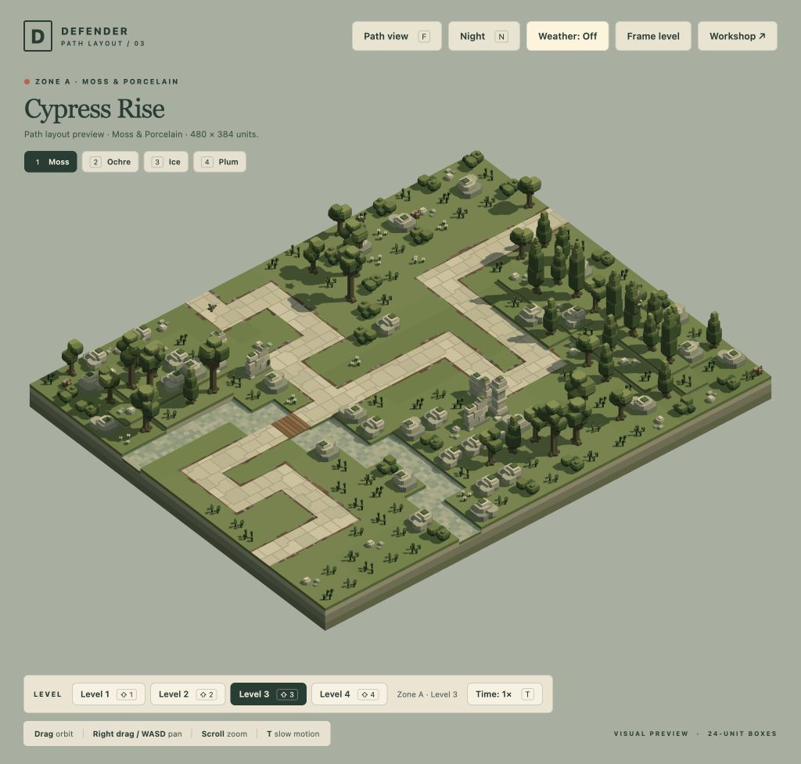
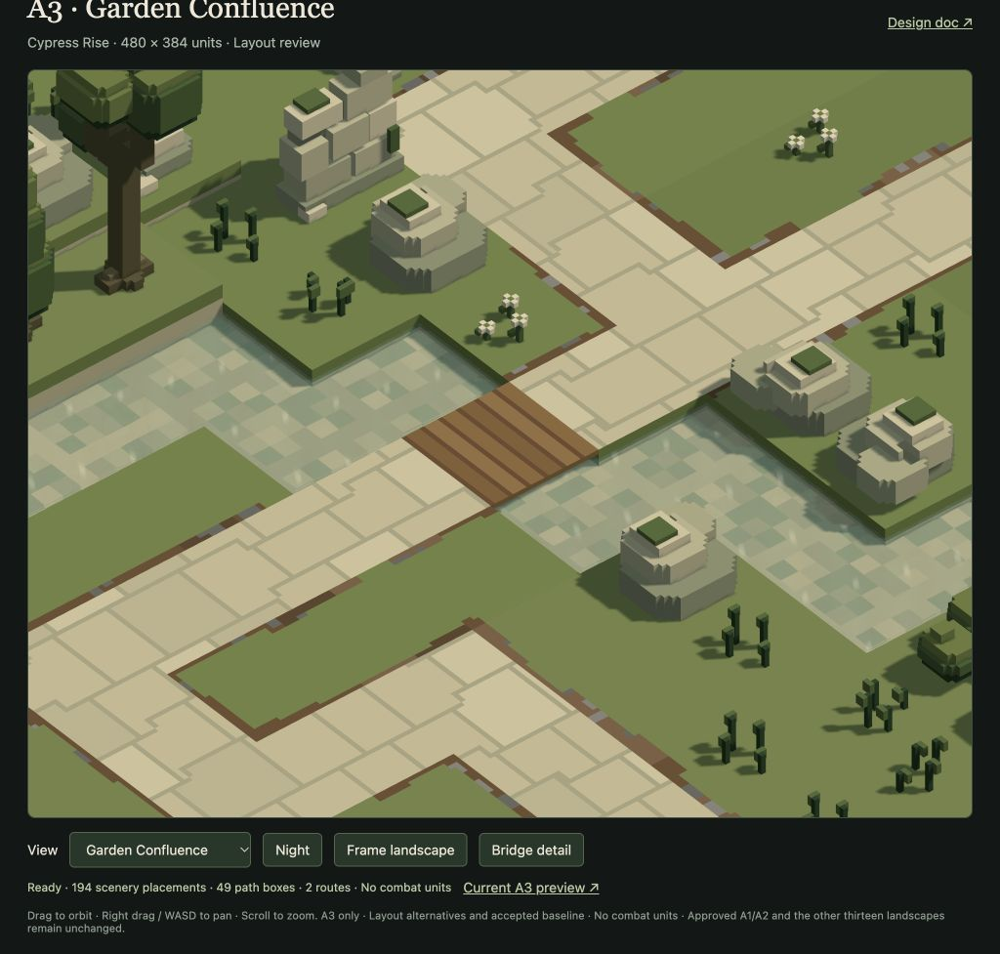

# A3 Cypress Rise · Garden Confluence

18 October 2026. **User-approved, implemented and verified.** The user accepted A3 on 18 October ("A3 looks good") and chose to switch tasks before A4. The user approved A2 Garden Crossing and asked to move on to A3. This pass changes only Cypress Rise. A1/A2 stay approved and unchanged; the other thirteen levels remain path-free landscapes.

[Open A3 in the game](/game/?inspect=&level=moss-03) · [Compare the layouts](/tools/a3-layout-review.html?view=garden-confluence) · [Design doc](../design-doc.md#current-landscape-composition) · [Independent Artist review](ARTIST.md)



## Journey and preserved landscape

Garden Confluence uses two complete approaches: a **768-unit western garden route** and a **648-unit northeastern bank route**. They meet on dry ground at `[12,8]`, then share a **264-unit southern journey** to the same exit. The paths contain 33 and 28 boxes respectively, with a 12-box shared tail and 49 unique path boxes. Both start and finish at level edges, keeping every intermediate box inside the level.

The eastern approach crosses the narrow stream at `[14,8]` on a **24×24 wooden-plank deck, one unit thick**. The deck top is Y24, underside Y23, with original water Y22 and bed Y20. It has dry banks and continuous flat support. The crossing is separate from the merge, so the junction does not appear to fork over water. [Existing bridge contract](../bridges.md).



The 20×16 footprint, all original terrain/water, five limestone pieces, three bird-perch anchors and six cosmetic wildlife actors remain. The layout retains 194 of 301 scenery placements; the 107 removals serve travel, complete candidate footprints and overview visibility. There are no moved/resized models, new landscape assets, enemies or placed defences.

## Compared approaches

| Option | Route lengths | Candidate positions | Retained scenery | Main trade-off |
| --- | ---: | ---: | ---: | --- |
| Single Western Return | 936 units | 32 | 220/301 | A simpler continuous journey and two returns, but southern meadow/ruin remain detached scenery. |
| **Garden Confluence** | 768 / 648 units | 44 | 194/301 | Uses distinct branch settings and a shared southern court, at the cost of more scenery clearing and more route complexity. |

Lead and Artist independently prefer Garden Confluence after matching-scale renderer comparisons. The stream remains connected and the cypress/limestone identity stays clear. The short wooden crossing supports the journey without repeating A2's long lake bridge. [Untouched comparison](screenshots/baseline-comparison.png), [single-route alternative](screenshots/single-west-return.png), [night overview](screenshots/garden-confluence-night.png).

All **44 surveyed positions** offer actual base gun/Arc opportunities against Dog, Roller and Moth: 18 western-only, 14 eastern-only and 12 covering both routes. The count is not a design quota, fixed build-pad system or proof of simultaneous adjacent compatibility. The hypothetical union of surveyed base gun/Arc opportunities leaves a **12-unit eastern-route gap at distance 354–366**, just after the bridge and before the junction's coverage; upgrade-1 range closes it. The western route has continuous hypothetical-site union. These unions do not promise simultaneous deployment or damage. [Actual coverage](coverage.json) and [Tactician's placement distinctions and limitations](TACTICIAN.md) separate these conclusions from final balance. This noncombat review does not assign waves, entrance timing or resources.

## Verification and handoff

Tactician owns deterministic A3 generation, complete-route and candidate-ground audits; Engineer checks current-source lifecycle/camera compatibility; Lead owns the production wrapper, existing browser tab and preservation evidence.

- The selected source passes 4,254 complete-approach pose checks, all 44 full-ground visibility checks and 308 individual weapon/stage placement combinations, with no exclusions. [Route/attack audit](garden-confluence.audit.json), [clearance](garden-confluence.clearance.json), [final source verification](verification.json).
- A bounded production-missile study completes 63 single flights across seven representative branch/bridge/junction/late cases, three silo stages and three species: 60 hits and three valid committed-intercept misses against Moth turning after the merge. Missed flights reach physical ground/stream-bed contact and release their claims. This establishes those scenarios, not every possible shot. [Flight evidence](garden-confluence.missiles.json).
- **20 targeted runtime tests pass, 0 fail, 305,873 assertions.** Both complete routes enter F/path view correctly, including a bridge start at Y36. All sixteen scenes animate only cosmetic wildlife, retain zero combat state and release previous scene resources. No runtime engine changes or full suite were needed. [Engineer handoff](ENGINEER.md).
- The existing game tab verifies A3, F/return, reset, weather on/off and A3 → A2 → A4 → A3 switching. Previous buffers/geometry/effects clear; the returned A3 has six wildlife, two routes, no combat, zero light overflow and no browser warnings/errors. [Browser evidence](browser-review.json), [rain capture](screenshots/moss-03-rain.png).
- `bun run check:previews` passes for all sixteen current factories/sources. Only A3 changed among 84 tracked JSON assets; approved A1/A2, other thirteen levels and all 66 models remain exact. All 69 frozen backup checksums and the compressed archive remain unchanged. [Preservation evidence](preservation.json).

The short deck reuses the ground mesh and existing collision structure: 15 wood quads / 3,000 gross vertex-index bytes before bank-face removal, and one visibility primitive / 56 bytes. No new game draw group or GPU pass is added. These are storage counts, not performance timing claims.

The deterministic `carveMoss03()` returns `{level, manifest}`; the canonical builder preserves approved A1/A2, this A3 review and the other thirteen landscapes. The original A3 source and before-change hashes are saved alongside the comparison artifacts; the frozen pre-carving backup is never edited.

```sh
bun scripts/a3-path-carving.js                       # Read-only summary
bun scripts/a3-path-carving.js --write               # A3-only regeneration
bun run check:previews                              # Current sources match factories
bun scripts/a3-path-carving-verify.js                # Selected evidence and preservation
```

Delegation uses explicit task choices: Tactician **gpt-6-astra/xhigh** for spatial/tactical trade-offs, Engineer **gpt-6.1-sol/high** for integration checks, Artist **gpt-6.1-sol/medium** for focused visual review. No effort exceeds Extra High.

**A3 is approved. A4 and further carving are deferred until the user requests them.**
