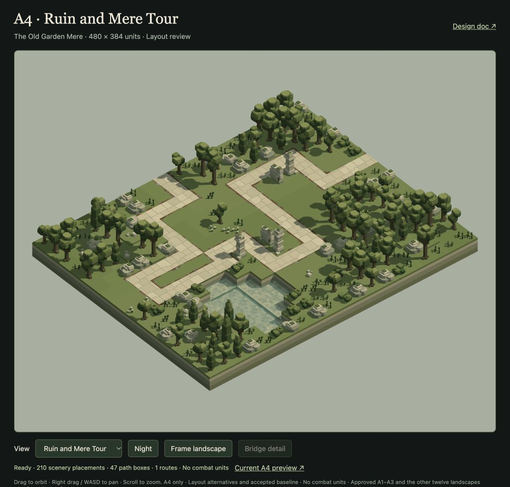

# A4 Old Garden Mere carving

The user authorised A4 carving before the separate A1 drone/enemy test. **Ruin and Mere Tour** is implemented for review: a dry 1,104-unit route through the southwest ruins, western woodland, mere-side masonry and a distinct southern return. Lead and Artist selected it after comparing a northern bridge alternative.

The level remains a scenery/wildlife layout with no combat units. It retains 210 scenery placements, original terrain/water/environment and all six wildlife actors. All 40 surveyed full placement areas are visible; 37 offer base gun/Arc opportunities and three depend on upgraded range. Some gun variants are excluded near retained walls/trees; the exact restrictions and short coverage gaps are documented.

- [Tactical handoff, limits and reproduction](TACTICIAN.md)
- [Two alternatives, same-scale maps and selection](OPTIONS.md)
- [Independent Artist review](ARTIST.md)
- [Selected source](ruin-and-mere-tour.level.json) · [manifest](moss-04.manifest.json)
- [Geometry/weapon/visibility audit](ruin-and-mere-tour.audit.json) · [individual weapon clearance](ruin-and-mere-tour.clearance.json)
- [Actual coverage intervals](coverage.json) · [45 production missile probes](ruin-and-mere-tour.missiles.json)
- [Factory and asset-preservation verification](verification.json)
- [Untouched baseline](baseline.level.json) · [baseline manifest](baseline.manifest.json) · [before-asset hashes](before-assets.json)
- [Read-only production comparison](/tools/a4-layout-review.html?view=ruin-and-mere-tour)

The selected source hash is `1e2970b40e61d6a5dd7be857114ce25f8b28d40b08518af5c8816dcc291ca33c`. The revised neck separates the incoming and returning road with unpaved ground, resolving the apparent shortcut in the first capture.

Technical/internal review and Lead’s runtime integration are complete. Nineteen relevant tests pass (44,296 assertions); live A4→A3→A4, path view, six wildlife/zero enemies and scene-release checks pass with zero errors. See [browser review](browser-review.json) and [final game capture](moss-04-game.png). The user explicitly approved A4 after this integration ("A4 looks good. Approved."). The dated preservation report predates the later authorised A1 test.

## Critter seed correction after approval

The user subsequently reported a trapped bunny. The original third seed had one reachable navigation node and never started a journey; the second occupied a small43-node pocket. Only those two ground seeds moved, to[106,24,250] and[358,24,202]; the first seed and all bird perches remain unchanged. Every path, terrain and scenery field is identical to the approved proposal. The original route/weapon reports remain evidence for that identical geometry; their full-source hashes predate this seed-only correction. [Current roaming evidence](wildlife-roaming.json) records all three on the4,683-node component, completing3–4 journeys and moving155–306 units in60 seconds. The regression test checks both the original failure and corrected motion.
