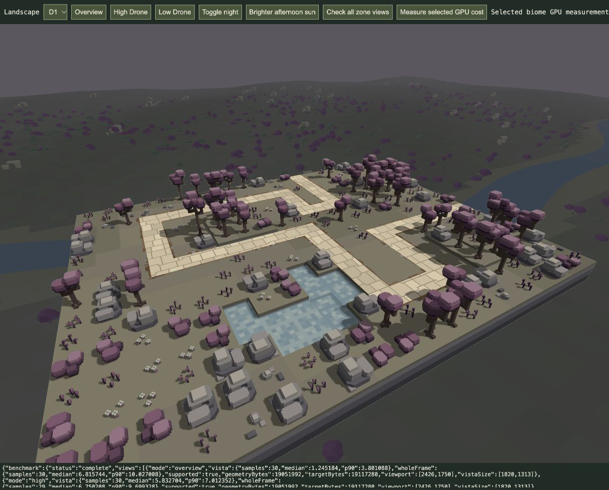

# Unblurred higher-fidelity vistas — 21 October 2026

Implemented in the shared production renderer for all sixteen `/play/` and `/game/` levels, following the user's request to remove blur, integrate the new Zone A vista and upgrade the other zones. Appearance remains for human review. Existing player sessions were not reloaded.

## Visual changes

Removed the nine-tap background blur entirely. The composite now takes one linear sample with the existing0.76darkening, retaining the darker distant palette and original depth-based colour fade. Every zone renders the background at75%linear viewport resolution (2.25× the former B–D pixel count); linear upsampling remains. No deliberate blur kernel remains on any skybox.

Retained the reviewed Zone A woodland mesh exactly, verified by SHA-256. A–D now share80-unit terrain facets and40-unit river segments over the existing extent. B has extra erosion relief, terraced mesa shoulders, caprock fragments and denser cacti; C has smaller terrain folds, inset snow shelves, secondary peaks and denser tiered snowy firs; D has small ground folds, sanctuary plinths/broken capitals/collapsed steps and denser branching plum canopies. No image textures are added.

The background remains cosmetic below the board. Accepted water, critters, models, level layouts, gameplay and lighting-period policy are untouched. No extra production pass or new uniforms are added. Frame `options.w` is once again simply the vista-enabled flag. Only the loaded biome has GPU geometry/targets; static views reuse the cached vista, resize recreates its images and zone unload destroys its resources.

## Resource and timing evidence

Current physical viewport2426×1750; vista images1820×1313. Colour plus depth is19,117,280bytes for the loaded zone. Geometry below excludes those images. All byte counts are nominal payloads, not allocator totals. [Geometry counts/hashes](geometry.json).

Full production render-span GPU medians in milliseconds:

| Zone | Vertices | Geometry bytes | Overview | High Drone | Low Drone |
| --- | ---: | ---: | ---: | ---: | ---: |
| A | 862,446 | 20,698,704 | 5.57 | 5.44 | 7.01 |
| B | 536,433 | 12,874,392 | 6.16 | 5.24 | 6.55 |
| C | 867,768 | 20,826,432 | 6.36 | 6.55 | 6.62 |
| D | 793,833 | 19,051,992 | 6.82 | 6.75 | 7.08 |

Each view uses350mswarmup and approximately30asynchronous samples with a tiny camera yaw sweep, stationary world and no combat. The review tool also replays the actual vista pass separately for diagnostic timing; that replay is absent from production. Isolated pass values vary substantially and full-frame p90s reach about10ms. These are exploratory measurements on this host, not combat FPS, a guaranteed hardware budget, or a reliable before/after delta. No paired baseline was captured for the B–D rollout. The earlier A blurred-trial whole-frame medians were7.7–8.1ms; current A readings are lower, but sequential noisy observations do not establish an exact blur-removal saving.

Raw reports: [A](A-gpu.json), [B](B-gpu.json), [C](C-gpu.json), [D](D-gpu.json). Geometry is generated at level load, not each frame; generation timings in the geometry JSON are single startup observations, not a performance distribution.

## Verification

32affected tests pass in `tests/zone-vista.test.js` and `tests/renderer.test.js`: deterministic finite/nondegenerate geometry, bounds below gameplay, dimension recentering, all-sixteen biome dispatch, reviewed A identity, renderer cache/relight/resize/release and GPU-timer span. [Test log](targeted-tests.log).

64actual GPU compositions pass across all sixteen levels: overview, high Drone, low Drone and night lighting; no captured GPU errors. [Results](all-level-gpu-checks.json). Screenshots were inspected for all four zones: [A](A.jpg), [B](B.jpg), [C](C.jpg), [D](D.jpg). The existing review tab is left on D1 High Drone, with every level available in its selector.

Culling remains [research only](../research/vista-culling-2026-10-21/README.md). It is technically feasible but has no measured net saving yet; no culling/compute/indirect infrastructure is integrated under the user's resource gate.

