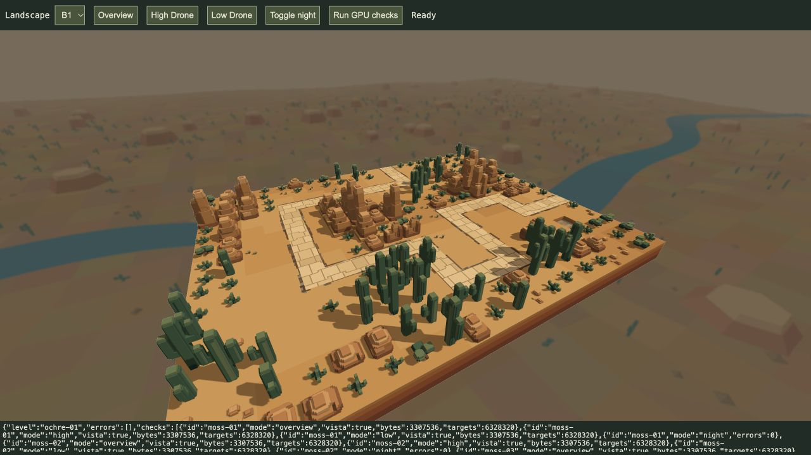
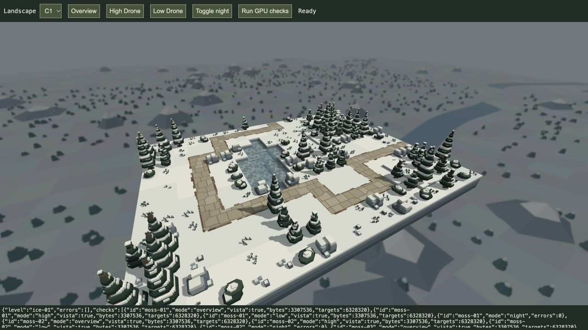
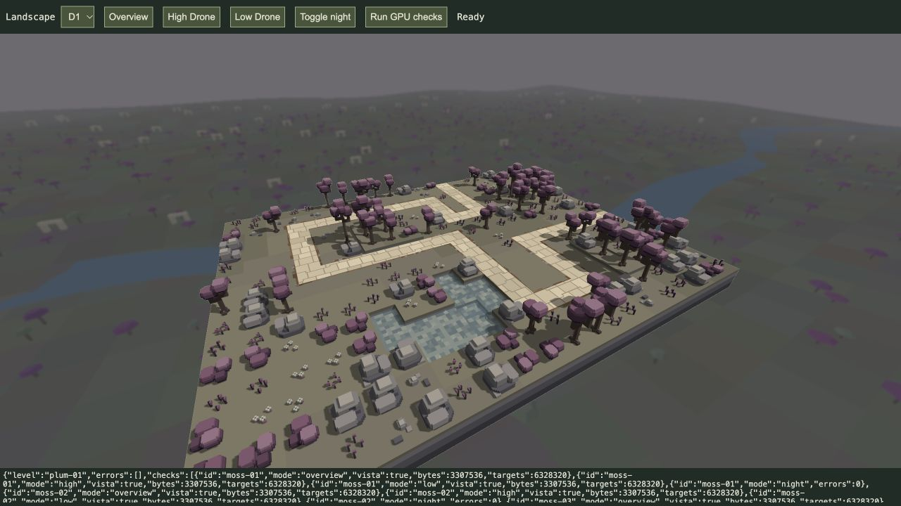

# All-zone floating vistas

20 October 2026. The user accepts all four engine vista appearances for now and confirms their inclusion in the game. **A–D are implemented, active and accepted as the current visual baseline.** All sixteen production landscapes now select their biome automatically in `/play/` and `/game/`.

| Zone | Distant landscape |
| --- | --- |
| A — Moss and Porcelain | Accepted woodland valley/river, unchanged |
| B — Ochre and Petrol | Ochre terraces, tiered sandstone mesas, branching cacti, scrub and petrol water |
| C — Ice and Ember | Neutral snowy ridges, slate peaks with snow caps, layered evergreen firs and cold blue water |
| D — Plum and Mint | Muted grey-earth hills, broad plum/green canopies, pale broken arches and blue river |

`engine/vista-geometry.js` adds deterministic B–D cosmetic meshes. `engine/zone-vista.js` dispatches each production ID/zone to its matching geometry and background colour; the renderer passes the loaded zone through. Non-production/mismatched IDs retain the flat fallback. No asset sources, combat or navigation geometry, paths, weather defaults or camera controls change.

All biomes reuse the accepted separate half-resolution background colour/depth, cached two-draw pass and background-only nine-tap softness. Gameplay colour/depth and HUD remain sharp. Parallax, orthographic-overview background perspective, pause caching, relighting, resize and resource release are shared. Every vista lies below Y−150 and is excluded from placement, targeting, collision and shadows. This is a distant rendered landscape, not a new playable area or static cubemap. No foreground fog/weather effect is added.

Fixed vertex allocations: A **3,307,536**, B **3,714,480**, C **4,159,584**, D **4,042,944 bytes**. Only the loaded zone has a vista buffer. Images use the unchanged `8 × ceil(displayWidth/2) × ceil(displayHeight/2)` byte budget. [Geometry bounds and hashes](geometry.json). Zone A retains SHA-256 `ba87a449b374351860c669b332da83788ca29ac40bd9bc15f98ab447de76a5db`, verified against the [before-change baseline](zone-a-baseline.sha256).

Verification:

- [47 affected tests](tests.log), 4,932,938 assertions, no failures. Deterministic and distinct biomes, bounded colour/height/storage, accepted A exact preservation, sixteen valid ID mappings, unsupported fallback, A→B→C→D→A cleanup, cached views, resize/relight and sharp/default Drone checks. Full suite not run.
- [64 actual GPU compositions](gpu-checks.json): every level in overview, high/low Drone perspective and night lighting; correct biome active and no reported GPU errors. These include ordinary and selective-bloom display paths through the production renderer. Rendering checks are not a GPU frame-time benchmark.
- Visually inspected B1, C1 and D1 in the isolated [all-zone review tool](/tools/zone-vista-review.html), without reloading an existing player run. The tool now lists every level and restores the loaded level's own lighting after its night review.

The user subsequently confirms: “They all look fine for now and can be added to the game.” All four appearances are accepted; further visual iteration is deferred until requested. This acceptance update changes documentation only; the production integration was already active, so no new runtime tests or player reset were necessary. Earlier Zone A-only scope and B1 flat-background evidence remain historical records of the first iteration.
