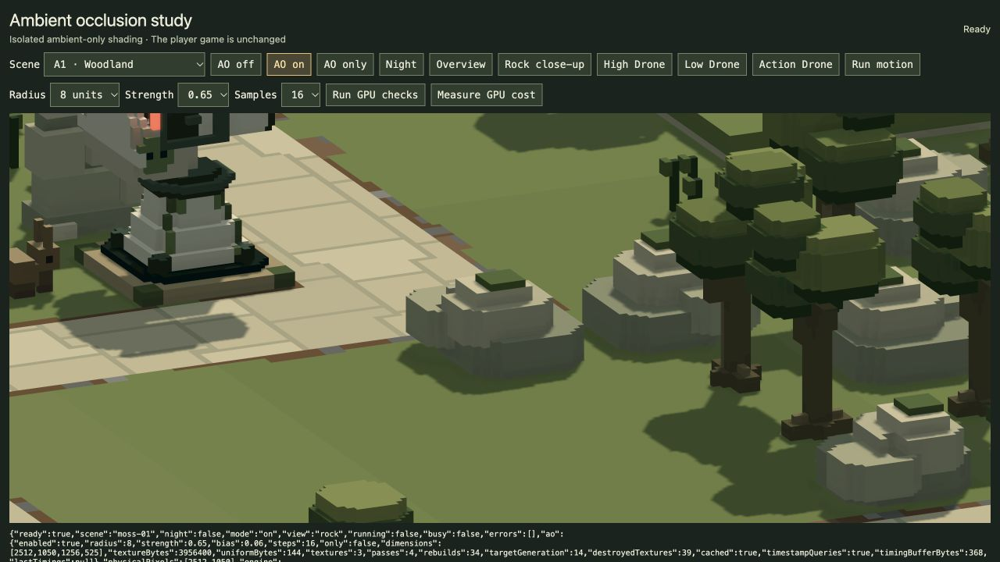

# Isolated ambient-occlusion trial — 20 October 2026

**Retired lighting experiment:** the user rejected GI and AO on 20 October. All related executable code, viewers, bake/audit scripts, GPU timing machinery and generated GI caches have been removed. The material below records earlier work, not current capability or a pending task. Other deliveries described here retain their separate status.

**The AO trial works and is ready for visual review.** It adds restrained contact/recess shading around scenery and units, with no indirect colour bounce. It remains outside `/play/` and `/game/`. The user's playthrough was never reloaded or controlled; the separate review tab was closed after testing. The user has dropped indirect lighting from the current plan; its earlier experiment is historical.

The former isolated AO viewer (removed) was used to compare **AO off / AO on / AO only**, overview, rock close-up, high/low/action Drone, day/night and four biome scenes. Motion and GPU measurements are explicit controls; they do not start automatically. The prototype defaults to an eight-unit radius, 0.65 strength and sixteen neighbouring depth samples.

## Result and recommendation

The improvement is modest and most readable in close-ups: rock and defence bases, stepped recesses and tree contacts gain definition. The main palette, sunlight, emissive panels and weapon lights retain their existing roles. I recommend this as a candidate for visual review before production integration, rather than assuming stronger darkening would be better. No art acceptance or production performance budget is implied.

This is a custom horizon-style screen-space approximation, **not an exact GTAO implementation**. It sees only visible depth. Hidden/off-screen occluders, thin foliage/silhouettes and moving-edge stability remain inherent limits. Twelve actual moving-Drone frames verify updates and finite poses; they do not establish subjective motion quality for every crowded scene.

[Same view without AO](a1-rock-off.png) · [AO-only diagnostic](a1-rock-only.png) · [Night](a1-rock-night.png) · [B4 water/bridge](b4-water.png) · [C1 snow](c1-snow.png) · [D1 ruins](d1-ruins.png).

## Measured cost

At **2512×1050 actual render pixels**, AO uses three half-resolution textures (1256×525): **3,956,400 bytes / 3.77 MiB**, plus 144 bytes of settings buffers. Four extra fullscreen passes prepare depth, estimate visibility and filter horizontally/vertically. Existing opaque shading upsamples and applies AO only to ambient illumination. No new world actors, material attributes or geometry pass are introduced.

The table uses GPU timestamps for the enclosing **camera-depth-start → display-end scene span**. It excludes earlier vista rendering and any post-display shockwave; it is **not** the complete production GPU-frame timer requested in TODO 14. Each comparison alternates on/off order, discards four warm-up iterations and retains sixteen samples per mode.

| A1 view | AO off median | AO on median | Difference of medians |
| --- | ---: | ---: | ---: |
| Day overview | 3.11 ms | 4.59 ms | +1.47 ms |
| Day high Drone | 1.97 ms | 3.34 ms | +1.38 ms |
| Night overview | 2.92 ms | 4.00 ms | +1.08 ms |

The user's game continued running during these measurements. Individual paired differences were noisy, including negative values, so these exploratory medians are not a controlled production-frame-rate claim. Median paired deltas were 0.85 / 1.15 / 1.05 ms respectively; full ranges and samples are preserved. [Summary](timing-summary.json), [raw benchmark records](benchmarks.json).

All 96 recorded timestamp sets have nonnegative intervals, endpoints within the measured scene span and no intervening frame during readback. Individual pass intervals overlap in the observations, so their durations are **not additive**. The AO subtotal now reports its enclosing span; an arithmetic sum remains diagnostic only. The [initial overlap capture](initial-timing-overlap.json) is preliminary, not the final cost result. The normal footer GPU timer remains queued; experimental measurements do not substitute for that implementation.

## Verification

**39 affected tests pass**, 11,129 assertions across AO reference/fixtures and renderer regressions. [Test log](affected-tests.log). The isolated browser bundle builds successfully. [Build log](build.log). No full repository suite was run.

**22 actual GPU checks pass with no recorded WebGPU errors.** [Results and probes](gpu-checks.json):

- Open plane visibility stays 1.0; near-wall/corner probes darken while distant ground stays neutral.
- Ground beneath a high floating box and exposed convex surfaces remain neutral.
- Direct-only, emissive-only and muzzle-only opaque output match AO-off **byte for byte**. Muzzle lights are live in the test.
- Actual opaque debris renders through the AO pipeline; overview/high/low/action Drone views compile and render.
- Moving Drone refreshes AO; paused and lighting-only redraws reuse it.
- Resized targets use ceil half-resolution dimensions; disabling AO releases its textures and draws no AO passes. Odd-dimension arithmetic/lifecycle coverage is additionally in CPU renderer tests.

Manual captures cover B4 water/bridge, C1 snow and D1 ruins with no recorded GPU errors. Water, smoke, glow, vistas and the GUI are not AO receivers/occluders themselves; opaque beds can carry AO through existing water transmission. [Composition records](compositions.json).

Source/CPU review found one viewer issue, Night→Day retaining night illumination; the viewer now restores base lighting before applying a condition. First compilation also caught a WGSL reserved identifier, fixed before these successful runs. Test cleanup now empties damage effects before unbinding them. No active-player changes were needed for those fixes.

## Implementation and preservation

[Shader notes](shader-note.md) explain depth reconstruction, world-radius sampling, edge rejection and limits. New files live under `tools/`: shaders, renderer subclass, fixture worlds and review page. The production renderer has one optional, inactive-by-default `afterDepthPass` hook; baseline tests confirm unchanged pass/resource behaviour without a callback. Production pages never import AO code. Readback/timestamp buffers and diagnostic colour-copy flags belong only to the review subclass.

All **86 model/level JSON hashes remain unchanged**. Gameplay, routes, balance, camera controller, skybox assets and live HUD are unchanged. [Source preservation](source-preservation.json).

New player feedback remains queued in [TODO 14–18](../../TODO.md): GPU frame timer, brighter late-afternoon sun, wounded stagger/catch-up and stage-2 Arc chaining at 20% strength within two tiles, and a CPU timer accuracy/scope audit. Stage-label mapping and unspecified chain eligibility remain open. These notes were recorded without changing the current playthrough.
