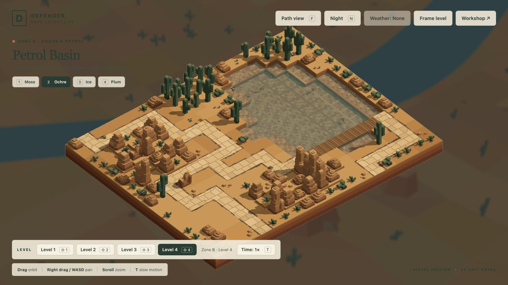
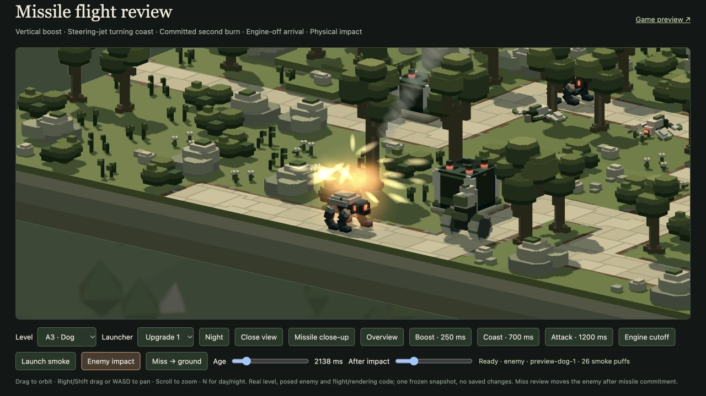
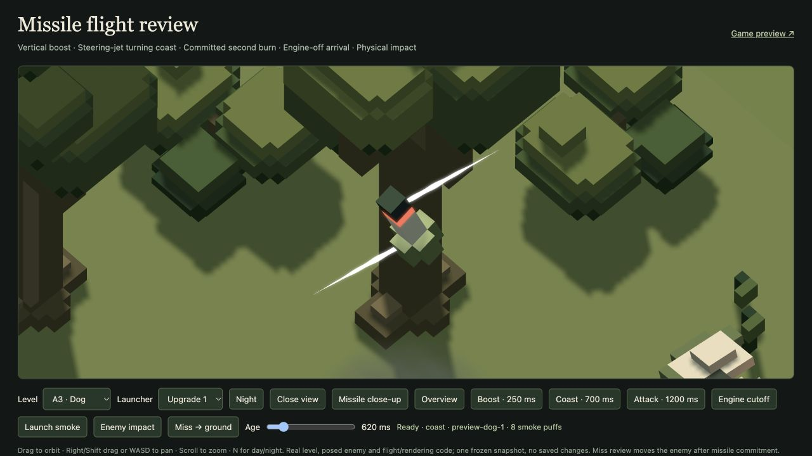

# B4 lake approach and missile presentation — 20 October 2026

Implemented at the user's request and visually accepted on20 October: ‘Everything looks good’. The user is continuing a playthrough; balance remains subject to playtesting.

B4 retains its original main route and adds the complete `lake` approach from the north, across six water boxes on a one-unit wooden bridge, into an identical shore tail. Water columns, bed, lighting, bird perches and wildlife seeds are unchanged. Three dry, four-unit mesa shoulders are trimmed to path height to clear the six-wheel rover's actual turning envelope; the remaining raised landforms stay intact. Scenery is cleared around the approach and bank courts. The authoring factory deterministically reproduces the production source. Historical B4 carving evidence predates this extension and is superseded here.

Both approaches carry ground and air traffic in all four waves. Their merge arrivals are staggered for the 240-unit length difference. Rosters, health, movement, arsenal prices and token awards are unchanged. There are 39 surveyed fully visible ground plots. Actual individual placement choices grow from 28→32 for base/Upgrade I guns, 29→33 for Upgrade II guns, and 38→45 for every Arc/silo tier. Twelve new Arc/silo plots replace five consumed by the additional path. These counts are individual alternatives, not simultaneous guarantees. One spread of ten Upgrade II Arcs passes preparation including connected wildlife and clear perches.

Missile contacts now produce a 22-unit layered fireball lasting 0.68s, eight expanding hot lobes, eighteen outward ballistic ember streaks, nine lit smoke puffs lasting 1–1.6s, and a 0.38s refractive pressure ring. Ground/scenery contacts use the same effect. The original surface offset, fright radius and exact local light curve are retained: strength 26, radius 52, lifetime 0.26s, warm RGB 1/.64/.3 and squared fade. Damage and enemy-death effects are unchanged. Blast sprites reuse the existing additive/bloom draw; smoke shares the 384-record pool. The larger fixed particle payload adds 104 records /4,992 bytes each on CPU and GPU. Smoke saturation drops new puffs; death blasts retain priority. No new model, texture, light slot or render pipeline is added. The existing shockwave target is reused lazily.

Attitude jets are 10.5 units long, exactly 3× the former 3.5. Jet width, pulse timing, acceleration/braking torque, varied turn rates, main engines and flight physics remain unchanged. The review tool now has an After impact slider for frozen production snapshots.

Verification:

- [72 focused tests](tests.log), [34 related regressions](regression-tests.log): 106 pass, zero fail. Bridge support/water preservation, placement gains, pooled effects, unchanged lighting/death explosions, pause/reset, flight and the portable GPU light limit are covered.
- [B4 audit](b4-audit.json): deterministic source, 39 fully visible plots, legal simultaneous deployment/wildlife preparation and all four unarmed schedules finish.
- [120Hz traffic audit](traffic.json): all four B4 waves have zero conservative route-circle overlaps; minimum margin2.42 units. Other B wave records are included.
- [Actual posed geometry at 4Hz](spacing.json): B4 finale, 560 samples /5,602 actor poses, zero scenery/actor overlaps. This is sampled evidence, not a continuous proof. This broader historical audit also records 14 rover-wheel contact samples in unchanged B1/B2 unarmed schedules; it is not a claim of source-wide physical clearance.
- [Full persistent mixed campaign](mixed-campaign.json): 64 waves, 1,084 kills, zero escapes, retained wallet balances exactly. B4 clears16/18/20/20 enemies. This is a demonstrated affordable strategy, not proof for arbitrary deployments or human balance acceptance.
- [Live B4 finale](b4-combat-browser.json): 20 kills, zero escapes, 101 missiles, six simultaneous steering jets observed and no GPU errors.
- [64 GPU biome/camera compositions](gpu-checks.json), [25 GPU bloom checks](bloom-checks.json): no errors. Actual production enemy/ground impact and steering-jet snapshots were reviewed, including night contact.
- [All 16 source factories](sources.log) and [browser build](build.log) pass. The user's existing player run was not reset.

