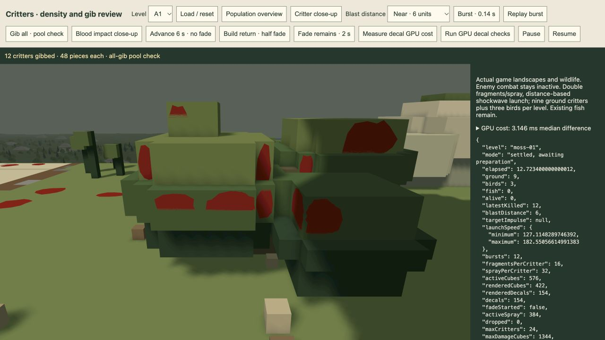
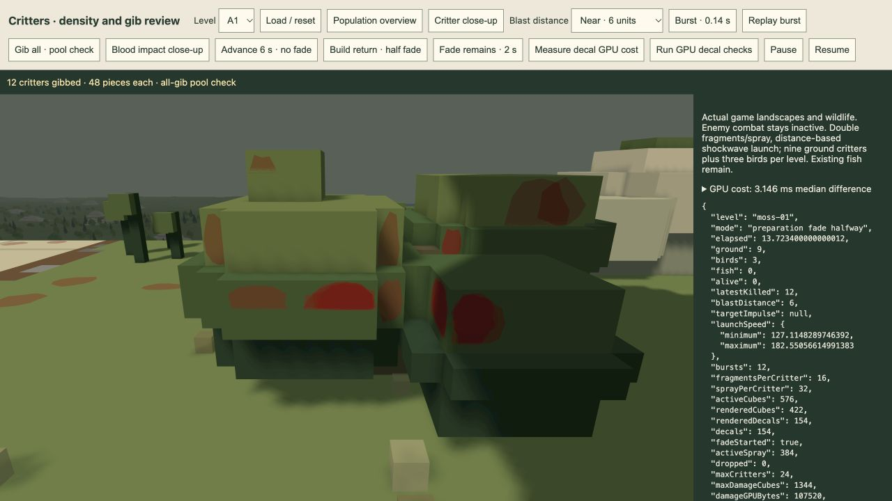

# Blood decal depth correction — 21 October 2026

Implemented for visual review in the shared `/play/`, `/game/` and tool renderer. The active player session was not reloaded. Decal impacts, population, gore, blast velocity and preparation-triggered lifetime retain their existing behaviour.

## Finding and research

The previous marks were tiny-offset coplanar geometry in the camera depth prepass and its depth-equal colour draw. Multiple marks therefore competed with each other and with their receiver. A fixed 0.012-world-unit separation did not provide reliable screen-depth separation across camera distances and slopes. Their ordered coverage fade also changed depth coverage unnecessarily.

Primary sources reviewed:

- [Unity HDRP decal shader documentation](https://docs.unity3d.com/Packages/com.unity.render-pipelines.high-definition@10.4/manual/Decal-Shader.html) describes mesh decal depth/view bias and selectable affected material channels. Mesh decals are an established option; bias is a conventional way of separating their raster depth from the receiver.
- [Babylon.js official decal demo source](https://www.babylonjs.com/Demos/Decals/source/) uses a negative material depth offset for projected mesh decals.
- [Pope Kim / Relic: Screen Space Decals in Space Marine](https://www.gamedevs.org/uploads/screenspace-decals-space-marine.pdf), especially slides21–29, describes rendering scene geometry first, rasterizing a decal volume, reading scene depth and reconstructing the receiving position. This supports depth-aware application after opaque geometry. It does not require adopting a full deferred renderer.
- [Epic decal materials: sort order](https://dev.epicgames.com/documentation/en-us/unreal-engine/decal-materials-in-unreal-engine#sortorder) documents explicit overlap ordering. Overlap should be controlled by drawing order rather than competing depth writes.
- [WGSL sample index and interpolation](https://www.w3.org/TR/WGSL/#sample-index-builtin-value) defines the sample input and per-sample interpolation used by the implementation's four-sample depth validation.

Our engineering conclusion: retain the small receiver-clipped fan meshes because impacts already identify exact flat static cuboid faces. Add screen-depth receiver validation and deterministic alpha composition. General volumetric projection / a DBuffer would require more machinery for curved surfaces or richer material changes that this feature does not currently need. A final display overlay would bypass the game's water transmission/refraction and surface composition, so it is unsuitable here.

A conventional biased, depth-tested mesh trial passed ordinary views but needed a substantially larger fixed clamp at an extreme close grazing view. That would enlarge the risk of painting over nearby occluders. The final path uses no raster depth bias: the fragment shader verifies the visible receiver instead.

## Final implementation

- `DamageEffects.prepare` packs actual solid fragments/droplets first and landed marks last, within the same bounded107,520-byte GPU instance buffer. The suffix follows stable pool order, independent of camera movement. No recurring sorting allocation or new effect capacity.
- Marks lie on the exact collision plane; the old0.012offset is removed. Existing face bounds, twelve-triangle irregular silhouettes, static-only attachment and underwater-bed impacts remain.
- Camera depth and shadow draws contain solids only. Blood never writes camera/shadow depth and never casts a separate shadow.
- A lazy dedicated pipeline draws the decal suffix once after all opaque objects. It samples the existing read-only four-sample depth attachment. World positions interpolate at each antialiasing sample; the shader projects that point and rejects absent or different-depth receivers. The acceptance window combines floating-point roundoff with a1/64-pixel slope footprint to tolerate independent triangle rasterization.
- Standard alpha blending gives stable overlap and a continuous two-second blood fade. Colour and the normal/material attachment are blended together: blood remains matte/nonemissive and the underlying material returns as the mark fades. Model fragments retain their existing matched coverage fade.
- This is a distinct decal **stage inside the existing opaque hardware render pass**. Colour/normal resolve once, after decals and before bloom, water/refraction, reflections and display conversion. Cached static frames add no decal work. A colour/light/camera/effect refresh redraws clean opaque receivers before decals, preventing repeated blend accumulation.
- There is one additional instanced draw while marks are visible and opaque colour is dirty; no new render pass, image texture, GPU buffer or full-screen intermediate. One pipeline, depth layout and resize-aware depth bind group are created lazily.

A separate hardware-pass prototype was implemented and measured, then replaced with the same-pass stage to avoid multisample attachment store/load traffic. The old prototype is not the delivered rendering path.

## Verification and measurements

[Targeted Bun log](targeted-tests.log): **65 tests pass** across blood impacts/packing, full critter capacity/lifetime, preparation gating, ordinary damage/water impacts, water and renderer caching/cleanup. All six impact normals and clipped footprints are checked. The renderer test proves solids alone enter depth/shadows, decals draw last before water, cached frames skip the stage, relighting redraws clean receivers and removal restores the original draw path. [Browser build](browser-build.log):108modules,1.21MB.

[Actual GPU pixel checks](gpu-pixels.json): **26 checks pass**, with zero centre-channel error against the expected sequential blend in the tested cases. Includes coincident differently coloured marks, both signs of depth slope, perspective distances8/800 and viewing angles0°/75°/87°, foreground depth rejection (including0.00002depth separation in the flat probe), half/zero opacity and matte/emission restoration. Entire colour readbacks are identical across each identical replay. Test resources/readbacks exist only in the review tool, not production.

[Production A1 pool](persistent-pool.json):576retained pieces,154marks, no drops/errors, the same107,520-byte GPU payload. Actual marks were inspected on plant faces and ground. [Half fade](half-fade.json) retains the pool at half opacity; [cleanup](after-fade.json) confirms zero active/rendered solids and marks. CPU tests retain the existing build/deploy-only fade trigger; this renderer change does not alter it.

Exploratory local GPU timestamps at **1990×1200**, alternating24fixed-camera opaque-colour refreshes plus display per condition, after warmup:

| View | Marks | Without marks, median | With marks, median | Difference |
| --- | ---: | ---: | ---: | ---: |
| [Final overview](gpu-cost-overview.json) |153|3.998ms|4.129ms|0.131ms|
| [Final close-up](gpu-cost.json) |154|3.801ms|6.947ms|3.146ms|
| [Earlier separate-pass close-up trial](separate-pass-gpu-cost.json) |160|2.130ms|7.209ms|5.079ms|

These are local exploratory differences, not a frame-rate budget or a controlled same-pose comparison between prototype and final versions. The main measurements include ordinary opaque refresh/display work; they do not isolate only the decal draw. Extreme close-ups increase covered pixels and overlap, and per-sample lighting costs more there. Ordinary static cached frames incur no additional stage draw. The final implementation removes the separate-pass multisample transfer regardless of timing noise.

## Limits and review

The receiver check has a small finite raster/depth tolerance; surfaces indistinguishable within that window cannot be separated by depth alone. This is not a general moving-object or curved-surface decal attachment system. Impact collision still covers static terrain/scenery/bridges; no new water-surface paint or actor collision is added. GPU correctness was checked on this host, not every graphics backend or every possible camera position. Visual acceptance remains with the user.

Review: `/tools/critter-review.html` uses the actual game world/effects/renderer and exposes GPU checks, optional paired timing, the densest impact close-up and existing persistence/fade controls. Current player gameplay was not touched.

