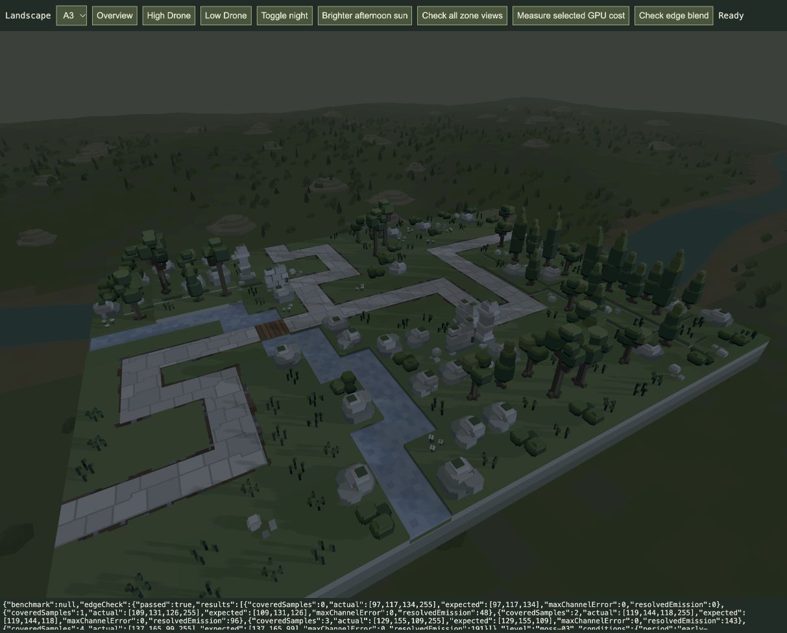

# Playing-area rim removed — 21 October 2026

The user accepts the low blue evening light and the completed removal of the outline around the playing area, with a different boundary treatment deferred until later. The user is starting another gameplay review; keep the current presentation unchanged. Evening light colour/strength/elevation and ambient fill are now accepted for the current baseline.

## Cause and change

Source inspection found no separate boundary line draw. The thin pale rim came from MSAA edge samples resolving foreground colour against the default lighter flat backdrop, then retaining those mixed pixels beside the darker vista. The composite previously replaced only completely uncovered pixels with the vista.

For vista scenes, the opaque pass now clears RGB to black while retaining the emission alpha channel. The final composite reads the same four depth samples already needed for minimum depth, calculates their uncovered fraction and adds the actual vista colour for that fraction. Fully covered surfaces and completely uncovered background keep their existing colours. Scenes without a vista retain the existing flat clear colour. No border, highlight or replacement boundary treatment is added. The correction also removes the same pale contamination from scenery silhouettes.

No new production pass, draw, texture, buffer or uniform is introduced. Existing water, lighting, bloom emission payload and authored geometry remain. Vista texture sampling now also occurs at partially covered edge pixels; its cost was not benchmarked separately. Production `/play/` and `/game/` share this composite; no active game was reloaded.

## Checks

31affected renderer/water tests pass, including vista/flat clear-colour switching, cache/resize/release and existing water checks. [Test log](targeted-tests.log).

Five actual GPU probes use the production composite with0/1/2/3/4covered MSAA samples. All RGB channels match the analytic linear foreground/vista mixture after display conversion with zero byte error; resolved emission alpha retains the expected coverage-weighted value. The probe allocates only on explicit review-tool invocation and destroys its resources. [GPU results](edge-gpu.json).

All64actual production-scene GPU compositions pass across16levels, overview/high/low/night, with no captured errors. [Full-scene results](all-level-gpu.json). A3High Drone was visually checked with the accepted low light: [before](before.jpg), [after](after.jpg). The existing tab is left on that view. Replacement boundary art remains deferred, without a selected design or implementation task.

