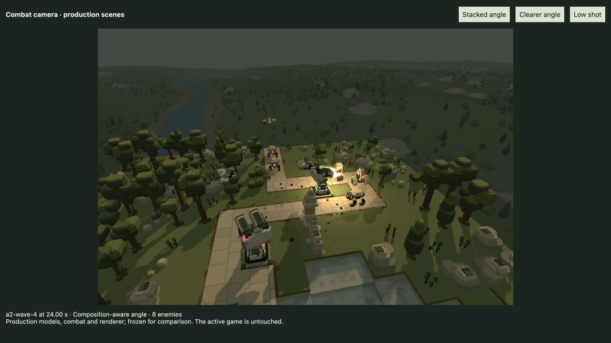
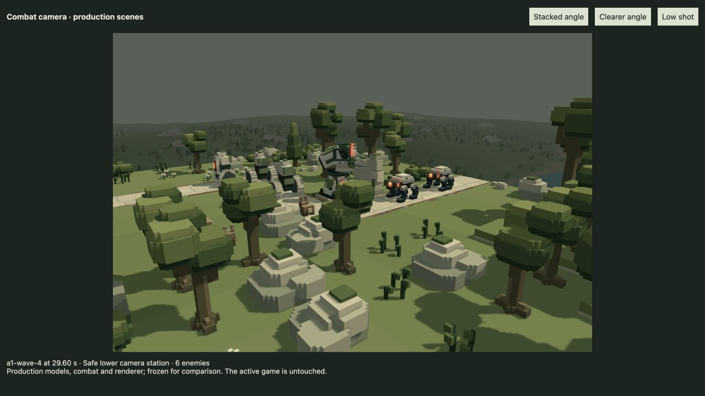

# Combat, deployment and Drone follow-up — 21 October 2026

Implemented the five requested changes in the shared production paths. Existing player tab 31 was not reloaded. New behavior applies on the next application load; visual tuning remains for user review.

- **Stationary guns prioritize ground.** Any living active ground enemy inside a gun's horizontal actor-root range suppresses air targeting, including an existing air burst/lock/reservation. Blocked or pitch-unreachable ground still counts as present; actual shots retain range, aiming and LOS requirements. Arc, silo and combat Drone policies are unchanged. [Rules, complexity and native tests](ground-targeting.md).
- **Missiles lead nearby flyers physically.** Replace the frozen reignition point with bounded powered-flight interception, acceleration-aware timing, authored curve/banked torso forecasts and sideways-momentum compensation. The terminal latch waits for safe velocity alignment; inertial post-cutoff behavior and target-death positions remain. Exact first-socket paired encounters improve from 2/16 to 16/16; all 64 current real-mesh cases hit across four flyer types, straight/corner approaches, three update rates and steering extremes. These are bounded witnesses, not universal hit guarantees. Obstructed/poor shots can wait; obstacle-free admission without a proven future contact remains allowed. [Diagnosis, evidence and limits](missile-interception.md).
- **Drone can occasionally descend.** Normal high views remain the default. Bounded low opportunities use individually clear stations and full swept routes, sky columns, reserved future air corridors, water/static geometry and moving actors. Successful lower shots are counted only after actual arrival. A three-second camera-owned analytic actor forecast gives slow safety climbs earlier warning; the combat Drone retains its one-second default. Drift also preserves the open static escape column. The reproduced bird crossing is clear at 30/60/120 Hz with continuous bounded movement; unchosen future wildlife destinations cannot be predicted. [Implementation, ordinary encounter and safety checks](drone-composition.md).
- **Placement follows the list.** The rendered roster and next-selection helper now share one family ordering. After successful deployment select the next undeployed visible row, cross groups and wrap if necessary, without sorting the owned array. Sixteen session/roster tests include interleaved purchases, skip/wrap/recall, missing selected IDs and identity preservation. [Log](selection-tests.log).
- **Drone scores combat composition.** Project up to eight nearby enemies and four participating defences through the actual perspective FOV/aspect. Penalize overlap, vertical stacking and clipping; retain readable holds, committed travel and material-improvement hysteresis. The actual A2 snapshot improves composition cost 0.2753→0.1761, stacked centre pairs 8→6, and primary horizontal gap roughly 0→0.2336 NDC. This improves the witness, not every pair in every scene. [Exact scene recipes](camera-review-poses.json).

## Verification

The frozen mixed campaign reuses the prior earned-token actions and courts: **64 waves, 1,084 kills, zero escapes**, 126 spent and four remaining tokens. All 53 audited source hashes remain fixed across the run; damage, health and wallet accounting pass. [Replay](mixed-campaign.json), [log](mixed-campaign.log). This demonstrates retained viability for that army, not final balance acceptance or all-strategy coverage.

[Independent code and transform review](REVIEW.md) covers missile/selection correctness and camera safety/lifecycle. The core sixteen-file run passed 159 checks and exposed one exact-floating-point assertion (`1` versus `0.9999999999999999`) after the new missile launch timing. Changing only that expectation to 12-place closeness retains the one-second gap requirement; all three tests in that file then pass. Across these runs, **160 distinct core checks pass**. [Initial integration log](integration-checks.log), [focused correction check](enhancer-timing-checks.log). The browser bundle builds all **118 modules**. [Build log](build.log).

The final camera command passes **53 tests / 235,793 assertions across four files**. Together with the corrected core run this is **213 distinct passing checks across 20 affected files**, with the three older exclusions below. [Camera check log](drone-checks.log), [camera report](drone-composition.md). No full-suite run was requested or performed. Independent review also reproduces the former A4 bird contact and verifies its clearance at 30/60/120 Hz; the final unprimed A1 witness reaches and holds a low shot.

Three older expectations remain excluded from the targeted integration run: the archived missile-only snapshot, a LOS spy omitting an existing self-exclusion argument, and an archived showcase sightline assertion. Their baseline reproduction is documented in the ground-targeting report; they are not silently retuned.

## Actual renderer review

[Open the comparison](http://127.0.0.1:4173/tools/combat-camera-review.html). It reconstructs frozen native production encounters with actual combat, models and WorldRenderer, separately from the active player. The A2 buttons use the same simulation state; only the camera changes. The low view uses a separately recorded ordinary, unprimed A1 encounter at actual low arrival: 29.60 seconds, three seconds of subsequent low hold/drift, and 77.95% of the complete wave at normal high altitude. The seed selects a safe demonstrated example, not a promise that every wave receives a low shot. This is a settled framing comparison, not a before/after camera-motion recording. All three actual GPU compositions have zero captured errors, zero light overflow and an empty warning/error console. [Browser metadata](browser-review.json).

No asset, HP, strength, economy, launch-speed, flight-rate or shader tuning is included. No production GPU resource or rendering pass is added. New retained scratch is 144 CPU bytes per missile pool and 960 typed CPU bytes plus 12 references for Drone composition; guidance/projection add bounded CPU work. Local admission/planner timings in the specialist reports are exploratory and include scheduling/JIT noise, not a game FPS benchmark.
