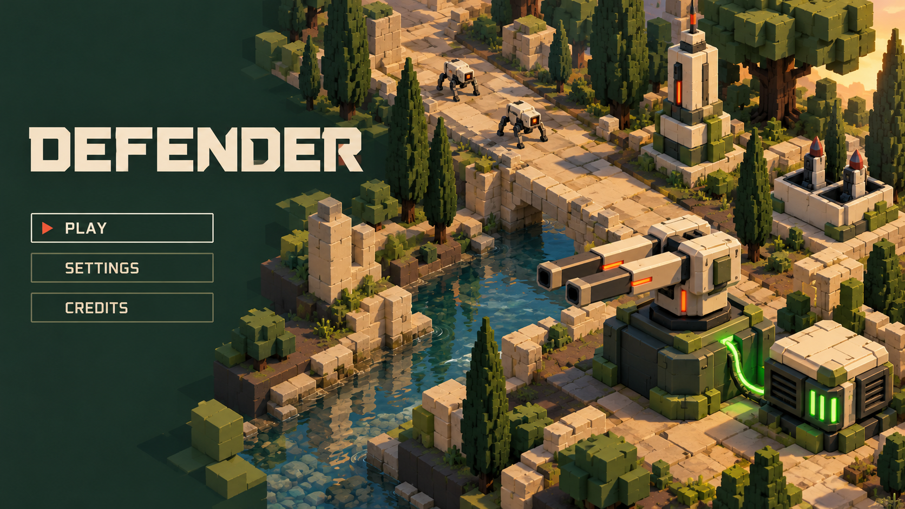

# Title / menu screen — Moss and Porcelain v1

**Historical version:** superseded for review by [v2](title-menu-moss-porcelain-v2.md), after the user requested closer resemblance to the existing defence models. Retained to document the initial composition; its alternative unit designs are not approved production models.

**18 October 2026 — proposal awaiting user review.** The user requested concept artwork while the design doc was being assembled. “Defender” is the current project/working title, not a new naming decision. This artwork explores a left-aligned title and simple menu against a Moss and Porcelain diorama with the existing arsenal and Dog visual language. The labels Play, Settings and Credits are proposed presentation, not implemented or approved menu behaviour.



The illustration is a composition/mood reference, not a production screenshot or a replacement model plan. Its stylised bridge, unit proportions and accent details do not supersede accepted models, terrain constraints, emitter assignments or exact bar/well counts. No title screen, menu UI, new model, level, effect or gameplay rule was added to the game.

Generated using the built-in `image_gen` tool through the **imagegen** skill. Saved project artwork: `docs/concepts/title-menu-moss-porcelain-v1.png`.

## Generation prompt

```text
Use case: ui-mockup
Asset type: proposed title / main-menu screen concept artwork for the desktop tower defence game DEFENDER.
Create a polished widescreen 16:9 game menu concept, one complete screen, not a contact sheet or a browser frame. Respect the established game identity: chunky mechanical models and architecture authored as crisp axis-aligned cube/quad geometry, solid matte colours, texture-free voxel-like forms, no tiny pixel-art sprites. Readable, refined, charming but formidable engineering.
Composition: quiet dark forest-green negative space on the left third for the title and menu; an angled isometric scene fills the right two-thirds and flows naturally beneath the interface. The title reads exactly "DEFENDER" in large bold porcelain-cream squared geometric lettering with subtle engineered cuts, excellent legibility. Below, a restrained vertical menu with exact labels "PLAY", "SETTINGS", "CREDITS"; PLAY is selected with a small vermilion marker and understated cream/moss frame. Keep UI flat and uncluttered, no HUD statistics, currencies, fake progress bars, platform logos, invented slogans or extra text.
Scene: the accepted Moss and Porcelain environment, an old waterway with large irregular warm limestone flagstones, mid-dark brown soil shoulders, grouped blocky broad oaks and slender cypresses, low warm limestone ruins and a small clear reflective stream showing its bed. Routes and props follow a visible but unpainted 24-unit grid; no grid overlay. Distinct ground/path/unit values.
Hero in right foreground: compact porcelain-armoured twin-barrel gun turret on a fixed dark forest pedestal, moss braces, two genuinely separate thick straight barrels on a pitching cradle, with tiny vermilion emissive strips casting warm light. Beside it a low sealed power generator, square porcelain cap, dark cooling banks and four narrow lime-green illuminated meter bars; a thin continuous smoothly wobbly green plasma link joins the generator shoulder to the fixed turret pedestal and lights nearby ground. Farther back along the route, a tall square-tiered porcelain electrical spire and a small flat-deck missile silo with two upward open wells. No large new weapons or redesigned silhouettes.
Two small pale mechanical four-legged dog enemies with dark joints and orange sensor eyes on the distant readable path, not organic dogs. No characters standing near the menu.
Palette: forest #243E35, moss #738B55, warm stone #D9CCAA, porcelain #F1E8D5, small vermilion #D65D45 accents; green is reserved for the enhancer connection/meters. Evening-style directional lighting with clear crisp shadow shapes and restrained source-coloured bloom. Scene remains clear, colourful and tangible. All armour, terrain and plants matte; water alone reflective.
Constraints: no fog, haze, mist, volumetric rays, rain, lens dirt, film grain, explosions or unapproved trails. No humans, military soldiers, organic monsters, texture maps, photoreal surfaces or floating debris. The artwork proposes a screen layout only, not additional game mechanics. Professional art-directed presentation, beautiful spacing, crisp readable title, cohesive with a clean 3D tower-defence prototype.
```
