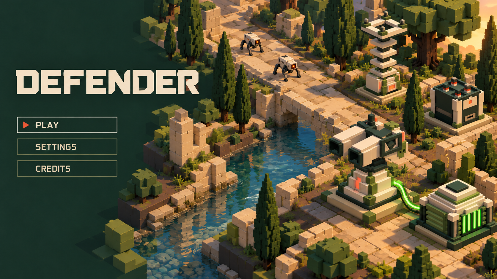

# Title / menu screen — Moss and Porcelain v2

**Historical iteration:** the user subsequently requested removing all defences and enemies. [Scenery-only v3](title-menu-moss-porcelain-v3.md) supersedes this composition for review.

**18 October 2026 — revised proposal, awaiting user review.** The user asked for the title-screen defences to look more like the existing game models, with better-quality presentation. This revision edits v1 using actual production captures for all four defence families while retaining the title, menu layout, palette and waterway scene.



The turret now has broad square barrel sleeves and its stepped porcelain pedestal; the Arc Spire has separated square insulators and an open four-post crown; the silo uses its dark box, porcelain front/corners and short red-banded square missile tips; the generator has the stepped sealed cap, cooling banks and green front bars. Lighting, contact shadows and finish provide the art polish. The image is a model-referenced illustration, not a pixel-exact engine render: the resulting silo shows four loaded tips, corresponding to the existing upgrade-1 family rather than the requested base count. It does not redefine production geometry, counts, scale or stats.

The working title and Play/Settings/Credits menu remain proposals. No in-game models, title-screen functionality or game code changed. V1 is retained as history and superseded by this revision for review.

## Image inputs and generation

Generated as an edit with the built-in `image_gen` tool through the **imagegen** skill. Project output: `docs/concepts/title-menu-moss-porcelain-v2.png`.

1. [V1 title screen](title-menu-moss-porcelain-v1.png): edit target, layout and scenery.
2. [Turret production review](../screenshots/turret-pitch-review.jpg): barrel, cradle and pedestal geometry.
3. [Arc Spire production review](../screenshots/arc-spire-models-day.jpg): insulator stack and open crown.
4. [Silo production review](../screenshots/missile-launcher-model-review.jpg): body, wells and missile tips.
5. [Generator production review](../power-generator-review-day.jpg): stepped cap, cooling banks and green bars.

## Edit prompt

```text
Use case: precise-object-edit / ui-mockup.
Edit image 1, the existing DEFENDER title/menu concept. Keep its 16:9 landscape composition, exact title DEFENDER and exact menu labels PLAY / SETTINGS / CREDITS, typography, left-side menu placement, forest-green negative space, warm Moss and Porcelain old-waterway setting, camera direction, paths, stream, trees, ruins and overall lighting mood.

The user's correction is crucial: replace the four defence objects with faithful premium-quality renders of the ACTUAL EXISTING GAME MODELS in images 2–5. Treat the production screenshots as shape references, not loose inspiration. This is an artwork-quality upgrade, NOT a redesign. Reproduce each referenced base model's main masses, proportions, openings, stepped geometry, material blocks, accent placement and silhouette. Do not copy screenshot labels, review UI, backgrounds or the two upgrade versions. Use only the leftmost/base unit in each reference. Add polish via excellent anti-aliasing, refined lighting, contact shadows and controlled emissive glow. Keep matte, clean, texture-free angular solids, no distressed metal, surface noise or arbitrary greebles.

Reference mapping:
Image 1 = edit target, preserve scene and menu.
Image 2 = turret family screenshot: copy the LEFTMOST base turret into the main foreground turret position. It has TWO VERY THICK SHORT RECTANGULAR BOX-SLEEVED BARRELS with large dark SQUARE openings, broad porcelain upper surfaces, dark forest square rim ends and shoulder cheek plates; compact rear head with a small ivory/olive top block. The paired guns sit in a pitching cradle above a narrow dark turning neck. Underneath is a TAPERING STEPPED PORCELAIN PEDESTAL with olive panels and a small glowing coral-red front panel, on a LOW FLAT SQUARE green/stone mounting PAD. Match these parts carefully. Do not use the previous image's long thin exposed tube barrels, giant cylindrical green drum or bulky ruined-rock pedestal. The accurate turret can remain the foreground hero, but keep its own elegant stepped pedestal and actual base silhouette.
Image 3 = Arc Spire family screenshot: copy the LEFTMOST base spire, placed where the old tall rear tower was. Three distinctly separated square porcelain insulator SHELVES around a thin dark vertical core, ABOVE a small dark/olive/porcelain foot housing with a coral front light. Crown is a LARGE OPEN SQUARE HORIZONTAL FRAME, with a clear square HOLE in its centre and FOUR upright DARK TERMINAL POSTS at its corners. Low flat square mounting pad. It must look like the tiered electrical model, NEVER a closed solid obelisk or lighthouse. Make its open crown and three shelves easily legible.
Image 4 = missile launcher family screenshot: copy LEFTMOST base launcher, at the right rear. Compact dark forest-green box, porcelain corner shoulders, a broad cream front rectangular plate with one SMALL GLOWING CORAL SQUARE in its centre, olive band and low flat square stone/green pad. Dark flat top has EXACTLY TWO square recessed wells side by side. Only small short SQUARE dark-nosed, red-banded missile tips protrude above the deck; most of each missile remains hidden in its well. NO tall exposed rockets, conical orange noses, big raised silver launch tubes or redesigned open cages.
Image 5 = generator family screenshot: copy LEFTMOST base generator, beside the foreground turret. A LOW BROAD symmetrical sealed reactor, squat rectangular cooling housing with horizontal olive radiator fins on its sides; layered stepped PORCELAIN CAP narrowing to a SMALL DARK SQUARE TOP TILE, four short square corner braces, and EXACTLY FOUR NARROW VERTICAL GREEN GLOWING METER BARS across its front. Low flat dark green square pad. Avoid the old plain slab-roof generator and huge black grille. Preserve a thin smooth wobbly green plasma connection from its upper shoulder to the turret's FIXED pedestal, with green light nearby, not to the moving barrels.

All four units use approximately the same footprint in the same world scale. Physical heights: gun 28, spire 32, loaded silo 17, generator 14. Respect these relative proportions with perspective. Keep coral-red identity light on gun/spire/silo, only green on generator/plasma. Armour remains nonemissive. Existing dogs, landscape, main title and menu should stay substantially unchanged.

Deliver one finished clean high-quality game-menu artwork. No diagrams, image grids, model reference panels, extra labels, new objects, new effects, fog, haze, or new menu items. Highest priority is unmistakable correspondence to the four base production models.
```
