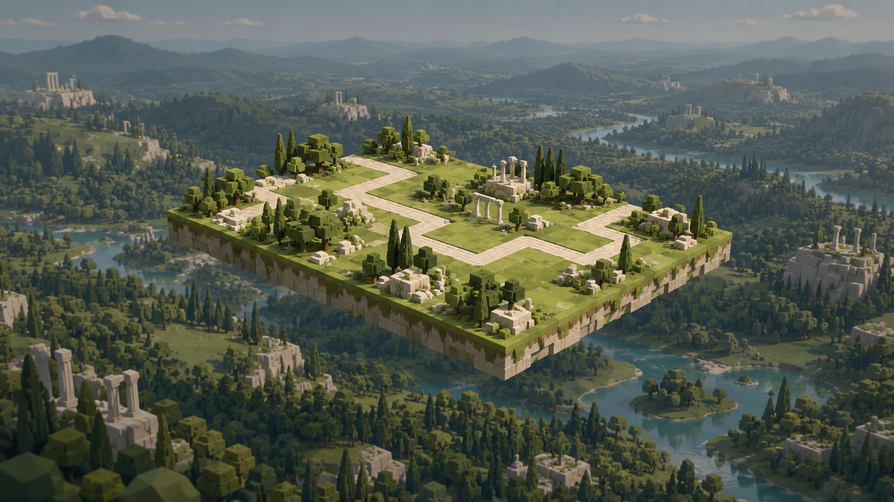

# Zone A floating woodland vista concept

20 October 2026. **Concept direction approved by the user; engine implementation authorised.** The user subsequently accepts the Zone A engine interpretation and authorises the remaining zones. [All-zone delivery](../all-zone-vistas-2026-10-20/README.md); The user has now accepted all four engine vistas for use in the game.

Built-in imagegen generated this art-direction image. [Exact generation prompt](zone-a-skybox-v1.prompt.txt). The selected output is stored in this project as [zone-a-skybox-v1.png](zone-a-skybox-v1.png), rather than relying on the generation cache.

A crisp Moss and Porcelain battlefield floats high above darker, less saturated woodland, faceted hills, limestone and a river. Only the distant scenery is soft. The image is a reference, not a production cubemap: the engine now renders independent low-poly vista geometry with camera parallax. No clouds, fog system, extra zones or gameplay changes are implied by the artwork. [Runtime delivery and verification](../drone-sharp-skybox-2026-10-20/README.md).
