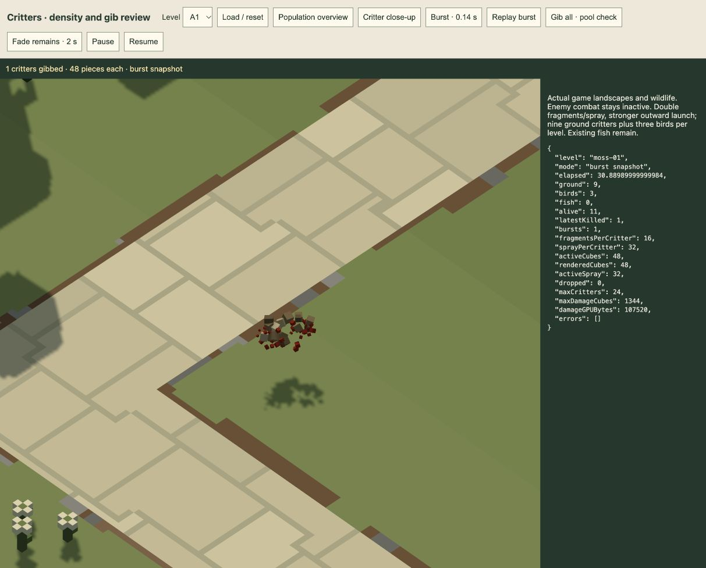

# More critters and stronger gibs · 21 October 2026

**Accepted for now:** the user accepts the current population and effects, including the later distance-based shockwave impulse. All are already integrated in the production game; no additional runtime edit or active-session reload is needed. Further tuning is deferred. Pending-review statements below are historical.

Implemented for review following the user's request for twice the critter gore, more violent motion and more wildlife on every level.

Each gib now produces **16 model-coloured fragments and 32 red spray droplets**, doubled from8+16. Horizontal outward launch is30%stronger, upward kick25%stronger and angular speed40%stronger. Spray diameter increases from0.22–0.52 to0.28–0.64units. No new flash/light, damage, rewards or texture is added. Fragments retain their model colours; blood remains red. The existing inclusive48-unit enemy/72-unit missile gib radii, swept collision, water drag, persistent remains and2-second wave-end fade are retained.

All sixteen current levels now carry **nine ground critters and three birds**, versus three+three previously. Existing fish populations are retained, giving12 or15actual critters in these authored levels. The six extra ground seeds favour route segments, on safe off-path ground with full body separation and connected roaming space. Five or six added seeds per level begin within48units of the route. These are cosmetic animals; they do not become combat targets or block enemy movement.

The current authoring entry point applies `scripts/denser-wildlife.js` after loading the archived layout, generating nine certified ground seed positions without editing archives, models, terrain, paths, placements or accepted water. Source-aware loading and player deployment validation support both legacy3-ground and new9-ground rosters. The virtual placement check now seeds and validates the actual nine ground actors. Existing relocation/respawn guards remain active when a player places a defence.

Storage remains bounded:24critters ×48persistent pieces =1,152reserved slots, separate from192enemy-debris slots. The1,344-cube packed CPU buffer and lazy GPU buffer are each107,520bytes,57,600bytes larger than before; JS pool objects also increase. A reused round-robin cursor prevents repeated scans from the beginning of the critter region. No render pass, image or additional light storage is introduced. One wildlife thinker per update and the shared navigation job remain; more animals increase pose and occupancy work. No frame-rate or GPU-cost improvement is claimed.

Verification completed this session:

- **94 unique targeted tests pass across10files:** critter gibs/density, damage effects, wildlife, fish, play engine, player placement, renderer, noncombat previews and world. The [initial run](targeted-tests.log) had92passes and two stale-expectation failures; [placement recheck](integration-recheck.log) resolves the new9-ground expectation, and the [final preview recheck](preview-final.log) passes after accounting for the denser roster, existing fish and previously delivered B4/C/D layouts. No runtime route, fish or combat change was made to resolve those preview assertions.
- The all-level density test verifies separated off-path supported spawns, usable navigation, route proximity, complete gib storage and safe respawn; every level advances cosmetic journeys. Its16-level survey is in the test log.
- [All16 current sources regenerate and validate](authoring.log), including their referenced model geometry. Historical source factories retain their old3+3rosters.
- A deterministic impulse test verifies16+32pieces, stronger velocities, red spray and no extra blast/smoke; the full-capacity test retains all1,152critter pieces alongside192enemy fragments, rejects overflow without eviction, preserves pause/storage and clears the run-end fade.
- Actual GPU: [single burst](burst-gpu.json) renders48pieces, [A1 full population](all-gib-gpu.json) renders576 and [A2 with fish](a2-all-gib-gpu.json) renders720. All have zero dropped critter pieces and no renderer errors. [A1](fade-gpu.json) and [A2](a2-fade-gpu.json) fade to zero live/rendered remains. The GPU cube buffer is107,520bytes.
- The retained [mixed campaign](mixed-campaign.json) clears all64waves/1,084enemies with0escapes/misses, validating ordinary combat and connected-wildlife deployment with the new density. This is one strategy witness, not universal balance proof or a GPU effects benchmark.

[Open the isolated review](http://127.0.0.1:4173/tools/critter-review.html). It loads real playable landscapes/wildlife without starting combat. Buttons expose a burst snapshot/replay, full-population pool check and run-end fade. Existing active playthroughs are preserved. The current shared implementation applies on the next game load.

Appearance, violence tuning and population density remain for user review.
