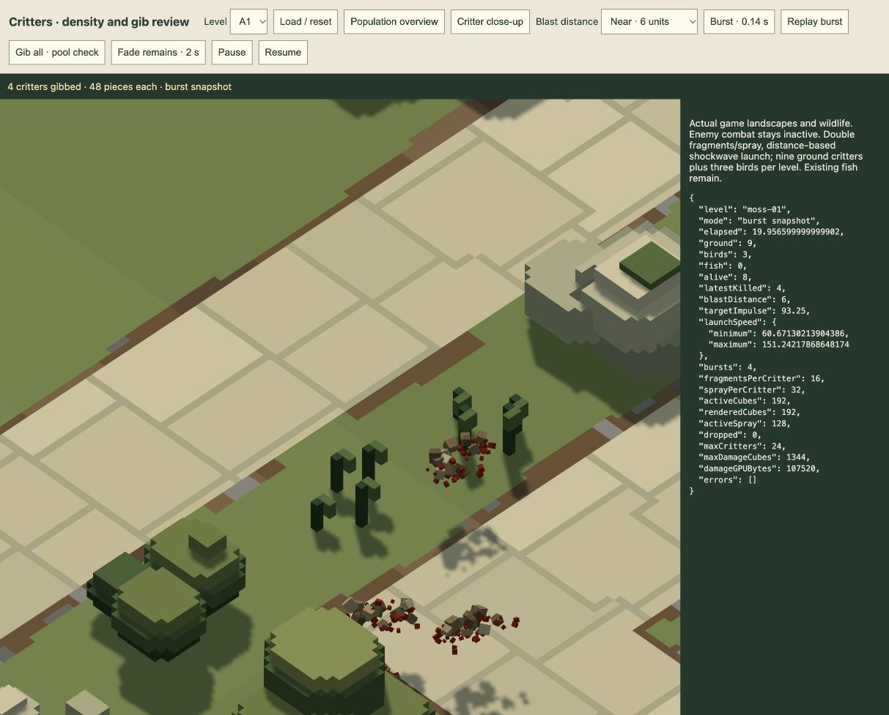

# Distance-based critter blast impulse · 21 October 2026

**Accepted for now:** the user accepts the current population and effects, including the later distance-based shockwave impulse. All are already integrated in the production game; no additional runtime edit or active-session reload is needed. Further tuning is deferred. Pending-review statements below are historical.

Implemented for review following the user's request to increase gib velocity and base it on distance from the explosion, with shockwave-driven motion.

Each fragment and spray droplet now receives a common outward **3D velocity impulse**, added to the existing per-piece scatter:

```
t = clamp(distance from explosion to critter body centre / gib radius, 0, 1)
added velocity = blast direction × (32 + 80 × (1 - t)²)
```

The core adds112world units/s and the lethal-radius edge adds32. A six-unit enemy blast adds93.25; at24units it adds52; at46units it adds32.139. Actual enemy/missile radius48/72 is forwarded by `WildlifePreview.gibIfNear()`, so the larger missile blast retains a stronger kick at the same absolute distance. Above/below blasts push down/up respectively. The exact centre uses a finite horizontal direction rather than dividing by zero.

This is a bounded game impulse proxy, applied at gib time. It strengthens the impression of a passing blast front without adding delayed gibbing, a pressure simulation or an expanding-ring entity. Fragment scatter/spin remain varied, and gravity/swept scenery collision/water drag continue after launch. Gib eligibility and body-centre metric remain unchanged. Population,48pieces per gib, fixed pool sizes, persistent remains and wave-end fade are retained. No new per-frame allocation, buffer, texture, light or render pass is added; the falloff is calculated once per gib.

Fresh verification:

- [28 targeted tests pass](targeted-tests.log) across critter gibs, all-level density/respawn, damage effects and water impacts. New checks cover bounded core/edge falloff, stronger nearby launch, actual radius forwarding, missile versus enemy response, vertical direction, centre safety and invalid inputs. Existing full-capacity, pause, settling-fade, collision and water checks pass.
- Actual GPU [near6](near-gpu.json) and [edge46](edge-gpu.json) bursts render without drops or errors. Near capture launch speeds range60.7–151.2units/s across its four victims; the edge capture's one victim ranges56.0–91.8. These ranges include random scatter and other victims' positions, so they are presentation evidence rather than a controlled same-particle comparison; deterministic tests verify the monotone relation.
- The [two-second fade](fade-gpu.json) clears every active/rendered piece after the edge burst. Cube storage remains107,520GPUbytes.
- The prior population delivery's94tests and mixed64-wave campaign are historical evidence, not rerun for this cosmetic velocity change.

The existing [critter review](http://127.0.0.1:4173/tools/critter-review.html) now has near/middle/edge distance controls. It uses production landscapes/actors/effects with combat inactive. No active player session was reloaded; the shared runtime change applies on the next game load. Appearance awaits user review.


