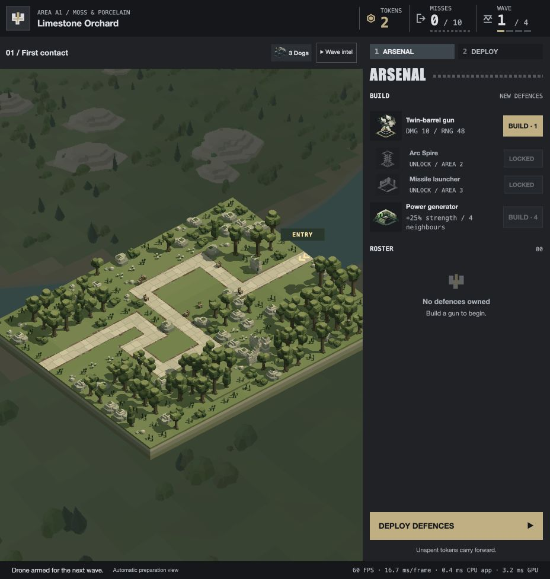

# Defence Drone removal and engine cleanup — 23 October 2026

The player requests complete removal of defence Drone units, followed by an engine cleanup/optimisation pass, commit and deployment. This supersedes the defence Drone economy, models, flight and intelligence work. The separately accepted spectator Drone camera remains.

## Removal and existing progress

The arsenal now contains Gun, Arc Spire, Missile launcher and Power generator. Removed the aircraft shop/catalogue/portrait, ownership/fleet/endurance UI, placement/departure rules, combat controller, navigation/motion/hull modules, model asset, seed command and standalone model-review tools. Their dedicated tests are retired with the implementation; removal, save migration and retained-camera tests replace that coverage.

The A1 preview keeps its accepted scenery, route, enemy roster and corrected wildlife seed, with both aircraft pads removed. Its authoring wrapper is now `scripts/a1-combat-preview.js`; rebuilding previews cannot restore the retired units. All sixteen current source factories match their saved levels. Historical development evidence and accepted source snapshots remain in `project-docs/` and Git history.

Legacy checkpoint payloads still authenticate using the existing local envelope. Valid former base-only, one-token Drone purchases (maximum four) are removed and refunded on restoration, preserving the level boundary, misses, ordinary units and their IDs. Loading does not rewrite browser storage. New payload version 2 permits the corresponding purchase-serial gaps, so refunds can buy replacement units and subsequent checkpoints remain valid without duplicate refunds. Old malformed units, over-cap fleets and inconsistent wallets remain rejected. No active browser save is modified by this task.

## Engine cleanup

- Both combat coordinators no longer create, prepare, tick, reset or dispose a defence fleet. The shared target planner drops mobile forecast branches, preparation/selection/ranking callbacks and its per-candidate rank array. Ordinary threat, coverage commitments, ground-first rules and one-defence-per-frame thinking remain.
- Placement drops Drone departure geometry, obstacle-envelope maps and temporary navigation construction. Remaining unit movement, enemy route, wildlife and scenery gates are retained. Removed obsolete family ownership-cap scans and bounded-item capacity logic; the remaining families use their wallet/entity bounds.
- The spectator collision cache is independent of the retired model/tuning. Camera callers retain their explicit 2.5-unit radius, timed actor predictions and scenery safeguards. Retained telemetry still includes camera, generator, gun, damage and footer performance state; only defence-flight diagnostics are removed.
- Arc spark admissions share one monotonic free-slot search per emission. Immediate expiry of backdated particles still permits slot reuse, and saturation consumes no extra RNG. The saturated fixture reduces slot reads **576 → 96**; a three-free-slot fixture reduces **573 → 99**.
- Model lights reuse unchanged packed source blocks while other groups move. Compaction and visibility changes still repack the affected slots; signed zeros and existing NaN dirty signalling are retained. A synthetic one-moving/433-static-source fixture avoids **3,464 reads and 3,464 stores** per eligible prepare. This fixture exercises the generic 463-source library limit, above the new campaign bound.

The model-light change adds two bounded JavaScript cache fields per source, no typed array, GPU resource, image or pass. [Reproducible comparison](compare-engine.mjs) against `df8ce98` matches 1,600 Arc frames including RNG/counters and 1,200 light frames including motion, visibility and NaN cases. [Recorded results](engine-comparison.json). The recorded isolated packing median is about **0.00345 → 0.00177 ms/call**; this is not a whole-frame or GPU improvement claim.

## Verification

**213 distinct focused checks pass** across the three recorded parent runs (76 integration, 141 engine/campaign and 15 presentation checks, with overlap removed). These cover native finite mixed combat, all remaining weapon families, deployment/ownership, checkpoint retirement/refunds, renderer cache/lifecycle, lights/effects, source preservation, game speed, telemetry and packaging. An additional specialist run passes **47 camera/obstacle checks**, including seven native openings and A2/B4/D4 clearance at 30/60/120 Hz. No full-suite or whole-campaign balance run was requested.

[Integration checks](integration-checks.log), [engine/campaign checks](engine-and-campaign-checks.log), [presentation checks](presentation-checks.log), [all sixteen authoring factories](preview-source-checks.log).

Three stale assertions encountered during affected checks were repaired against the established runtime: archived missile shots `[2,15,8] → [0,6,6]` with unchanged `[4,4,4]` hits and three kills; finite missile incoming damage now follows the configured strength (300), and the scene teardown fixture uses `hadTransientLights`. These expectation repairs change no gameplay or renderer behavior. The previous task already reproduced both missile discrepancies with an unchanged planner; the Engineer separately reproduced the scene fixture failure with unchanged renderer code.

The built-in browser review starts an isolated A1 New Game, shows the four-family arsenal, buys and deploys a Gun, starts a wave with the retained spectator camera, records thirteen real gun pulses and returns to preparation for wave 2 without reported errors or captured warnings. The one-gun smoke test has three escapes and makes no balance claim. Final reload confirms camera/performance/generator telemetry, model-light capacity 410, and no defence Drone state. [Final DOM-derived review](browser-result.json). The player's external `/play` tab remains untouched.

## Local delivery

The local package contains **206 files / 116 modules / 65 models / 16 levels / 6 audio files**, down from 213 files / 122 modules / 66 models. Packaged bytes fall **21,702,742 → 20,707,282**, a reduction of **995,460 bytes**. The conservative campaign model-light bound falls **434 → 410**, removing 24 light slots (768 bytes per corresponding packed CPU/GPU block). Ordinary unit prices, upgrades, wave schedules, enemy stats, sounds and spectator controls remain unchanged.

The existing `bun run deploy:local` packager refreshed `docs/`. [Static validation](static-validation.json) passes exact source/output hashes, MIME/resources at root and repository prefixes, all sixteen native levels and all 64 wave starts. No remote push, public hosting change or active-player reload. The completed source, tests, delivery notes and generated package are committed locally.

To reproduce the isolated engine equivalence/counters, run `bun project-docs/defence-drone-removal-2026-10-23/compare-engine.mjs`. Focused test commands are represented by the test-file headings in the recorded logs; run only affected checks. Package with `bun run deploy:local` and validate with `bun run check:deployment`.
