# design doc

**Defence Drones removed and engine cleaned, 23 October (implemented):** user requests complete defence-unit removal, engine cleanup, commit and deploy. Removes their catalogue/UI/model/pools/combat/navigation/motion/placement/tools and planner hooks; spectator Drone camera remains. Valid legacy checkpoints refund retired one-token purchases while preserving progress and ordinary unit IDs; new saves retain serial gaps safely. Arc spark scans become monotonic and unchanged model-light slots retain packed data; deterministic baseline packets/RNG match, with no new GPU resource/pass. 213 distinct parent checks plus 47 camera/obstacle checks pass; isolated native A1 shop/deploy/wave/return reports no errors. All sixteen authoring sources and 64 packaged wave starts validate. Local package shrinks 995,460 bytes; model-light bound434→410. Local package refreshed/committed; active player untouched, no push. Supersedes earlier defence Drone deliveries. [Delivery, measurements and limits](defence-drone-removal-2026-10-23/README.md).

**TODO28–30 implemented, 21 October (for review):** hidden paused screenshot mode uses BACKSPACE to hide/restore the pause overlay/dimming, WASD free flight and drag rotation, restoring the saved camera exactly without ticking simulation/directors/effects. Red critter droplets now become larger irregular flat marks at actual static-surface impacts, including walls, using their existing slots/draws/buffers. All critter fragments/spray/marks remain through wave end and settling, fading over2seconds only after build/deploy appears; level transfers retain the outgoing board until that fade completes. Quick starts release unfinished old fades; defeat/final views retain remains until reset/unload.102affected tests and real GPU/UI checks pass. No new production rendering resource/pass or active-playthrough reload. Appearance remains for user review. [Delivery and verification](todo-28-30-2026-10-21/README.md).

**Critter-gib persistence correction queued, 21 October:** user reports that critter effects fade too early. TODO30requires every critter-gib remnant, red spray particle and future blood decal to remain through wave end and settling until the build/deploy screen actually returns; fading may start then. This supersedes prior wave-end fade timing as a requested change, not a delivered fix. Screenshot mode (28) and blood decals (29) remain queued. No runtime change or active-playthrough reload. [Current TODO](../TODO.md).

**Screenshot camera and blood decals queued, 21 October:** user adds TODO28for a hidden paused screenshot mode (`BACKSPACE` hides/restores all pause UI and dimming; WASD/mouse-drag free camera; exit restores the saved paused view) and TODO29for larger flat blood marks on surfaces struck by the small red critter spray particles. Both are queued only. Keep the active game unchanged while the user reviews; no implementation, pause/input change or session reload is delivered. [Current TODO](../TODO.md).

**Outline removal accepted, 21 October:** the user accepts the playing-area rim removal and will review the game through a fresh playthrough. Keep the current presentation unchanged during that review. Replacement boundary art remains deferred; no further runtime change or active-session reload is requested. Gameplay/balance review remains pending.

**Playing-area rim removed; evening lighting accepted, 21 October:** user accepts the low blue level3sky light and requests removal of the playing-area outline. Source inspection identifies an MSAA/flat-background compositing rim rather than a separate line draw. Vista scenes now resolve over black and fill uncovered edge samples with the actual vista, retaining emission alpha; non-vista flat backgrounds remain. No replacement border/treatment is added; reconsider boundary presentation later when requested.31affected renderer/water tests, five exact GPU coverage probes and64actual level/view compositions pass. No new production resource/pass; no active playthrough reload. [Delivery and checks](board-edge-2026-10-21/README.md).

**Low evening sky light, 21 October (implemented for review):** user requests the level-4 light nearer the horizon for A3/B3/C3/D3, retaining level-3 ambient. The evening preset now uses the night blue `#708ABA` and direct strength0.65at12°elevation, preserving authored XZ heading and evening ambient `#8493B4`/0.42. Existing shadows now read clearly at a low angle. Level2/4lighting and authored sources remain; no additional rendering resource/pass.33affected tests pass; actual GPU overview/High Drone views for all four levels have no captured errors and confirm shadow redraw/ambient preservation. Existing tab is left on A3; no active playthrough reload. Appearance remains for review. [Delivery and checks](evening-skylight-2026-10-21/README.md).

**Unblurred higher-fidelity vistas, 21 October (implemented for review):** user requests blur removal, production integration of the new A vista and matching fidelity upgrades for B–D. All sixteen `/play/` and `/game/` levels now use 80-unit terrain, 40-unit river segments, richer biome landmarks/vegetation and 75% linear background resolution. Removed the nine-tap background blur; one filtered sample retains the existing darker palette. Reviewed A geometry is byte-identical; B has layered mesas/cacti, C faceted snowy ridges/tiered firs, D detailed sanctuary ruins/branching plum crowns. Geometry is 12.87–20.83 MB for the loaded zone; only its resources remain resident. Thirty-two affected tests and 64 actual GPU compositions pass. Appearance remains for user review. Culling is research only: net saving unproven, no production culling added. [Delivery and evidence](all-zone-vista-fidelity-2026-10-21/README.md).

**Zone A vista fidelity trial, 21 October (implemented for review):** user authorises a substantial skybox fidelity increase, starting with A and reviewing before other zones. A1–A4 now use finer80-unit terrain facets, smaller ground folds, layered limestone, detailed riverbanks and denser trees with trunks/branching crowns. Zone A alone uses75%linear render resolution and1.8-source-texel softness, versus50%/3.2for B–D. The distant woodland/river identity, darker palette, foreground isolation and cache lifecycle remain. Geometry grows3.29→20.70MB; at2426×1750vista images grow8.49→19.12MB. Exploratory full-frame GPU medians grow about1.6–2.1ms, with noisy isolated-pass readings.32affected tests and16actual A1–A4 GPU compositions pass; B–D geometry hashes are identical to the baseline. No active playthrough reload. Appearance/cost await user review; B–D upgrades are deferred. [Trial and measurements](zone-a-vista-fidelity-2026-10-21/README.md).

**Critters accepted for now, 21 October:** the user accepts the denser population, doubled gore and distance-based shockwave velocity, and requests no further work. Already integrated through the production wildlife/effects paths: all sixteen playable levels use nine ground critters plus three birds and existing fish; each gib has16fragments+32spray with the accepted radial impulse. Read-only production composition and enemy/missile callback checks confirm no additional integration edit is needed. Existing game sessions are not reloaded. Further critter/gib tuning is deferred until requested.

**Critter shockwave velocity, 21 October (implemented for review):** user requests faster gibs driven by explosion distance. Added a common outward 3D velocity impulse, smoothly falling from112world units/s at the core to32at the lethal-radius edge, on top of existing fragment scatter. Each actual enemy/missile gib forwards its48/72-unit radius; distance is measured to the current critter body centre. Centre behaviour is finite, with no new delay or expanding-ring simulation. Doubled gore, population, radii, collision, water drag and wave-end fade remain. Twenty-eight affected tests and actual GPU near/edge/fade checks pass. Appearance awaits review. [Delivery and checks](critter-shockwave-2026-10-21/README.md).

**Critter gore and population, 21 October (implemented for review):** doubled each critter burst to 16 model-colour fragments plus 32 red spray droplets, with 30% more outward speed, 25% more upward kick, faster spin and larger spray. All sixteen current levels now have nine ground critters and three birds (12 versus six land/bird actors), plus existing fish; additional seeds use separated, connected routeside ground. Reserved capacity covers 24 critters/1,152 persistent pieces alongside 192 enemy fragments; round-robin allocation avoids repeated prefix scans. Existing gib radii, wave-end fading and safe respawn remain. Ninety-four affected tests pass after updating population and historical-preview expectations; all sixteen authored sources validate. Actual GPU burst/pool/fade checks pass, and the mixed replay clears 64 waves/1,084 enemies with zero escapes. Active playthroughs and accepted water were not reloaded or retuned. Appearance awaits user review. [Delivery and checks](critter-density-2026-10-21/README.md).

**Water accepted for now, 21 October:** the user accepts the finer breeze/refraction version and requests no further changes. It already uses the shared production renderer and all sixteen playable level materials, so no additional integration or runtime edit is needed. Keep the current blue tint, 60% transparency, 0.18 ripple strength, 2.5 ripple scale and 0.24 cycles/s; no highlights. Further water work is deferred until requested. Existing sessions are not reloaded.

**Finer ripple tuning, 21 October (implemented for review):** user finds the first breeze ripples too broad and refraction too subtle for gameplay. Reduced wavelengths by 60% (5.6/3.2/2 units), increased slope/refraction strength from 0.08 to 0.18 and primary frequency from 0.16 to 0.24 cycles/s. Retained 60% transparency, blue tint and no highlights. Twelve targeted water/world tests and sixteen authoring checks pass. Matching A2 GPU comparisons show stronger transmitted-scene motion with zero motion when refraction is off or water is opaque. Appearance awaits review. [Current tuning](water-breeze-2026-10-21/README.md).

**Breeze ripple refraction, 21 October (implemented for review):** the user authorises slight breeze ripples and refraction, with no highlights yet. Three small analytic wave slopes now bend the transmitted riverbed view; the blue tint and 60% transparency remain. Tint lighting still uses the flat surface normal, with no specular/glints, reflections or caustics. Refraction validates the complete bilinear sample footprint against submerged depth, rejecting dry banks, bridges, other-height water and off-screen samples. All sixteen current materials use the same gentle settings. Thirty-nine targeted tests, sixteen authoring checks and actual GPU shallow/deep and overview/perspective comparisons pass; opacity-only captures remain still and the 60/40 blend is preserved. No active playthrough reload. Appearance awaits review. [Delivery and checks](water-breeze-2026-10-21/README.md).

**Water rebuild, 21 October (implemented for base review):** replaced the former water shading with a smooth, slightly blue tint (`#8FBBD4`) at 60% transparency / 40% opacity. The shader blends the visible opaque bed with a lit tint in linear light. No water texture, procedural colour pattern, ripple normals/glints, refraction, depth absorption or reflections are applied in this first stage; those effects await the base review. Updated all sixteen production water materials and their current authoring entry point; archived landscapes and models are preserved. Thirty-nine targeted tests and all sixteen authoring checks pass; actual GPU endpoint-blend checks pass in daylight, dusk, deep pools and night. Active playthroughs were not reloaded. Appearance awaits user review. [Delivery and review](water-base-2026-10-21/README.md).

**Water and TODO 20–23, 20 October (latest, implemented for review):** reduced the first low-sun water sheen revision by 75%, retaining physical refraction, translucency and moving ripple normals. The reported A3 water was rendered and animated, but its two-unit depth and low dusk sun made the effect subtle; no lost-water/material regression was found. Removed health-based enemy slowdown/catch-up, hid Frame/Auto/Drone selectors while keeping Drone during runs, confirmed the existing camera depth-only prepass, and doubled Arc chain range to 96 units and enemy/missile critter-gib radii to 48/72 units. Existing missile-hit reactions, 20% chain damage and wave-end remains fading stay intact. 88 affected tests pass; the retained mixed strategy clears 64 waves/1,084 enemies without escapes. No GI/AO is restored. Active player run was preserved. Appearance remains for user review. [Delivery and evidence](water-regression-2026-10-20/README.md).

**Earlier TODO14–19 delivery, 20 October (historical; movement/radii superseded by TODO 20/23):** completed items 14–19: sampled asynchronous GPU frame timing beside an audited whole-callback CPU app timer; 35% stronger direct sunlight on A2/B2/C2/D2; smooth half-health route staggering and bounded catch-up; one Upgrade I Arc chain at 20% strength within two tiles; and persistent blast-driven critter gibs/spray with safe respawn and run-end fading. Stage 2 means the middle Upgrade I tier, consistent with existing project terminology. Enemy run means the current wave. Actual combat/visual tuning remains provisional for user playtesting. GI and AO remain removed. [Implementation and checks](latest-todo-2026-10-20/README.md).

**Indirect lighting and AO removed, 20 October (latest, user decision):** the user rejects both experiments because their visual benefit is too small. Removed the GI/AO viewers, shader/cache implementations, bake/audit scripts, generated GI probe/BVH caches, experiment-only tests/timing readbacks and the AO depth-pass hook from the main renderer. Historical reports, measurements and screenshots remain as retired evidence only; no integration or optimisation follow-up is active. Existing direct/ambient/emissive lighting, shadows, reflections, water, bloom and vistas remain unchanged. The GPU HUD timer and other queued TODOs remain open. The active playthrough is not reloaded. [Removal and checks](lighting-experiment-removal-2026-10-20/README.md).

**Critter explosion gibs TODO, 20 October (queued):** critters within one tile (24 units) of an enemy explosion or 1.5 tiles (36 units) of a missile explosion should gib. Fragments and spray fly away from the blast realistically, persist in the level until the enemy run ends, then fade. Exact run-end cleanup/fade, distance metric and respawn handling remain to specify during implementation. No runtime wildlife/effects change or active-playthrough reload. [Current TODO](../TODO.md).

**CPU timer audit TODO, 20 October (queued):** verify the reported 0.5–1.0 ms and the readout's scope/label. It currently wraps synchronous renderer work; simulation/UI, asynchronous GPU work and other-process driver work are outside that interval. Audit boundaries, units, averages and active/static/pause cases, comparing full main-thread frame work where useful. No current HUD or playthrough change. [Current TODO](../TODO.md).

**AO trial delivered, 20 October (latest, implemented for review):** isolated half-resolution ambient-only AO adds restrained contact/recess shading; production AO remains off and the active player tab was not reloaded. At 2512×1050 it uses 3.77 MiB of textures; exploratory median scene-span increases are 1.08–1.47 ms while the game runs, with noisy individual samples. Thirty-nine affected tests and 22 actual GPU checks pass, including direct/emissive/muzzle colour identity, debris, Drone, cache and resize. Indirect lighting is dropped from the current plan; TODOs 14–17 remain queued. Appearance and production integration await review. [Trial, comparisons and measurement limits](ambient-occlusion-study-2026-10-20/README.md).

**Stage-2 Arc chaining TODO, 20 October (queued):** a successful hit should chain once to one random nearby enemy at 20% of the Arc's strength. The user corrects the wording to “chain to a random nearby enemy at 20%”; nearby is at most two tiles (48 current world units) from the hit enemy. Keep the requested stage label until its Base/Upgrade I/Upgrade II mapping is confirmed; chain visibility/target eligibility and planner accounting remain to specify. No runtime ability or active-playthrough change. [Current TODO](../TODO.md).

**Wounded-enemy stagger TODO, 20 October (queued):** at 50% maximum health or below, enemies should stagger briefly then catch up smoothly to their expected path position. Amount/cadence and bounded recovery remain to prototype; check route traffic, animation clearance and targeting rather than teleporting. This does not restore the withdrawn escape-running/gallop system. No runtime movement change or active playthrough reload. [Current TODO](../TODO.md).

**Late-afternoon sun TODO, 20 October (queued):** brighten sunlight on each zone's second level, A2/B2/C2/D2, retaining the warm late-afternoon identity. Intensity tuning awaits comparison; no runtime lighting change or active playthrough reload. [Current TODO](../TODO.md).

**AO trial authorised; indirect lighting dropped, 20 October (latest):** the user authorises an isolated ambient-occlusion trial while playtesting and agrees to drop indirect lighting because its visual contribution is small. Keep production GI disabled; its experimental viewer/evidence are historical, with no integration follow-up. Build/test AO off/on/only, overview/Drone, contact quality and actual GPU cost separately from `/play/`; do not reload the active player tab. The new GPU HUD timer remains TODO 14. AO production integration awaits the trial result and user review.

**GPU frame timer TODO, 20 October (queued):** add actual GPU frame milliseconds beside the existing CPU timer in the footer. Measure the complete production render span asynchronously with supported timestamp queries; avoid render-loop waits and label unsupported/stale states accurately. The current AO review's partial scene/pass timing is experimental groundwork, not this HUD feature. No live playthrough reload or HUD implementation in this TODO update. [Current TODO](../TODO.md).

**Ambient occlusion, 20 October (research complete):** a restrained half-resolution screen-space AO experiment is feasible using the existing depth prepass and inverse projection. Proposed depth preparation, horizon AO, two edge-aware filters and ambient-only upsampling add about 5.27 MiB of nominal textures at 2560×1440; GPU cost and appearance are unmeasured. Current resolved normals arrive too late for pre-opaque AO, so reconstruct from depth first. Exclude water/glow/vistas, control foliage/silhouette artefacts and retain direct/emissive light. AO does not add colour bounce. An isolated A1 proof is proposed; no AO implementation or production integration is authorised/delivered. [Report, primary sources and arithmetic](research/ambient-occlusion-feasibility-2026-10-20/README.md).

**TODO follow-up, 20 October (latest, implemented for review):** removed the timed overview↔Drone transition and its projection/waiting code; added labelled FPS/frame/CPU-render timings; grouped the roster and added actual current/next range previews. Missiles turn more gently and use two brief lit attitude impulses instead of a repeated correction train. Removed outward missile fragments, reduced muzzle-light peak by 20% and enemy-death-light duration by 30%. A–D vistas have finer terrain and biome landmarks with smaller buffers. The mixed campaign clears all 64 waves/1,084 enemies without escapes. This supersedes the earlier queued notes and transition acceptance; appearance awaits human review. Indirect lighting remains isolated. [Delivery and evidence](todo-follow-up-2026-10-20/README.md).

**Unreal feasibility, 20 October (research complete):** a native remake is feasible in principle using current Unreal and its official Experimental MCP alongside source/build tools. Reuse authored data; port the simulation, renderer/materials and GUI deliberately. Browser delivery differs; an isolated A1 proof is proposed before a migration decision. No Unreal project, installation, live connection or port is delivered. [Primary-source report](research/unreal-feasibility-2026-10-20/README.md).

**A3 path-edging report, 20 October (withdrawn):** the user confirms this was a misunderstanding and requests removal of the TODO. Removed item 6; no path-edging investigation or change remains queued. Runtime appearance is unchanged. [Current TODO](../TODO.md).

**Indirect colour audit, 20 October:** the requested grass-to-rock tint needs only one bounce, and diffuse material colours are already used. A direct A1 reference and a grass-only neutralisation bake confirm colour transfer. Four of 32 sampled rock faces lose the reference green bias in the coarse probe estimate; existing ambient/direct light further masks the effect. The prototype is not yet locally accurate enough for production. Added a review-only Rock close-up and a passing matte green-floor regression; no production shading/material/cache change. [Audit and evidence](research/indirect-colour-audit-2026-10-20/README.md).

**TODO delivery, 20 October (implemented for review):** completed the isolated A1 day/night one-bounce experiment, fixed Drone projection feedback/apparent framing in both transition directions, and halved attitude jets to 5.25 units with pulsed white illumination and a one-degree alignment cutoff. GI remains outside production: measured opaque GPU overhead is about 6.2 ms day/8.1 ms night on this host, requiring optimisation before integration. Camera/jet changes are active on the next application load; the existing player tab was not reset. 90 affected tests and 25 actual GPU checks pass. [Delivery and limits](todo-delivery-2026-10-20/README.md).

**Audio workflow research, 20 October:** the requested Researcher recommends a small team-operated recipe/sample workbench plus Web Audio and an offline Ogg Opus encoder, retaining lossless masters. Ogg does not itself guarantee seamless loops or save decoded PCM memory. No audio/editor/encoder implementation or installation is authorised by this research result. [Report and primary sources](research/audio-workflow-2026-10-20/README.md).

**Missile steering-jet TODO, 20 October (queued):** add item 3 after indirect lighting and the Drone start-camera fix: halve directional-jet length from 10.5 to 5.25 units and add pulse-synchronised local white illumination. The user also requests that directional pulses and their lights stop once rotation has aligned the missile with its target, without lingering during aligned flight. Light strength/range remain to tune. This is a TODO update; runtime behaviour and the active playthrough are unchanged. [Current TODO](../TODO.md).

**Current TODO and Drone-start investigation, 20 October:** the user requests the ordered follow-up list: (1) indirect lighting, (2) the Drone start-camera fix. A production CPU replay confirms projection feedback: the destination remains orthographic during the hand-off, then switches abruptly to perspective, causing the apparent pull-away/return. Both items are queued; no camera/runtime/asset changes or player-run reset were made. [Current TODO](../TODO.md) · [Investigation](research/drone-start-transition-2026-10-20/README.md).

**Indirect-lighting feasibility, 20 October (research complete):** the user accepts the current B4/missile presentation and requests research while playing. A cached, world-space single diffuse bounce from static landscape/directional lighting is the recommended first experiment; moving units could receive it. Visibility/leak prevention and actual GPU cost need isolated verification. No GI, renderer, gameplay or asset changes were made. [Research, options and resource estimates](research/indirect-lighting-2026-10-20/README.md).

**B4 lake approach and missile presentation, 20 October (user-approved):** B4 gains a complete northern approach over a six-box wooden lake bridge, cleared bank courts and staggered two-route waves. Three low dry mesa shoulders are trimmed for six-wheel turning; water/bed and existing main route remain. Legal individual choices gain four guns/seven Arcs or silos. Missile impacts now have a larger layered fireball, outward hot fragments, smoke and a pressure ring, retaining the exact previous local light curve. Attitude jets are 3× longer. 106 tests, 89 GPU checks and a 64-wave/zero-escape mixed replay pass. [Implementation and limits](b4-missile-follow-up-2026-10-20/README.md).

**Eight player notes, 20 October (latest, implemented for review):** added 1.05-second eased landscape↔Drone transitions and disabled manual `/play/` camera movement; darker vistas with double blur radius; less uniform water currents/tint/glints; six exposed wheels replacing Dune Tread tracks; actual enemy-surface bullet sparks; live defence geometry blocking other units’ LOS with self-exclusion; white acceleration/braking steering jets and varied missile turn rates; and repeated day/afternoon/evening/night across each zone’s four levels. Weather stays off. This supersedes all-level-daytime defaults and the previous manual-camera policy. 135 affected tests and GPU checks pass; B1 wave2 clears 15 with 0 escapes. [Implementation and limits](play-polish-2026-10-20/README.md).

**All-zone vistas accepted, 20 October (latest):** the user accepts the appearance of A–D for now and confirms adding all four vistas to the game. They are active across every production level. Retained A exactly; all sixteen `/play/` and `/game/` landscapes now render a matching darker, softer distant biome: B sandstone mesas/cacti, C snowy ridges/firs, D plum canopies/pale ruins. Background-only rendering preserves sharp gameplay and stays outside navigation/combat. All four vista appearances are the accepted current baseline; further visual iteration is deferred until requested. 47 affected tests and 64 actual GPU compositions pass. [Delivery and screenshots](all-zone-vistas-2026-10-20/README.md).

**Sharp default Drone and Zone A vista, 20 October (latest, implemented for review):** removed Drone depth of field and its complete renderer pass/resources; new games/retries arm Drone for waves and settling, while title/preparation use overview and manual overrides persist. The user approved the Zone A floating-vista concept and authorised engine integration. A1–A4 now float above a darker, softly filtered low-poly woodland valley/river with camera parallax. Background-only rendering preserves sharp gameplay and stays outside navigation/combat. Other zones retain their backgrounds. 45 affected tests and 20 GPU compositions pass. [Delivery and visual evidence](drone-sharp-skybox-2026-10-20/README.md).

**Full campaign implemented for review, 20 October (latest):** `/play/` now spans A–D: sixteen levels, sixty-four authored waves and 1,084 enemies. B uses its accepted layouts; C/D now have tactical routes, useful visible courts and connected wildlife. Existing zone enemies and gun/Arc/missile tiers retain the 2-token start, +2 wave reward, ten cumulative misses, persistent ownership and ordinary movement. A’s waves, accepted A/B assets, all 67 model sources and frozen backup remain unchanged. Mixed and Arc-heavy native campaigns both clear all64 waves; new layouts and numerical balance remain provisional for human playtesting. [Implementation and verification](campaign-completion-2026-10-20/README.md).

**Daytime and clear player defaults, 20 October (latest, implemented):** after the engine cleanup, the user requests removal of level-start day/night and weather randomness. Every `/play/` level now selects `night: false` and `weather: false`, retained across waves, retries and fresh runs, without random draws. Existing A1–A4 authored 10:30 lighting and sky settings stay intact; models/levels and `/game/` preview controls remain unchanged. This supersedes the earlier per-level random policy. [Checks and browser state](engine-cleanup-2026-10-20/README.md#daytime-and-clear-defaults-follow-up).

**Engine cleanup and review, 20 October:** completed a source-wide engine audit and bounded optimisation pass, preserving accepted visuals, gameplay, all 85 assets and the running rollback. Resettable spawn cursors, active-only pose traversal, repeated Moth/camera calculations and idle splash work are reduced with exact baseline traces. Fixed bloom blast offsets/capacity and retired-camera input/error ownership. Independent review finds no blocker; 150 affected tests and 25 actual GPU checks pass. [Evidence and limits](engine-cleanup-2026-10-20/README.md).

Defender is a tower defence game for desktop web browsers, built around readable mechanical units, distinct environments and a texture-free, grid-authored world. This is the shared, living design reference for the game and its development tools.

**Last updated: 20 October 2026.** The project currently provides visual and combat development previews. The complete sixteen-level, sixty-four-wave A–D campaign at `/play/` is implemented for gameplay review; new C/D layouts and detailed numerical balance await human acceptance.

## How to use this document

Every agent must read this document and [the contributor instructions](../AGENTS.md) before performing project tasks, then read the relevant specialist notes linked below. The document is stored at `docs/design-doc.md`; the browser view renders that same file. Edit the source to amend it—there is no separate browser copy to maintain.

| Status | Meaning |
| --- | --- |
| Approved requirement | A user decision that governs future work, whether or not it is implemented yet. |
| Implemented | Present in the current engine, assets or development preview. This does not imply a finished campaign. |
| Provisional tuning | A working value chosen for preview/testing; not final balance. |
| Open | Not decided or authorised for implementation. |
| Superseded | An earlier idea or implementation replaced by a later decision; retain it only as history. |

Latest explicit user instructions take precedence. This document consolidates the current design; [the project brief](project-brief.md) and [development diary](development-diary.md) retain approval history and progress. Specialist notes explain implementation and evidence. Older milestone descriptions must not override newer decisions. If current code and an approved requirement disagree, record the discrepancy and resolve it within the task's scope rather than silently redefining the design.

When a decision changes, update the relevant section here, its status and date, and any affected specialist notes. Record the change and verification in the diary and team handoff. Keep assumptions and unassigned values visible. The lead owns integration; specialists report decisions and evidence for inclusion. Creating this document does not authorise new game mechanics.

## Game identity and design principles

**Genre: tower defence.** The intended player decisions concern where to deploy defences, which units to upgrade, and which to repair while dealing with successive enemy waves. The first available defence is a twin-barrel gun turret. The player's arsenal persists conceptually across the four zone themes, with palette changes rather than a different arsenal for each environment; the approved first delivery retains ownership, tiers and unspent tokens across its eight waves. Broader save/campaign persistence remains open.

The current previews demonstrate stationary defences attacking moving enemies on authored routes. They are not yet a complete game loop. On 19 October the user assigned a miss counter for enemies reaching the exit, game over at a configurable threshold, manual wave starts, 2 initial purchase/upgrade tokens and 2 more after each successful wave. The signed first plan assigns 10 cumulative run-wide misses, four waves per level, retained ownership/tokens and fresh-run retry. The bounded `/play/` implementation is complete for gameplay testing.

The design principles are:

- **Readable tactical choices.** Distinguish paths, enemies, defences and scenery by silhouette, value, hue and spacing. Show useful early contact, repeat coverage and late interception opportunities.
- **Distinct places.** Give each zone its own setting, palette, route character, scenery, weather options and enemy identity while preserving a coherent arsenal.
- **Physical presentation.** Articulated feet, weighted turret aiming, pitched barrels, powerful electrical strikes, staged missile thrust and visible hit reactions make the mechanical units understandable.
- **Clean forms and light.** Construct models from solid grid geometry, keep ordinary surfaces matte and crisp, and use approved emissive accents/effects for contrast.
- **Measured efficiency.** Share geometry, reuse state and buffers, bound effect pools and preserve scene ownership. Optimisation must retain approved behaviour and appearance.
- **Deliberate scope.** Genre conventions and concept illustrations are inspiration, not automatic requirements. New units, rules, effects and default engine behaviours need user approval; routine work inside an approved scope proceeds without repeated confirmation.

The [layout research](research/tower-defence-layouts.md) informs coverage and composition. It does not establish fixed build pads, player-created mazes, lives, selling/refunds, interest, splash damage, enemy resistances or any other unassigned rule. The approved adaptation is purposeful coverage geometry with generous nearby alternatives, not copied maps or imported mechanics.

## Campaign and progression

**Full campaign implemented for review, 20 October (latest):** `/play/` now spans A–D: sixteen levels, sixty-four authored waves and 1,084 enemies. B uses its accepted layouts; C/D now have tactical routes, useful visible courts and connected wildlife. Existing zone enemies and gun/Arc/missile tiers retain the 2-token start, +2 wave reward, ten cumulative misses, persistent ownership and ordinary movement. A’s waves, accepted A/B assets, all 67 model sources and frozen backup remain unchanged. Mixed and Arc-heavy native campaigns both clear all64 waves; new layouts and numerical balance remain provisional for human playtesting. [Implementation and verification](campaign-completion-2026-10-20/README.md).

**Implementation authorised, 20 October:** following the progression research, the user asks the team to complete Zone A, then review it before other zones. This expands `/play/` work to A1–A4 and sixteen waves, staged defence availability and enemy/weapon/economy balancing. Report any Researcher/Tactician finding that additional types are needed before adding them. Accepted landscapes/models and preview defaults remain the baseline; the detailed numerical balance is provisional.

**Session direction, 20 October:** the user reports that the game is far too easy and sets the session aim of finishing Zone A, including its enemy waves, defence availability, enemy/weapon tuning and possibly tokens. The first requested step is research. The [wave-progression brief](research/zone-a-wave-progression-2026-10-20.md) compares developer sources with current code and historical play evidence, and proposes a sixteen-wave encounter outline, staged arsenal availability and a balance-testing sequence. Those detailed schedules, unlocks and economy alternatives are proposals; this research pass changes no runtime settings. The current eight-wave implementation below remains the baseline.

| Order | Zone | Approved campaign levels | Current enemy preview |
| --- | --- | ---: | --- |
| 1 | A — Moss and Porcelain | 4 | Dog, Roller, Moth |
| 2 | B — Ochre and Petrol | 4 | Walker, Dune Tread, Twin Fan |
| 3 | C — Ice and Ember | 4 | Tripod, Ray |
| 4 | D — Plum and Mint | 4 | Spider, Lantern |

**Approved structure, implemented for review:** four zones with four levels each, **16 campaign levels**, and **four enemy waves per level** (64 waves total). On 19 October the user confirmed that completing all four waves advances to the next level in the current area/zone; completing the area's final level advances to the next zone. This supersedes the earlier five-wave rule. Play-only encounter schedules are implemented with a rising investment requirement; detailed difficulty remains provisional. Zones have their own enemy types. The player's arsenal stays the same across zones, with palette changes rather than different zone-specific weapon rules. Every arsenal item has a base model, upgrade 1 and upgrade 2.

The latest enemy-roster direction calls for **more than one enemy type per zone**, including ground and airborne types. The user approved all eight concepts for modelling and mixed previews with sensible defaults. Ground and airborne actors now share existing routes; final combat roles and campaign balance remain open. See [production notes](enemy-expansion.md).

The sixteen current development studies are described under [Preview levels and controls](#preview-levels-and-controls); they are not balanced campaign difficulties.

## First player loop and original development gate

**Latest GUI, 20 October:** the complete game interface is redesigned after the user rejects its generic landing-page appearance and asks Researcher for references first. The delivered command-panel GUI below supersedes the original cream/serif presentation, preserving the player loop and rules.

**Implementation approved, 19 October:** the user has signed off on the [first plan](plans/first-playable-game-2026-10-19.md). The initial `/play/` delivery provided A1/A2 with four waves each, base/upgrade1 guns and Dogs, 2 starting/+2 successful-wave tokens, 10 cumulative misses and the plan's ownership/preparation/retry rules as provisional tuning. Implementation is complete for gameplay testing;100 affected tests pass (30,644 assertions). [Evidence and limits](play-first-2026-10-19/README.md). `/game/`, layouts and model assets remain the accepted baseline. The prior planning gate is satisfied for this bounded delivery.

The approved loop is title → new game with 2 purchase/upgrade tokens → loadout/deployment → manual wave start → kill/escape resolution → four seconds for effects to settle → +2 tokens after a successful wave → preparation. Each escaped living enemy adds one miss; reaching 10 cumulative misses ends the run. Keep owned tiers, unspent tokens and same-map positions between waves; return units to deployment inventory when changing landscape. Purchases, upgrades and free repositioning are preparation-only. Retry starts fresh at A1 with 2 tokens, zero misses and no owned units. As of 23 October, every New Game also clears the existing checkpoint before constructing that fresh run, after any pending save writes finish. A failed deletion leaves the checkpoint/current screen intact for retry; Continue and return-to-title retain progress. These are approved provisional settings, isolated from preview configuration.

**Pause requirement, 19 October:** during an active wave, **P toggles pause/resume** and shows/hides a pause screen. Paused combat and spawn clocks must not advance; resuming must not accumulate paused time. This is implemented and live-verified: wave time and shot counts freeze, with no paused-time catch-up. Retain the existing pause/resume UI as well.

**Player feedback implemented, 19 October:** the title landscape fills the viewport with a fixed closer camera; manual camera controls are disabled until Play. Placing, moving, removing and upgrading deployed guns updates the loaded landscape in place, preserving camera, scenery, wildlife and GPU resources. Successful waves enter a **four-second settling phase** before rewards/preparation or final completion; effects and wildlife continue, while buying and deployment remain locked. P and hidden-tab suspension freeze the settling timer without catch-up. The duration is isolated, adjustable play tuning (`waveSettleSeconds: 4`). Same-level waves reuse their loaded landscape and bounded actor slots. [Refinement evidence](play-refinements-2026-10-19/README.md).

The original 19 October `/play/` delivery contained A1/A2, four waves each, all three gun tiers and Dogs. That historical eight-wave evidence remains reproducible. The user subsequently authorised completing Zone A and then B–D; the current playable scope is the full64-wave campaign described above. `/game/` retains accepted previews, including the A1 drone test. Repairs and save/resume remain future work.

**Route entrances, 20 October (implemented for review):** every distinct path start gains an amber ENTRY badge and two inward chevrons in the initial preparation overview. The latest follow-up removes the connecting stem and hides the whole marker for the remainder of the level after its first wave starts. Multi-approach levels number the entries; shared starts are deduplicated. These projected UI markers follow orbit/pan/zoom, hide in title/results/Drone view, and add no solid geometry. [Browser and all-level checks](play-notes-2026-10-20/README.md).

**Arsenal and camera feedback implemented, 19 October:** hovering an owned, deployed gun's row—including its Upgrade button—outlines that gun in the world and labels its inventory number. Keyboard focus provides the same identification; unplaced inventory has no world marker. The outline follows actual articulated model geometry and camera changes without altering selection or spending tokens.

**Path-focused overview, 20 October (implemented for review):** initial preparation and Frame fit the complete bounds of every nonempty route, including secondary approaches and merged tails. Include full path tiles and a 12-unit margin clipped to landscape edges; centre at the path surface and retain the existing vertical allowance and aspect-aware fit. Pathless scenes keep the previous full-landscape framing. The automatic return after combat uses the same calculation at the current viewing angle. World navigation bounds stay full-size and the fixed scenic title keeps its existing composition. [Verification](path-framing-2026-10-20/README.md).

Active waves use smooth automatic pan/zoom around the live enemy front, nearby participating guns, shots and recent destruction. The camera retains its viewing angle, widens for spread-out action, holds the last battle through the four-second settling period, and eases back toward an overview for preparation. Manual drag/scroll or movement keys take control for six seconds during a wave; the **Auto** button disables automatic framing until re-enabled. P freezes the director with the simulation. Title framing remains fixed; preparation uses the fixed path/landscape frame; manual camera controls are now disabled in `/play/`. **Laptop and desktop screens are the explicit priority; mobile-specific polish is deferred.** The presentation is implemented for testing; exact zoom, pace and event weights remain provisional. [Implementation and evidence](play-camera-highlight-2026-10-19/README.md).

### Full A–D campaign delivery (20 October)

The 64-wave campaign has 168 A, 284 B, 288 C and 344 D enemies (1,084 total). Zone B introduces Walker, Dune Tread and Twin Fan; C uses Tripod and Ray; D uses Spider and Lantern. Every type reuses its accepted model and ordinary controller. Ground speeds are coordinated per zone and multi-approach releases are staggered to avoid overtaking or overlap; no running or new traffic controller returns. All airborne campaign profiles use height44. The first16 A waves and all defence costs, tiers, unlocks and combat values remain unchanged.

Inventory, upgrade tiers, wallet and misses carry across A4→B1→C1→D1; deployments clear at each level transfer. The existing2 starting/+2 earned/10miss rule remains. Final reward completes at D4.4. The HUD now names the actual zone and local level, every existing enemy has a model-derived portrait, and the completion screen counts64 waves across16 landscapes. These content changes retain the accepted GUI layout and camera controls. Daytime/clear is retained on every level, wave and retry.

Only the current zone’s enemy geometry is allocated. Defence pools cover all affordable purchases through that zone’s end (32/64/96/128 maximum base guns); no new player inventory limit is imposed. Full-campaign light demand is424 model clusters plus48 transient slots, within a16KiB portable uniform. The reusable36-missile pool retains the existing Zone A player policy: it fairly seats waiting launchers and may admit partial magazines under exhaustion, without phantom shots or ammunition loss. This differs from the full-magazine shared-preview contract below; unusually silo-heavy player arsenals share that throughput and cadence limitation. No projectile-pool policy changes in this delivery.

Physical placement remains authoritative. The 20 October follow-up corrects an oversized full-height 12-unit Walker/Tripod capsule. Height-specific voxel bounds, analytic joint-interval sweeps and level IK foot support preserve the broad low limbs and narrow upper bodies, without changing paths or gait. Current B1 offers 42 base/Upgrade I and 43 Upgrade II individual gun alternatives; C upgraded guns recover to 35–46 per level. Faster per-wave Walker overrides use the prior broader envelope. Full model/gun sweeps, scenery, route and unit separation remain active. Native gait regressions check all B/C routes, and every B–D level is surveyed. [Evidence](placement-follow-up-2026-10-20/README.md). See [campaign evidence](campaign-completion-2026-10-20/README.md), [C layouts](campaign-completion-2026-10-20/zone-c.md) and [D layouts](campaign-completion-2026-10-20/zone-d-README.md).

### Deployment, second upgrade and first-area difficulty follow-up (19 October)

**User-requested and implemented:** a successful placement selects the next unplaced owned gun in inventory order, wrapping when needed; selection clears when all guns are deployed. Invalid or temporarily occupied placements keep the current selection. Preparation allows as many consecutive upgrades as the gun supports and the wallet affords. Upgrade I remains eligible for Upgrade II after transfer to the next landscape. Upgrade II is the maximum supported gun tier.

The play-only Upgrade II profile uses **14 damage, 96 range, five pulses with 0.12-second minimum gaps and a one-second cooldown after the last actual pulse**. It uses the accepted third model and normal hitscan/LOS/aiming rules. Base and Upgrade I retain their existing values. The shared `/game/` Upgrade II attack remains inactive; preview defaults are unchanged. These new player values are provisional tuning.

The action camera's minimum automatic radius is now **116**, previously 88, giving about 32% more horizontal/vertical ground span at its closest framing. Smooth movement, action interest, manual takeover, Auto, pause and settling behaviour remain active. Laptop/desktop presentation remains the priority.

Researcher and Tactician jointly compared affordable preparations and the prior successful strategy. The implemented per-wave Dog settings are:

| Wave | Dogs | HP each | Speed (units/s) | Spawn gap (s) |
| --- | ---: | ---: | ---: | ---: |
| A1.1 | 3 | 100 | 12 | 3.0 |
| A1.2 | 4 | 120 | 13 | 2.8 |
| A1.3 | 5 | 140 | 14 | 2.6 |
| A1.4 | 6 | 160 | 15 | 2.4 |
| A2.1 | 6 | 180 | 15 | 2.3 |
| A2.2 | 7 | 200 | 15 | 2.2 |
| A2.3 | 8 | 220 | 15 | 2.1 |
| A2.4 | 9 | 240 | 15 | 2.0 |

This is a moderate introductory increase: the old two-Upgrade-I strategy now incurs five misses instead of zero; two well-placed guns upgraded through Upgrade II clear all 48 Dogs with zero misses, spending six tokens. Both two-base and one-upgraded openings remain viable. The 2-token start, +2 reward, ten-miss limit and costs are unchanged. These finite witnesses establish useful options and increased pressure, not optimal play or final human difficulty acceptance. Broader campaign balance remains open. [Research rationale](research/play-difficulty-2026-10-19.md), [51-wave strategy audit](play-balance-2026-10-19/README.md), [implementation and browser evidence](play-feedback-2026-10-19/README.md).

### Confident gun target acquisition (19 October)

**User-requested and implemented:** after choosing a new living, reachable target, a gun retains that choice through its existing cooldown and a bounded 0.75-second acquisition allowance, until its first pulse. It then finishes a still-valid burst before discretionary reprioritisation. The earlier 0.35-second general hold could expire while the head was still turning after a kill; the A1 wave-3 replay at the user's two gun positions reproduced four unfired switches.

Death, range loss, blocked sight and unreachable pitch still invalidate the lock immediately. The acquisition allowance is bounded so a target that remains eligible but cannot actually be hit cannot retain the gun forever. Existing cooperative coverage, reservation ownership and urgency ranking resume after the initial attack opportunity; Arc, missile and drone acquisition policies are unchanged. Damage, range, cadence, models and wave tuning are unchanged. The fixed replay has no unfired discretionary switches and still kills all five Dogs. [Implementation, regression evidence and browser status](target-commitment-2026-10-19/README.md).

### Ground cameraman removed (20 October)

**User-requested and implemented:** Cam man is completely removed from the game, including its UI/action, controller, ground navigation, diagnostics and handheld film treatment. Earlier Live cam deliveries are historical. Drone is the default action view on fresh runs, with Auto and Frame returning to the overview. [Removal and verification](cam-man-removal-2026-10-20/README.md).

### Drone action view (20 October)

**Drone controls accepted and deployed locally, 24 October:** the player accepts the 80% three-quarter orbit reticle, smooth WASD controls, expanded hint and persistent A/D direction, then requests commit and deployment. Runtime and generated package are already committed in `97aacb3` and `956dfe2`. Fresh `bun run deploy:local` output is identical to the committed 206-file / 20,714,392-byte package. Records acceptance only; no runtime change, repeated tests, active-player reload or remote push.

**Persistent player orbit direction, 24 October (implemented for review):** A/D now remember the chosen clockwise/counter-clockwise direction immediately, including a tap released before the next frame. After release, the Drone eases back to automatic orbit speed and automatic framing may speed up travel in that direction but cannot reverse it. The choice survives later W/S movement, mouse retargeting, pause and input cleanup for the current wave; preparation/new waves reset it. The 80% reticle and controls hint remain. [Follow-up evidence](drone-controls-2026-10-24/README.md#persistent-direction-follow-up).

**Drone reticle and WASD, 24 October (implemented for review):** replaces the faint crosshair with an outlined 270° ring and centre dot, at the player-requested 80% opacity. Ring rotation follows the actual aircraft bearing every rendered frame and freezes on pause. W/S smoothly translate the target forward/backward relative to the current view; A/D steer clockwise/counter-clockwise viewed from above. Releasing keys eases translation to rest and restores automatic orbit/framing. The centred drag hint also explains every key and automatic resumption, dismissing on first drag or keyboard control; accessible instructions agree. Keyboard input respects pause, modals, editable fields, modifiers, hidden/blur, phase changes and disposal. Engineer review found and fixed orbit-only retargeting of raised-wall anchors. 75 targeted checks pass, including native A2/B4/D4 combat identity and swept clearance with keyboard control at 30/60/120 Hz; isolated A1 verifies all four keys, reversals, hint dismissal, ring bearing, automatic return and no captured warnings/errors. Local package refreshed and validated across all 64 wave starts. Visual feel awaits player review. No audio edit or remote push. [Evidence](drone-controls-2026-10-24/README.md).

**Inward-facing Drone opening, 23 October (implemented for review):** starts on the opposite side of the entrance orbit from board centre, approximately 180° around the previous opening bearing. The camera now faces across the entrance into the board, at the existing 144-unit standoff; the fixed spawn reticle, high altitude, manual control, smooth orbit/zoom and safety rules remain. This supersedes the centre-board XZ opening. Central entrances use their incoming route direction, with a finite fallback for missing paths. Fifty focused checks pass, including all seven native openings and A2/B4/D4 combat identity/clearance at 30/60/120 Hz. Isolated A1 verifies the inward view, unchanged anchor, zero blocked moves and no reported errors. Local package refreshed/committed; active player untouched, no push. [Delivery](drone-reticle-2026-10-23/README.md).

**Drone control hint wording, 23 October (implemented):** changes the centred hint to “Click and drag to control the drone” to avoid confusion with defence targeting. The black background uses 70% opacity; text remains fully opaque and first-drag dismissal is unchanged. Eight focused UI checks pass. Local package refreshed; no active-player reload or push.

**Occasional Drone zoom, 23 October (implemented for review):** narrows the default FOV from 64° to 60°, with eased 54–62° framing. Settled, compact visible action may receive a six-second close shot after eight seconds at normal width; edge pressure backs out smoothly, quiet views return to 60° and manual aiming defers the next close shot. Padded current-frustum enemies and recently firing participating defences determine fit; off-screen action is ignored. Lens changes preserve the exact reticle anchor, altitude and flight constraints, freeze on pause and reset each wave. Sixty-two distinct focused checks pass, including native A2/B4/D4 combat identity/clearance at 30/60/120 Hz. Isolated A1 records 60° opening, 54.75° close shot, smooth wider recovery and exact paused lens with no reported errors. No new GPU resource/pass; visual feel awaits player review. Local package refreshed/committed; active player untouched, no push. [Delivery and evidence](drone-reticle-2026-10-23/README.md).

**Centred dismissible Drone hint, 23 October (implemented):** moves “Click and drag to target” directly below the centre reticle, with opaque light text and a solid dark backing for contrast. First successful drag hides it immediately; ordinary clicks and sub-threshold motion retain it. A page-session interaction flag keeps it dismissed across later waves/world bindings, with no new saved preference. Pause, loading, settling and screenshot mode hide the hint; the duplicated footer instruction is replaced with neutral camera status. Thirty focused UI/input/ownership/presentation/packaging checks pass. Native A1 verifies exact centre alignment, 12-pixel gap below the reticle, opacity1, click/retain and drag/hide without reported errors. Local package refreshed/committed; active player untouched, no push. The subsequently requested narrower FOV/occasional smooth zoom is the next task. [Delivery and screenshot](drone-reticle-2026-10-23/README.md).

**Visible-action Drone framing and instructions, 23 October (implemented for review):** player requires the reticle point to remain fixed at all times; off-screen action may be ignored. Viewfinder/footer/accessibility now explicitly explain click-drag targeting. Framing captures currently visible living enemies and recently firing participating defences, then searches 24 positions around the same 144-unit orbit for foreground coverage and less overlap. A material improvement commits a viewing angle for four seconds; purposeful travel eases up to 0.12 rad/s and settles into a small living arc, rather than taking a roughly ninety-second half-orbit. Free survey remains gentle. Off-screen fights, idle/stale weapons and remote impacts cannot steal framing; manual input waits 0.25 seconds before costly reframing. Exact anchor, high altitude, lens, exterior flight and collision safeguards remain. Fifty-six distinct focused checks pass, including visible/remote exchanges, real weapon-height fallback, free/purposeful reversals at 30/60/120 Hz and native A2/B4/D4 combat identity/clearance. Isolated A1 records a useful held angle with all three enemies visible, unchanged anchor and no reported errors; manual targeting remains fixed. Adds one 256-byte projection scratch array and bounded actor-reference lists, no GPU resource/pass. Local package refreshed and committed; active player untouched, no push. [Details and evidence](drone-reticle-2026-10-23/README.md).

**Foreground Drone orbit, 23 October (implemented for review):** player accepts the new reticle flight and requests foreground action with smooth orbiting. Orbit composition now rewards visible subjects on the near side of the anchor, below the reticle, fading the extra preference near frame edges. Recent impacts fade over two seconds; a single visible enemy can guide direction, with the existing four-second reversal hold. Angular velocity eases continuously through reversal and its integrated angle/tangent feed-forward agree; physical acceleration/jerk limits remain. Fixed target, altitude, radius, exterior flight and combat are unchanged. Forty-two focused camera/input/ownership/screenshot/packaging checks pass, including foreground selection, smooth reversal at 30/60/120 Hz, seven native openings and A2/B4/D4 combat identity/swept clearance. Local package refreshed and committed; active game untouched, no push. New motion feel awaits player review. [Details](drone-reticle-2026-10-23/README.md).

**Reticle-driven high Drone orbit, 23 October (implemented for review):** user approves replacing the spectator camera logic, retaining a tunable high altitude. Every wave opens near board centre looking at a participating route entrance. Dragging either mouse button aims a fixed centre reticle and sets its exact board-surface anchor; automatic framing cannot move it. The aircraft approaches a 144-unit offset orbit, slowly chooses direction for actual enemy visibility, and may fly outside the board. Targets remain inside board bounds, including raised ground, lower water and bridge tops. Flight stays at least path+200 and above static scenery, with a gentle 12-unit vertical band, bounded speed/acceleration/jerk and swept geometry/actor clearance. Retires click-anywhere targeting, autonomous subject handovers, low shots and aircraft board clamps. Sixty-three distinct focused checks pass, including seven native openings, A2/B4/D4 combat identity/clearance at 30/60/120 Hz, input, lifecycle, screenshot/study, defence and packaging checks. Isolated A1 browser review verifies drag, unchanged anchor during travel, pause and no reported errors. Local package refreshed; no active-player reload or remote push. Altitude, orbit radius and feel await player review. [Delivery and evidence](drone-reticle-2026-10-23/README.md).

The following camera milestones are historical; the 23 October reticle contract supersedes their targeting, altitude and aircraft-boundary rules.

**21 October combat-framing revision (implemented for review):** keep the usual high/far views, with occasional lower stations only when the entire route, sky column, static scenery, water and current/future actor corridors are clear. Score actual projected enemy and participating-defence bounds for overlap, vertical stacking and clipping; commit to a materially better angle with a readable hold and hysteresis. Safety can defer a low shot. [Current implementation and evidence](combat-camera-follow-up-2026-10-21/drone-composition.md). This supersedes the blanket high filming floor for these individually certified low shots.

**Central Drone openings, 21 October (TODO 34 implemented for review):** choose safe opening stations in the middle half of the map in X/Z, with small cosmetic seed variation. Widen only if no central candidate is safe. Higher/farther clearance, view-quality scoring and later action-driven filming remain. All 16 levels pass five seeds and repeated entries (160 openings). [Delivery and checks](todo-34-35-2026-10-21/README.md).

**Latest user decision, queued rollback:** remove the entire animated overview↔Drone transition and return to immediate view changes. The transition implementation described below is historical and remains in the runtime only until TODO item 5 is implemented. Normal Drone motion and view selection remain in scope to preserve.

The landscape↔Drone hand-off lasts 1.05 seconds with easing and follows an interpolated composition anchor. Its independent perspective destination cannot read back the partly blended display projection. Apparent framing is interpolated at that anchor, avoiding the former pull-away/final snap; reversals preserve the displayed source. Pause freezes transition time, and manual movement remains disabled. [Current transition fix and evidence](todo-delivery-2026-10-20/README.md).

**Latest requested revision:** preparation↔Drone entry/return now eases over 1.05 seconds with a continuous orthographic/perspective projection. Pause freezes it, and next-level unloading waits for the return. Manual camera orbit/pan/zoom/movement is disabled throughout `/play/`; placement and view buttons remain. General preview controls remain unchanged. [Eight-note delivery](play-polish-2026-10-20/README.md).

**Latest:** Drone is the default wave/settling view on fresh runs, with no depth of field. See the [sharp-camera and vista delivery](drone-sharp-skybox-2026-10-20/README.md). Earlier lens evidence below is historical.

**Latest user notes, implemented for review:** vary the opening station using a cosmetic seed on each level bind and a different opening angle on each activation. After a readable 5–8-second hold, seek a fresh station at least 64 horizontal units away and 23° around the same subject, aiming for about 60° of angle change. Continue smooth swept travel, high/farther separation, anticipation, pause and gimbal/zoom easing. Holds may extend when no safe readable alternative exists. This supersedes the earlier preference to retain a useful azimuth indefinitely. [Verification](play-notes-2026-10-20/README.md).

**User-authorised and implemented for review:** an autonomous aerial camera films the action from low, middle and high stations, with smooth flight, zoom and a stabilised gimbal that can tilt up or down (bounded to about ±77°). It follows actual enemy aim points, including airborne targets, and includes participating weapons when useful. The latest user instruction replaces stationary aerial holds with continuous slow survey movement around a stable composition. Ease flight direction and gimbal/zoom changes; slow down while framing action, without stopping in open safe space. Pause still freezes motion. Reduce maximum magnification by 20% (closest FOV about 51.25°, widest 76° unchanged). Height changes and canopy-clear detours provide varied aerial coverage. Movement/zoom/planning values remain provisional presentation tuning.

The camera occupies a small swept navigation envelope. It reads static scene geometry and actual/predicted actor envelopes, chooses open ascent/descent columns and can climb above scenery for travel. It does not change enemy movement, combat, wildlife navigation, models or authored paths. It is a viewpoint, with no visible combat-drone model. Drone renders the full gameplay scene sharply. The depth-of-field module, renderer pass/resources and focus-distance tracking are removed at the user’s request; handheld film effects and profiles remain deleted. Ground-only filming bands are now 120/152/184 units above the path, with 176–192 horizontal units of preferred standoff and a 148–236 holding band. Scenes with airborne enemies raise the minimum flight/filming floor to aim+100 and reserved lane top+24 (current A2–A4 Y173/197/221). Transit starts at path+200, or higher for scenery/airborne clearance. This supersedes the previous 60/96/128 heights and 128–140 standoff, following the user’s request for higher, more distant coverage. [Latest verification](drone-distance-2026-10-20/README.md). Drone uses a crisp aerial viewfinder. [Current lens, higher flight and anticipation evidence](camera-anticipation-2026-10-20/README.md).

New games and fresh retries arm Drone by default. Explicit Frame/Auto selections persist across waves and level transfers until a fresh run. Preparation restores the overview with the choice armed; wave/settling activate it, pause freezes it, and leaving/switching restores the saved overview. New worlds, deployments and same-level next waves refresh scene references. The camera coordinator releases Drone before restoring the overview. Auto enables automatic overview framing; Frame also cancels an armed Drone during preparation. [Implementation, clearance evidence and limits](drone-camera-2026-10-20/README.md). The rejected running work remains withdrawn.

### Critters during deployment (20 October follow-up)

**User-authorised and implemented for review:** a critter occupying a legal defence placement no longer temporarily blocks it. Stage the new navigation and reserve replacement destinations first, then commit the defence and affected critter respawns together. Ground spawns must have connected usable roaming ground, room for journeys and separation from other actors/destinations; birds use clear supported unreserved perches. Also relocate an animal whose current edge or component would become unusable. Unaffected actors retain their poses and valid journeys; all keep their identities and rigs. Habitat failure still rejects an arrangement with no safe destination. [Verification](placement-follow-up-2026-10-20/README.md).

## Playable Zone A delivery (20 October)

**User-authorised, implemented and verified for review:** `/play/` now finishes A1 Southern Hook, A2 Garden Crossing, A3 Garden Confluence and A4 Ruin and Mere Tour, four waves each and 168 scheduled enemies. Complete A4 wave 4 to finish this delivery; the user will review Zone A before further zones. Researcher and Tactician find the existing Dog/Roller/Moth and gun/Arc/missile families sufficient. No additional type is required for this implementation. [Delivery, evidence and limits](zone-a-completion-2026-10-20/README.md).

The zone introduces Dogs, then higher-health Rollers in A1; Moths in A2; staggered/overlapping western and eastern approaches in A3; and a staged mixed finale in A4. Each species keeps one effective HP/speed profile per level. Ground species share that level's speed. Moths follow the route at a play-only altitude of 44, preserving the preview's 36; actual gun pitch/LOS and physical missile contact remain required. This height clears the complete gun sweep and retains substantial firing windows for the carried upgraded guns.

| First level | Defence availability |
| --- | --- |
| A1 | Gun base and Upgrade I |
| A2 | Gun Upgrade II; Arc base and Upgrade I |
| A3 | Arc Upgrade II; missile base and Upgrade I |
| A4 | Missile Upgrade II |

Purchase and each upgrade step cost gun 1, Arc 2 and missile 3 tokens. The 20 October price query confirms this was intentional existing tuning; no cost revision is made in that follow-up. Starting 2, successful-wave +2 and ten cumulative misses remain unchanged. Retain owned units/tiers, unspent tokens and misses across all three landscape transfers; positions return to inventory at each transfer. Same-level edits/waves preserve the loaded scenery and live wildlife. The preparation briefing shows effective counts, HP, speed, flight height, approach and release window; family/tier availability is enforced by the session as well as displayed by the UI.

| Family | Base damage/range | Upgrade I damage/range | Upgrade II damage/range |
| --- | --- | --- | --- |
| Gun | 10 / 48 | 12 / 66 | 14 / 84 |
| Arc | 36 / 60 | 48 / 84 | 65 / 108 |
| Missile | 200 / 96 | 280 / 126 | 360 / 150 |

These values are provisional **play-only** profiles, superseding the earlier player gun range tuning without changing shared preview defaults. Gun pulse counts/gaps/cooldown stay 1/3/5, 0.12 seconds and one second. Arc counts are 1/2/3, upgraded gaps 0.16/0.18 and cooldowns 1.2/1.3/1.4 seconds. Missile magazines remain 2/4/6 with the user-set minimum one-second launch gap and separate 4/4.5/5-second reloads. Primary attacks remain single-target; both upgraded Arc tiers also make the one-hop 25% chain described below, within half their current targeting range. Projectile flight, static obstruction, overkill and missed passes remain real costs.

The authoritative 79-wave comparison across six persistent spending policies clears all sixteen waves with a mixed seven-unit arsenal (31 spent, zero misses), an Arc-focused arsenal (32 spent, zero misses), and a larger gun arsenal (32 spent, one miss). Recovery retains three deliberately incurred opening misses and then clears every later wave. The old six-token two-gun strategy fails at A2.4; wide base guns fail at A2.3. These witnesses show reinvestment and viable alternatives, not optimality or human win rates. [Exact transactions, placements, damage and hashes](zone-a-completion-2026-10-20/balance.json).

**145 affected tests pass (515,101 assertions); no full suite run.** Independent 120 Hz conservative traffic and 20 Hz occupied-geometry sampling found no observed overlap in the checked schedules/placements. Real browser checks cover the ordinary opening UI/pause/reward and isolated mixed A3/A4 GPU combat, Live cam, effects and scene release. All 85 active assets and accepted source landscapes/models remain unchanged. Bounded pools/light membership and resource limits are recorded in the delivery evidence. Final human difficulty, pacing and presentation acceptance remain provisional; drone inventory, repairs and saving remain future work; the generator is now available in the player inventory.

## Current full-campaign balance audit (21 October)

**Subsequent authorised correctness fix:** Arc surface retries now use enemy identity and clear on reset. Actual lifecycle regression covers kill/escape compaction, later spawns, expiration and reset. Four paired C3 snapshots retain their zero-escape clears; no numerical tuning accompanies this correction. Fifty-eight affected checks pass, with one independently reproduced pre-existing archived missile snapshot failure. [Fix and evidence](arc-retry-identity-2026-10-21/README.md). The audit below records the earlier pre-fix state.

**Read-only re-evaluation; no tuning decision:** Tactician replayed current chains, the single 4-token/+25% generator and faster missiles through the real retained-wallet campaign. Mixed, Arc-focused, missile-focused and purposeful generator policies each clear all 64 waves with no escapes. A bounded gun-focused policy fails at C1.2; stopping mixed purchases after B fails at C3.4. These demonstrate viable choices and continued investment pressure, not optimal play or human difficulty acceptance.

Removing only secondary Arc damage from the frozen Arc army gives eight C3 escapes. Disabling the generator bonus in the same 127-token purchased army/placements gives two escapes instead of zero. Later maps usually accommodate two or three useful generator recipients in the studied policies; four eligible cardinal neighbours is a cap, not a guaranteed productive court. Its current price remains provisional. The accepted faster missile flight does not produce a uniform combat buff in the paired mixed witness.

**Proposed next step:** correct Arc retry timestamps being indexed by the compacting active-enemy array before adjusting numerical balance; its possible impact on escapes has not been isolated. Then review the C3 bottleneck and later-zone pacing with human feedback. Retain current prices, income and damage meanwhile; these data do not justify a blanket enemy-HP increase. No production correction or tuning change is delivered by this audit. [Tactician report, reproducible evidence and limits](balance-review-2026-10-21/README.md).

## Airborne enemy cornering (21 October)

**User-authorised, implemented for visual review:** Moth, Twin Fan, Ray and Lantern follow rounded flight curves through corners and visibly roll into the turn. Apply their previously computed body bank rather than overwriting it with impact roll; use a smooth bounded response within the existing 10°/10°/12°/8° caps. Ground models keep their existing path/pose behavior. No model assets, health, damage, income or speed settings change.

`FlightPathMotion` integrates smootherstep tangents over the existing twelve authored units on each side of a right-angle corner. Position and its first two derivatives join the straight route smoothly. Nominal authored distance, spawn timing and time-to-exit stay intact; actual geometric velocity eases through the shorter curved turn (about70.7%of configured speed at its midpoint). Root and torso velocities include the actual curve, yaw and bank derivatives for targeting. Air/ground path caches are separate, including the Tripod/Ray shared-turn-distance case.

Root deviation from the nearest authored edge is at most1.875units. Placement uses bounded monotone curve slabs with the existing per-height bank envelope, preserving all320saved arrangements; it does not inflate every straight corridor. Drone and impact predictions include curve extrema between adjacent opposite bends. Existing altitude44in campaign/36in shared previews remains. Ground movement, the withdrawn running system and free-flight navigation remain unchanged.

All136affected checks and a fresh64-wave/1,084-enemy zero-escape frozen mixed replay pass. The sampled route/traffic audit reports80,252flight poses without static contacts and8.38million air-related pair checks without envelope overlap. These are bounded samples and one strategy witness, not exhaustive collision/difficulty acceptance. Four actual GPU model compositions visibly bank; a separate review page is open. The active player tab was not reloaded. [Delivery, visual review and limits](flying-turns-2026-10-21/README.md).

## Later-level route variety

**Implemented engine capability; active in approved A3 and B3; all four Zone B layouts were accepted on 19 October 2026.** The user subsequently authorised rebuilding all sixteen A–D levels 1–4 and explicitly selected merging paths in selected later levels. The research below informs that work; exact wave schedules, economy and outcome rules remain open. Use multiple enemy routes selectively in later levels. The implemented topology is **two readable approaches merging into one shared final stretch and a common exit**; see [the sixteen-level catalogue](level-rebuild-2026-10-18/README.md) for selected layouts. Retain strong single-route levels throughout the campaign; extra paths are a source of different placement decisions, not an automatic difficulty upgrade.

Hidden Path’s Jeff Pobst describes single-path layouts as useful for learning and treats entrance/exit counts as separate design choices for later puzzles that build on prior knowledge. This supports gradual variety, not a universal rule that every later map needs more routes. [Developer interview](https://truepcgaming.wordpress.com/2011/09/21/hidden-path-entertaiment-interview-defense-grid-the-awakening/).

Ninja Kiwi’s [v43.0 editor notes](https://store.steampowered.com/news/posts/?appgroupname=Bloons+TD+6&appids=960090&enddate=1749696583&feed=steam_community_announcements) explicitly separate alternating, sequential and patterned path use. Its [v39.0 Workshop fix](https://store.steampowered.com/news/posts/?appids=960090&enddate=1716946448&feed=steam_community_announcements) documents a targeting gap at a merge. These support treating schedule and transition correctness as distinct concerns; they do not establish that merging routes are better balanced.

| Route pattern | Proposed use in Defender | Main design risk |
| --- | --- | --- |
| One route with deliberate returns | Teach a zone’s enemies; retain focused puzzles later. | Repeating the same coverage problem despite different scenery. |
| Two approaches merging into a shared tail | First multi-route trial: trade branch-specific early damage against shared late defence. | A dominant junction position makes every branch placement redundant. |
| Independent lanes that stay separate | Consider later when the player understands deployment and simultaneous pressure. | Splitting resources and attention can become compulsory spending rather than an interesting choice. Exit/objective rules also need to be assigned. |
| One route splitting and rejoining | A separate future option for distinct exposure windows. | Ambiguous routing at the split or a rejoin that erases every branch trade-off. |

**Topology and scheduling are separate.** Two entrances used alternately are a different problem from simultaneous arrivals. Future wave authoring should establish each approach clearly before overlapping traffic. Signal active entrances and intended routes before commitment; the exact preview/UI remains to be designed. Across the approved four levels per zone and four waves per level, introduce, reinforce and combine ideas without assigning a mandatory topology to each numbered level. A new zone’s enemy introduction may justify simpler routing again.

A merge should offer useful exclusive coverage on each approach, a shared defence opportunity and a readable final interception area. Compare branch-focused, junction-focused and mixed placements under the same roster, total enemy health and timing assumptions before increasing pressure. Do not duplicate a full wave on every entrance by default. Check the arrival overlap at the junction, actual range/LOS/pitch windows, targeting contention and firing/reload capacity. If camping at the merge always wins, revise geometry, supported sites or the proposed schedule; do not rescue it with unapproved splash, blocking or status effects. All current weapons deal single-target damage, including missiles with visual explosions.

Artist’s landscape-first stage remains free of reserved routes/clearings. Tactician should propose how the delivered landscape supports the selected topology, then record the carve and coverage trade-offs. Every intended placement area and alternative must stay visible in the normal overview. Entrances, forks, merges and destinations must read clearly; a road crossing must not ambiguously imply a junction.

**Multi-route support is implemented and verified. A3’s approved Garden Confluence uses two complete approaches with a shared tail; the other accepted A layouts use single routes.** Level v4 retains `path` as the complete primary route (`main`), with optional complete `routes` and per-actor `actorRoutes`. Paths join into an identical directed tail; actors retain one route without switching at the junction. Shared ground is paved once. Movement and exit timing use each actor’s route, while the targeting planner keeps one round-robin thinker and one accounting of in-flight damage. Unequal route progress is compared by time to exit rather than raw distance. The workshop selects/highlights authored routes; merged geometry is edited in source. Enemies still have no avoidance or queueing, so visual merge crowding requires review. The later fixed-size reset retains the landscape character and archives all prior route designs. Affordability, losses and final difficulty remain open until deployment, economy and wave rules are assigned. The [full research and review criteria](research/multiple-and-merging-paths.md) separate external evidence from Defender-specific decisions.

## Tokens, purchases, upgrades and repair

| Rule | Agreed value | Status |
| --- | --- | --- |
| Starting tokens | 2 per new game | Implemented in `/play/`; provisional and tunable. |
| Successful-wave award | 2 more tokens after each wave completed without game over | Implemented in `/play/`; provisional and tunable. |
| Token use | Purchase or upgrade defences during preparation | Signed plan: preparation-only purchases/upgrades; retain ownership/tiers and unspent tokens through the test run. Implemented in `/play/`. |
| Upgrade structure | Base → upgrade 1 → upgrade 2 | Gun, Arc and missile tiers are implemented in `/play/`, with the first-level gates above and consecutive affordable upgrades during preparation. Each step costs gun 1, Arc 2 or missile 3 tokens. Generator inventory is implemented as a single tier; drone inventory remains future work. |
| Repairs | Repairable state, damage source, costs and spending remain open | Earlier repair goals remain later work; no repair mechanic is inferred for the first loop. |

The new starting/wave purchase-and-upgrade tokens supersede the earlier unassigned funding and separate level-end upgrade award for this loop. Do not stack a second level award on the +2 wave reward. Older repair-token notes are historical pending a separate repair design.

| Family | Source ID | Purchase | Each single upgrade step |
| --- | --- | ---: | ---: |
| Gun turret | `turret-study` | 1 token | 1 token |
| Zapper / Arc Spire | `arc-spire` | 2 tokens | 2 tokens |
| Missile launcher | `missile-launcher` | 3 tokens | 3 tokens |
| Power generator | `power-generator` | 4 (provisional) | No upgrades |

The weapon-family prices are explicit user decisions, shared across zones and stored as immutable metadata. The `/play/` gun wallet/transactions are implemented; preview metadata itself does not spend tokens. Starting resources and successful-wave awards are 2 tokens each; the signed plan retains ownership and unspent tokens, restricts spending/repositioning to preparation, and redeploys owned units on a new landscape. Repairs and defence durability remain open. Existing weapon tier statistics below describe preview combat; they do not complete the campaign upgrade and repair economy. No kill bounty, sell refund, income, energy consumption or enemy attack against defences is implied.

Sources: [cost data](../shared/defence.js), [token decisions](project-brief.md#waves-and-arsenal-upgrades).

## Game GUI (20 October)

**Team review, 24 October (implemented under the user's improvement authorisation):** placement feedback and Cancel sit above the scrolling roster. Choosing a defence during deployment, including the automatically chosen reserve on entering deployment, focuses the board; existing arrow keys/Enter/Escape now have visible and accessible instructions. Loadout focus remains on its controls. Narrow deployment allocates 360 pixels to the console so guidance and roster can coexist. Future shop/upgrade unlocks derive actual zone-local area and wave from the configured catalogue (A2, or B1 · WAVE 3); already unlocked items skip that presentation lookup. The speed button's accessible name changes with its target action. Established art, mechanics and balance remain; [review and limitations](team-review-2026-10-24/README.md).

**Deployment selection, 21 October (implemented):** after placing a defence, select the next undeployed unit in the visible grouped roster order (guns, Arcs, silos, generators), continuing through groups and wrapping when needed. Ownership identity and purchase order remain intact. [Delivery](combat-camera-follow-up-2026-10-21/README.md).

**Queued range preview:** hovering a roster unit shows its current range in the battlefield; hovering its UPGRADE button previews the next tier's range. Read actual family/tier settings, clear transient previews on leave and retain keyboard-focus behaviour. [TODO item 11](../TODO.md).

**Queued roster change:** group owned defences by type, keeping upgrade variants together while preserving unit identity, selection and actions. [TODO item 10](../TODO.md).

**Queued:** add a compact current FPS and frame-render-time (ms) readout to the existing bottom bar. Implementation and the precise timing source remain pending; label measurements accurately. [TODO item 4](../TODO.md).

**Borderless GUI panels, 20 October (latest):** remove panel borders completely and distinguish adjoining surfaces by tone. HUD/footer use darker greens, wave intel a lighter muted moss, and the arsenal a middle green; title/dialog/intel/status panels are also borderless. Roster cards alternate porcelain tones, with amber selection. Preserve zero gaps, button outlines and keyboard focus. Forty browser compositions confirm visible panels have zero border width, zero seams, no overflow and loaded portraits. [Evidence](game-gui-borderless-2026-10-20/README.md).

**Continuous GUI panels, 20 October (latest):** the user asks to remove the remaining gaps completely and authorises reloading the current game for testing. The HUD, wave intel, battlefield, preparation console and footer now meet edge to edge in a zero-gap CSS grid, flush with the viewport. Owned-defence cards also meet without gaps. This supersedes the eight-pixel gutters from the preceding finishing pass. Panel padding and control spacing remain for readability. Forty browser screen/viewport checks confirm zero measured seams, no horizontal overflow, loaded portraits and visible HUD bounds. [Evidence](game-gui-seamless-2026-10-20/README.md).

**Latest finishing pass, approved and implemented:** the user asks for flat panel/button edges and less wasted space, then to leave the GUI alone for now. Bevel borders, offset shadows and pressed-depth movement are removed. Outer/panel gutters are eight pixels, wave intel is shorter, and preparation spacing is tighter. Existing visual language, portraits, semantics and focus/selection cues remain. [Verification](play-follow-up-2026-10-20/README.md).

**Authorised and implemented for user review:** the user rejects the generic website-style GUI and requests reference research before a complete redesign. Researcher records developer/official references for Defense Grid, C&C Remastered, Bad North and Into the Breach before implementation. The new original direction uses dark moss command frames, porcelain inset unit faces, restrained amber action/selection cues, an exit/miss symbol rather than implied base health, a condensed game wordmark and a path-confluence emblem. The accepted game-world palette and model geometry stay intact.

The title presents New game and the actual area/wave/miss-limit counts over the retained scenic camera. Preparation separates incoming-wave intel above the battlefield from a portrait-led three-family build catalogue and owned roster. Available units, locked areas, tiers, prices, deployed/reserve state and upgrades remain explicit. Full route-specific HP/speed/arrival/altitude details are available in the native Wave intel disclosure; the compact strip sums repeated species across approaches. Deployment/start stays fixed while the catalogue/roster scroll. Existing range overlays, inventory-to-world highlighting and free preparation repositioning remain.

Combat keeps a stable token/miss/wave strip, miss notches, Frame, Auto and Pause/P. Pause, defeat, completion, loading and errors use the same panel/type vocabulary and concise state labels. Native button/focus/modal semantics are retained. Drone is the default action-camera control; Cam man and its dedicated code have been removed.

GPU GUI rendering is permitted, but this delivery uses DOM/CSS/SVG, with twelve static model-derived vector portraits and no new engine pass, render target or external dependency. Laptop/desktop remain the priority; a basic narrow layout is retained. The user has not yet accepted the visual result. [Reference research](research/game-gui-references-2026-10-20.md) · [screens, browser interactions and limits](game-gui-2026-10-20/README.md).

## Visual direction and environments

The approved look combines chunky, texture-free mechanical models with readable paths and coherent groups of trees, rocks and ruined masonry. The original concepts establish colour and mood; production models translate their bevels, curves and fine detail into clean unit-grid shapes. A concept image does not approve every prop, effect or mechanic depicted in it. The current production scene is more geometrically restrained than the illustrations. [Visual brief](visual-style.md), [rendering requirements](rendering.md).

### Four zone identities

| Zone | Mood and primary reference colours | Current environment and readability |
| --- | --- | --- |
| **A · Moss and Porcelain** | Verdant and warm. Forest `#243E35`, moss `#738B55`, stone `#D9CCAA`, cream `#F1E8D5`, vermilion `#D65D45`. | Asymmetric broad oaks and slender cypresses, warm limestone ruins, fractured low rock and clustered plants around an old waterway. Pale paths and porcelain defence armour stand above subdued green scenery. |
| **B · Ochre and Petrol** | Desert warmth and industrial character. Ochre `#D79A4B`, terracotta `#AD5842`, sand `#EBD3A4`, petrol `#24535C`, turquoise `#75B6AA`. | Unequal-armed cacti, cleft mesas, eroded aqueduct walls and dry scrub. Defence armour uses A's porcelain-white shades with petrol secondary parts. Pale paving separates the ochre Walker from sandstone scenery. |
| **C · Ice and Ember** | Crisp and cold, with warm accents. Ice `#D8E7EB`, pale blue `#8BAFBF`, slate `#46647B`, navy `#22364B`, orange `#EF854A`. | Evergreen firs with uneven snow caps, fractured slate, snow-lipped masonry and sparse alpine plants. Warm-stone paths and ivory/navy/ember defences contrast with neutral snow; avoid an all-blue scene. Tripod and Ray provide its archived ground/air combat study. |
| **D · Plum and Mint** | Playful and slightly mysterious. Aubergine `#302C46`, plum `#655376`, mauve `#B58C9C`, mint `#A8D4BE`, coral `#F08873`. | Open umbrella crowns, taller airy trees, stepped arches and broken neutral ruins. Strong plum belongs mainly to foliage; grey-earth terrain, warm limestone paving and mint armour preserve separation. Pale paving makes Spider's dark legs readable. |

These are reference swatches, not a restricted palette or measurements of the concept pixels. Tints, shades and related colours are approved. Neutral materials and separate value ranges for ground, route, scenery, defences and enemies take priority over uniform zone tinting. Shared arsenal geometry is recoloured by zone; authored scenery and enemy palettes retain their own identities. [Production art](production-art.md), [zone palette implementation](../shared/zone-style.js).

### Current landscape composition

**20 October B4 extension (implemented for review):** the new lake approach and bank courts supersede the earlier uninterrupted-lake layout below. The bed and water remain, crossed by a wooden deck; both routes feed the same shore tail. Only three dry mesa-edge shoulders are lowered for actual rover turning. See the [current B4 evidence](b4-missile-follow-up-2026-10-20/README.md).

**Zone B selected and integrated, 19 October:** all four layouts are implemented and now explicitly user-approved: B1 **Cistern and Mesa Circuit**, B2 **Riverfold Crossing**, B3 **Mesa Confluence**, and B4 **Aqueduct and Shore Tour**. Lead and Artist compared two alternatives per level in the production renderer. B2 crosses the existing river on a two-box, one-unit wooden deck; B3 has two complete approaches sharing a southern tail. B4 keeps the large lake uninterrupted. These remain scenery/wildlife previews, with no placed defences or enemies. Technical validation is complete: all 146 surveyed full footprints are visible, 142 have an actual base-gun or base-Arc opportunity after physical exclusions, and four require upgraded range. Exact family/tier restrictions are recorded in the evidence. Twenty affected tests and four 180-second wildlife runs pass; all 12 lizards and 12 birds complete journeys. Ten seed points were improved using actual connected roaming ground. The user subsequently accepted all four layouts on 19 October; campaign balance remains open. [Current evidence](zone-b-path-carving-2026-10-19/README.md) · [Read-only comparison](/tools/b-layout-review.html).

**Day 3 scope, 19 October 2026:** the user authorises path carving across **Zone B / Zone 2 (Ochre and Petrol), levels 1–4**, while Researcher prepares a code-backed TODO list for turning the current previews into a playable game. The TODO is a proposal for later user review and approval; it does not authorise gameplay implementation or resolve open rules. Preserve the accepted A1–A4 baseline, C/D landscapes, all models and the frozen pre-carving backup. B remains a layout/wildlife preview with original terrain/water, winding routes and useful fully visible defence alternatives. Compare routes before selecting; existing wooden bridges and selective merges are available where justified. Verify actual clearance/coverage, normal-overview visibility and connected wildlife journeys.

**A4 approved and implemented, 18 October:** the user accepted Ruin and Mere Tour ("A4 looks good. Approved."). The47-box/1,104-unit dry route winds through ruin courts and returns beside the lake, with40 surveyed visible placement areas and210 retained scenery placements. The original terrain/water, six wildlife actors and frozen backup are preserved. Existing weapon clearance restrictions are documented; this is not final campaign balance. [Comparison, verification and approved preview](a4-path-carving-2026-10-18/README.md).

**Current previews, 18 October:** all four Zone A layouts are approved. A1 adds two base drones, two Dogs and one Moth for the authorised combat test while preserving Southern Hook’s path/scenery. A2–A4 remain layout/wildlife previews; the twelve B–D landscapes and frozen backup are unchanged. [A1 implementation and verification](a1-drone-test-2026-10-18/README.md).

**A3 approved and implemented, 18 October:** The user explicitly approved A2 Garden Crossing ("Perfect!") and requested A3 next. Carve only **A3 / Cypress Rise (`moss-03`)**, with winding routes and useful fully visible defence ground, then present it for review before other levels. Preserve approved A1/A2, the other thirteen levels, the 20×16 footprint, original A3 terrain/water/environment/wildlife and the frozen backup. This remains a scenery/wildlife layout without enemies or placed defences. Existing wooden bridges and selective merges are available where justified by the landscape; neither is mandatory. Compare alternatives before selecting the active source.

Garden Confluence is implemented for user review: two complete approaches of 768/648 units merge at [12,8] into a 264-unit shared southern tail. Its short one-unit wooden bridge crosses one original stream box. All 44 surveyed ground areas are visible and base-useful; individual gun/Arc/silo clearances and representative missile flights pass. Retained 194 scenery placements, all five limestone pieces, original terrain/water and six wildlife actors. No combat units are placed. Twenty affected runtime tests and live preview/F/reset/weather/switching checks pass; approved A1/A2, other thirteen landscapes, all models and frozen backup remain unchanged. A short 12-unit gap in the eastern base gun/Arc coverage after the bridge is closed by upgrade-1 range; this is documented for later balancing. A3 is now user-approved; the latest task above resumes A4 after the drone model review. [A3 comparison, screenshots and evidence](a3-path-carving-2026-10-18/README.md).

**A2 Garden Crossing approved and implemented, 18 October:** Tactician compared three journeys and Lead/Artist selected Garden Crossing for the user's review. Its 42-box, 984-unit route winds through the western garden, crosses the lake on a 144-unit wooden deck, then reaches a distinct southern shore court and exit. Thirty-two visible land positions have base-range opportunities; individual base/upgrade-1 guns and Arcs fit all 32. The bridge's central section is outside their bank coverage (84 units at base range, 32 at upgrade-1 range), a documented trade-off for later balancing. The original terrain/water, six wildlife actors, A1, other fourteen landscapes, models and frozen backup are preserved. No enemies or defences are placed. **The user approved A2 and authorised A3 next; further levels remain deferred.** [Comparison and evidence](a2-path-carving-2026-10-18/README.md).

**A1 Southern Hook approved and implemented, 18 October:** the user reviewed and explicitly approved this winding route through Limestone Orchard. It supersedes the internal Orchard Tour preference and the landscape-only stopping point for A1 alone. The active source matches the approved proposal exactly: 40 path boxes / 936 units, 229 retained scenery placements, unchanged terrain and six cosmetic wildlife actors. There are no enemies or actual defence placements. Other fifteen levels and the frozen backup remain unchanged. [Full review and evidence](a1-path-carving-2026-10-18/README.md).

The study identifies 34 fully visible candidate boxes: 32 useful at base range and two requiring upgraded range. Base guns and the two tested Arc stages clear all 34 individually; the upgrade-1 gun is unsuitable at `[17,11]` because its rotating head reaches a retained canopy. These are authoring alternatives, not fixed build pads, a promise of simultaneous adjacent compatibility or campaign balance. Targeted runtime tests, live preview/lifecycle checks and the new edge rule pass.

**Latest approved direction — fixed-size landscape reset, 18 October.** Every production level uses **20×16 placement boxes, 480×384 world units**, matching Zone D level 3 (Lantern Mere). This is a fixed authoring requirement, replacing the previous 16×14, 18×16 and 18×18 variants; generic workshop/model-test scenes are not campaign levels. `shared/level-footprint.js` centralises the footprint.

The user accepts the landscape appearance and asks to rebuild all 16 as populated landscapes **without paths or enemies for now**. This stage also omits defence placements and reserved clearings; cosmetic wildlife may remain. Keep coherent mixed-height scenery, varied water, approved models/palettes and weather off. Earlier carved sources are archived and their technical audits remain valid only for that historical state.

The next Tactician pass must spend more time comparing routes that wind through more of each landscape and create more useful defence placement choices. Route length alone, or several almost-equivalent plots in three small clusters, does not establish a good layout. Compare purposeful returns, branch/shared coverage where appropriate, early/late alternatives and actual range/LOS while preserving readable full placement ground and the accepted scenery. This is a durable brief for later carving, **not permission to add paths during the current reset**. See [the saved comparative workflow](research/path-carving-workflow.md) and [all sixteen current landscapes and verification](landscape-reset-2026-10-18/README.md).

**Rollback baseline saved, 18 October:** the user accepts these landscapes and requested a backup before later carving. A separate read-only timestamped snapshot and compressed archive preserve all16 active level sources and their51 scenery/wildlife models. File hashes and an extraction check pass. Keep this copy unchanged when editing or regenerating levels; [backup and rollback instructions](landscape-reset-2026-10-18/backup.md).

### Water composition and variety

**Approved standing requirement — 18 October 2026.** Water must contribute to each level’s identity. Do not repeat a similarly sized isolated pool in every landscape. Vary the scale, shape, location and relationship to the surrounding land: use substantial irregular lakes or large pools on some levels, winding rivers on others, and narrower streams where appropriate. Smaller ponds and drier settings can provide contrast. There is no required water feature or fixed water-area quota for every level.

Artist must establish these water features as part of the initial populated landscape, before paths and defence clearings are chosen. Build coherent banks, shorelines and surrounding scenery rather than treating water as an interchangeable decorative hole. Tactician then routes enemies and places useful, fully visible defence ground around those landforms. Preserve the 24-unit horizontal terrain grid, one-unit elevation steps, and flat dry path/defence ground. This direction changes landscape composition; new water effects and water-specific combat mechanics remain separate decisions.

**Bridges are an approved design option (18 October follow-up).** Enemy paths may cross large bodies of water on bridges when that supports a more interesting level composition. Water need not force every route to remain on one bank. Use crossings selectively, make the route and its entry/exit readable, and maintain a continuous supported walking surface. This does not assign a bridge quota, destructible bridges, jumping/swimming, water combat, or permission to place defences on bridges. Explicit straight wooden bridge support is now implemented for the A2 review: retain the water and lake bed, validate dry banks and continuous route support, and render a real deck rather than replacing water with dry terrain. Proposed crossings in other levels still need their own authoring review. [Bridge contract and implementation](bridges.md).

**Approved bridge style (18 October):** bridges crossing water should have a **1-unit-high deck that looks like wooden planks**, with subtle variations between zones permitted while retaining the same recognisable construction. Follow the existing texture-free model/material style. The user subsequently authorised **Zone A level 2, The Broadwater Garden (`moss-02`)**, now implemented for review. Its six-box deck runs from `[11,8]` through `[16,8]`, with top Y24 and underside Y23, flush with both dry banks above the unchanged Y20 water. Broad transverse planks have flush darker joints, preserving a continuous top; no rails or pillars are added. Zone-specific refinements remain permitted for future crossings.

The initial compact-pool pass and later carved layouts are archived. The current path-free landscapes retain this variety, including A4’s smaller pool as a contrasting setting. Current source checks establish scenery geometry and supported wildlife; route clearance and placement visibility will be checked after a later carve.

### Terrain, paving and water

**Standing path-edge rule (18 October):** every complete enemy route must start and end at the level boundary, but must never run along the level edges. Entry/exit connect directly into/from the interior; the main journey stays inside the level. For the24-unit box grid, the authoring check treats the first and last route boxes as boundary boxes and requires every intermediate route box to be interior. This adds no extra setback beyond that rule. Apply it to each complete approach in any later merging layout; historical fixtures need not be rewritten.

Main terrain, water regions and route footprints align to the 24-unit placement grid from above. Ground elevations change in one-unit steps. The default ground is 24 units high; water cut-outs and higher scenery mounds are supported. Defences stand at path height rather than on raised defence mounds. The current landscapes vary water beds from Y4–20 and surfaces from Y12–22. Scenery mounds stay separate from flat defence ground; see the authored source data. [Terrain authoring](terrain.md).

Paving uses large irregular flagstones with staggered joints, occasional orthogonal stepped or L-shaped edges and quiet whole-slab shade variation. The pattern continues across box boundaries; the route footprint is box aligned, individual slab seams need not be. Outside the paving, broken stony-dirt shoulders soften the boundary: normally 1–3 units wide, rarely 4, with occasional gaps and coherent runs. The surface is predominantly mid-dark brown soil (`#76583F`, `#876A50`, `#654B37`) with occasional grey stone (`#929292`, `#737373`). Grouped stones occupy about 17–18% of the current shoulder area. This brown palette is shared across zones; the earlier green/grey edging is superseded.

Paving, soil and weather treatments partition the existing ground plane. They do not form overlapping decals, raised stones or new obstacles. The soil shoulder stays matte even in rain. [Path surfaces and final brown-soil review](path-surfaces.md).

Water is the approved special translucent surface, flat and box aligned, with visible bed, blue`#8FBBD4`, opacity0.4/60%base transmission, IOR1.333refraction and analytic breeze ripples (strength0.09,scale2.5,speed0.24). **21OctoberSSR follow-up, implemented for review:** all16level materials now use reflectiveness0.85 (TODO35); reflections of visible above-water opaque geometry follow the ripples and strengthen at grazing angles, with a raised 0.25 overhead reflection floor for game readability. A bounded28-step trace reuses the existing composite/colour/depth textures and preserves refracted water on misses. This supersedes the earlier reflection-off baseline. No image water texture, analytic light glint, foam, caustic or environment reflection is added. Rain-wet paving retains its existing reflection; ordinary models stay matte. [Latest SSR delivery and cost](todo-31-33-2026-10-21/README.md), [water requirements](rendering.md), [runtime material](../shared/water.js).

**Stronger water reflections, 21 October (TODO 35 implemented for review):** use reflectiveness 0.85 and a 0.25 overhead reflection floor (rising towards grazing angles) for clearer game-camera reflections. Retain the blue tint, 60% base transmission, breeze ripples and refraction. Existing bounded trace/resources remain; A2/A3/B4 GPU controls pass. Appearance awaits review. [Delivery and checks](todo-34-35-2026-10-21/README.md).

### Lighting, weather and cosmetic life

**TODO 40 implemented for review:** nighttime A4/B4/C4/D4 uses 4× authored sky-direction Y at unchanged XZ heading, reducing comparable flat-ground shadows to one quarter. Preserve night colour/intensity/ambient and the low 12° evening light. All four GPU comparisons pass. [Evidence](todo-36-41-2026-10-21/README.md).

**Deep-pool fish (20 October), user-authorised and implemented for review:** suitable connected water at least eight units deep contains three small articulated fish per pool (up to four schools per active world). Current eligible levels are A2, A4, B4, C1, C4 and D3. They swim beneath the existing water surface at four units/second and scatter at eighteen when actual destruction debris enters nearby connected water. Fear ends 2.4 seconds after the last detected disturbance. A dry divider isolates pools; explosions alone and debris stopped by bridges do not trigger fish. Navigation checks the full rotating body/tail envelope and usable journeys, not merely safe spawn points. They share the one-critter thinker rotation, pause and lifecycle; they do not participate in combat. One new fish model is added; all existing assets/layouts remain unchanged. Density, depth threshold and motion are provisional visual tuning. [Implementation and verification](fish-critters-2026-10-20/README.md).

**Historical random player conditions, 20 October (superseded by daytime/clear defaults above):** `/play/` independently draws day/night and assigned weather on/off at 50/50 when entering each level, then holds both through its four waves, preparation changes, pause and load retries. Fresh runs reroll. This supersedes authored-only player conditions; saved sources and `/game/` defaults remain unchanged. Night uses the accepted preview palette with fixed light direction/intensity/shadows. Weather is applied to the cloned play level before rendering; no environment controls or within-level transitions are added. [Evidence](play-follow-up-2026-10-20/README.md).

Saved time of day and weather remain authored per level; `/play/` now uses the entry-time random choices described above. There is no dynamic day/night cycle. The preview's **N / Night–Day** control changes sky-light and ambient colours while retaining the authored direction and intensity; it is a temporary inspection override. Local approved emitters illuminate nearby surfaces, with bloom around light sources while ordinary surfaces stay crisp.

**All sixteen current zone studies save weather off.** The optional preview/author settings provide the following treatments:

| Zone | Optional weather | Surface treatment |
| --- | --- | --- |
| A | Fast, soft white translucent rain. | Reflectiveness 0.4 on wet stone, 0.1 on mortar and 0.85 on broken blue-grey edge puddles; the centre stays clear. |
| B | None assigned; clear. | Dry paving. |
| C | Downward snow with bounded flutter and no steady sideways drift. | Flat matte settled-snow patches along path edges, with clear central paving. |
| D | Gently falling and tumbling leaves, 80% purple / 20% muted rusty-orange palette weighting. | Sparse flat leaf litter along exposed paving edges. |

Weather receives scene and local lighting; it does not glow in darkness independently. Toggling weather changes its particles and matching path treatment without changing saved settings. The old muzzle-pressure weather disturbance was removed. [Current weather contract](weather.md).

Each zone currently has **three ground critters and three birds**, entirely cosmetic. A has warm-brown hares, B sand/olive lizards, C white hares and D dark-plum beetles; each also has a small zone-coloured bird. Ground critters use short hops or scuttling movement, birds use separate flapping wings and supported tree/cactus perches. They choose destinations autonomously and may cross enemy paths. Nearby living enemies, enemy explosions and missile contacts frighten them into safe escape journeys. They are not targets, health-bearing actors or static obstacles, and add no audio or effects. [Wildlife appearance and movement](wildlife.md).

**Critter placement rule (18 October):** a collision-free spawn point is not enough. Ground critters must start in connected, usable roaming ground with several meaningful destinations and room to flee. Reject isolated single-node pockets and tiny scenery cages. Check the actual movement/navigation envelope after carving or placement changes, then observe completed journeys; choose a better seed instead of trapping wildlife among props. Keep birds on supported perches with clear departure/arrival flight. This is an authoring/readability requirement, not a new confinement radius or gameplay mechanic.

One wildlife actor chooses its next journey per frame; all active actors still move each frame. Spawn locations seed their habitats rather than confining them. Current normal/flee speeds are 20/30 units per second for hares, 6/24 for lizards, 4/12 for beetles and 44/66 for birds. Hares retain low hops up to 8 units long and 1.2 units high when fleeing; fright increases their travel speed, and birds flap at 6 Hz in flight. These are cosmetic tuning values, not enemy statistics.

## Model and material conventions

- Authoring uses **one-unit cells**, Y up, with a **24-unit maximum X/Z footprint**; height may exceed 24. Axis alignment applies in model/part space. Models and rigid parts may rotate during animation.
- Models are solid, texture-free geometry. Avoid overlapping cells and coplanar decorative shells; remove hidden faces inside each rigid part and merge matching exposed faces. Keep articulation interfaces that become visible as parts move.
- Broad silhouettes, a few purposeful secondary forms and authored colour variation carry detail. Mechanical gaps, launch wells, forked branches and radiator recesses are real spaces, not painted textures.
- Every arsenal family has `base`, `upgrade1` and `upgrade2`. Enemy, scenery, wildlife and guided-missile sources populate only the base variant; empty format slots do not imply gameplay upgrades.
- Rigged models use rigid-part hierarchies and explicit pivots, not deforming skins. Clearance must consider animated poses as well as the bind footprint; a rotating turret can extend beyond its original square.
- Every ordinary model material, including face overrides, has **reflectiveness 0**. Face colour, emission and reflectiveness are preserved through authoring and compilation. Emission alone does not cast local light: `castsLight: true` is a separate opt-in.
- Arsenal casing shares a 17-slot palette convention. Only approved identity accents have emission 1 (maximum material luminance). Turret/Zapper/silo accents and enemy eyes cast local light; the missile band emits but explicitly does **not** cast model light. Power-generator identity bars remain green across every zone and cast local light. Ordinary armour, joints and cooling banks stay nonemissive.
- Game models remain texture-free; effect/GUI textures are separately permitted when needed for approved work. That permission does not authorise new visual effects.

[Model and rig format](tools.md), [rendering requirements](rendering.md), [turret materials](turret-model.md), [enemy eye materials](enemy-models.md#eye-lighting-18-october-2026).

## Accepted arsenal and enemy designs

**TODO 37 implemented for review:** all ten enemies reviewed; six gain balanced sensors/strips or cleaner wheel/guard surfaces. No occupied cells are added, and model sizes/rig contracts/palettes remain; four models stay identical. Six affected meshes regenerated and geometry/gait checks pass. [Changes and before/after](todo-36-41-2026-10-21/README.md).

The table describes the current model families, distinct from their combat numbers. A completed upgrade model does not by itself activate an upgrade ability.

| Family and source ID | Base → Upgrade 1 → Upgrade 2 | Rig and identity |
| --- | --- | --- |
| **Gun turret** · [`turret-study`](../assets/models/turret-study.json) | Compact twin-barrel housing → longer sleeves and larger cheek/observation housing → heavier stepped shell and reinforced support. Current heights **28 / 32 / 35**. All fit the 24-unit bind footprint. | Three parts: fixed pedestal → yawing shell → paired guns/cradle. Square bearings allow **−35° to +35° pitch** and 1.25-unit recoil without tilting the whole shell. Coloured identity panels glow and cast local light. [Model notes](turret-model.md). |
| **Zapper / Arc Spire** · [`arc-spire`](../assets/models/arc-spire.json) | **3 / 5 / 7** square porcelain insulator tiers on a dark upright mast; heights **32 / 42 / 54** on a common **22 × 22** pad. Upper stages add housings and a heavier open square crown. | One fixed body, four visible crown terminals, moss braces and small luminous identity panels. Electric attacks are a separate procedural effect, not baked model arcs. All three finished models were explicitly approved. [Model notes](arc-spire-model.md). |
| **Missile launcher / silo** · [`missile-launcher`](../assets/models/missile-launcher.json) | **2 / 4 / 6** upward wells; body heights **14 / 18 / 22**, loaded heights **17 / 21 / 25**, on a common **22 × 22** pad. Porcelain corner shoulders, forest deck and moss bracing. | One fixed body with real empty wells. Separate missile actors occupy the cells and depart vertically; there are no baked noses or animated hatches. The small identity panel glows and casts local light. [Model notes](missile-launcher-model.md). |
| **Power generator** · [`power-generator`](../assets/models/power-generator.json) | Sealed broad reactor with increasingly deep cooling banks, taller corner braces and stepped porcelain caps. **22 × 22** footprint; the single playable version is **14** high. Taller 18/22 variants are historical geometry. | One fixed body. Four front-facing green bars emit and cast local light; the cap remains sealed and nonemissive. Distinct from the tall Zapper and open silo wells. All three historical models were approved; only the base is offered in-game. [Model notes](power-generator-model.md). |

The shared [`guided-missile`](../assets/models/guided-missile.json) is a separate **4 × 10 × 4-unit** one-part model: narrow porcelain body, dark square nose, emissive identity band and four short moss fins. Its local +Y points toward the nose. Loaded and flying rounds use the same model. Exhaust is procedural rather than a separate flame model. [Geometry and launch sockets](missile-launcher-model.md#missile-and-socket-contract).

| Enemy | Current accepted silhouette and motion | Material distinction |
| --- | --- | --- |
| **A · Dog** · [`dog`](../assets/models/dog.json) | Compact mechanical quadruped, stepped pale shell, dark sensor head/underbody and four articulated legs. **13 rigid parts**, occupied height 15. Diagonal walking pairs and flat foot contacts. No organic ears or tail. [Model notes](dog-model.md). | Orange sensor eyes glow and cast local light; pale armour and dark mechanisms remain matte and nonemissive. |
| **B · Walker** · [`walker`](../assets/models/walker.json) | Tall narrow mechanical biped with ochre torso and long petrol legs. **7 rigid parts**, occupied height 27; broad flat feet and a six-unit stride. [Model notes](enemy-models.md). | Turquoise eye surfaces glow and cast local light; armour and legs remain nonemissive. |
| **D · Spider** · [`spider`](../assets/models/spider.json) | Low pale shell above dark folded legs. **Four legs, 13 rigid parts**, occupied height 14. The user removed the middle leg on each side; diagonal pairs now use longer 2.88-unit strides at the retained 12-unit/second speed. [Current revision](enemy-models.md#four-legged-spider-18-october-2026). | Coral eye surfaces glow and cast local light. Joint accents remain nonemissive. |

The eight additional accepted production models are described under [enemy defaults](#enemies-damage-and-recovery) and in the [expansion notes](enemy-expansion.md). Zone C now uses Tripod and Ray. The earlier A Brambleback and C Cinderhaul concepts were set aside as too similar to Dog. They are not part of the current model library or enemy roster. No enemy upgrade designs are approved.

Missile hits now cause a visible supported stagger and recovery without redesigning the models. The gait and inverse-kinematic compensation keep soles flat; an intentional support skid translates the relative gait. Dog retains a conservative turn-specific limit on torso tilt, while its whole-support shove and steep-hit stumble remain available where clearance permits. This is not a ragdoll or a change to route speed. [Current response and limits](enemy-impact.md).

### Approved effect appearance associated with these models

Gun fire uses powerful paired muzzle flashes, recoil, local sparks and transient warm lighting. Zapper attacks use a thicker white-blue lightning channel with **no branches**, light along the channel and a few warm welding-like impact sparks that fall to the ground and fade. Missile flight uses boost thrust, an engine-off coast/turn, a stronger committed attack burn and engine cutoff near contact; exhaust light follows actual engine state. Launch-only smoke and compact violent enemy/ground contact flashes are approved separately from the missile concept. There is no persistent missile trail.

Living enemies below half health emit damage smoke. Death uses a bright warm blast, a short refractive shockwave and fast spinning model-coloured cube fragments that collide, settle briefly and disappear. **The added explosion-spawned smoke burst was removed at the user's request.** This does not remove living damage smoke or the later missile launch smoke.

**Debris water impacts (20 October, implemented for review):** the user requests heavy splashes and ripples when destroyed enemy parts land in A2's pool. Production debris now detects downward crossings of the authored water surface before solid contact, emits a brief crown and large gravity-driven droplets, then slows and sinks. Expanding paired rings clip to the visible water surface; bridge decks, banks and scenery still block impacts. Disturbance strength follows fragment size and fall speed. This shared cosmetic effect works on wet levels without changing combat, campaign rules or water assets. Motion/appearance tuning remains provisional pending user review. [Evidence and limits](water-impacts-2026-10-20/README.md).

The generator's approved connection is a continuous smooth green plasma tube with a pale core, modest travelling wobble and green light along its length. Anchors use existing solid surfaces: the generator's upper shoulder and a recipient's fixed structure, including the turret pedestal rather than moving barrels. The later tuning halves wave displacement and doubles motion speed. It adds no receiver geometry, branching bolts, sparks, smoke or global green tint. [Combat effects](combat.md), [damage presentation](damage-effects.md), [missile presentation](missile-combat.md), [plasma approval](concepts/power-generator-plasma-link-v1.md).

## Proposed drone defence

**Campaign integration, 23 October (Tactician decision authorised by the player):** base Drone costs 1 token from A2.1, with an explicit four-owned limit including reserve pads. No endurance upgrades are offered: their limited gain does not justify another purchase; existing higher-tier models remain historical review assets. The approved base combat/flight/recharge values below are unchanged. Mobile Drones receive no fixed-pad generator bonus. Shop, purchase/save limits, safe deployment, shared finite-wave combat and settling return are implemented for review. This supersedes older “costs/upgrades open” and preview-only status. [Decision and evidence](drone-campaign-2026-10-23/README.md).

**User acceptance, 18 October 2026:** the user says the corrected drones look great and also accepts the current path carving across A1–A4. Preserve this baseline for the next session. That session is complete. The 19 October task authorises Zone B carving and a separate game-readiness proposal; preserve the accepted drones.

**Drone flight-control audit (18 October, latest):** corrected stale avoidance warnings, an attack flag that stalled return flight, inflated vertical collision bounds and impossible ground-critter forecasts inside protected pad space. Waiting for safe take-off does not consume the20-second flight allowance. Use time-matched actual flight intentions, retain live collision checks and verify productive sorties as well as physical clearance. Models, levels and approved weapon/endurance/recharge values are unchanged. The current audit record supersedes earlier collision-only acceptance.

**Drone coordination (18 October, latest):** drones share ten short trajectory intervals over the next second. One yields with stable right-of-way, moving outside the other aircraft’s remaining corridor when braking alone is insufficient. The agreement survives phase changes; take-off/landing constraints and live clearance remain active. Shared target ranking, conservative damage commitments and firing-position reservations remain separate. No formations or combat-timing changes are introduced.

**Drone firing-position follow-up (18 October):** when the selected living enemy leaves range or passes beneath the aircraft outside the gun’s aiming limits, reposition to regain a valid shot at that enemy and continue firing. Keep a useful firing position while range, aiming and visibility remain valid; an unusable position or partial burst must not leave the drone waiting indefinitely. Preserve collision avoidance, flight expiry and the separate weapon/recharge timers. An invalid range/pitch/visibility pose cancels the remaining rounds of the current burst. The five-second cooldown stays anchored to the last actual shot and runs during repositioning; a fresh burst starts only when settled, aimed, in range and ready. Focused same-target range/underneath checks and the combined A1 avoidance observation pass.

**Predictive drone positioning and collision avoidance (18 October):** the user says drones still follow enemies too much. Predict the enemy’s progress along its actual route and choose a useful firing position for the drone’s arrival, then commit to that position and hold while it remains useful. Reposition for invalid/unsafe targets or materially better threats, rather than chasing every live position update. Avoid other drones, scenery, terrain, solid defence parts, living enemies and wildlife, using their actual animated envelopes and anticipated movement. Wildlife remains cosmetic and keeps its existing behaviour; drones steer around it. This does not add collisions with weather, visual effects or missiles, damage from collisions, or physical pushing. Preserve the current 72/48 movement speeds, 20-degree fan tilt and level body, plus the approved weapon/endurance/recharge values. Implemented and verified in A1: committed route-aware firing positions, same-target range/pitch recovery and bounded avoidance throughout flight. The motion record contains targeted checks and finite-scene evidence.

**Drone motion revision (18 October):** the user finds the initial flight too erratic. Smooth acceleration, braking and route changes; keep the aircraft body level with no pitch or roll. Tilt the fan assemblies to direct thrust while their rotors keep spinning. The user also explicitly requires the fans to rotate the aircraft: differential fan tilt must visibly drive yaw and its braking, with a level body and independent gun aiming. Latest follow-up requests more pronounced fan tilt for visual effect and 50% faster movement so drones feel zippy. Increase provisional cruise speed from 48 to 72 units/second and launch/descent movement from 32 to 48, with smooth acceleration/braking retained and mechanically validated wider fan travel. Preserve approved weapon/endurance/recharge values and level layouts. The speed/fan and subsequent predictive-positioning/collision revisions are implemented and checked.

**Concept and revised models approved, 18 October.** A machine-gun drone launches from its own landing/recharge pad, flies for a specified duration, then returns to recharge. Upgrades increase flight duration. The flight/recharge cycle is separate from the machine gun's own firing rate and weapon cooldown. The user will refine provisional firing and cooldown values once the unit is in levels.

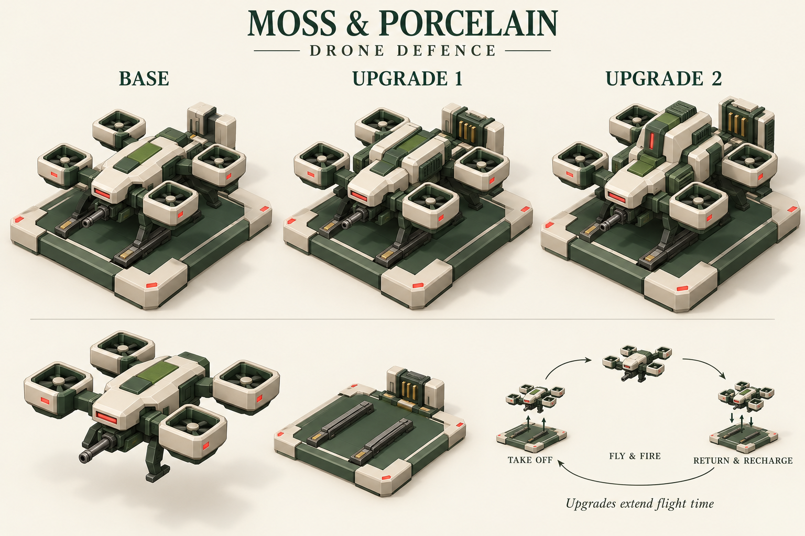

The approved visual direction uses four square shrouded lift fans, an underslung gun, increasing battery housings and a low docking pad in the existing porcelain/forest-green palette. Modelling now covers all three stages, with the pad stationary and the drone, rotors and gun independently articulated. The user accepted the revised production models and authorised an A1 combat test after A4 carving.

**Latest model revision:** remove all legs/skids and replace the single gun with twin barrels on every stage. At rest the aircraft hovers slightly above its pad, so its fans keep turning there too. The concept image predates this explicit revision. Two barrels do not by themselves double damage or the round count; barrel sequencing remains a later combat-presentation choice.

**Fan movement:** opposite spin directions for diagonal pairs and automatic motor spin in both pad-hover and flight inspection. The earlier landed/spin-down review is superseded. The latest rig retains provisional 28-radian/second opposing rotor spin. Complete fan housings tilt independently for travel and yaw; the aircraft stays level, superseding the initial five-degree body lean.

**Revised models approved:** the family has a common22×22 footprint and docked heights14/16/19. Each variant now has twelve rigid parts: fixed pad, flying body, four tilting fan housings, four nested spinning rotors and separate gun yaw/pitch. The fan revision recesses the lower mounting area while preserving the neutral outside silhouette. Small identity accents use emission1 and cast light; all armour stays matte. The [interactive review](/tools/drone-review.html) supports pad-hover/flight inspection poses, A–D palettes, day/night, moving fans and gun inspection. [Model contract and validation](drone-model.md). The user accepted these models before requesting the A1 test.

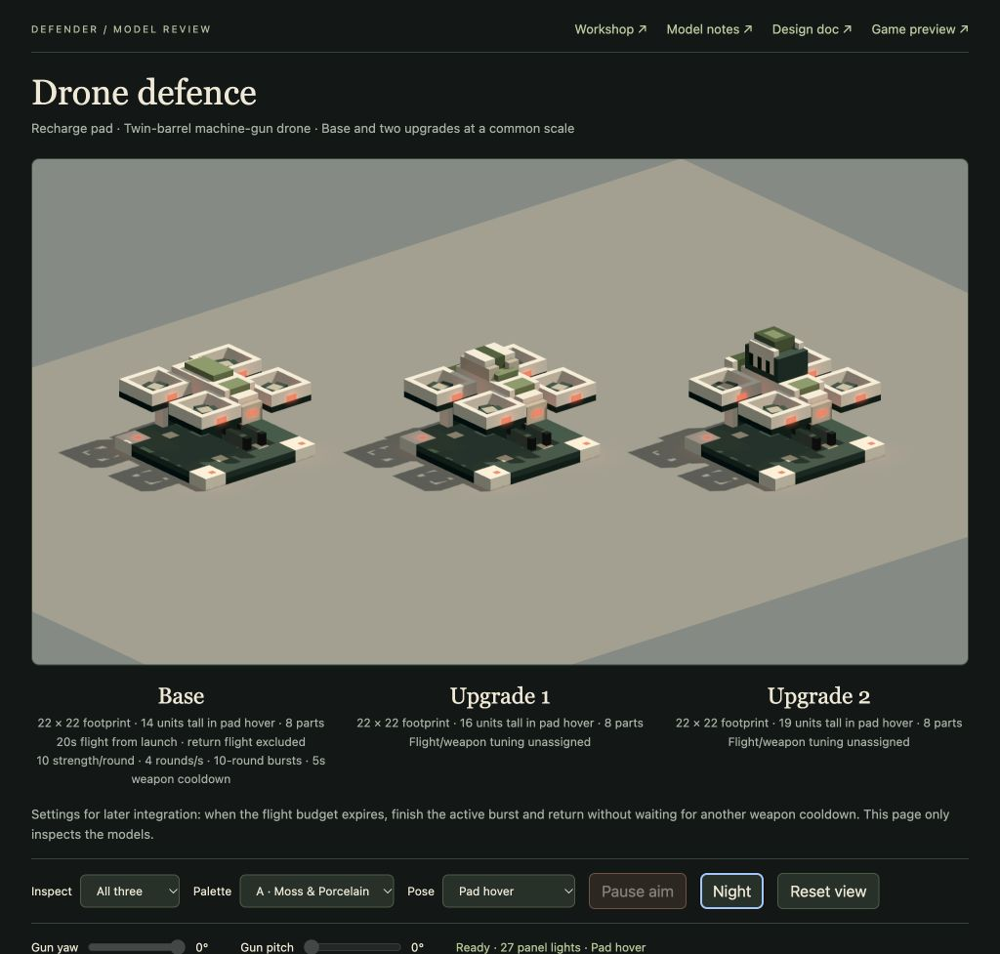

The initial legless model passed six geometry tests and the turret-palette regression. The latest fan revision passes eight focused model checks, including compound steering and simultaneous fan/gun clearance. Live review confirms the two-unit powered pad hover, opposing rotors, independent fan tilt, gun articulation and lighting with no GPU errors. The previous single-barrel/skidded captures are historical. [Current evidence and limits](drone-model.md).

The drone predicts the enemy along its complete route, including corners, at its estimated arrival and next weapon-ready time. A bounded shortlist of twelve positions is checked against the actual rounded travel route and a future firing window of up to ten rounds. It commits while travelling and holds a useful station. A dead/unsafe target, lost range or gun elevation, or a materially more urgent threat releases that commitment. A living target that needs repositioning is preferred again when reachable. Station spacing is separate from damage promises; only a valid active burst can reserve damage.

Avoidance uses a proven asymmetric aircraft hull, actual posed solid actors and time-matched short trajectories. Global route planning considers current actor positions; only an imminent conflict interrupts flight. Straight routes use exact swept-box clearance, while curved turns retain conservative certification. Drones share intended motion and stable right-of-way; a yielding aircraft moves to a useful safe passing position instead of repeatedly retreating along the same corridor. Stale warnings are withdrawn after revalidation, and return flight clears attack-only braking flags. Ground-critter forecasts respect the fixed defence volumes already forbidden by wildlife navigation, without ignoring current critter contact. Exact neutral poses are written before descent. These are bounded local flight controls, not a general physics or crowd solver. [Current audit, evidence and limits](drone-controls-audit-2026-10-18/README.md).

The flight controller eases acceleration and braking, keeps useful firing destinations, and rounds route corners only where the complete aircraft envelope clears obstacles. Fan tilt mixes collective acceleration/braking with differential yaw torque; the body remains level. The latest visual retune doubles combined fan travel to 20 degrees, enabled at least six units above the resting pose. Front fan mounts rise one unit to clear the gun. Cruise and launch/descent speeds increase 50% to 72 and 48 units/second, with faster acceleration/braking and yaw response. Return alignment uses fan steering and waits for neutral housings before descent. These are provisional presentation/control values; the approved weapon, flight and recharge values below remain unchanged. [Current implementation and evidence](drone-motion-2026-10-18/README.md).

**Approved targeting intent:** prioritise enemies nearing the level exit and nearly destroyed enemies that are outside other defences' range. Account for the enemy's own complete route when comparing exit urgency. The A1 controller now uses the shared threat/time-to-exit ranking plus a provisional finish-target bonus below 100 residual HP when outside other active weapons’ ranges. It considers only certified damage commitments; pursuit and loaded rounds are not promises. Uncertain airborne/impact poses receive no speculative future-shot credit. Exact weights remain provisional. [Targeting handoff](defence-targeting.md#drone-priority-requirements).

**Approved base starting values:** 20 seconds of flight time measured from launch; return travel is outside that budget. Each machine-gun round has the base turret's strength (currently 10 HP), at **4 rounds/second** (0.25-second gap), in **10-round bursts**, with a **5-second weapon cooldown after the last actual round**. If the flight budget expires during a firing phase, finish that active burst, then return immediately; no new burst starts after expiry and return does not wait for the weapon cooldown. The nominal 20 seconds may therefore extend only to finish the active firing phase. Return to base and **10 seconds of recharge** remain distinct from the weapon cooldown.

A4 is approved and the A1 test is implemented. [`shared/drone.js`](../shared/drone.js) separates the approved base timings from provisional 72-unit horizontal gun range, 72-unit/second travel and 24-unit attack lift above the resting bind pose. Cached navigation uses higher transit layers where needed, conservatively clears scenery, and returns each aircraft to its own stationary pad. Firing requires settled flight, mechanical aim limits and both actual muzzle rays clear; twin flashes deliver one 10-HP damage event per round. Upgrade values, costs and enhancer interaction remain open. [Implementation, limits and evidence](a1-drone-test-2026-10-18/README.md). [Concept notes](concepts/drone-defence-moss-porcelain-v1.md) · [Generation prompt](concepts/drone-defence-moss-porcelain-v1.prompt.txt).

## Shared attack rules and current weapon values

Maximum range is **inclusive horizontal centre-to-centre distance in XZ**, measured from the defence centre to the enemy's actual root/navigation centre. For a drone, use the current aircraft centre, not its fixed recharge pad. Enemy radius, muzzle reach and visual lightning length do not extend admission range. Strength means HP removed by one validated attack, not damage per barrel, spark or frame. Fractional damage is preserved. Health clamps at zero and dead enemies cannot take further damage.

Every weapon stage has explicit range, strength and line-of-sight policy, separate from geometry and firing cadence. All values below are **unmodified strengths before a generator bonus**. The base gun's 48-unit range is user-set; other range/damage/reload settings are current provisional preview balance. The approved launcher wells define 2/4/6-round magazines; the user subsequently set every missile launch gap to 1.0 second. An inactive model stage must not acquire an invented firing rule.

| Weapon | Stage | Maximum range (units) | Strength (HP per attack) | Attacks per burst / magazine | Minimum interval (s) | Cooldown / empty reload (s) | Direct LOS | Status |
| --- | --- | ---: | ---: | ---: | ---: | ---: | --- | --- |
| Gun | Base | 48 | 10 | 1 pulse | — | 1.0 cooldown | Required | Active hitscan |
| Gun | Upgrade 1 | 72 | 12 | 3 pulses | 0.12 | 1.0 cooldown | Required | Active hitscan |
| Gun | Upgrade 2 | 96 | 0 | Unassigned | — | Unassigned | Required | Shared preview attack inactive; play-only profile below |
| Arc Spire | Base | 48 | 30 | 1 pulse | — | 1.4 cooldown | Required | Active hitscan |
| Arc Spire | Upgrade 1 | 72 | 40 | 2 pulses | 0.20 | 1.4 cooldown | Required | Active hitscan |
| Arc Spire | Upgrade 2 | 96 | 55 | 3 pulses | 0.20 | 1.6 cooldown | Required | Active hitscan |
| Missile launcher | Base | 72 | 60 | 2 missiles | 1.0 | 4.0 full reload | Curved flight checked | Active physical projectile |
| Missile launcher | Upgrade 1 | 96 | 75 | 4 missiles | 1.0 | 4.5 full reload | Curved flight checked | Active physical projectile |
| Missile launcher | Upgrade 2 | 120 | 90 | 6 missiles | 1.0 | 5.0 full reload | Curved flight checked | Active physical projectile |

`/play/` separately resolves Gun Upgrade II to 14 strength, five pulses at 0.12-second gaps and a one-second cooldown, with required LOS. The latest Zone A player ranges are 48/66/84, so Upgrade II now uses range 84. These provisional player values do not mutate this shared preview table.

Gun/Arc cooldown starts after the **last actual pulse**, including a prematurely cancelled burst. Live controllers emit at most one current attack per weapon per frame; they do not replay missed historical shots against stale poses. Minimum gaps may therefore be longer by a frame. Every actual shot independently validates its current target.

Sources: [immutable attack data and prices](../shared/defence.js), [gun/Arc firing and articulation](../shared/arsenal.js), [missile timing](../shared/missile-flight.js), [health](../engine/health.js), [combat](combat.md).

### Gun turret

**Ground-first priority, 21 October (implemented for review):** a stationary gun must not target or retain a flying enemy while any living active ground enemy is within its inclusive horizontal actor-root range. This overrides air urgency, damage coverage, acquisition holds and an already firing air burst. Obscured or pitch-unreachable ground still suppresses air; actual ground shots require the ordinary aiming and LOS checks. Arc, silo and mobile combat Drone priorities are unchanged. [Implementation and regressions](combat-camera-follow-up-2026-10-21/ground-targeting.md).

The accepted turret has a fixed pedestal, yawing head and paired barrels on a pitching/recoiling cradle. One paired-barrel pulse applies strength **once**. Gun delivery is immediate hitscan; there is no travelling bullet or implemented random miss roll.

The head tracks continuously through bursts and cooldown, at up to **360°/s** and **2,400°/s²**. Barrel pitch is mechanically limited to **−35° to +35°**, at up to **180°/s** and **1,200°/s²**. Firing requires no more than **2° error on each axis**. A target outside the pitch envelope is ineligible; clamping the barrels does not authorise a hit. Recoil is **1.25 units** along the pitched guns.

Both current muzzle-to-torso segments must be clear. Acquisition uses the candidate aimed pose; actual firing uses the rendered yaw/pitch/recoil pose. Static occupied scenery and terrain block LOS, including plants, rocks and ruins; openings in geometry remain usable. Water and enemy actors do not block that query. Current deployed defence solids also block LOS, with the firing unit excluded. Invalid target, death, range loss, obstruction or lost alignment cancels the rest of the burst; another target does not inherit its unfired pulses. Validated pulses have no artificial random misses.

Visual delivery uses paired muzzle flames, local sparks, transient lighting and recoil. Flash dimensions are 2× the original study; each lasts 0.085 seconds, with a 96-unit light radius. These are presentation of a single attack. Sources: [turret model](turret-model.md), [targeting and pitch](defence-targeting.md#barrel-pitch-18-october-2026).

### Zapper / Arc Spire

**TODO 39 implemented for review:** both Upgrade I and II trigger one visible enemy-to-enemy beam at 25% effective strength within half the originating Arc range. Bounded compatible contact sampling and separate primary/secondary visual banks replace the prior incoming-contact/Upgrade-I-only behaviour. [Actual encounters and limits](todo-36-41-2026-10-21/README.md).

All three accepted fixed-mast stages attack. The source is the nearest of the model's four crown terminals in horizontal distance; the mast centre still defines range. Acquisition tests a terminal-to-torso ray. Each actual pulse chooses a random point on an exposed side of the enemy's **current animated mesh facing the source**, weighted by visible projected area, then checks both enemy self-occlusion and static scenery clearance.

If no valid contact is found within sixteen attempts, no damage occurs. The spire cancels its burst and excludes that enemy for **0.5 seconds**, allowing another target to be acquired; a later attempt samples again. Reset clears this exclusion. A successful pulse applies damage once and the short visual contact follows the struck part.

The primary presentation is one thick, pale, unbranched electrical channel with whole-length light and welding-like sparks that fall, land and fade. Both upgraded tiers add one visible enemy-to-enemy channel at 25% effective Arc strength within half the originating Arc's targeting range, using inclusive 3D torso distance and exposed clear contacts. The outgoing source faces the recipient and both ends follow their enemy parts; separate six-slot primary/secondary banks prevent primary-only saturation from suppressing all chains. Actual production encounters verify both tiers. No stun, area damage or travelling projectile is introduced. Arc future damage is not promised by cooperative forecasting because route-centre samples cannot certify its animated random surface contact.

Sources: [Arc model](arc-spire-model.md), [Arc attack policy](defence-targeting.md#arc-spire-preview-tuning-18-october-2026), [surface sampler](../engine/arc-impact.js).

### Missile launcher and projectile

**21 October nearby-flyer correction (implemented for review):** powered flight now refreshes a physical lead rather than freezing a destination at reignition. This user-requested change supersedes the earlier fixed-point design; terminal cutoff and target-death flights remain inertial/last-position respectively. Admission forecasts the same guidance and actual future flyer body contact, preventing rejection based on ground behind an already-hit target. It still permits obstacle-free forecasts without proven contact; admission is not a hit guarantee. [Paired evidence and limits](combat-camera-follow-up-2026-10-21/missile-interception.md).

**TODO 41 implemented for review:** missile admission and actual swept flight include live defence cuboids at current rigid poses, with launcher self-exclusion, earliest contact and deployment revision invalidation. Actual Arc-tower collision tests pass at 30/60/120 Hz; ordinary gun/Arc LOS already includes defence solids. [Implementation and checks](todo-36-41-2026-10-21/README.md).

**20 October follow-up, implemented:** admission now forecasts the actual boost, coast and powered turn with the shared flight integrator, using the next occupied socket and full missile clearance sphere against terrain/scenery. Blocked trajectories retain ammo and readiness and may yield to another target. Forecasts use current aim velocity; later target turns/death can still change the outcome, so actual swept contacts remain authoritative. Powered homing emits 24 smoke puffs/second from the real tail; stop new puffs at engine cutoff and fade existing puffs over 2 seconds, up from the first 0.8-second delivery. Starting radius is now 3.2 and peak opacity 0.90. Smoke capacity grows from128 to384 to support the longer trails, adding12,288 GPU bytes; shaders/passes are reused. [Evidence](play-notes-2026-10-20/README.md).

The accepted launcher has **2/4/6 upward-facing wells** and a separate `guided-missile` model. A successful launch consumes one loaded round. The magazine must become empty before its full timed reload begins; there is no early top-up, partial refill or firing during reload. A partially full magazine can wait for a useful target without losing ammunition or advancing its next launch deadline. These rules apply equally to all three stages.

Launch admission checks a living target within horizontal range and a scenery-clear predicted curved flight, without requiring a straight ground-level LOS. The curved flight itself must reach its assigned enemy. The missile keeps the original target identity and route lap and does not retarget to another enemy. It may continue beyond its original acquisition range.

| Flight phase | Current implemented tuning and behavior |
| --- | --- |
| Vertical thrust burst | **64 units/s for 0.50 s**, giving a **32-unit rise**; exhaust flame and local light on. |
| Engine-off coast and rotation | **0.40 s**; existing momentum continues under **40 units/s² gravity**; attitude can turn at **360°/s**. No freezing or hovering; exhaust/light off. |
| Predictive powered attack | Refresh a bounded acceleration-aware intercept while powered. Undisturbed flyers use their authored future curve, yaw and bank; impact motion uses actual torso velocity. Commanded speed **180 units/s**, acceleration **630 units/s²**, turn cap **240°/s** with existing 0.85–1.15 variation and eased attitude. Compensate sideways launch momentum. Existing exhaust/light and no approach braking remain. |
| Terminal inertial approach | Within **22 units**, latch cutoff only when velocity is forward, at least 98% cruise speed and passes within one unit of the predicted point. Then freeze guidance and preserve velocity/attitude; no steering, acceleration, braking, gravity or reignition. A close physical impact can occur before cutoff is safe. |

Prediction is approximate because finite turns/acceleration and later enemy direction changes remain real. Misses are explicitly permitted. A passed empty destination releases its damage claim immediately; the missile continues forward until real ground/scenery contact or release. Passing the point alone causes no explosion or damage.

When its enemy dies, a missile retains that enemy's final finite actual aim position, rather than acquiring a different target. It can steer to that position before terminal cutoff; cutoff prevents any subsequent physical redirect. Such an orphan flight deals no new enemy damage. Removal, replacement, route wrapping or invalid geometry also invalidate a target claim; reset/unload releases flights. The implementation bounds flight life to **8 seconds** and discards existing flights after a frame stall longer than **1 second**. These safeguards are not campaign rules.

Damage occurs **only at physical contact**: sweep the missile nose against the assigned enemy's current exposed articulated faces, compare with terrain/scenery obstruction, and resolve the first contact. Static collision conservatively encloses the missile body; it can stop a near-corner flight before a visible model edge touches. Flights are not obstacle-planned. Static terrain/scenery impacts cause no health damage. There is no proximity detonation, splash damage, retargeting or generic enemy interception.

Every real enemy or static-surface contact produces the accepted compact hot explosion and brief warm light. Current visual tuning is an **8-unit blast size**, **0.04-second onset**, **0.32-second flash**, and light strength **26**, radius **52 units**, duration **0.26 seconds**. Impacts scatter nearby cosmetic wildlife, including birds, within **48 units in 3D**, even if a visual blast slot is unavailable. This radius does not deal damage or push enemies. Successful launches emit **eight warm-grey smoke puffs lasting 1.3–1.8 seconds**, drifting outward/up; there is no continuous smoke trail. Enemy-death blasts take priority over missile flashes in shared visual pools.

Sources: [current missile rules and collision limits](missile-combat.md), [flight data](../shared/missile-flight.js), [launcher and missile models](missile-launcher-model.md), [impact/launch effect data](../shared/damage-effects.js).

## Power generator and enhancement

**21 October — current design:** the Power Generator is a placed, non-attacking, **single-version enhancer**, now purchasable and deployable in `/play/`. It costs **4 tokens** (provisional balance chosen above the 1/2/3-token weapons), is offered from the beginning when affordable, and has **no upgrades**. Only its base 22 × 22 × 14 model is playable. Previously approved taller model variants remain historical authoring geometry; the +50%/+75% gameplay records and review upgrade choices are removed.

The generator increases defence strength by **25%**. Fire-rate increase and cooldown decrease remain zero; it does not change range, cadence, magazines, reload or missile movement. The shared enhancer contract now contains only `base`, with finite 0–1 scalar fields kept separate from geometry and weapon stats.

It benefits attacking defences in any of the **four edge-sharing placement boxes** on the same dry path-height ground. Cardinal box centres are 24 units apart. Diagonal neighbours and two-box gaps do not qualify. It can enhance all four at once, activates only with eligible recipients, and does not enhance itself or other generators.

Bonuses do not stack: only the strongest applicable increase applies once.

`effective strength = original strength × 1.25`

Fractional values remain valid: a 10-HP pulse becomes 12.5 HP. Gun/Arc hits and planner forecasts use effective strength. Missiles capture effective strength at launch for incoming-damage accounting and eventual contact; no second multiplication or retroactive aura change occurs.

Purchase, ownership, recall, relocation, wave preparation, weapon upgrade and level transfer use the ordinary campaign flow. Deployment edits rebuild cached adjacency before combat, and reset derives from original strengths without compounding. Generators obey the same dry-ground, occupied-solid, scenery, route and enabled wildlife clearance rules. They block weapon LOS and physical missiles as real scenery-sized defence solids; they never join the attack planner.

Active connections use the approved green plasma tube with pale core, fixed model-surface anchors and full-length illumination. Existing motion remains displacement `min(0.6, link length × 0.05)`, phase rate 6.4, width 0.8, light strength/radius 1.8/14, 32 visible spans and eight light spans. The bounded visual pool now supports 128 connections: the campaign's 128 available tokens buy at most 32 four-token generators, each with four neighbours (a conservative bound before recipient costs). Visual overflow never suppresses actual enhancement. No new production pass or viewport texture is added.

The arsenal shows the 25% bonus and price; the roster has no enhancer upgrade control. Deployed weapons display their effective damage. Generator hover highlights current edge-adjacent recipients rather than an attack-range circle. Models, effects, campaign tuning and active player appearance remain for review. [Delivery and checks](enhancer-campaign-2026-10-21/README.md).

Sources: [enhancer data](../shared/enhancer.js), [runtime adjacency](../game/enhancer-preview.js), [generator model](power-generator-model.md), [accepted plasma concept](concepts/power-generator-plasma-link-v1.md).

## Enemies, damage and recovery

**Running withdrawn and rolled back, 20 October (latest):** the user rejects the isolated gallop prototype and requests removal of everything related to running. Enemies again use their ordinary configured walking/flying speeds and authored routes; the accepted thirteen-part Dog retains its diagonal walk. Removed escape certainty/acceleration, the bounding gait/body bank, rounded runtime corners and associated traffic/merge controls, along with the isolated articulated model/review and run-only tests/scripts. The brief trial used 3× straights under the user's prototype-only instruction; neither that speed nor its rig was integrated into production assets. The research and implementation paragraphs below are historical and superseded. Gentler water ripples, GUI, level conditions, targeting fixes and Zone A balance remain. No further running work is active. [Rollback evidence](run-rollback-2026-10-20/README.md).

**Dog gallop research, 20 October — proposal, not implemented:** the user finds the first running pass insufficiently canine, especially its almost level body, and supplies a greyhound's extended airborne pose. Researcher audits primary locomotion studies and the production rig in [the gallop brief](research/canine-gallop-rigging-2026-10-20.md). Current full-run body excursion is only 0.35 units; a fixed short stride drives roughly five cycles/second at 2× pace, and the rigid torso/head cannot gather and extend. Recommend a phase/contact-driven gallop with visible flight and landing compression, longer strides, and an isolated comparison of the existing rig against separately controlled chest, pelvis and head. Anticipatory braking for tight bends should use the actual runtime curve, then smoothly regain speed. Retain the approved roughly 2× straight cap; any greater speed or production model/hierarchy revision remains a proposal. Existing tests establish sampled safety, not acceptance of the running appearance. This research pass changes no runtime or assets.

**Certain escapes and softer ripples, 20 October:** the user requests gentler water-impact edges and faster movement only once an enemy cannot be destroyed; confirms about 2× normal speed. Impact rings now use 0.30 peak opacity and restrained water-tinted crest/trough shading. `/play/` proves impossibility from remaining route/weapon opportunities, a generous isolated-actor damage ceiling and all physically live assigned missiles (including passed-aim rounds); uncertain traffic cases keep walking. Accelerating runners/flyers brake behind same-band actors and reserve passage at merges. Dogs gain a true airborne bounding gait, IK-supported paws, body bounce and damped corner lean; running bends round within the authored corridor. Shared walking previews, profiles, economy, assets and source layouts remain unchanged. 125 distinct affected checks pass; all sixteen unarmed waves complete, and the mixed strategy still clears 168 enemies without misses. Appearance/motion tuning awaits user review. [Evidence](escape-running-2026-10-20/README.md).

**Scope and proof limits:** certainty deliberately overestimates possible future damage rather than using the targeting planner’s coverage promises. Active/scheduled same-band traffic prevents the isolated damage-ceiling proof; it does not prevent proving that every remaining weapon window is already behind the enemy. Running never bypasses misses or missile contact. Current Zone A legged runners are Dogs; other-zone campaign activation remains separate work. [Decision, traffic and animation details](escape-running-2026-10-20/README.md).

| Zone | Model/source ID | Current model | Maximum health (HP) | Route speed (units/s) | Threat |
| --- | --- | --- | ---: | ---: | ---: |
| A | `dog` | Mechanical quadruped | 300 | 12 | 1 |
| B | `walker` | Articulated biped | 300 | 18 | 1 |
| D | `spider` | Four-legged low mechanical walker | 300 | 12 | 1 |
| A | `roller` | Two large wheels, upright core | 360 | 16 | 1 |
| A | `moth` | Four hinged wings, airborne | 180 | 20 | 1 |
| B | `dune-tread` | Low tracked chassis | 420 | 10 | 1 |
| B | `twin-fan` | Twin lift fans, airborne | 240 | 18 | 1 |
| C | `tripod` | Three articulated legs | 280 | 14 | 1 |
| C | `ray` | Flying wing, airborne | 220 | 22 | 1 |
| D | `lantern` | Suspended rotor pod, airborne | 260 | 16 | 1 |

The user removed the additional Zone D ground enemy entirely after the Concertina, Tumbler and Monowheel trials. Zone D currently has Spider and Lantern only; another design is undecided. The retired `concertina` model, generator, rig, stats and movement entry are removed, rather than hidden from the roster. [Removal record](enemy-expansion.md#zone-d-ground-enemy-removed-18-october).

These are implemented preview values, not final enemy roles or campaign balance. A/B retain three original actors plus two instances of each new type (seven total); C has two Tripods and two Rays (four total); D has three Spiders and two Lanterns (five total). All three studies in a zone share its roster. Earlier Brambleback and Cinderhaul proposals were set aside; they are not extra active enemies. Enemy armour, resistances, special abilities, attacks, bosses and wave composition are unassigned.

Current enemies follow the authored X/Z route with individual speeds and independent laps. Ground actors walk, roll or move on tracks; flyers use a root altitude 36 units above the path and animated wings/rotors or banking. Turrets use actual height and their existing pitch/LOS limits; Arcs and missiles test actual animated geometry. Surviving enemies loop without healing. Death is synchronous at zero HP: stop animation, remove the actor and its eye lights, and retain removal until manual reset, refresh or returning to the scene. There is no automatic respawn or implemented escape penalty.

Living enemies emit damage smoke **strictly below 50% health** (for example, below 150 of 300 HP). Death produces a concentrated **0.55-second blast**, light with peak strength 44 and 96-unit falloff radius, a **0.7-second visual refractive wave**, and spinning model-coloured cubes that collide, settle for **1.5 seconds**, then vanish. Dog/Spider use 24 cubes and a 12-unit blast size; Walker uses 28 cubes and size 14. New ground enemies use size 12/24 cubes, except Dune Tread at 14/28; Moth uses 8/16 and the other flyers 10/20. Fright radius is six times blast size (48–84 units). There is no separate death-smoke burst. Death explosions frighten wildlife within **72 units for Dog/Spider and 84 for Walker**, measured in 3D. Neither fragments nor optical waves deal splash damage or apply gameplay forces.

Nonlethal missile hits also cause the accepted directional **stagger and recovery**. The whole actor shifts in the incoming horizontal direction, with safe torso tilt/brace where its rig and route allow it, then returns to the unchanged canonical gait and route. Current provisional tuning uses a **32-unit/s impulse**, **3-unit maximum displacement**, **4/s critical damping** and **2-second recovery**. Steep hits retain at least 65% push; nearly vertical hits use forward facing. Clearance can reduce the response; Dog corners use a guarded skid instead of unsafe torso tilt. Repeated impacts remain bounded and continuous. Lethal hits add no new kick; reset, route wrap and unload clear the response. This is not a stun, slow, ragdoll, extra damage or a change to route progress.

The new ground rigs use a guarded whole-body skid; flyers use guarded airborne sway without requiring a grounded sole. The legacy three articulated enemies retain their existing supported stagger.

Targeting, physical collision, effect origins and published velocities use the actual displaced/animated body. Speculative route damage forecasts are suppressed during recovery, while ordinary actual-position shots remain allowed.

Sources: [enemy stats](../shared/enemy.js), [enemy controller](../game/enemy-preview.js), [Dog gait](../engine/dog-gait.js), [Walker/Spider gait](../engine/articulated-gait.js), [original models](enemy-models.md), [enemy expansion](enemy-expansion.md), [impact response](enemy-impact.md), [damage effects](damage-effects.md).

## Coordinated targeting and missile damage claims

**20 October air-targeting correction:** horizontal XZ admission range was already active. The reported A2 guns were sometimes waiting on a future Dog reservation while an uncovered Moth was currently hittable. A reserved enemy absent from the current eligible list no longer forces idle time when an uncovered alternative is available: the gun drops that future damage promise and chooses the live target. Hittable reservations, already-covered alternatives, valid bursts and mechanical pitch limits retain their existing rules. The reported six-gun A2.1 replay now destroys all seven enemies, with both upgraded guns firing at Moths. [Evidence and remaining pitch limitation](air-targeting-2026-10-20/README.md).

All weapons share **one round-robin candidate-ranking pass per frame**. Every defence still validates its live target, aims/animates and checks actual shots each frame. Cosmetic wildlife is never a candidate. Invalid locks clear immediately; replacement selection waits for that defence's scheduled thinking turn.

The provisional priority is threat divided by remaining seconds to the current route exit, with a one-second floor. Uncovered enemies rank before covered enemies. Within a 10% urgency band, fewer pulses to kill, route progress, distance and stable ID break ties. A valid target is held for at least **0.35 seconds** and through a valid burst. After that, a useful uncovered alternative or a challenger at least **25% more urgent** can justify switching. These are targeting-tuning rules, not new enemy abilities.

The planner separates two kinds of commitment:

- **Actual launched missile damage P:** captured damage from still-valid missiles assigned to the exact living enemy and route lap, including the querying silo's own rounds. Loaded ammunition and speculative future launches count zero. Contact, a known miss, death/orphaning, invalidation, expiry, reset and unload release the corresponding claim.
- **Speculative gun damage F:** conservative capacity from other committed guns during their next continuous in-range, visible route window, including aim allowance, cooldown and remaining burst. Each owner can reserve capacity for only one enemy. Arc Spires and future missile volleys contribute no speculative forecast.

For current health **H**, compute **residual = max(0, H − P)**. The target is adequately covered if residual is zero or **F ≥ 1.25 × residual**. This credits launched damage once and applies the safety margin only to uncertain gun forecasts. Fully claimed targets release unnecessary gun reservations. Unknown health is treated conservatively rather than inventing a lethal threshold. Off-centre or airborne/banking enemy aim points receive no speculative route-centre gun credit; actual shots and launched missile claims still use current geometry.

Silos additionally check **H > P immediately before every launch**, with no safety margin. Three launched 75-HP missiles cover 225 HP exactly, so another silo holds its round; at 226 HP another launch is permitted. A known miss makes remaining health available for later launches again. This accounting reduces avoidable overkill but cannot guarantee a hit. Guns/Arcs may finish valid bursts or keep firing when there is no better alternative; the system is not a blanket prohibition on all overkill.

Sources: [targeting policy](defence-targeting.md), [planner](../engine/target-planner.js), [shared controller](../game/defence-preview.js), [flight accounting](missile-combat.md#firing-and-target-ownership).

## Rendering and lighting

The game GUI is native DOM/CSS/SVG, including model-derived vector portraits. The user allows GPU-rendered GUI if needed; no new GPU GUI renderer is required or implemented. Drone has no depth of field; the separate all-zone vistas have no blur kernel as of 21 October. Cam man and handheld film effects have been removed. [GUI delivery](game-gui-2026-10-20/README.md).

The game renderer uses WebGPU, an initial camera depth-only pass, a shadow-casting directional sky light, instanced geometry and dynamic local lighting. Pass invalidation distinguishes camera, geometry, shadows, opaque lighting and water; unchanged work can be reused. The workshop has a simpler viewport and is not the authority for final effect appearance.

| Capability | Current requirement and behaviour |
| --- | --- |
| Sky and shadows | At least one shadow-casting sky light per level. Time of day is an authored, fixed level setting. Moving geometry can update shadows. |
| Model emission | Face `emission` is a normalised 0–1 artistic value. `castsLight: true` independently opts an emissive face into surrounding illumination; emission alone does not. Flags survive overrides, meshing, export and recolouring. |
| Local model light | Connected exposed emissive panels become bounded sources following their rigid parts and visibility. Current sources approximate panels with unshadowed point lights; spill can pass through walls. This is not an area-light or local-shadow system. |
| Continuous energy light | Arc strikes and generator plasma use finite tube segments, illuminating the full span. Conservative source bounds reject distant shading work without changing the light response. |
| Bloom | Selective source-coloured halos at strength 0.70 (doubled by TODO 38), retaining source masks and blur footprint. Nonemissive armour, paving and terrain stay crisp. |
| Reflection | Screen-space reflections for water and enabled rain-wet paths. All active model materials and new-model defaults have reflectiveness 0. SSR has screen-space visibility limits. |
| Water | Box-aligned translucent surfaces reveal the bed, with refraction and procedural ripple glints. Current reflectiveness is 0.65. No foam or caustics are approved. |
| Particles | Approved muzzle flashes, sparks, damage/death effects, missile launch smoke/thrust, and optional weather. Geometry/data/render-target textures are allowed; effect and GUI textures may be used when needed. Model textures remain prohibited. |
| Indirect lighting / ambient occlusion | Both experiments rejected and completely removed on 20 October. No GI or AO implementation, viewer, cache or renderer hook remains. Historical evidence is retired; no integration follow-up. Existing ambient fill remains. |

Current model-panel light tuning is radius 14 units and strength 0.65. Capacity is 29 model-light clusters, within 77 shared point-light slots: 8 muzzle, 4 damage, 29 model and 36 missile exhaust. A1 is the measured maximum with its generator and seven enemies. Six Arc slots and sixteen generator-plasma links have separate tube-light storage. These are bounded preview implementation capacities, not final campaign entity limits. Overflow must remain observable; pool rules must not silently suppress gameplay damage.

No fog, haze, audio, unrelated post-processing or unapproved effects are enabled by the general rendering capability. See [rendering requirements](rendering.md), [engine implementation](engine.md), [damage effects](damage-effects.md) and [Arc effects](arc-effects.md).

## Audio authoring direction (research only)

A compact team-operated sound recipe/sample workbench with native Web Audio is the recommended initial direction. Keep lossless masters and encode delivery files offline, provisionally Ogg Opus. Native decoded-buffer looping avoids JavaScript scheduling gaps; seamless audio still requires authored boundaries/crossfades and checks after actual browser decoding. Compression reduces delivered bytes, not decoded PCM storage. A verified external encoder is not yet installed. No sound, editor, encoder or final audio budget is implemented or approved through this research. [Code-backed report and source references](research/audio-workflow-2026-10-20/README.md).

## Approved concept gallery

These are design references, not screenshots or dimensional plans. The captions state exactly what was accepted; later model and effect revisions take precedence.

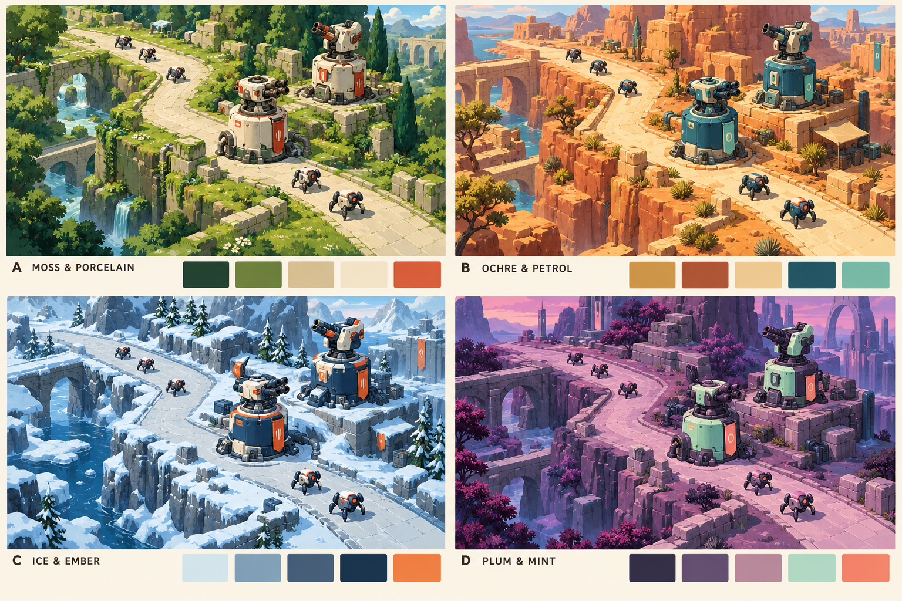

**Approved 17 October 2026 — all four zone colour/mood directions, A → B → C → D.** The depicted setting establishes palette and atmosphere. Specific bridges, props, enemy variants and effects are illustrative unless separately approved. The pictured small quadruped subsequently became the approved Dog reference. [Selection record](visual-style.md#selection-record).

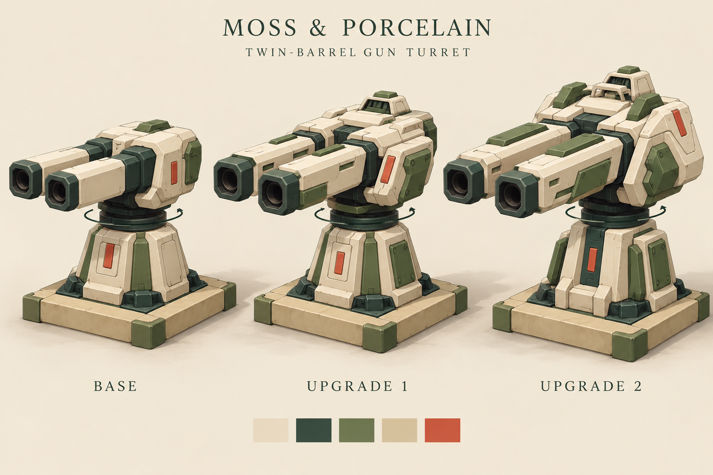

**Approved 17 October — starting gun-turret visual reference, all three stages.** Production later refitted it to the final 24-unit footprint and added the independently pitching gun cradle; this drawing predates that current three-part rig. [Approval and translation](turret-model.md).

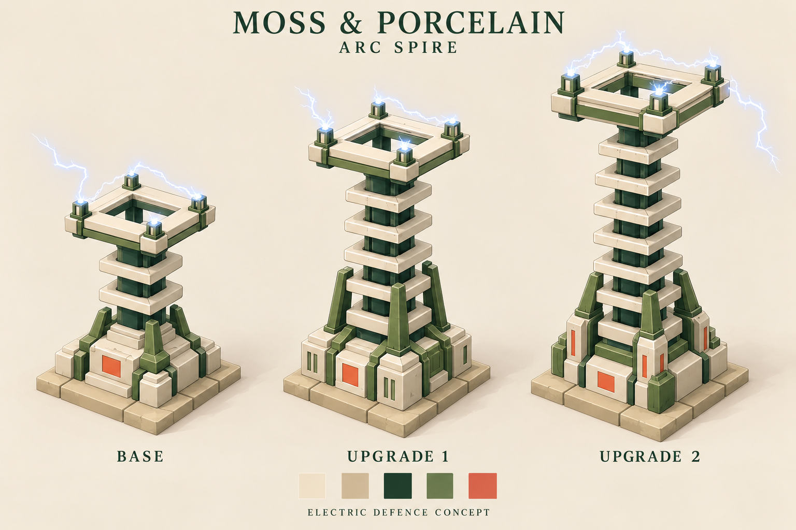

**Approved 18 October — the three-stage electric-defence family; completed models also approved.** The stable source ID is `arc-spire`; the family is also referred to as Zapper. Illustrated arcs are not model geometry. Runtime lightning was approved and tuned separately. [Concept record](concepts/arc-spire-moss-porcelain-v1.md), [model acceptance](arc-spire-model.md).

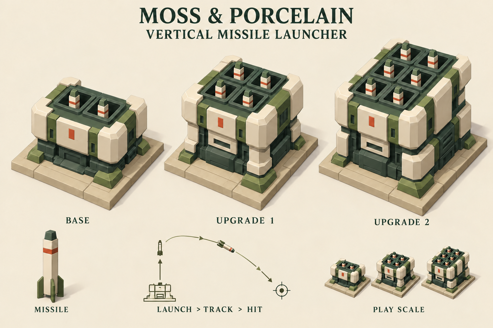

**Approved 18 October — corrected v2 concept, “The concept art looks good.”** Shows 2/4/6 vertical launch cells and the separate missile. The v1 inset missile faced backwards; v2 fixes it. Flight arrows are explanatory annotations, not trails. Exhaust, smoke and impact effects were later approvals. [Approval record](concepts/missile-launcher-moss-porcelain-v1.md).

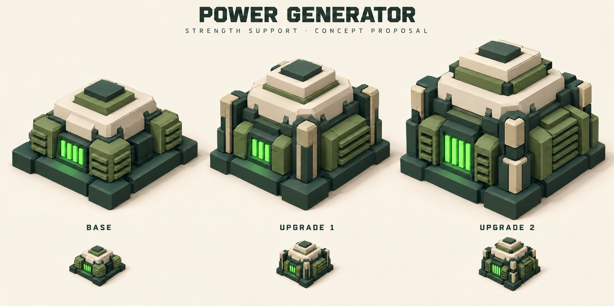

**Approved 18 October — green-highlight v2 concept, “That looks good!”** The user then approved all three finished production models: “Those models look good to me.” The earlier red-highlight v1 is superseded. [Concept record](concepts/power-generator-moss-porcelain-v2.md), [finished-model acceptance](power-generator-model.md).

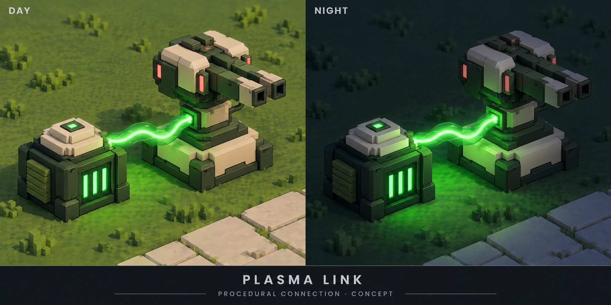

**Approved 18 October — the procedural green connection, “That looks good.”** This day/night sheet is a concept, not a game capture. The later smaller-wave, doubled-speed adjustment governs current motion. [Approval and implementation record](concepts/power-generator-plasma-link-v1.md).

## Production image references

These captures demonstrate specific implemented features. They do not imply that every detail visible in an older screenshot is the latest game state, or that an internal art review is a separate user approval.

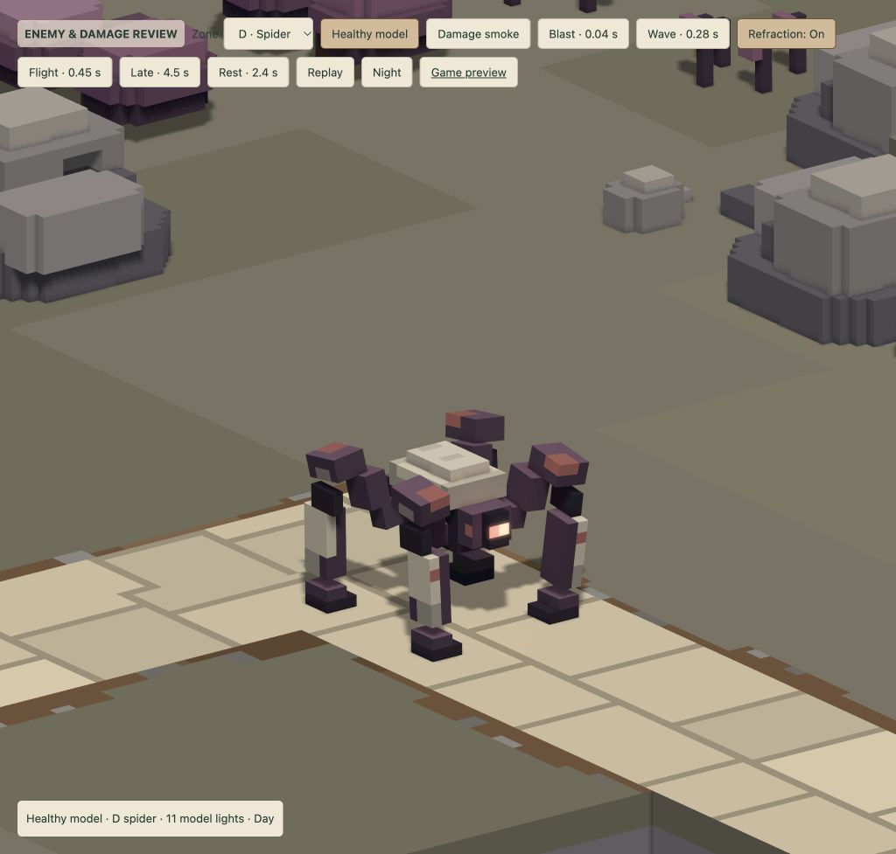

**Production capture, 18 October — current four-leg geometry and eye materials.** This supersedes the six-legged Spider shown in the original lineup and early model reviews. Later stagger work changes its response to hits, not this model. [Revision and eye-light records](enemy-models.md).

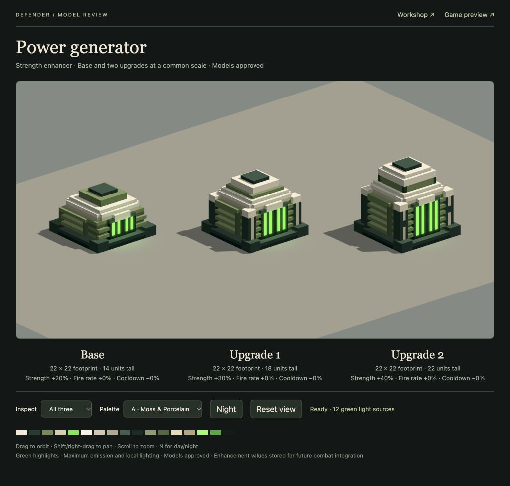

**Production model review, 18 October — all three finished generator models, subsequently user-approved.** Heights, sealed caps, cooling banks and four green meters are visible at common scale. [Night comparison](power-generator-review-night.jpg), [approval evidence](power-generator-model.md).

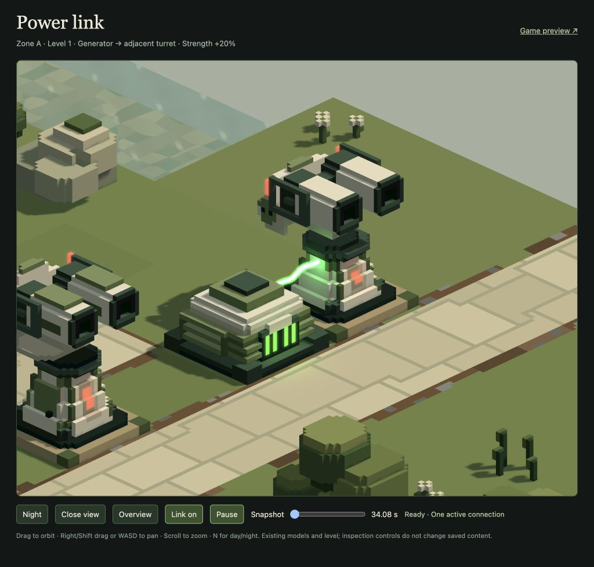

**Production capture, 18 October — current link appearance after the smaller-wave / double-speed follow-up.** It shows real geometry anchors, local green spill and preserved turret identity colour. A still image cannot demonstrate the motion rate; that was reviewed live. [Browser evidence](plasma-browser-review.json).

Additional precise references:

| Subject | Capture | Status and limits |
| --- | --- | --- |
| Current gun family | [Neutral](screenshots/turret-pitch-review.jpg), [depressed at full recoil](screenshots/turret-pitch-depressed.jpg), [raised/yawed at full recoil](screenshots/turret-pitch-raised.jpg) | Current three-part geometry; Artist reviewed both extremes after the user authorised independent pitch. |
| Zapper family | [Day](screenshots/arc-spire-models-day.jpg), [night](screenshots/arc-spire-models-night.jpg) | Production models subsequently approved by the user; these are model studies, not attack captures. |
| Silo family | [Loaded models](screenshots/missile-launcher-model-review.jpg), [later identity lighting](screenshots/missile-highlights-night.jpg) | The loaded-model study shows accepted geometry but predates the separate emission follow-up; use the second image for current lighting. |
| Other enemies | [Dog eyes at night](screenshots/enemy-eyes-dog-night.jpg), [Walker eyes at night](screenshots/enemy-eyes-walker-night.jpg), [Spider eyes at night](screenshots/enemy-eyes-spider-night.jpg) | Current eye-material reviews on accepted models; effects and hit response were refined afterward. |
| Current soil/paving treatment | [A](screenshots/path-soil-a.jpg), [B](screenshots/path-soil-b.jpg), [C](screenshots/path-soil-c.jpg), [D detail](screenshots/path-soil-d-close.jpg) | Brown-soil implementation reviewed in all zones. These environmental milestones predate later gun-rig and combat-effect changes. |
| Optional weather on current edging | [A rain](screenshots/path-soil-a-weather.jpg), [C snow](screenshots/path-soil-c-weather.jpg), [D leaves](screenshots/path-soil-d-weather.jpg) | Weather-enabled review states; all saved zone levels currently start with weather off. |

### Historical images that must not be presented as current approvals

- [Enemy lineup](concepts/enemy-lineup-v1.png): **partial selection only**. B's “Dunewalker” and D's “Spindle” became Walker and Spider. A Brambleback and C Cinderhaul were set aside. The illustrated six-leg Spider is superseded by the four-leg revision. [Selection evidence](concepts/enemy-lineup-v1.md).
- `enemy-models-first-pass.png`, `walker-spider-review.png` and `spider-longer-stride.jpg`: earlier Spider milestones; do not use them to document the current leg count.
- Missile concept v1: superseded by the corrected v2 inset. Power-generator concept v1: superseded by green v2 accents.
- Screenshots named `explosion-smoke-*`: the removed death-smoke trial, not the current death effect. Living damage smoke and missile launch smoke are distinct retained features.
- `path-edging-*`: the initial zone-coloured shoulder before the brown/grey correction; prefer `path-soil-*` for current soil colours.
- Early 15/32-unit model/editor images and the original sparse square layouts are historical. They do not define current scale, route composition or remote scenery density.

## Title and menu screen

**Development notice, 21 October (implemented):** display “Development Preview” clearly above NEW GAME, followed by the smaller “Saves are disabled for now”. This is title-screen copy; gameplay and graphics preference persistence are unchanged. Verified in the actual 1280×720 title screen.

**21 October current options:** the title includes Critters, Reflections and Bloom switches, default on and saved locally. Critters includes ground animals, birds and fish; off omits their resources/simulation and cosmetic placement constraints. Reflections off retains water tint/transparency/refraction/ripples; Bloom off retains lights and emissive surfaces. These apply across the campaign and can be changed from the title only. [Implementation, verification and inherited test limits](graphics-options-2026-10-21/README.md).

**Deployment workflow, 21 October (latest user correction):** [Deployer](team/deployer.md) runs `bun run deploy:local`, which clears `docs/` and rebuilds only the static game at `docs/index.html` and `docs/site/`. `docs/` is the GitHub Pages document root, so Markdown/text notes, debug files, review evidence and packaging metadata must stay outside it: documentation lives in `project-docs/`, manifests/logs in `build/deployment/`. Preserve development sources and strip debug code from delivery copies, while retaining the approved bottom-bar FPS/frame/CPU/GPU readout, its styles and CPU/asynchronous GPU sampling. Inspector datasets and developer controls remain excluded. Finish after packaging; tests, browser checks, preview servers, playthroughs and reports require an explicit request. No commit, push or publication is implied.

**Current, 20 October:** the delivered GUI above replaces the generic serif title, boxed D, promotional copy and cream arrow button with a game wordmark/path emblem, a single New game command and zone-run information over the preserved scenery. The three graphics controls above are implemented; a separate Settings page and Credits functionality have not been added. The artwork descriptions below are historical concept approvals; the new GUI awaits visual review.

**Visually accepted for now, 18 October 2026.** The user said, “That looks good, let’s keep that version for now.” “Defender” is the working title. The latest user direction removes all defences and enemies from the concept, leaving a scenery-only Moss and Porcelain background with the title/menu layout retained.

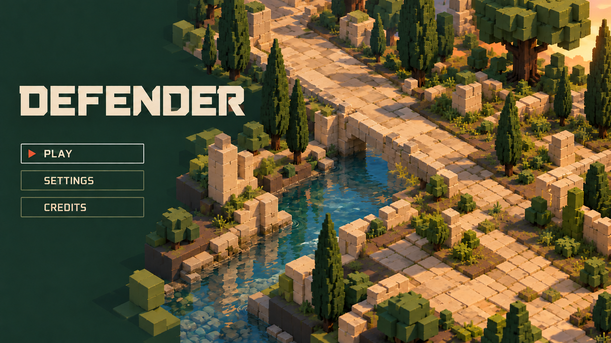

V3 removes the four defence units, both Dog enemies, mounting pads, green plasma and unit lighting; paving, soil and vegetation restore the scene. The stream, bridge, ruins, trees and warm lighting remain. V1 and the subsequent production-model-referenced v2 are historical iterations. Play, Settings and Credits are accepted visual labels. The signed first delivery is integrating a working title/Play flow at `/play/`; implementation/verification are in progress. Settings and Credits functionality remain outside that delivery, and visual concept acceptance does not imply a complete menu. [Saved prompt, generation method and review status](concepts/title-menu-moss-porcelain-v3.md).

## Additional enemy concepts

**Approved for modelling and mixed combat previews, 18 October 2026.** The user requests multiple enemy types per zone, including ground and airborne. The initial expansion explores eight new mechanical silhouettes; the existing Dog, Walker and four-legged Spider stay unchanged.

| Zone | New ground candidate | Airborne candidate |
| --- | --- | --- |
| A · Moss and Porcelain | Roller — paired large wheels and upright core | Moth — four hinged rectangular wings |
| B · Ochre and Petrol | Dune Tread — low wedge on two track pods | Twin Fan — two square fan housings |
| C · Ice and Ember | Tripod — three articulated legs and raised body | Ray — broad flat flying wing |
| D · Plum and Mint | Original Concertina — removed; replacement undecided | Lantern — vertical pod below one rotor frame |

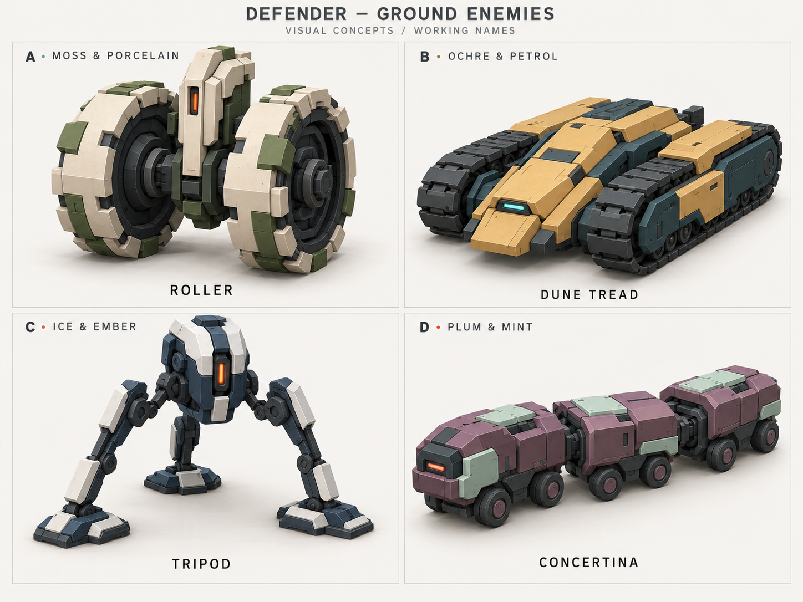

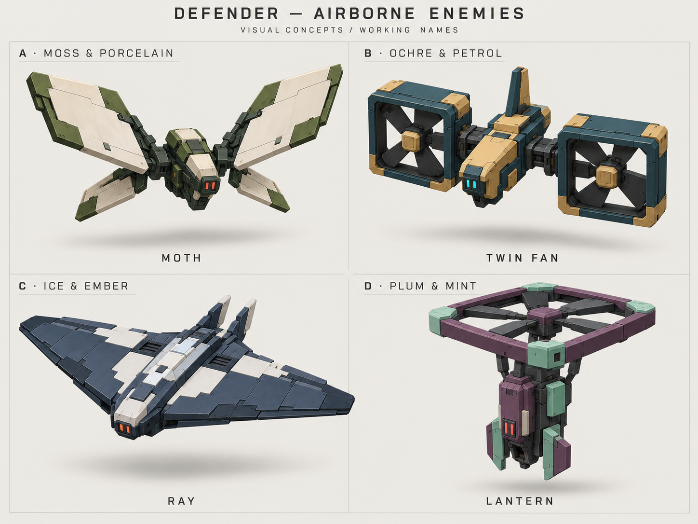

The user accepted all eight designs and requested production models, sensible default values and placement alongside the existing enemies. **Later revisions:** D Concertina was replaced by a Tumbler ball, then by Monowheel: one large central wheel with body housings on either side. The user subsequently removed this enemy entirely; all three forms are historical, and the `concertina` asset ID is no longer active. Their latest production feedback matches Concertina/Lantern’s pale panels to the Spider’s off-white instead of the concept’s mint-blue. The production models and mixed ground/air integration are described in [expansion notes](enemy-expansion.md). These illustrations require grid translation and motion-clearance checks. No new abilities, enemy attacks or wave content are implied. [Design notes and full prompts](concepts/enemy-expansion-v1.md). [Actual model captures and default values](enemy-expansion.md#production-review-captures).

## Preview levels and controls

Sixteen development views provide four levels in every zone, all **20×16 boxes (480×384 units)**. All eight Zone A/B layouts are user-approved. A1 now tests two base drones against two Dogs and one Moth. A2–A4 and B1–D4 contain routes and wildlife without combat units in `/game/`; the complete finite campaign runs separately in `/play/`. C/D carving is implemented for review, including the C2/C3 and D4 wooden crossings. Existing cosmetic wildlife remains. Previous weapon studies and carved layouts are archived.

| View | A / B / C / D source IDs | Current contents |
| --- | --- | --- |
| Level 1 | `moss-01`, `ochre-01`, `ice-01`, `plum-01` | A1: Southern Hook with two base drones, two Dogs and one Moth. B1: Cistern and Mesa Circuit layout. C1/D1: unchanged populated landscapes without combat units. |
| Level 2 | `moss-02`, `ochre-02`, `ice-02`, `plum-02` | A2: approved Garden Crossing path/clearing layout and wooden bridge. B2: Riverfold Crossing layout with a two-box wooden bridge. C2/D2: unchanged populated landscapes. No combat units. |
| Level 3 | `moss-03`, `ochre-03`, `ice-03`, `plum-03` | A3: approved Garden Confluence merging layout and short wooden bridge. B3: Mesa Confluence merging layout. C3/D3: unchanged landscapes. No combat units. |
| Level 4 | `moss-04`, `ochre-04`, `ice-04`, `plum-04` | A4: approved Ruin and Mere Tour with corrected free-roaming critter seeds. B4: Aqueduct and Shore Tour layout. C4/D4: unchanged landscapes. No combat units. |

Archived combat rosters remain A/B seven enemies, C four and D five. They are not loaded by current landscape previews. No enemy designs, strengths, costs, combat rules or wave rules have been removed or reassigned.

| Control | Development behaviour |
| --- | --- |
| `1`–`4` / zone buttons | Select A–D, retaining the selected level number where available. |
| `Shift` + `1`, `2`, `3`, `4` / bottom level buttons | Select levels 1–4 in the current zone. Zone switching retains the level number. The selector sits above the interaction instructions. |
| Drag / right-drag / wheel | Orbit, pan and zoom in the orthographic overview. WASD also pans. |
| `F` / Path view | Available in A1–A4 and B1–B4 routed previews, including bridge support and either complete A3/B3 approach; unavailable in path-free C/D landscapes. In a routed preview, enter perspective at a random path-box start, 80° field of view, always 12 units above terrain. WASD moves and dragging looks; models do not block the camera. Press again to restore the previous overview. |
| Frame level | Reframe the current level. |
| `N` / Night–Day | Preview sky/ambient colour changes without changing sky-light position, direction or intensity settings. The night backdrop is flat ambient colour. Saved time of day remains unchanged. |
| Weather button | Temporarily toggle assigned particles and path treatments without resetting camera/animation. Switching scenes or reloading restores authored weather; B stays clear. |
| `T` / Time button | Toggle normal time and 0.1× time by scaling the shared delta once. Persists through R, scene changes and visibility pause; a page reload returns to normal. |
| `R` | No enemy reset work in current layout/landscape previews. In a combat preview, restore the roster's health/starting poses and missile magazines; reset drones to their own pads with fresh flight/weapon timers, and clear damage effects, flights and targeting claims using existing assets. Preserve camera, lighting, weather, wildlife and time-scale settings. Valid static generator links remain active. |
| `?level=moss-03` URL | Open a catalogue level directly; scene changes update the URL so refresh retains selection. |
| `?inspect` URL | Expose diagnostic JSON on the canvas. Snapshots update at most 10 Hz in real time; simulation and rendering still run every frame. |

These controls and model-review sliders are development features, not a final player HUD or a decision about the gameplay camera. The final placement, selection, upgrade, repair and economy interfaces remain open.

Open the [game preview](/game/?inspect), [workshop](/), [turret review](/tools/turret-review.html), [enemy review](/tools/enemy-review.html), [Arc Spire review](/tools/arc-spire-review.html), [missile launcher review](/tools/missile-launcher-review.html), [missile flight review](/tools/missile-review.html), [generator review](/tools/power-generator-review.html) or [plasma review](/tools/power-link-review.html).

## Engine and performance requirements

Use Bun locally and native JavaScript/WebGPU, with no third-party dependencies, libraries, frameworks, engines, CDN packages or package-based tooling. Target desktop web browsers. Agent browser work uses only Codex's built-in Chrome; reuse an existing preview tab and leave the relevant view open after verification.

One `requestAnimationFrame` loop owns time. Delta seconds are `(currentTimestamp - previousTimestamp) / 1000`, passed to all movement, animation and time-dependent systems. Rates are per second. Visibility loss/pause resets the previous timestamp: do not accumulate hidden-tab time or silently clamp normal frame deltas. Development slow motion scales the initial delta once before elapsed time accumulates.

Scene replacement stops the loop, cancels superseded requests, releases current controllers/assets/rig references and scene GPU buffers, drains submitted work, then fetches only the selected scene's assets. Shared pipelines, targets and fixed effect pools have explicit application ownership. Rapid changes activate only the newest request. Failed loads leave an empty, retryable scene. Do not cache inactive zone geometry or retain old worlds in callbacks.

Avoid recurring allocations in simulation/rendering hot paths. Reuse state, matrices, scratch data and typed buffers; define finite pool capacity, reset and exhaustion behaviour. Share repeated geometry, batch pose uploads, upload active/changed prefixes and cache only work with valid lifetime/invalidation rules. Keep scenery visibility tests, collision, animation and shot validation correct while optimising. Only one defence ranking pass and one wildlife planning turn occur per frame; that does not reduce per-frame animation or attack safety checks.

The [18 October performance review](performance-review-2026-10-18.md) added unchanged-pose skips, exact-zero rotation shortcuts, lazy missile target bounds, omitted unused Arc/silo route forecasts, cached plasma wave terms and model bind poses, conservative tube-light rejection and zero-contribution specular guards. Tested combat, matrices, packed effect data and lighting remain equivalent. Recorded CPU improvements apply to their measured fixtures; no whole-game frame-rate or GPU-time improvement is assumed.

No hardware baseline, frame-time target, campaign entity budget or final shadow/SSR quality budget is agreed. Profile representative scenes before claiming performance gains or introducing a visual-quality tradeoff. Keep future Web Audio API integration possible, but do not add sound playback, music or audio tooling yet.

## Landscape-first level design

**Defence-placement visibility is a standing requirement (18 October):** any scenery that obscures an area where defences can be placed must be removed or replaced with something smaller. Apply this to occupied sites and usable alternative clearings in the normal gameplay overview. Physical clearance and attack line-of-sight are separate checks; a technically usable site is insufficient if the player cannot see it. Do not rely on camera orbiting to reveal intended placement ground.

The user reviewed the in-progress A4 preview and said it looks much better and that this is the right direction. The completed placement-visibility pass preserves that landscape/route composition; this positive feedback does not certify final campaign balance.

**Approved experiment, 18 October 2026:** create Zone A level 4 by having Artist first build a populated Moss and Porcelain landscape **without paths or reserved defence clearings**, then have Tactician carve one tactical route and useful defence ground into it. Preserve the first-stage source and overview so the transformation is reviewable. This order supersedes the earlier route-first recommendation for this specific trial; it does not establish a production rule for every level. Lead records integration and verification separately in the preview/layout notes.

Fresh research supports testing clear route reading, repeated attack opportunities, useful alternatives and the relationship between scenery and shots. Hidden Path's [developer interview](https://truepcgaming.wordpress.com/2011/09/21/hidden-path-entertaiment-interview-defense-grid-the-awakening/) discusses understandable single paths and repeat tower exposure. Its art director's [production account](https://www.gamedeveloper.com/design/from-concept-to-execution---the-art-of-i-defense-grid-the-awakening-i-) records LOS and silhouette problems that required revision. Ninja Kiwi's [editor documentation](https://store.steampowered.com/news/posts/?appids=960090&enddate=1700181328&feed=steam_community_announcements) distinguishes shot and placement blocking. These are source-supported examples, not evidence that landscape-first is universally superior.

**Proposed evaluation:** let the delivered landscape guide the route; retain recognisable scenic masses while creating early contact, a measured repeat-exposure opportunity and distinct late coverage. For each opportunity, record a primary candidate and a nearby alternative, their supported footprints, actual range/LOS/pitch windows and their different journey coverage. Keep geometric potential separate from actual attacks. Compare matched before/after views and record scenery removals/moves rather than treating empty-box counts as tactical quality. At base range 48, a path 48 units from a defence centre is tangent and provides no positive-length straight firing window.

The trial uses the current 24-unit grid, flat dry path/defence ground, accepted assets and existing combat rules. That original A4 trial did not assign waves, budgets, placement UI, new route topology or final campaign difficulty. The later all-zone rebuild adds explicitly approved fixed merging routes in selected levels. The [full research report](research/landscape-first-levels.md) separates source-supported findings, interpretation and proposed A4 checks, with map-specific examples, exact sources, access date **18 October 2026**, arithmetic and limitations. Its numeric/site-count review targets are provisional diagnostics, not game rules.

### Archived all-zone carving pass

The previous 16 previews used Artist’s frozen, populated path-free landscapes followed by Tactician’s documented carving. The user subsequently requested more winding paths and more useful defence choices, and reset the current sources to fixed-size landscapes without routes. A4 retains its accepted terrain, sites and single route, with three additional tree removals exposing the generator support ground. Selected later maps add two approaches and a shared tail, with visible alternatives for early branch coverage and later combined coverage. The renderer paves common ground once; each enemy retains an explicit complete route, and target urgency uses that route’s time to exit. No new waves, enemy counts, models, combat values or avoidance mechanics are implied.

[The rebuild record](level-rebuild-2026-10-18/README.md) includes the 16-level catalogue, production screenshots, per-level removals, range/LOS and full-route clearance audits, independent whole-area visibility proof, model/source preservation and live runtime checks. The [before/after viewer](/tools/landscape-review.html) switches between the archived original landscapes and their historical layouts. Current `bun run rebuild:previews` preserves the accepted A1–A4, the four accepted B layouts and eight path-free C/D landscapes. Campaign balance remains open.

### Historical A4 trial: the old garden mere

The historical **18×16-box** trial first appeared as Zone A level 4; the current A4 is the approved 20×16 Ruin and Mere Tour layout. That original milestone preserved the prior studies; the subsequent rebuilds provide four distinct levels per zone while retaining this landscape’s character. The archived A4 trial mixed three Dogs, two Rollers and two Moths with six cosmetic wildlife actors; current A4 retains only cosmetic wildlife.

Artist’s frozen landscape has **292 scenery placements and no path or reserved clearings**. Tactician’s carve retains **236** exact original scenery placements, adds a **29-box / 672-unit** route and provides **ten** supported defence candidate boxes: early choices, a repeat-coverage pocket and late alternatives. Its four placed items are a base gun, Arc Spire, missile silo and base generator. The generator is directly beside the gun and boosts only that gun from 10 to **12.5** strength. Arc strength remains 30 and missile strength 60; existing timings and mechanics are unchanged.

The 56 scenery removals comprise 31 route placements, 13 candidate-site placements, one generator support placement and 11 view obstructions. All terrain, water and seven ruin pieces remain. The ten complete 24×24 placement-ground areas pass separate normal-overview visibility checks against every retained scenery cuboid and terrain; combat LOS and physical motion clearance are checked independently. This is verified at the default camera, not every arbitrary orbit.

Fourteen distinct affected tests pass, including 2,019 sampled enemy poses, supported sites, real gun eligibility, mixed combat, wildlife, selection and resource cleanup. Live browser review confirms day/night, rain, R, all three weapon types, 25 authored lights without overflow and clean A4 unload. The 14 previous level files and 66 model sources retain their hashes. Final wave balance remains open.

Use the [matched before/after viewer](http://127.0.0.1:4173/tools/landscape-review.html) to inspect the untouched landscape and final carve. [Art baseline](zone-a-four-art.md), [route/site evidence](zone-a-four-layout.md), [visibility audit](zone-a-four-visibility-review.json) and [browser checks](zone-a-four-browser-review.json) record the decisions, verification and limits.

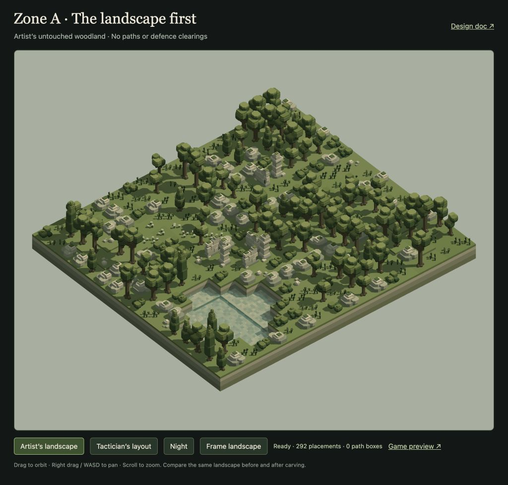

*Before: 292 scenery placements, no paths or reserved defence ground.*

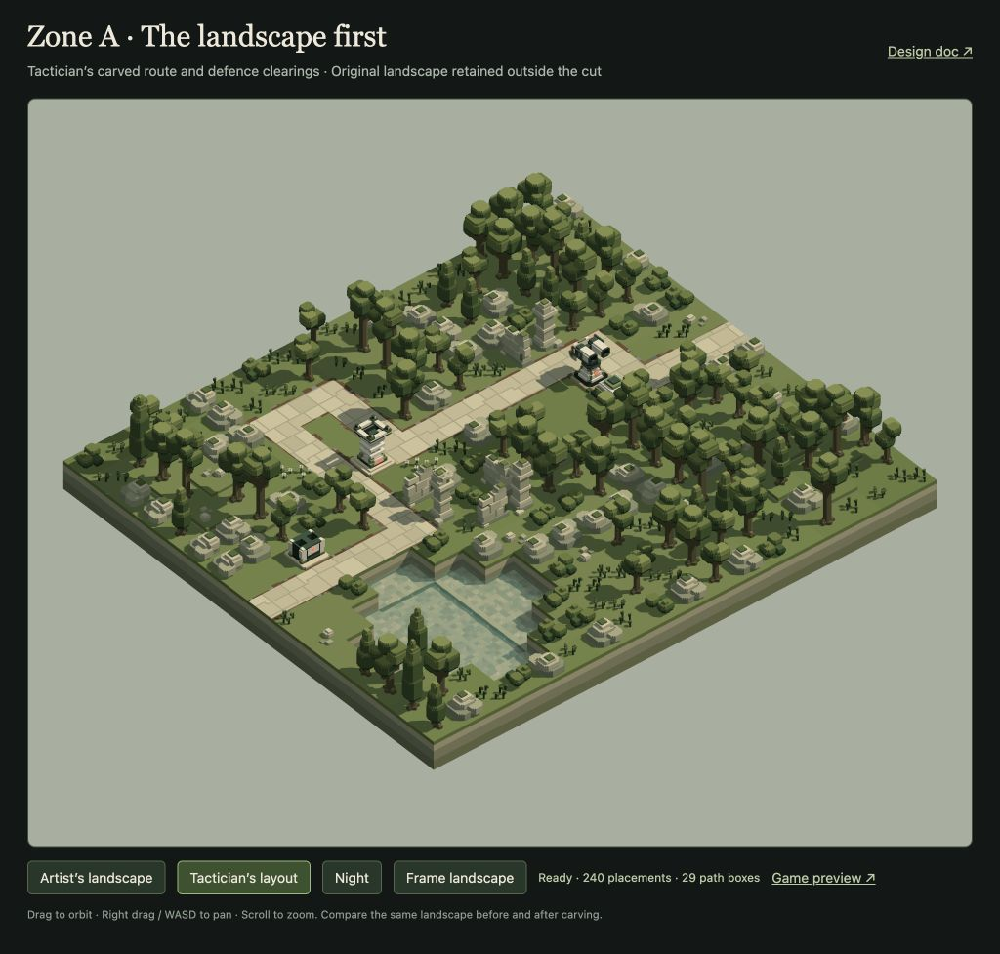

*After: 236 retained scenery placements, four defence items and 29 path boxes, shown with matching camera framing.*

## Authoring workflow and source ownership

Versioned JSON is the editable asset authority. The browser workshop, source generators, validation and engine use shared contracts. Generated mesh files are derived artifacts, not the place to edit a model's design.

The current preview entry point is `scripts/current-preview-levels.js`. Zone B uses `scripts/b-path-carving.js` and its selected authoring data to reproduce the reviewed sources from the untouched frozen landscapes. Alternative studies and audits remain in `docs/zone-b-path-carving-2026-10-19/`; they do not replace the active selection. The read-only comparison tool exposes original, alternative and current sources without saving to assets.

| Location | Purpose |
| --- | --- |
| `docs/design-doc.md` | Current consolidated game design; required reading for every agent. |
| `docs/project-brief.md`, `docs/development-diary.md`, `docs/team/` | Approval history, daily progress, specialist roles and integration handoffs. |
| `assets/models/` | Model-v3 sources, 24-unit scale, three variant slots, materials and rigid-part hierarchies. |
| `assets/levels/` | Level-v4 sources, box-aligned terrain/water/path and model placements. Includes studies as well as the sixteen game previews. |
| `scripts/` | Authored model/level generators, validation, mesh compilation and explicit rebuild tools. |
| `build/models/` | Ignored, derived compiled meshes. |
| `shared/` | Grid, asset validation/meshing, immutable defence/enhancer stats, palettes and effect contracts. |
| `engine/` | Rendering, clock, camera, scene lifecycle, animation, targeting, collision and effects. |
| `game/` | Preview orchestration and defence/enemy/wildlife controllers. |
| `tools/` | Model/level editors and focused model/effect/GPU review pages. |
| `tests/` | Affected unit/integration checks and reproducible probes. |

Model coordinates use X width, Y up and Z length. Bind-pose cells are integer grid cells; pivots may be fractional. Part transforms compose under their parent using the authored pivot, and runtime matrices keep animated instances independent. Enemy upgrade slots may be empty: the three-model requirement applies to arsenal items. Moving actors and wildlife are not static scenery obstacles. Player defences are marked `role: "defence"`.

Authoring rejects overlapping cells, removes hidden faces within rigid parts and merges matching exposed faces, while preserving interfaces exposed by articulation. Do not cover errors with depth bias or duplicate coplanar surfaces. Check full motion clearance, not only the bind pose. Models may be rotated as a whole or by part at runtime despite axis-aligned authoring.

The workshop supports model slices/materials/face overrides, hierarchy/pivot inspection and level placements/terrain/path editing. Source saves use revision checks and atomic replacement; stale saves conflict instead of overwriting external changes. Unsaved local browser drafts are recovery aids, not authoritative saved assets. Inspect [the tool and format guide](tools.md) before modifying assets or tools. Legacy 15/32-unit models may convert only if they fit the final 24-unit footprint; otherwise refit them, never silently crop them.

| Command | Purpose and boundary |
| --- | --- |
| `bun run dev` | Start the local Bun server at `http://127.0.0.1:4173/`. No installation/build step is needed. |
| `bun test <affected files>` | Run tests relevant to the change. Run the full suite only when the user explicitly requests it. Documentation-only changes do not need game-runtime tests. |
| `bun run compile <model source>` | Rebuild derived meshes for a changed source. Use the full compile command when the asset scope warrants it. |
| `bun run seed:zones` and family seed commands | Create missing sources without overwriting existing edits. |
| `bun run rebuild:previews` | Explicitly regenerates and overwrites preview/scenery assets; use only when that regeneration is the intended authorised work. |

Use the specialist team when useful: Artist owns art/model/readability; Tactician gameplay/layout/coverage; Engineer engine/rendering/performance; Researcher cited genre/reference studies. The lead assigns bounded work, integrates and verifies it, maintains this document and presents reviewable results. Every new sub-agent assignment must explicitly select a task-appropriate model and reasoning effort rather than inheriting the lead settings. Extra High (`xhigh`) is the maximum effort for any model; higher settings are prohibited. Preserve this rule in delegated context and session handoffs. Specialist signoff does not replace user approval of new scope. See [the team workflow](team/README.md).

## Current model-source inventory

Audited from the saved zone levels and the runtime model contracts on 18 October 2026. The active source library contains **66 model JSON files: 43 scenery, four defence families, ten enemies, one guided missile and eight wildlife models**. All 43 listed scenery sources appear in the current zone studies. Runtime enemies, wildlife and missiles are loaded separately rather than saved as static level placements. Archive assets and the separate layout/terrain workshop studies are excluded.

Each linked name below is the exact model/source ID for agents; it is not necessarily a player-facing label. Scenery uses only its base variant, with authored colour rather than arsenal palette replacement.

### A · Moss and Porcelain

**Scenery (12):** [`detail-flowers`](../assets/models/detail-flowers.json), [`detail-grass`](../assets/models/detail-grass.json), [`detail-pebbles`](../assets/models/detail-pebbles.json), [`scenery-cypress`](../assets/models/scenery-cypress.json), [`scenery-cypress-short`](../assets/models/scenery-cypress-short.json), [`scenery-oak`](../assets/models/scenery-oak.json), [`scenery-oak-tall`](../assets/models/scenery-oak-tall.json), [`scenery-oak-young`](../assets/models/scenery-oak-young.json), [`scenery-rock`](../assets/models/scenery-rock.json), [`scenery-ruin-pillar`](../assets/models/scenery-ruin-pillar.json), [`scenery-ruin-wall`](../assets/models/scenery-ruin-wall.json), [`scenery-shrub`](../assets/models/scenery-shrub.json).

**Cosmetic actors:** [`wildlife-hare-moss`](../assets/models/wildlife-hare-moss.json), [`wildlife-bird-moss`](../assets/models/wildlife-bird-moss.json).

### B · Ochre and Petrol

**Scenery (10):** [`ochre-cactus`](../assets/models/ochre-cactus.json), [`ochre-cactus-young`](../assets/models/ochre-cactus-young.json), [`ochre-flowers`](../assets/models/ochre-flowers.json), [`ochre-mesa`](../assets/models/ochre-mesa.json), [`ochre-mesa-low`](../assets/models/ochre-mesa-low.json), [`ochre-pebbles`](../assets/models/ochre-pebbles.json), [`ochre-rock`](../assets/models/ochre-rock.json), [`ochre-shrub`](../assets/models/ochre-shrub.json), [`ochre-tuft`](../assets/models/ochre-tuft.json), [`ochre-wall`](../assets/models/ochre-wall.json).

**Cosmetic actors:** [`wildlife-lizard-ochre`](../assets/models/wildlife-lizard-ochre.json), [`wildlife-bird-ochre`](../assets/models/wildlife-bird-ochre.json).

### C · Ice and Ember

**Scenery (10):** [`ice-fir`](../assets/models/ice-fir.json), [`ice-fir-young`](../assets/models/ice-fir-young.json), [`ice-flowers`](../assets/models/ice-flowers.json), [`ice-pebbles`](../assets/models/ice-pebbles.json), [`ice-pillar`](../assets/models/ice-pillar.json), [`ice-pillar-broken`](../assets/models/ice-pillar-broken.json), [`ice-rock`](../assets/models/ice-rock.json), [`ice-shrub`](../assets/models/ice-shrub.json), [`ice-tuft`](../assets/models/ice-tuft.json), [`ice-wall`](../assets/models/ice-wall.json).

**Cosmetic actors:** [`wildlife-hare-ice`](../assets/models/wildlife-hare-ice.json), [`wildlife-bird-ice`](../assets/models/wildlife-bird-ice.json).

### D · Plum and Mint

**Scenery (11):** [`plum-arch`](../assets/models/plum-arch.json), [`plum-arch-broken`](../assets/models/plum-arch-broken.json), [`plum-flowers`](../assets/models/plum-flowers.json), [`plum-pebbles`](../assets/models/plum-pebbles.json), [`plum-rock`](../assets/models/plum-rock.json), [`plum-shrub`](../assets/models/plum-shrub.json), [`plum-tree`](../assets/models/plum-tree.json), [`plum-tree-tall`](../assets/models/plum-tree-tall.json), [`plum-tree-young`](../assets/models/plum-tree-young.json), [`plum-tuft`](../assets/models/plum-tuft.json), [`plum-wall`](../assets/models/plum-wall.json).

**Cosmetic actors:** [`wildlife-beetle-plum`](../assets/models/wildlife-beetle-plum.json), [`wildlife-bird-plum`](../assets/models/wildlife-bird-plum.json).

### Shared defence and projectile sources

- [`turret-study`](../assets/models/turret-study.json): base and both upgrades; current three-part pitch rig.
- [`arc-spire`](../assets/models/arc-spire.json): Zapper, base and both upgrades.
- [`missile-launcher`](../assets/models/missile-launcher.json): silo, base and both upgrades.
- [`power-generator`](../assets/models/power-generator.json): base and both upgrades; base placements in A1 and each zone’s level 4 remain in the archived combat previews. Current landscapes contain no defences.
- [`drone-defence`](../assets/models/drone-defence.json): approved base and both upgrade designs, with stationary pad, level aircraft, independent fan housings/spinning rotors and twin gun. A1 tests two base units; upgrade gameplay values remain open.
- [`guided-missile`](../assets/models/guided-missile.json): one shared base projectile model, used for seated and flying rounds.

### Zone enemy sources

- A: [`dog`](../assets/models/dog.json), [`roller`](../assets/models/roller.json), [`moth`](../assets/models/moth.json).
- B: [`walker`](../assets/models/walker.json), [`dune-tread`](../assets/models/dune-tread.json), [`twin-fan`](../assets/models/twin-fan.json).
- C: [`tripod`](../assets/models/tripod.json), [`ray`](../assets/models/ray.json).
- D: [`spider`](../assets/models/spider.json), [`lantern`](../assets/models/lantern.json). All enemy models currently have one base variant.

Scenery and wildlife generators, rig details and approval scope are documented in [production art](production-art.md), [wildlife](wildlife.md), [Dog](dog-model.md) and [Walker/Spider](enemy-models.md). The defence model notes above remain the detailed source of geometry, pivots, emitter assignments and clearance limits.

## Open decisions and scope boundaries

**Game-readiness review, 19 October:** the [broader TODO](research/game-readiness-todo-2026-10-19.md) remains a backlog, while the user has signed the [first development plan](plans/first-playable-game-2026-10-19.md). The A1/A2 eight-wave gun/Dog scope and its provisional economy/miss/preparation/retry policies are authorised and implementation/verification are in progress. P toggles pause/resume with a pause screen during an active wave. Other backlog items are not automatically authorised.

The following decisions remain open; their absence must not be filled with genre defaults:

| Area | Still to decide |
| --- | --- |
| Objective and outcomes | First delivery: +1 per escape, 10 cumulative run-wide misses, fresh-run retry and completion after A4 wave 4 are implemented provisional rules for the current Zone A delivery. Broader campaign balance/outcomes remain future work; no defence damage/protected base is implied. |
| Playable loop | Manual starts, preparation between waves and four waves per level are assigned. Advance level after wave 4 and zone after the final level in the area. A1–A4 sixteen-wave encounter data is implemented for review; later-zone encounters, final pacing and transition polish remain future work. |
| Deployment | First delivery uses authored routes, preparation-only purchase/upgrade/free repositioning and full physical placement clearance. Broader limits and reactive routing remain unassigned. |
| Route variety | Two-approach support is implemented and A3’s merging layout is active and approved. Earlier B4/C3/D4 designs remain historical; B3 Mesa Confluence is user-approved. Zone A entrance schedules are implemented; later-zone schedules, independent exits and dynamic routing remain open. |
| Economy and persistence | Initial 2, successful-wave +2, retained ownership/tiers/unspent balance and new-landscape redeployment are approved for the first delivery. Repair design, save persistence and broader economy remain open. |
| Balance and roster | Final strengths/ranges/HP/cadence, further defences/enhancers and broader campaign rosters. Zone A's sixteen encounters and three-family player profiles are implemented provisional tuning; final human acceptance remains pending. |
| Enhancers | Additional enhancer families or non-strength effects require approval. The single-version 25% Power Generator is implemented at a provisional 4-token price. |
| Enemy abilities | Armour/resistances, special abilities, attacks on defences, bosses and status interactions. Four flying enemy types are now approved for the combat preview; final flight/navigation rules remain open. |
| Camera and interface | Player HUD, wave briefing, selection, placement, gun/Arc/missile upgrades, action camera and P pause screen are implemented for testing. Final camera/accessibility/remapping polish and repair UI remain future work. Preview controls are separate. |
| Presentation and platform | Audio/music, accessibility and remapping options, save/load, distribution, broader device support and an agreed performance/hardware budget. |

Current exclusions include enemy missile splash damage, Arc stun, audio, fog/haze, dynamic day/night cycles and dynamic weather transitions. Both upgraded Arc tiers' one-hop chaining and cosmetic critter blast lethality are explicitly implemented. Indirect lighting and ambient occlusion were tried, rejected and removed; no follow-up implementation is planned. The signed first plan authorises its bounded player loop; new abilities/effects and unrelated final-game systems need their own scope approval.

## Superseded decisions

| Earlier state | Current decision |
| --- | --- |
| Five levels per zone / 20 campaign levels | Four per zone / 16 total. |
| Five enemy waves per level | Four waves per level, then the next level in the area; next zone after the area is complete (19 October). |
| 15-unit or 32-unit placement boxes | 24 × 24 × 24 units, with one-unit cells. |
| Raised player defence mounds | All player defences sit on dry ground at enemy path height. |
| Six-legged Spider / older stride | Four legs, larger 2.88-unit strides at 12 units/second. |
| Yaw-only turrets | Independent pitched gun cradle tracks target height. |
| Thin branched electric arcs | Double-width unbranched channels, stronger light and welding-like impact sparks. |
| Rising smoke burst from enemy death | Removed. Living damage smoke and missile launch smoke remain. |
| Missile braking near its target / constant pursuit | Commit to a predicted point after the turning coast; attack at full speed and coast after terminal thrust cutoff. Physical contact decides hits. |
| Shorter silo launch gaps | Every missile variant uses a 1.0-second minimum gap. |
| Proposed 48-unit base generator radius | Same-height edge-adjacent boxes only. Upgrade coverage remains open. |
| Larger, slower generator-plasma waves | Half-sized displacement parameters and twice the phase speed. |
| Enabled weather by default / muzzle pressure affecting weather | All saved previews default weather off; pressure experiment removed. Ordinary optional weather and enemy death refraction remain. |
| Sparse remote terrain / uniformly reserved space | Useful close-path alternatives plus coherent distant scenery; preserve distinct routes. |

Historical screenshots, earlier concept sheets and milestone notes may show those former states. Their existence is not approval to restore them.

## Detailed reference library

| Subject | Reference |
| --- | --- |
| Instructions, decisions and progress | [Contributor instructions](../AGENTS.md), [project brief](project-brief.md), [daily diary](development-diary.md), [team roles](team/README.md) |
| Appearance and environment | [Visual brief](visual-style.md), [rendering requirements](rendering.md), [terrain](terrain.md), [path surfaces](path-surfaces.md), [weather](weather.md) |
| Layout and scenery | [Current production levels](production-levels.md), [production art](production-art.md), [cited genre/layout study](research/tower-defence-layouts.md), [multiple/merging-route research](research/multiple-and-merging-paths.md) |
| Arsenal models | [Turret](turret-model.md), [Arc Spire](arc-spire-model.md), [missile launcher](missile-launcher-model.md), [power generator](power-generator-model.md) |
| Combat | [Combat resolution](combat.md), [target selection](defence-targeting.md), [missile flight and claims](missile-combat.md), [enemy stagger](enemy-impact.md) |
| Actors | [Dog rig](dog-model.md), [Walker/Spider](enemy-models.md), [cosmetic wildlife](wildlife.md) |
| Effects and runtime | [Damage/explosions](damage-effects.md), [electrical strikes](arc-effects.md), [engine](engine.md), [current performance review](performance-review-2026-10-18.md) |
| Development | [Tool/source-format guide](tools.md), [Arc test levels](arc-spire-levels.md), [missile test levels](missile-launcher-levels.md) |

### Background vistas for all zones (20 October)

All sixteen production levels float over a darker distant landscape of their own biome. On 21 October the user authorised integrating the new Zone A fidelity and upgrading B–D, with blur removed. All zones use 80-unit terrain facets and 40-unit river segments. A retains the reviewed limestone/woodland geometry exactly; B adds layered mesa shoulders/caprock and more cacti, C adds faceted slate/snow shelves and tiered snowy firs, D adds plinths/broken capitals/steps and branching plum crowns. The shared production renderer enables the change in `/play/` and `/game/`; appearance remains for user review. [Current checks, resource costs and views](all-zone-vista-fidelity-2026-10-21/README.md).

Render each background independently at 75% linear viewport resolution, with camera parallax and matching focal-distance perspective behind orthographic overview. There is no deliberate blur kernel: uncovered background pixels take one linear sample and retain the 0.76 darkening factor. The pale playing-area/scenery rim removal is user-accepted: MSAA edge pixels now blend with the actual vista according to uncovered depth samples, rather than the flat backdrop. No replacement boundary art is selected; reconsider it later when requested. Upsampling is still linear. Geometry stays below Y−150 and outside gameplay, navigation, placement and shadow queries. Keep the cached sky/terrain two-draw pass; unload releases the previous biome. Meshes occupy 12.87–20.83 MB and background colour/depth occupy `ceil(width*.75) × ceil(height*.75) × 8` bytes. No inactive biome is cached. Culling remains a [research-only candidate](research/vista-culling-2026-10-21/README.md), with no proven net hardware saving or production implementation.

### Player presentation and combat revision (20 October)

The user requests four fixed lighting periods per zone: level 1 day at 10:30, level 2 late afternoon at 16:30, level 3 early evening at 18:30, level 4 night at 22:00, repeated in B/C/D and retained through all waves. Weather stays off. Level3uses the level4blue key light at0.65strength, lowered to12°elevation while retaining its previous evening ambient `#8493B4`/0.42. The user accepted this21Octoberlighting trial. Level4retains its existing higher blue night light and ambient. This supersedes the earlier all-daylight player policy, while saved level sources and preview controls remain authored.

Vistas retain the 24% darker linear colour and follow ambient palette brightness at dusk/night. The 20 October doubled blur was removed on 21 October; foreground and background now have no deliberate blur filter. Water gains broad spatial variation in ripple phase, current direction, calmness, tint and glints; geometry, boundaries, refraction, fish and impact ripples remain.

Dune Tread keeps its enemy identity/statistics but replaces tracks with three exposed rotating wheels per side. Other defence solids now block LOS-requiring gun/Arc/drone attacks, with only the shooter excluded and actual part poses/gaps respected. Indirect missile direct-LOS rules remain unchanged. Bullets create bounded warm-white sparks on sampled visible enemy surfaces without adding damage. Missiles vary turn speed per round and show 5.25-unit opposed white steering bursts for angular acceleration/braking, with synchronised local white illumination and no pulses within one degree of alignment. Ordinary boost/attack flames and inertial terminal cutoff remain. The powered white contribution shares the existing engine-light record to preserve bounded light capacity. [Delivery, resource bounds and verification](play-polish-2026-10-20/README.md). New visuals and detailed formation balance remain for review.

### Current TODO delivery (20 October)

Preparation/overview and Drone now change immediately. The timed hand-off module, mixed projection/depth/vista branches and transfer waiting are removed. Ordinary smooth Drone movement, default Drone during combat, disabled manual pan/zoom and four-second effect settling remain.

The footer shows a rolling FPS, wall milliseconds per frame and synchronous CPU renderer time, explicitly distinct from GPU execution. Measurements reset on pause/loading/hidden/resume. The arsenal groups each defence family; hovering/focusing a deployed row shows its actual current horizontal XZ range, while UPGRADE shows the next enabled tier's range with a dashed NEXT ring. Previews neither buy nor select a unit.

Missile attitude acceleration is gentler (16 rad/s² limit versus 40) with a longer proportional settling tail (gain 6 versus 10). Actual flight and scenery admission share this controller. Each flight emits a short spin-up and braking impulse, at most 65 ms each, with matching white lighting and the existing 5.25-unit jets; minor corrections cannot restart the train. The one-degree/terminal cutoffs and ordinary main exhaust remain. This changes trajectory orientation, so a fresh 64-wave mixed campaign verifies the retained strategy still clears every enemy; it is not a guarantee for all strategies.

Missile impacts retain their core, eight lobes, smoke, ring and light, while the eighteen outward fragments and unused shader branches are removed. Turret muzzle-light peak is 8 instead of 10; every enemy destruction light lasts .336 instead of .48 seconds with its peak retained. Particle/flash durations and missile lighting otherwise remain. Fixed damage-particle storage saves 3,456 bytes on both CPU and GPU. Visual changes are implemented, with human acceptance pending. [Delivery, checks and limits](todo-follow-up-2026-10-20/README.md).

## Latest combat and performance follow-up (20 October)

The footer now distinguishes unscaled rAF frame interval, whole synchronous **CPU app** callback time and asynchronously sampled **GPU** render time. The former 0.5–1.0 ms CPU figure covered only `renderer.render()`; that renderer-only figure remains in diagnostics. CPU app includes simulation, camera/effect preparation, rendering, overlays, highlighting and scheduled HUD/diagnostics updates. It excludes later browser layout/paint, independent event callbacks and asynchronous driver/GPU work. GPU timestamps enclose the first real render pass through final display/refraction, including vista, bloom, weather and shockwaves when present; uploads before that span, queue wait, readback and presentation are excluded. Optional feature support, stale status and all pause/load/resize/dispose boundaries are explicit. No GI/AO code is restored.

Late afternoon on each zone's second level uses **1.35× authored direct sunlight**. Colour, direction and ambient intensity retain the accepted warm preset; all other periods and saved sources are unchanged. This is provisional visual tuning.

Enemies use their ordinary configured route speed regardless of health. TODO20 removes the health-based slowdown/catch-up and its wounded-only traffic/forecast state, restoring original gait, yaw and aim-velocity expressions. Existing nonlethal missile-hit impact reactions remain; these do not alter route progress or configured speed. The withdrawn escape-running/gallop system stays removed.

**Stage 2 means Upgrade I**, consistent with the project's existing middle-tier terminology. Each successful Arc pulse selects at most one random living secondary within **96 units (four tiles) inclusive in 3D torso-centre distance**, at **20% current enhanced pulse strength** (not 20% HP-clamped inflicted damage). Ground and air can receive a chain if a visible exposed surface can be reached from the primary contact without crossing scenery, another defence or the primary body. No recursion/self-hit or speculative secondary reservation is added. Six existing visual slots prioritise primary strikes; secondary visuals can be omitted under saturation while damage remains accurate.

A critter whose current body centre is within **33.6 units (1.4 tiles) of an enemy destruction** or **72 units (three tiles) of a missile impact** gibs, including the boundary. Distance is3Dand lethality radius-based, without an additional blast-occlusion rule. Ground animals, birds and fish are included. Sixteen model-colour fragments and32small red droplets receive the accepted distance-based blast impulse, gravity, collision and water drag; no critter kill changes rewards or misses. Each red droplet converts on its first solid impact to a larger flat, irregular matte blood mark aligned with and bounded by that surface. This reuses its existing reserved slot and matrix buffer. Marks are excluded from camera/shadow depth and drawn in a dedicated alpha stage after opaque geometry, with stable pool ordering and read-only less-or-equal scene depth. A0.08-unit outward normal offset separates them from the impact plane, replacing the prior per-sample plane check after the user still observed near-camera flicker. Marks remain lit/matte, without raster depth bias. The stage shares the existing opaque hardware pass and resolves before water/refraction; marks do not cast new shadows. Current collision surfaces are the existing static terrain/scenery/bridge cuboids; underwater solid impacts stain the bed, with no floating water-surface mark.

**21Octoberlifetime correction, implemented for review:** retain every critter fragment, droplet and mark through the wave and post-wave settling. Start the existing **two-second fade only once build/deploy is visible**. Rebinding enemy effects for the next wave keeps these records and their time; safe critter respawn occurs in preparation. During a level transfer, display preparation over the outgoing board while the remains fade, then release it and load the next landscape; controls are busy during that transfer. An immediate new-wave start clears unfinished old fades to protect the fixed pool. Defeat and final-completion views retain remains until scene disposal. Reserved critter capacity is1,152pieces plus192enemy slots (107,520GPU bytes total), unchanged by the decal conversion. Model fragments keep matched ordered-coverage masks in depth/colour; blood marks fade with continuous alpha blending. No extra pass, texture or GPU buffer is added. [Lifetime delivery](todo-28-30-2026-10-21/README.md) · [Latest offset/radius/SSR follow-up](todo-31-33-2026-10-21/README.md); [earlier decal research](blood-decals-2026-10-21/README.md).

[Delivery, limitations and verification](latest-todo-2026-10-20/README.md).

### Hidden paused screenshot mode (21 October, implemented for review)

While paused, `BACKSPACE` hides the pause screen and its dimming, releases scene input and hides the Drone viewfinder. Only the camera advances. `W` moves forward along the viewing direction, `S` backward, `A` strafes left and `D` right, at72world units/s with normalized diagonals; mouse drag rotates freely in pitch/yaw. Movement is not tethered to terrain or board bounds. The simulation, wildlife, weapons, particles, weather, water phase and camera director remain frozen.

A second `BACKSPACE` restores the saved camera position, orientation, projection/view settings and ordinary pause screen, keeping the game paused. P/Escape restore the saved view before normal resume. Input is cleared on focus/visibility loss and exit; errors, scene switches and teardown release the temporary camera owner. No ordinary gameplay selector or advertised shortcut is added. HUD/footer layout is retained; this mode removes the pause overlay rather than changing the viewport framing. [Implementation and verification](todo-28-30-2026-10-21/README.md). The accepted blood-impact/persistence behaviour is specified above and recorded in TODO28–30; no related implementation remains queued.

## Document change record

| Date | Change |
| --- | --- |
| 24 October 2026 | Player accepts the 80% rotating reticle, smooth WASD controls, expanded hint and persistent A/D direction. Local deployment refreshed byte-identically to the committed package; acceptance recorded. |
| 24 October 2026 | A/D direction now persists after release for the current wave, constraining automatic framing to the chosen orbit direction; quick taps, later movement/retargeting and wave resets are covered. [Evidence](drone-controls-2026-10-24/README.md#persistent-direction-follow-up). |
| 24 October 2026 | Added an outlined 270° orbit-bearing reticle at 80% opacity, smooth W/S target movement and A/D orbit control with automatic resumption. Expanded the centred hint and accessible instructions; 75 targeted checks, isolated A1 browser review and local deployment validation pass. [Evidence](drone-controls-2026-10-24/README.md). |
| 24 October 2026 | Team review improves persistent placement guidance, keyboard access and unlock/speed labels; retains accepted art and original engine culling after measured alternative regression. Removes unused placement closures and repairs migrated model-test fixture. [Evidence](team-review-2026-10-24/README.md). |
| 23 October 2026 | Rotated the opening Drone orbit bearing by 180° to face inward across the entrance, at the existing 144-unit standoff. Spawn reticle and subsequent flight/zoom remain. 50 focused checks and native A1 review pass. |
| 23 October 2026 | Renamed the centred hint to “Click and drag to control the drone” and set its black backing to 70% opacity, retaining opaque text and first-drag dismissal. |
| 23 October 2026 | Narrowed Drone default FOV to 60° and added occasional smooth 54–62° zooms using padded visible-action fit; fixed reticle, pause and high flight remain. 62 focused checks and native A1 review pass. [Delivery](drone-reticle-2026-10-23/README.md). |
| 21 October 2026 | User requests retaining the bottom-bar FPS, frame interval, CPU and GPU data in deployments. Packager now preserves its UI, styles and CPU/asynchronous GPU sampling while stripping unrelated inspectors. Updated deployment instructions and rebuilt docs/; no tests or browser checks run. |
| 21 October 2026 | Reserved docs/ exclusively for generated static hosting output; moved development documentation/evidence to project-docs/ and packaging metadata to build/deployment/. The packager now clears docs/ before rebuilding. No tests or browser checks as part of deployment. |
| 21 October 2026 | Simplified deployment at the user’s request: reuse the local packager to refresh docs/index.html and docs/site/, then finish. No tests, browser checks, preview servers or evidence reports unless explicitly requested; preserve source/documentation and retain packaging file/path safeguards. Supersedes the former deployment validation checklist. |
| 21 October 2026 | Added the requested Development Preview title notice and smaller Saves are disabled for now subtitle above NEW GAME. Actual title layout checked; no gameplay/save implementation change. |
| 21 October 2026 | Implemented ground-first stationary guns, refreshed physical missile lead and safe terminal alignment, occasional clear low Drone stations, projected combat composition and deployment selection matching the visible roster. [Delivery and verification](combat-camera-follow-up-2026-10-21/README.md). |
| 21 October 2026 | Added airborne-only smooth corner curves and applied the previously overwritten visible bank. Analytic aim motion, route clearance and Drone/impact bounds follow curves; authored exit timing and ground paths stay intact.136affected checks, sampled flight/traffic/placement audit and64-wave zero-escape mixed replay pass. Appearance awaits review; no asset/stat edit or active-session reload. [Delivery](flying-turns-2026-10-21/README.md). |
| 21 October 2026 | Fixed Arc retry ownership by enemy identity; real lifecycle regression fails before/passes after. 58 affected checks pass; one archived missile snapshot failure is reproduced on pre-fix Arc code. Paired C3 snapshots clear72enemies/0escapes with identical shot/rejection counts. No tuning or active-player reload. [Evidence](arc-retry-identity-2026-10-21/README.md). |
| 21 October 2026 | Read-only Tactician reassessment of current chains, generator and missile flight: multiple 64-wave zero-escape portfolios remain viable, C3 pressure survives constrained investment, generator bonus is useful without proving dominance. Proposed Arc retry identity fix before numerical tuning; retain current provisional values pending review. No runtime edits or live-session reload. [Audit](balance-review-2026-10-21/README.md). |
| 21 October 2026 | Removed enhancer upgrade options and 50%/75% stats; added single-version +25% Power Generator purchase/deployment to the campaign at a provisional 4-token cost, cached cardinal bonuses and green links. Existing source geometry variants remain historical. [Delivery](enhancer-campaign-2026-10-21/README.md). |
| 21 October 2026 | Added default-on persistent title Critters/Reflections/Bloom switches with actual work disabled when off; 60 affected checks and five A2 GPU combinations pass, four inherited deployment pose expectations remain failing. Established Deployer for future local static copies in root docs with output-only debug stripping; no deployment created. |
| 21 October 2026 | Implemented TODO 36–41: halve water ripples, refine six enemy models, double bloom, visible 25%/half-range chains for both Arc upgrades, quarter-length night shadows, and live-defence missile obstruction. 145 affected tests/61 GPU checks, actual encounters and a 64-wave zero-escape replay pass. Appearance awaits review. [Delivery](todo-36-41-2026-10-21/README.md). |
| 21 October 2026 | Queued TODO 41 after reported missiles clipping through Arc towers: include defence geometry in LOS, trajectory admission and actual missile collisions, preserving posed openings and launcher self-exclusion. Audit separate live-defence integration; no runtime edit. |
| 21 October 2026 | Queued TODO 40: raise nighttime sky-light elevation to reduce shadows to about one quarter of their current length. Retain heading, night colour/intensity/ambient and level-3 evening lighting; no runtime edit. |
| 21 October 2026 | Queued TODO 39: both upgraded Arc tiers should produce a visible enemy-to-enemy secondary beam at 25% originating strength and 50% originating targeting range. Existing Upgrade I-only 20%/96-unit implementation confirmed; reported missing visual remains to investigate. No runtime edit. |
| 21 October 2026 | Queued TODO 38: confirmed existing selective emitter bloom; request +100% composite strength (0.35→0.70). Retain source selection/blur footprint; no runtime edits. |
| 21 October 2026 | Queued TODO 37: revisit existing enemy-model aesthetics, favouring symmetry and purposeful details while avoiding arbitrary additions. Specific revisions await assessment and review; no model/runtime edits. |
| 21 October 2026 | Queued TODO 36: halve water ripple amplitude (strength 0.18→0.09) for clearer reflections, retaining other ripple/material/reflection settings. Documentation only; runtime and current session unchanged. |
| 21 October 2026 | Implemented TODO 34–35 after the user quit: central safe Drone openings and stronger water reflection material/view-angle weighting. 55 targeted tests, 160 opening selections, 16 source checks, production UI and GPU reflection/transmission/refraction controls pass. Appearance awaits review. [Delivery](todo-34-35-2026-10-21/README.md). |
| 21 October 2026 | Queued TODO 35: increase water reflection visibility after the user reports the current SSR is only very slight. Retain blue tint, ripples and refraction; tuning awaits implementation/review. Documentation only; active playthrough preserved. |
| 21 October 2026 | Queued TODO 34: start Drone-cam nearer the middle of the playing area, avoiding map-edge openings while preserving safe clearance and subsequent filming behaviour. Documentation only; active playthrough preserved. |
| 21 October 2026 | Implemented TODO31–33: reduce enemy critter-gib radius30%to33.6(missiles72); separate blood marks0.08from scenery using stable read-only-depth alpha drawing; add ripple-driven water SSR across16levels.65tests,32decal GPU checks,3SSR comparisons and transparency/refraction controls pass. Active run preserved; appearance awaits review. [Delivery and measured cost](todo-31-33-2026-10-21/README.md). |
| 21 October 2026 | Researched and replaced blood depth competition with a stable alpha decal stage and per-sample receiver-depth validation. Final implementation shares the opaque hardware pass/buffer after a separate-pass trial proved costly;65targeted tests and26GPU checks pass. Preparation fading and active playthrough retained. [Research and evidence](blood-decals-2026-10-21/README.md). |
| 21 October 2026 | Implemented TODO28–30: hidden paused free camera with exact restoration, static-surface blood marks in existing droplet slots, and preparation-triggered critter fading.102affected tests plus real GPU/UI/movement/fade checks pass. Current player session preserved; appearance awaits review. [Evidence](todo-28-30-2026-10-21/README.md). |
| 21 October 2026 | Queued TODO30 after the user reports early critter-remains fading: retain all critter fragments, blood particles and future decals until build/deploy returns; only then fade. Supersedes the requested wave-end fade timing; no runtime change or active-session reload. |
| 21 October 2026 | Queued TODO28: hidden paused screenshot camera with BACKSPACE toggle, WASD/mouse-drag motion, complete pause-UI/dimming removal and exact saved-view restoration. Queued TODO29: larger flat blood decals at actual red-particle surface impacts. Documentation only; active review game unchanged. |
| 21 October 2026 | User accepts playing-area rim removal and begins another gameplay review. Keep presentation unchanged; replacement boundary art remains deferred. Documentation only, with no runtime edit or reload. |
| 21 October 2026 | User accepts low blue evening light; removes the playing-area rim and defers replacement art. Corrected vista MSAA edge composition, preserving emission and flat-background fallback.31affected tests, five exact GPU coverage checks and64scene compositions pass. [Evidence](board-edge-2026-10-21/README.md). |
| 21 October 2026 | Trialled level4blue sky light at12°elevation on A3/B3/C3/D3, keeping evening ambient exactly.33affected tests and four-zone GPU overview/High Drone checks pass; appearance awaits review. [Evidence](evening-skylight-2026-10-21/README.md). |
| 21 October 2026 | User authorises blur removal and higher-fidelity vista rollout across A–D. Integrated the reviewed A mesh unchanged, upgraded B–D, removed nine-tap blur and standardised 75% background resolution. 32 affected tests and 64 GPU compositions pass. Culling research finds technical feasibility but no proven net saving, so no production culling. [Evidence](all-zone-vista-fidelity-2026-10-21/README.md). |
| 20 October 2026 | Completed water revision and TODO 20–23: reduced initial dusk sheen75%, retained refraction/ripples, restored ordinary health-independent movement, hid camera selectors with Drone default, verified actual depth prepass/cache order, doubled Arc/gib radii. 88 tests and64-wave mixed clear; visual review pending. [Evidence](water-regression-2026-10-20/README.md). |
| 20 October 2026 | Queued TODO23: double Arc secondary range to4tiles/96units, enemy critter-gib radius to2tiles/48units and missile critter-gib radius to3tiles/72units. No live radius change; water investigation continues separately. |
| 20 October 2026 | Queued TODO 22 to confirm camera depth-only pass, production order/coverage and dirty-cache behaviour. Preliminary source confirms its colour-free descriptor; actual GPU audit remains pending. No runtime change. |
| 20 October 2026 | Queued TODO 21 to hide camera view selectors for now, retaining Drone as the run default and the normal overview lifecycle. No UI/runtime change or playthrough reload yet. |
| 20 October 2026 | User requests removal of enemy stagger as TODO 20. Queue rollback of wounded slowdown/catch-up and associated machinery; no runtime change or playthrough reload yet. |
| 20 October 2026 | Completed TODO14–19: full-span GPU/CPU app timings, +35% level-2 sun, half-health stagger/recovery, Upgrade I Arc20% chain and persistent critter blast remains/fade/respawn. Confirmed implementation meanings for stage2/current wave; tuning remains for human review. GI/AO stay removed. |
| 20 October 2026 | User rejects AO and requests complete GI/AO removal. Deleted isolated implementations, viewers, shaders, caches, scripts, tests/timing machinery and the production AO hook. Historical evidence retired; current lighting/gameplay and live playthrough preserved. |
| 20 October 2026 | Queued critter gibs/spray from enemy blasts within one tile and missile blasts within 1.5 tiles as TODO 19. Remains persist until the enemy run ends, then fade; no runtime effects/wildlife change. |
| 20 October 2026 | Queued CPU timer accuracy/scope audit as TODO18; the existing interval measures synchronous renderer work. No current HUD/timing/runtime change. |
| 20 October 2026 | Delivered isolated ambient-only AO trial with 39 affected tests/22 GPU checks and noisy paired timing evidence. Production remains off, playthrough retained, GI dropped and TODO 14–17 queued. |
| 20 October 2026 | Queued stage-2 Arc single-hop chaining to a random enemy within two tiles, at 20% Arc strength (corrected wording), as TODO17. Tier-label mapping and chain eligibility remain to specify; no runtime ability added. |
| 20 October 2026 | Queued wounded stagger/catch-up while health is at most 50% as TODO16. Cadence/magnitude need prototyping; no running rollback reversal, motion implementation or active-playthrough change. |
| 20 October 2026 | Queued brighter late-afternoon sunlight for A2/B2/C2/D2 as TODO 15; amount remains to compare. No runtime/preset change or playthrough reload. |
| 20 October 2026 | Authorised an isolated AO visual/GPU trial while the user plays; retain live player state. Dropped indirect lighting from the current plan; historical GI evidence retained and no production integration follows. |
| 20 October 2026 | Queued GPU frame timing beside the footer CPU timer as TODO 14. Requires asynchronous complete-frame GPU timestamps and unsupported/reset handling; no production HUD change or playthrough reload. |
| 20 October 2026 | Completed current-engine AO feasibility research: depth-based half-resolution ambient-only candidate, render-order constraints and reproducible memory estimates. GPU/visual proof proposed; no AO runtime/prototype added. |
| 20 October 2026 | Implemented remaining TODOs 3–5 and 7–13: immediate camera endpoints, labelled performance readings, roster/ranges, eased missile attitude/short impulses, fragment removal, requested light tuning and richer bounded vistas. 181 affected tests/89 GPU checks pass; mixed campaign clears 1,084 enemies. Unreal/MCP feasibility research complete; no migration authorised or performed. |
| 20 October 2026 | Queued stronger ease-in/ease-out for missile rotation/targeting as TODO item 13, coordinated with steering-thruster duration item 3. No runtime implementation or active-playthrough reload. |
| 20 October 2026 | User requests more detailed zone skyboxes, reopening vista iteration as TODO item 12. Preserve biome/style, distant treatment and battlefield focus; implementation remains queued. |
| 20 October 2026 | Queued current-range previews on roster hover and next-upgrade-range previews on UPGRADE hover as TODO item 11. No runtime implementation or active-playthrough reload. |
| 20 October 2026 | Queued UI defence-roster grouping by type as TODO item 10. No runtime implementation or active-playthrough reload. |
| 20 October 2026 | User withdraws the A3 path-edging report as a misunderstanding. Removed that TODO; no path-edging investigation or runtime change remains requested. |
| 20 October 2026 | Queued a 30% shorter enemy-destruction light burst as TODO item 9, retaining peak intensity. No runtime change or active-playthrough reload. |
| 20 October 2026 | Reopened missile directional-thruster duration in TODO item 3: the user still sees overlong firing after the initial cutoff change. Shorter jets/lighting remain implemented; further diagnosis/fix are pending, with no runtime changes. |
| 20 October 2026 | Queued a 20% reduction in turret muzzle-flash light intensity as TODO item 8. Runtime values and current playthrough remain unchanged. |
| 20 October 2026 | Queued removal of the large outward-flying missile-explosion particles as TODO item 7, preserving the main blast/light. No runtime implementation or active-playthrough reload. |
| 20 October 2026 | Recorded the user's A3 weather-associated path edging seen with weather disabled. Queued investigation as TODO item 6; reproduction/cause/fix remain unconfirmed. No runtime changes. |
| 20 October 2026 | User rejects the animated menu/preparation↔run camera transition. Queued complete rollback to immediate view changes as TODO item 5, superseding earlier transition work. No runtime change or playthrough reload. |
| 20 October 2026 | Queued requested bottom-bar FPS and frame-render-time readout as TODO item 4. No runtime implementation or active-playthrough reload. |
| 20 October 2026 | Audited reported weak grass-to-rock colour spill: diffuse colour transfer is present; a 32-face direct reference exposes four lost green biases in coarse probes. Added a review close-up and green-floor regression; no production/material/lighting changes. Accuracy/ambient balance remain proposed follow-up work. |
| 20 October 2026 | Delivered isolated one-bounce A1 experiment with measured cost/limits; fixed independent Drone destination, scale and anchor-following transitions; halved/lit/alignment-gated attitude jets. 90 affected tests/25 GPU checks pass. Audio researcher completed internal-workbench/Web Audio/Ogg feasibility only. |
| 20 October 2026 | Extended missile directional-thruster TODO: end jet pulses and matching illumination once rotation faces the target. No runtime change; existing priority order retained. |
| 20 October 2026 | Added requested TODO item3: halve current directional missile-jet length and add pulsed local white illumination. Earlier indirect-lighting/camera priorities stay first/second; no runtime changes. |
| 20 October 2026 | Investigated reported Drone start pull-away; native A1/B4 traces confirm projection-state feedback and a final-frame scale jump. Added the requested current TODO in order: indirect lighting, then camera fix. No runtime changes; both implementation items remain pending. |
| 20 October 2026 | User accepts the current B4/missile presentation and requests indirect-lighting feasibility research during play. Compared cached probes, RSM, SSGI, voxel GI and hardware RT; recommended a static-world one-bounce prototype with visibility safeguards and explicit measured-cost gates. No runtime or asset changes. |
| 20 October 2026 | Added the authorised B4 lake bridge approach and bank courts, two-route wave timing and three dry turning shoulders. Strengthened missile impact visuals with the exact prior light curve; tripled steering-jet length.106 tests,89 GPU checks and the complete zero-escape mixed campaign pass; appearance remains for review. |
| 20 October 2026 | Implemented all eight player notes: eased camera/control lock, darker/doubly blurred vistas, varied water, six-wheel Dune Tread, bullet contact sparks, defence cover, white steering jets/varied turn rates, and four-period per-zone lighting. 135 affected tests plus GPU/real combat verification; new presentation remains for review. |
| 20 October 2026 | User accepts all four zone vistas for now and confirms adding them to the game. Recorded the active all-sixteen-level integration as the accepted visual baseline. No additional runtime changes or new tests were needed for this acceptance update. |
| 20 October 2026 | User accepts the Zone A engine vista and requests B–D. Retained A exactly and added distinct biome geometry/sky tones across all sixteen levels. 47 affected tests and 64 GPU compositions pass; B–D appearance remains for review. |
| 20 October 2026 | User approves the Zone A skybox concept and authorises engine integration. Added background-only low-poly valley/parallax/softness for A1–A4; removed Drone depth of field and made Drone default on new runs/retries. 45 affected tests and 20 GPU compositions pass; engine appearance remains for review. |
| 20 October 2026 | Implemented entry-marker cleanup/first-wave hiding, stronger 2-second smoke with a larger fixed pool, safe critter respawns during deployment, and corrected Walker/Tripod per-height clearance. B1 recovers 43 individual Upgrade II gun choices; all B–D levels audited. 110 affected tests and browser/GPU checks pass. |
| 20 October 2026 | Addressed player notes: confirmed intentional gun upgrade price; added more frequent Drone angle changes and varied starts, route-entry indicators, pre-launch curved missile clearance and powered-flight smoke trails. 84 affected tests plus final missile recheck and production browser/GPU checks pass. |
| 20 October 2026 | Implemented requested path-first overview framing, covering all branches and falling back to full landscape. Shared Frame/preparation/automatic-return calculation; 38 affected tests and an A1 browser check pass. |
| 20 October 2026 | Added user-requested deep-pool fish with articulated tails, bounded underwater navigation and escape from actual nearby debris water impacts. Six eligible campaign pools gain three fish each. Existing renderer, one-critter scheduling, pause and cleanup retained; 92 affected tests plus browser review pass. Visual acceptance remains open. |
| 20 October 2026 | Raised Drone filming bands to path+120/152/184 and preferred horizontal standoff to 176–192; raised airborne clearance to aim+100. Kept zoom limits, smooth motion, anticipation and gameplay unchanged. Implemented and verified for visual review. |
| 20 October 2026 | Removed Cam man completely at the user’s request: UI, controller, ground navigation, diagnostics and handheld film effects. Drone retains clean depth of field, anticipation, pause and overview restoration. 68 affected tests and eight actual GPU lens checks pass. |
| 20 October 2026 | Completed the authorised A–D campaign: 16 levels/64 waves/1,084 enemies, C/D carving, existing zone rosters and persistent economy. Mixed/Arc clear witnesses and failed stop-investing comparisons verify provisional progression. Actual GPU light boundary, resource ownership, physical layouts and wildlife checks pass; accepted A/B and all models preserved. New layouts and balance await human playtesting. |
| 20 October 2026 | After engine cleanup, removed player level-start environment rolls at the user’s request. All levels now start in daytime with weather off, retained through waves/retries/new runs. Preview controls and source assets remain unchanged. |
| 20 October 2026 | Audited and cleaned the engine, preserving exact simulation/animation traces and assets. Reduced repeated scheduling/pose/water/camera work; fixed bloom offsets/player-light capacity and camera teardown. Independent review and 150 affected tests/25 GPU checks pass. |
| 20 October 2026 | Added clean subject-focused Drone depth of field, raised/further aerial coverage including an airborne-scene height floor, shared bounded route-based anticipation for Cam man/Drone, eased continuous aerial drift and 20% less maximum magnification. They prepare for idle-defence encounters before firing, retain useful held shots and prioritise real action. Cosmetic only; presentation remains for review. |
| 20 October 2026 | Restored Cam man UI and added a cosmetic aerial Drone view with low/high shots, broad gimbal pitch, smoothed scene-aware flight and exclusive camera ownership. Both arm in preparation, film wave/settling, pause with the simulation and restore overview; Cam man retains film and Drone stays clean. No model, combat or running changes; presentation awaits user review. |
| 20 October 2026 | User rejects the isolated gallop and requests rollback of all running work. Removed prototype and production sprint/escape/route/traffic additions; restored ordinary configured walking/flying movement. Softer ripples and unrelated completed changes remain. Earlier running research/evidence is historical; further work deferred. |
| 20 October 2026 | User requests Researcher investigation after finding the Dog run too level and insufficiently canine. Recorded primary-source gallop/turning research, measured rig limitations and staged animation/rig proposals. No runtime/model changes; roughly 2× remains the approved straight cap and visual acceptance is open. |
| 20 October 2026 | Softened water-impact ring contrast/opacity. Added conservative certain-escape decisions, roughly 2× acceleration, following/merge reservations, rounded running bends and true airborne Dog bounding with supported IK/lean. All 16 unarmed waves complete; mixed clear remains 168/0; 125 distinct affected tests pass and all 85 assets are preserved. |
| 20 October 2026 | Removed all panel borders to eliminate doubled seams. Distinguish adjoining GUI surfaces with darker HUD/footer, lighter intel, middle-green arsenal and alternating porcelain roster rows; amber selection and control/focus outlines remain. Forty browser compositions pass borderless/seam/overflow checks. |
| 20 October 2026 | Removed remaining GUI gaps: adjoining HUD/intel/battlefield/console/footer and roster cards now form a continuous layout. Forty browser compositions measure zero seams and pass overflow/readability checks. User authorises current-session reloads for testing. |
| 20 October 2026 | Flattened and tightened the GUI at user request, then defer further GUI work. Added independent per-level day/night and weather draws, stable throughout each level and load retries. 32 affected tests and 40 compositions pass; assets preserved. User defers unreproduced turret issue; exact A2 setup recorded for recurrence, without a new targeting fix. |
| 20 October 2026 | Redesigned the complete game GUI after reference research: original command-panel layout, model portraits, scenic game menu, compact state/briefing and consistent pause/results/error surfaces. Live cam option hidden with functionality preserved. DOM/SVG chosen under GPU permission; visual acceptance pending. |
| 20 October 2026 | Corrected idle future reservations preventing upgraded guns from attacking currently hittable Moths. Confirmed existing 2D range; reported A2.1 positions now clear all seven enemies. Stats, pitch limits and assets unchanged. |
| 20 October 2026 | Implemented requested heavy debris/water splashes, gravity-driven droplets, sinking fragments and paired ripples. Real A2 pool/bridge replay, 52 affected tests and 24 production GPU checks pass; all 85 assets preserved. Appearance awaits user review. |
| 20 October 2026 | Completed Zone A for review: sixteen authored mixed-enemy waves, gun/Arc/missile unlocks and play-only balancing, preparation briefing, persistent inventory and bounded finite combat. 145 affected checks pass; 79 actual wave attempts establish viable investing strategies and weak-strategy failure. Existing economy retained; all 85 assets preserved. Human acceptance pending. |
| 20 October 2026 | User authorises the team to complete Zone A for review before other zones, including waves, arsenal availability and balance. New enemy/defence types require bringing the demonstrated need back to the user. Implementation underway. |
| 20 October 2026 | User reports excessive ease and sets finishing Zone A as the session aim. Researched wave progression using developer sources and current code; recorded a proposed sixteen-wave structure, defence unlocks, economy comparisons and verification criteria. No gameplay tuning implemented in this research pass. |
| 19 October 2026 | User accepts the night/rain replay and requests rollback of its query parameters. Removed temporary overrides/helper and their test; authored environment behaviour restored. |
| 19 October 2026 | User accepts calmer camera direction and requests the same test with night and weather enabled. Added temporary URL presentation overrides; source settings and gameplay remain unchanged. |
| 19 October 2026 | User finds the camera too restless/distant and trees blocking action; requests tilt on quick pans. Implemented closer, slower coverage, held shots, wider frame/canopy visibility checks and damped pan lean. Latest values supersede the prior standoff tuning; presentation acceptance remains open. |
| 19 October 2026 | User requests more separation from combat, lens zoom instead of close approaches, and subtle depth of field. Implemented safe-distance routing/retreat, a smooth 40–76° lens and subject-driven depth focus in the existing film pass; provisional tuning remains open. |
| 19 October 2026 | User authorises a toggleable first-person Live cam, intelligent movement/action tracking, nearby-explosion flinches and aged-camera grain/edge distortion. Follow-up requires a central safe start and an operator moving around like a news cameraman. Implemented for playtesting with a scene-only film pass and pause/overview continuity. |
| 19 October 2026 | User reports post-kill target dithering on A1 wave 3. Reproduced at the current gun positions; added bounded gun acquisition commitment through cooldown/first pulse and the existing valid-burst hold, retaining immediate invalidation and cooperative ranking. Stats/assets unchanged. |
| 19 October 2026 | User requests automatic next deployment, consecutive upgrades including Upgrade II after level transfer, wider action framing and harder Area One. Implemented all three gun tiers with isolated provisional attack values, minimum camera radius 116 and a 100–240 HP / 3–9 Dog ramp. Researcher/Tactician verify 51 wave attempts across seven strategies; gameplay acceptance remains open. |
| 19 October 2026 | User requests arsenal hover identification and smooth action framing. Implemented projected gun outlines, automatic wave pan/zoom, manual takeover/Auto control and pause/settling continuity. User explicitly prioritises laptop/desktop screens; presentation tuning remains provisional. |
| 19 October 2026 | User requests a closer fixed title background, in-place defence edits and four seconds for final effects. Implemented with bounded runtime slots, preserved live wildlife and pause-aware settling; same-level waves also avoid scene reloads. See the refinement evidence. |
| 19 October 2026 | User explicitly requires P to toggle active-wave pause/resume and a visible pause screen. Added to the approved first delivery; implementation and verification are in progress. |
| 19 October 2026 | First `/play/` slice delivered for gameplay testing: A1/A2, eight finite waves, gun economy/placement/upgrades, misses/results/retry and P pause screen.100 affected checks pass, including real complete success/failure runs; all assets/frozen backup preserved. Final balance and user acceptance pending. |
| 19 October 2026 | User signs off on the first playable plan and authorises implementation/testing at `/play/`. Two A levels, eight waves, base/upgrade1 guns and Dogs; approved provisional economy/miss/preparation/persistence rules. Preserve accepted previews/assets. |
| 19 October 2026 | User clarifies four waves per level, then the next level in the area/zone, then the next zone after the area is complete. Replaces five waves; full campaign is 64 waves, proposed two-level first delivery is 8. Planning documents updated; implementation still awaits plan sign-off. |
| 19 October 2026 | User accepts all four Zone B layouts and specifies the title/preparation/manual-wave/miss-counter loop with 2 initial purchase/upgrade tokens and +2 per successful wave. Requests a separate `/play/` and a first development plan for sign-off before implementation. Notes/plan only; miss and progression details remain open/proposed. |
| 19 October 2026 | Implemented four Zone B layouts for review after comparing alternatives. B2 uses a two-box wooden crossing; B3 has two merging approaches. Full-footprint visibility, restricted actual weapon opportunity, wildlife journeys and 20 affected runtime tests pass. Researcher’s 12-task game-readiness proposal is ready for later user review; gameplay implementation remains unapproved. |
| 19 October 2026 | User authorises B1–B4 path carving, preserving accepted A1–A4 and untouched C/D, plus Researcher’s playable-game TODO proposal for later review and approval. Game rules remain open; no gameplay implementation authorised by the research assignment. |
| 18 October 2026 | Created the shared design doc at the user's request, consolidated current approved design and implementation, embedded approved concepts/current review captures, and made the source required reading for every agent with a browser view. This does not add game content or resolve the open decisions above. |
| 18 October 2026 | Added the subsequently requested title/menu concept in a separate proposal section, pending user review. |
| 18 October 2026 | Revised title/menu artwork against actual production-model captures at the user's request, retaining the layout and improving the presentation; subsequently superseded by scenery-only v3. |
| 18 October 2026 | Removed defences, enemies and their plasma/lighting from the title artwork at the user’s request; scenery-only v3 retains the title/menu. |
| 18 October 2026 | User accepted scenery-only title/menu v3 for now and requested further ground and airborne enemy concepts for each zone. Enemy visuals are proposals until selected; no flight/combat mechanics are assigned. |
| 18 October 2026 | Created two comparison sheets with eight proposed enemy designs, one additional ground and one airborne candidate per zone; awaiting user selection. |
| 18 October 2026 | User approved all eight ground/air concepts, sensible defaults and mixed existing-level previews. Added production models, motion and combat integration; see the expansion verification record. |
| 18 October 2026 | User requested matching Concertina/Lantern pale panels to the existing Spider’s off-white shell colours; plum armour and emissive coral eyes are retained. |
| 18 October 2026 | Replaced D Concertina with a rolling armoured ball, working name Tumbler, retaining its internal ID and provisional 360 HP / 11 units per second. Current models use the Spider-matched off-white palette. |
| 18 October 2026 | User requested replacing the ball trial with one large central wheel and side body housings, working name Monowheel. Retain Zone D palette, existing stats and the internal `concertina` ID. |
| 18 October 2026 | User removed the Monowheel/Concertina enemy completely for now. Removed its model, generated mesh, generator, rig/stats/movement entries, review option and D roster instances. D now contains Spider and Lantern; a replacement is undecided. |
| 18 October 2026 | User increased power-generator strength bonuses to 25% / 50% / 75%. Updated shared data, review labels and combat expectations; existing base adjacency and unassigned upgrade activation remain unchanged. |
| 18 October 2026 | Added fresh primary-source level-design research and the user-approved landscape-first A4 experiment: populated path-free landscape first, tactical carving second. Recorded proposed coverage/LOS/alternative-site and before/after checks; no universal workflow or final campaign balance is claimed. |
| 18 October 2026 | User requires removing or shrinking scenery that obscures defence placement areas, including usable alternative clearings. User says the in-progress landscape-first A4 looks much better; preserve the layout direction while refining visibility. |
| 18 October 2026 | Completed landscape-first A4 with ten visible placement areas, mixed existing combat and a preserved before/after landscape. Fourteen targeted checks and live day/night/weather/reset/lifecycle review pass; previous levels/models remain unchanged. Campaign balance is still open. |
| 18 October 2026 | Researched later-level route variety. Recommend selective multi-route use, beginning with two approaches merging into a shared tail; distinguish topology from spawn timing, prevent junction-only dominance and retain single-route variety. Recommendation only: no level/runtime change or fixed campaign topology. |
| 18 October 2026 | User authorised rebuilding all sixteen levels and explicitly approved merging paths in selected later levels, including necessary engine support. Landscape-first authoring, full placement visibility and existing combat/model rules govern the rebuild; campaign scheduling/economy remain open. |
| 18 October 2026 | User requires more creative water in initial landscape designs: varied large pools/lakes, rivers and streams instead of similarly sized pools across levels. Added a standing water-composition requirement; revise the ongoing rebuild and recheck affected routes and clearings. |
| 18 October 2026 | User allows enemy paths to cross large bodies of water on bridges as a creative level-design option. Record selective supported crossings; bridge geometry/runtime support is not yet implemented, and no water combat or destructibility is implied. |
| 18 October 2026 | Completed all 16 landscape-first previews and selected later merging routes, preserving accepted A4, models, stats and finite rosters. Added route-aware movement/planning, authored wildlife seeds, all-zone level 4 selection, source inspection and before/after review. Targeted tests, visibility audits and live browser checks pass; campaign balance remains open. |
| 18 October 2026 | Standing delegation policy: explicitly choose a task-appropriate sub-agent model and effort, never simply inherit the lead settings, and never exceed Extra High (`xhigh`). Persisted in contributor instructions, team workflow, project brief and diary. |
| 18 October 2026 | User fixes every production level at 20×16 boxes (480×384 units), matching D3. Landscape appearance is accepted; path carving needs more winding routes and more worthwhile defence options. Rebuild all 16 as populated landscapes without paths/enemies now; preserve previous carved sources and strengthen Tactician’s future workflow. |
| 18 October 2026 | User accepts the current landscapes and requests a backup before path carving. Created an independent read-only snapshot/archive of16 levels and51 referenced scenery/wildlife models; verified byte hashes and archive extraction. Active assets unchanged; future carving must preserve this rollback copy. |
| 18 October 2026 | Added standing carving rule: routes start/end at boundary, enter/leave the interior directly and never run along level edges. User explicitly approved A1 Southern Hook after viewing it; select that layout over internal alternatives and keep the other15 levels unchanged. |
| 18 October 2026 | Implemented the exact approved A1 source; 40 path boxes, 34 surveyed visible alternatives with range/upgrade limitations recorded. Twenty affected runtime tests, live preview and preservation checks pass. Other fifteen sources and backup unchanged. |
| 18 October 2026 | User specifies 1-unit-high wooden-plank bridge decks, permitting subtle variations by zone. A2 / The Broadwater Garden is a candidate. Style recorded; no crossing or runtime bridge support implemented yet. |
| 18 October 2026 | User authorises Tactician to carve A2 next, including a 1-unit-high wooden-plank bridge over existing water. Keep A1 and other levels unchanged; review A2 before further carving. Bridge support is now authorised for this trial. |
| 18 October 2026 | A2 Garden Crossing implemented for user review: 42 path boxes, a 1-unit-thick wooden deck over six original water boxes, and 32 visible land placement alternatives. Original water/terrain, A1, other levels and backup preserved. Bridge support uses existing geometry/collision passes; no active combat units. |
| 18 October 2026 | User approved A2 Garden Crossing and authorised A3 Cypress Rise carving next, with review before further levels. Preserve approved A1/A2 and frozen landscapes. |
| 18 October 2026 | A3 Garden Confluence implemented for review: two approaches share a southern tail, one-unit wooden stream bridge, 44 visible base-useful positions. Actual route/weapon checks, 20 runtime tests, browser lifecycle and preservation checks pass. A1/A2 remain approved; A3 approval pending. |
| 18 October 2026 | User approved A3 Garden Confluence and chose to switch tasks before A4. Preserve A1–A3; further carving remains deferred. |
| 18 October 2026 | User requested machine-gun drone concept art with a landing/recharge pad, upgradeable flight duration and independent flight/recharge and weapon timing. Saved a base/two-upgrade proposal and prompt; artwork awaits approval, values remain open, and no runtime/model/level changes were made. |
| 18 October 2026 | User approved the drone artwork and requested all three models. Recorded prioritisation of near-exit enemies and nearly destroyed enemies beyond other defences' reach; flight/recharge and gun timing stay separate. Firing/cooldown tuning waits for level testing. |
| 18 October 2026 | Set base drone defaults:20 seconds from launch excluding return; base-turret strength per round;10-round bursts at4 rounds/second with5 seconds cooldown after each burst. Finish an active burst on flight expiry, then return. Recharge duration and upgrades remain open; values are data for later combat integration. |
| 18 October 2026 | User requires the drone fans to rotate for movement. Added automatic airborne counter-rotation and motor spool-up/down to the model-review scope; gameplay flight remains future work. |
| 18 October 2026 | Modelled all three drone/pad variants with separate body, rotors and gun joints; added an isolated production-renderer review, palette support and saved base tuning. Targeted geometry/clearance checks pass; user model acceptance remains pending. |
| 18 October 2026 | User revised every drone stage: remove legs/skids, use a twin-barrel gun and hover slightly above the pad at rest. Fans remain powered during pad hover. Existing per-round strength/cadence remain unchanged; prior grounded review captures are superseded. |
| 18 October 2026 | Completed the legless/twin-barrel revision and powered pad hover;6 geometry tests and fresh browser checks pass. Production levels and all84 prior JSON assets remain unchanged. |
| 18 October 2026 | User approved the revised drone models; requested A4 carving first, followed by two base drones and enemies in A1. Selected10 seconds pad recharge, separate from5-second weapon cooldown. Implementation in progress; preserve accepted layouts and the frozen backup. |
| 18 October 2026 | User explicitly approved A4 Ruin and Mere Tour. A1 drone test now proceeds within the accepted Southern Hook layout. |
| 18 October 2026 | User reported a trapped A4 bunny. Ground3 had one reachable node; ground2 was in a43-node corner pocket. Moved their seeds to the existing4,683-node roaming component, preserving approved path/scenery/perches. Added a durable connectivity/journey placement rule and an offline regression check. The same check found and corrected one eight-node A1 corner seed before the drone test handoff. |
| 18 October 2026 | Implemented A1’s two-drone combat test with explicit two-Dog/one-Moth roster, approved flight/burst/recharge timers, obstacle-cleared navigation and conservative shared target planning. A1 geometry, A2/A3, all models and frozen backup remain preserved; A4 wildlife seeds corrected separately. |
| 18 October 2026 | Reworked drone flight with smooth acceleration/braking and clearance-tested curves; level body, collective/differential fan steering, doubled20° fan travel and50% faster72-unit cruise/48-unit launch-descent. Front mounts raised one unit for clearance; approved combat timers remain unchanged. |
| 18 October 2026 | Added committed route-aware interception stations, same-target repositioning after range/gun-elevation loss, and animated solid-actor avoidance with time-matched escapes. Targeted checks and a150-second actual A1 combat/wildlife/death-spook observation pass with no measured envelope overlaps or emergency stops; all source layouts and non-drone models remain unchanged. |
| 18 October 2026 | Reopened drone flight review after confused sorties; corrected stale warnings/return braking, excessive vertical bounds and impossible pad-area critter forecasts. Added time-matched shared flight intentions and persistent right-of-way, precise straight sweeps and exact neutral descent. Verified useful engagement and safe returns together; models, levels and combat tuning remain unchanged. See the current flight-control audit. |
| 18 October 2026 | User accepted the corrected drones and praised all four Zone A path layouts. Closed the day with those implementations preserved; diary and team handoff updated for continuation on 19 October. |
