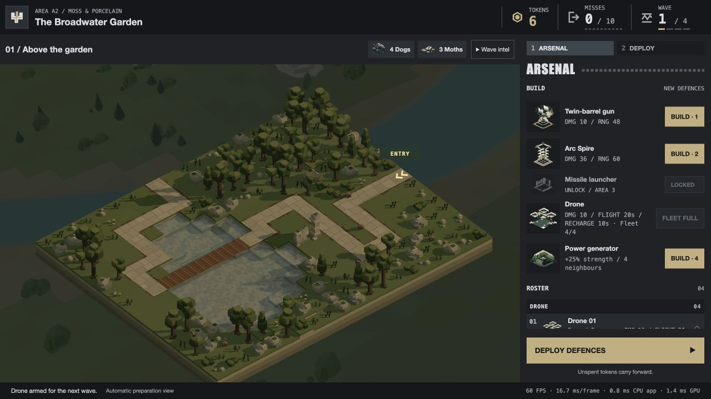

# Campaign Drone defence — 23 October 2026

The player found that Drone defences existed only in the development combat preview, and explicitly asked Tactician to decide their campaign economy and progression. The delivered implementation follows [Tactician's decision and six finite probes](TACTICIAN.md): **1 token, unlock A2.1, base only, maximum four owned pads including reserves**. They are mobile cleanup support; they do not replace an invested stationary army. Endurance-only upgrades would provide limited marginal benefit for another purchase, so no unavailable or speculative upgrade tier is offered.

Approved base behavior stays: 20 seconds from launch excluding the return trip; finish an active valid burst at expiry; return to the same pad and recharge for 10 seconds. Each burst fires ten 10-HP rounds at four rounds per second, followed by five seconds of weapon cooldown. Gun range72 follows the aircraft. The pad does not project a stationary range circle, and generators do not grant a permanent flying bonus.

## Integration and limits

- Shop, model-derived portrait, grouped roster and deployed unit details expose the fleet count and sortie/recharge timings. A fifth purchase is visibly disabled; recalling a pad does not free an ownership slot.
- Session transactions, checkpoint restoration and deployment validation enforce the same four-owned limit. Existing gun-only saves remain compatible. Only base geometry pools are allocated; models/assets remain unchanged.
- Campaign Drone control joins the existing shared planner and reuses the active enemy list. A stable identity-to-slot map preserves cached navigation when kills/escapes compact that list; scheduled enemies reserve collision space but cannot be attacked.
- Aircraft muzzle matrices and actual Drone sockets pass to the shared flash/audio callback. Silent0% policy and existing mono assets remain. No new sound assets.
- Placement reserves a safe neutral departure and actual navigation home. It reuses the runtime conservative turret prediction envelope, rejecting a reproduced legal-looking A2 pad/gun corner in either placement order. It follows the actual first fixed-clear transit layer, rather than relying on a higher alternative that the runtime would not use. Ordinary-to-ordinary placement behavior remains unchanged.
- Settling commands safe return without relaunch. New waves/controller replacement restore neutral poses through the existing rig pools. Wildlife behavior remains cosmetic; Drone flight consumes existing collision forecasts.

[Engine evidence and resource detail](ENGINEER.md) includes native mixed-fleet checks. The supported base aircraft's top envelope is path+111; the spectator camera's lowest bottom is path+117.5, retaining6.5 units of vertical separation. No camera collision change is needed.

Four pooled Drone models add bounded scene geometry/instances. The affordable lighting calculation accounts for their ownership limit: the full campaign bound rises410→434 model lights, below the existing463 maximum; local-light CPU and GPU uniform capacity each grow by768bytes. No new GPU pass, shader or viewport image is introduced. Existing Drone route/search memory scales with board nodes: the isolated2,100-node fixture retains480,448 typed bytes per aircraft,54,768 shared navigation bytes and592 scratch bytes, excluding JS/PoseRig/actor-envelope storage. Temporary20×16 preparation navigation is140,880 typed bytes and is disposed immediately. Runtime articulated-bound extraction uses774 temporary typed bytes for the base gun before caching six scalar bounds. These are bounded resource observations, not whole-scene heap or GPU-speed measurements.

## Verification

Focused checks cover config/ownership and checkpoint compatibility, native purchase-cap presentation, actual hits and correct muzzle delivery, pause/fixed ticking, stable target-slot compaction, departure geometry, ordinary placement preservation, wildlife relocation, generator exclusion, renderer pools, audio/speed compatibility and static packaging. The existing44 Drone combat/motion/obstacle/hull checks pass. The final24 placement/hull/clearance/controller checks include nine new placement cases and seven campaign-controller cases; four aircraft with mixed gun/Arc defences complete their first return with clear live hulls and identical outcomes at30/60/120Hz. Two parent targeted runs passed55 and58 tests respectively; these overlap and are not additive. An old placement fixture's hard-coded nine-ground-animal expectation was corrected to the authored roster count (currently seven); it failed identically with unchanged HEAD placement code.

The native browser review uses a separate port4307 with an explicitly seeded completed-A1 checkpoint (10 tokens, no initial defences), then the real Continue, arsenal, purchase, deployment and start-wave handlers. It buys four Drones, displays Fleet4/4 and disables the fifth purchase, deploys four pads, launches all four and advances a real A2.1 wave at2×. The Drone-only army gets **2 kills / 5 escapes**, then retains all four owned pads in preparation with neutral aircraft. [Browser result](browser-result.json). No reported game errors or captured console warnings/errors. The review origin, temporary staging page and server are isolated; the staging files/server/tab were removed after review. Active player/save origins remain untouched.

Local static package refreshed using the existing packager and committed with the source:214 files,123 runtime modules,16 levels,66 models and the existing6 audio files. The packaged validator passes hashes/MIME/relative resources at both root and repository-prefix URLs, loads all16 levels and starts all64 wave rosters. No remote push or publication. Appearance, pad placement choices and whole-campaign balance remain for player review; the finite probes do not establish universal usefulness, optimal strategies or a frame-speed improvement.
