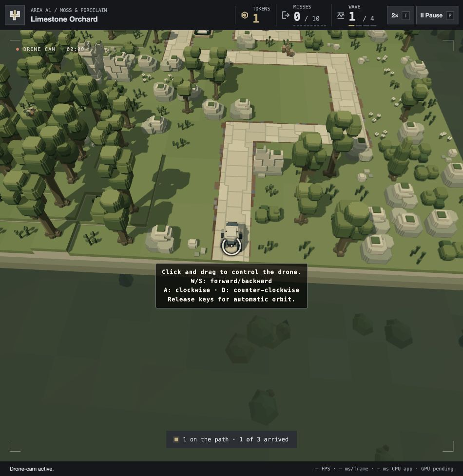

# Drone reticle and keyboard control — 24 October 2026

The player requests a clearer rotating three-quarter circular reticle, smooth W/S forward/backward target movement relative to the current orbit view, A clockwise and D counter-clockwise orbit control, and automatic behaviour when keys are released. The follow-up adds the new controls to the existing drag hint and sets the reticle to **80% opacity**. Implemented for player review.

The 48px SVG reticle uses an outlined 270° arc and a centre dot. Its angle follows the actual physical aircraft bearing every displayed frame, rather than a separate animation clock or the desired flight station. It therefore follows easing, reversals and pause. The four-line centred hint explains W/S, each orbit direction and automatic resumption. Either the first drag or a keyboard command dismisses it for the page session. Accessible canvas instructions agree.

W/S move the board-bounded target in the physical view direction, with an analytically integrated eased speed toward 40 world units/s. A/D set the existing eased orbit controller toward ±0.28 rad/s (clockwise/counter-clockwise viewed from above). Commands combine, opposing keys cancel their own axes, and the automatic composition planner waits during manual control. On release, translation decelerates smoothly to a fixed anchor and the ordinary orbit/framing resumes. These provisional speeds await player feedback. The actual aircraft still uses the existing 68-unit speed, 96-unit acceleration, 384-unit jerk and swept-clearance checks. Altitude, lens and combat rules remain.

Keys release on blur, hide, pause and lifecycle cleanup; modifiers, editable controls and unavailable scenes reject keyboard commands. Screenshot-mode controls retain their separate paused behaviour. Mouse capture release does not cancel a held keyboard command. No recurring typed array or new WebGPU resource/pass is introduced; the reticle adds one bounded DOM style update per displayed frame. No measured whole-frame performance claim.

Engineer (`gpt-6.1-sol`, high effort) performed an independent read-only integration review. Its raised-wall finding is fixed: orbit-only commands preserve the exact target XYZ, updating surface height only when X/Z translates. A real wall-ray regression covers it.

## Verification

- **75 targeted checks pass**, 560,372 assertions across eight files: `bun test tests/play-drone-input.test.js tests/play-ui-follow-up.test.js tests/play-drone-camera.test.js tests/play-camera-views.test.js tests/drone-lens.test.js tests/screenshot-camera.test.js tests/play-presentation.test.js tests/static-deployment.test.js`. [Log](targeted-tests.log).
- Keyboard checks cover all four forward bearings, opposing/combined keys, focus/modifier/blur cleanup, smooth start/reversal/release, exact pause, board bounds, fixed anchors, wall anchors, physical speed/acceleration/jerk, automatic return and 30/60/120 Hz agreement.
- Native A2/B4/D4 keyboard/edge-target runs at 30/60/120 Hz preserve camera-off combat outcomes/steps and pass static/live-actor swept clearance, with no blocked camera moves. Seven native opening checks pass as well.
- Isolated A1 browser review on port4389 verifies W forward, S backward, A clockwise, D counter-clockwise, actual-bearing ring rotation, automatic resumption and immediate hint dismissal. Captured warnings/errors are empty. [Records](browser-review.json). The final refreshed preview separately confirms computed reticle opacity0.8 and the revised multiline hint. Only this isolated review page was refreshed.
- `bun run deploy:local` refreshes **206 files / 116 modules / 16 levels / 65 models / six existing audio files / 20,713,818 bytes**. `bun run check:deployment` passes hashes, MIME/exact bytes, runtime boundaries, root/subpath HTTP delivery and all64 packaged wave starts. [Validation](deployment-validation.json).

Local changes and package are committed together under standing delivery instructions. No audio changes or remote push. Appearance and control feel await player review.

