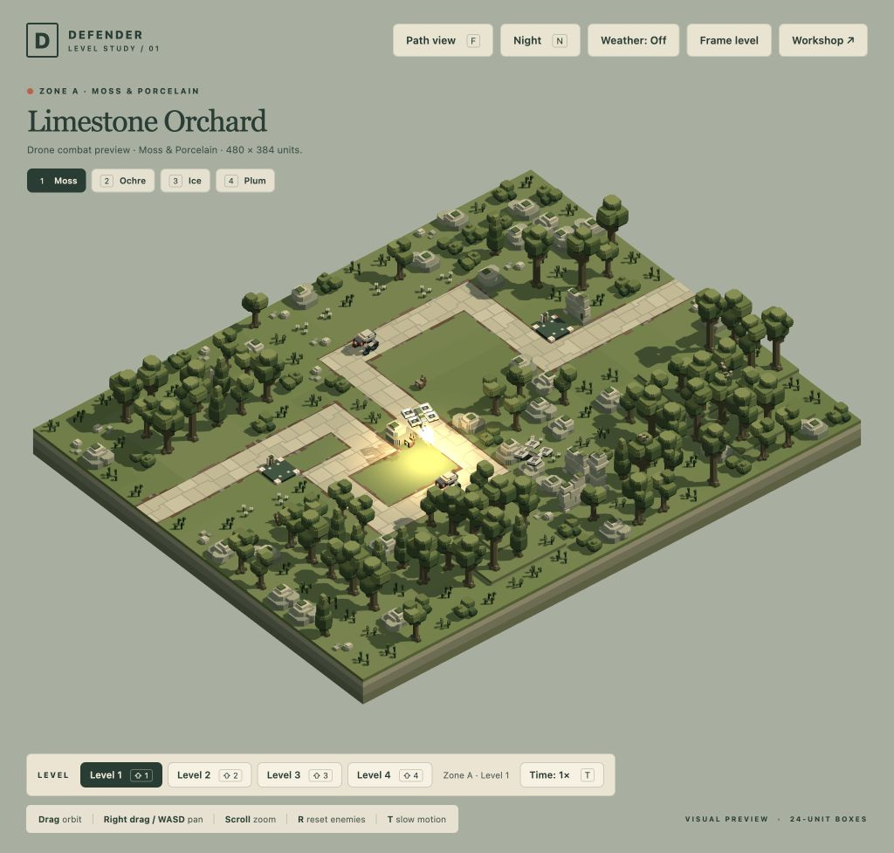

# Drone flight-control and coordination audit

**User accepted, 18 October 2026:** the corrected drones look great; the flight-control review is closed for this session.

18 October 2026. The user reported confused flights and premature-looking returns, then suggested coordination between drones. This reopens the earlier motion acceptance: a collision-free observation alone did not establish useful flight behaviour.

## Confirmed causes

- An avoidance warning could remain latched after its threat had passed. In all three baseline rates, drone 1 stayed over the pad for about 8.4 seconds, consuming its flight allowance, then climbed away even though the original obstruction was gone.
- Return flight inherited an attack-only retarget/braking flag. At 120 Hz, drone 2 stopped for the remaining 101 seconds of the observation despite having a valid return path and no living enemies.
- A symmetric 33-unit-tall aircraft envelope and unrestricted enemy joint envelopes rejected clear vertical space. Actual aircraft geometry supports a smaller asymmetric vertical envelope without reducing horizontal clearance.
- Drones shared target information and firing-position reservations, but not their intended short flight trajectories. Reactive avoidance could therefore interfere with useful progress.

The initial 20-second expiry was working as configured. Avoidance and waiting consumed the allowance; increasing endurance would hide the cause. The approved flight, weapon and recharge values remain the acceptance baseline.

## Evidence and scope

[Independent behaviour review](REVIEW.md) records the baseline and final results, with saved finite simulation data. [Geometry audit](OBSTACLES.md) explains the conservative hull derivation. [Controller handoff](ENGINEER.md) documents the implementation and checks.

The finite checks use the saved A1 scene, actual enemy and wildlife controllers, damage, death scares and multiple simulation rates. They must demonstrate useful engagement and return progress alongside physical clearance, including combat resets while wildlife continues moving. They do not establish universal crowd-navigation safety or an FPS improvement.

All existing model and level JSON files are protected by `before-assets.json`; the original runtime sources are preserved in `before-runtime/`. No geometry, layout, enemy roster or approved combat tuning changes are part of this correction.

## Implemented correction

Drones publish ten0.1-second intervals of intended motion, including actual curved routes and neutral take-off/landing. Stable right-of-way persists across phase changes. One aircraft brakes or moves outside the other’s remaining route; the waiting aircraft resumes when that movement is safe. Target ranking and damage reservations stay separate.

Warnings are revalidated against intended motion. Global routing uses current actors, with live substep guards and time-matched imminent checks. Exact straight sweeps reject actual swept-hull contact instead of empty corners of a broad rectangle; curved turns retain conservative certification. The validated aircraft envelope is X/Z16.5, below9/above6 for base. Dog future Y bounds derive from legal source articulation. Ground forecasts may discard only impossible intersections wholly inside the fixed defence volumes already excluded by wildlife navigation; actual current contact remains checked.

Return clears attack-only retarget/braking state. Safe take-off admission precedes the20-second clock. Exact neutral fan/gun/body poses are written when descent starts. Inspection fields expose return reason, avoidance cause/actor, planning failure, current flight action and yield ownership.

## Verified outcomes

The independent180-second A1 runs use real damage, living wildlife and death scares:

| Outcome |30 Hz |60 Hz |120 Hz |
| --- | ---: | ---: | ---: |
| Drone1 first-sortie rounds, before → after |0 →20 |1 →21 |10 →21 |
| Drone1 first shot after actual launch |3.93s |3.90s |3.90s |
| Drone1 first-sortie avoidance time |0.80s |0.73s |0.68s |
| All enemies destroyed |56.30s |53.97s |51.11s |
| Both aircraft returned and settled |80.73s |79.65s |80.23s |
| Actor/static/fleet envelope overlaps |0 |0 |0 |

Both aircraft finish two sorties and stay over their own pads. There are no emergency stops, post-combat escape departures or measured moving-corner enclosure violations. A separate60Hz run resets combat at45/90s while wildlife continues; it also clears the roster and settles both aircraft. Nine adversarial head-on, crossing and neutral-launch fixtures complete with no overlaps or emergency stops. The head-on case needs one passing manoeuvre, rather than repeated short escapes. These are finite checks, not a claim that all future layouts or unpredictable crowds are solved. Full details and source hashes are in [the independent review](REVIEW.md).

The live built-in browser independently records21/27 rounds in the first sorties, valid20-second expiry returns, recharges and a second sortie. At94.47s all enemies are destroyed and both aircraft are at pad hover, with no emergency stops. R restores combat while keeping wildlife active; T toggles0.1×/1×; A1→A4→A1 releases scene buffers, obstacle references and drone navigation. Browser warnings/errors and model-light overflow remain zero. The existing tab is left on A1 at normal speed, day lighting and weather off, matching the user’s settings immediately before refresh. [Live record](browser-final.json) and `browser-runtime-hashes.json` preserve the observed source version.

## Resources and preservation

A1 inspection reports2,611,352 navigation/flight typed bytes, including1,440 new intent/braking bytes. Obstacles own6,086 typed bytes and borrow96 existing wildlife-exclusion bytes. Another112 existing controller-vector bytes are outside that navigation total. Arrays are reused and released on scene unload; no new GPU resources are added. No FPS gain is claimed.

The [preservation check](preservation.json) confirms all85 model/level JSON files, all69 frozen backup checksums and the archive are unchanged. Run `bun docs/drone-controls-audit-2026-10-18/check-assets.js` to repeat the read-only comparison. The final45 affected tests pass with436,834 assertions; the lead also ran five noncombat lifecycle checks with9,788 assertions. No full test suite was run.
