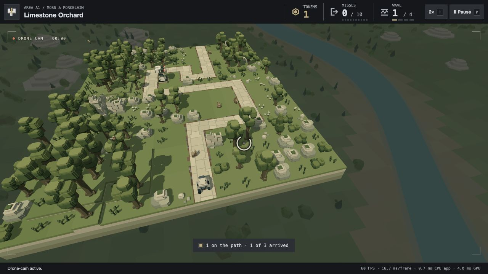

# First Drone drag repair — 24 October 2026

The player reports that the first mouse drag does not move the Drone target, while the second does. Reproduced exactly in an isolated native A1 session: the initial HUD focus is `pause-button`; after the first drag focus becomes `world`, but the target remains [12,24,204] and the controls hint remains. The second drag changes the target and dismisses the hint. [Before/after records](browser-review.json).

The window `blur` listener introduced with WASD cleanup was registered in capture mode. Element blur does not bubble, but it reaches capturing ancestors. The first pointerdown captures the pointer, then focuses the canvas, blurring the previously focused HUD button. The capturing window listener calls `clear()` and releases the pointer before any drag movement is handled. A second pointerdown does not change focus, so it survives.

`DroneInput` now registers its window-blur listener without capture. Actual window focus loss still releases the pointer and held keys. Listener ownership records the capture flag and disposal removes each listener with that exact flag. Pointer/keyboard interception remains in capture mode where required. Camera targeting, flight, orbit direction, opacity and hint behaviour remain as accepted.

## Verification

- A new focus-propagation regression fails on the original implementation (`pointer capture expected true, received false`) and passes with the fix. Both supported mouse buttons are covered, along with complete first-drag deltas, real-window-blur mouse/keyboard cleanup and exact listener disposal.
- **35 checks pass** across input, camera ownership, screenshot-camera compatibility, UI and packaging: `bun test tests/play-drone-input.test.js tests/play-camera-views.test.js tests/screenshot-camera.test.js tests/play-ui-follow-up.test.js tests/static-deployment.test.js`. [Log](targeted-tests.log). Camera flight/targeting arithmetic is unchanged, so its longer native simulation sweep was not repeated.
- The corrected isolated A1 first drag changes the target immediately and dismisses the hint with the HUD initially focused. A first drag after pause/resume also succeeds. Captured warnings/errors are empty. The player's existing tab was not reloaded; only the separate port4391 review page was refreshed.
- `bun run deploy:local` refreshes206files /116modules /20,714,585bytes. `bun run check:deployment` passes HTTP delivery, exact hashes/MIME, runtime boundaries and all64 packaged wave starts. [Validation](deployment-validation.json).

The player subsequently authorises commit, deployment and remote push; that explicit instruction supersedes the previous no-push rule for this delivery. Local source, regression checks, evidence and regenerated package are committed together; remote delivery is verified separately after push.

