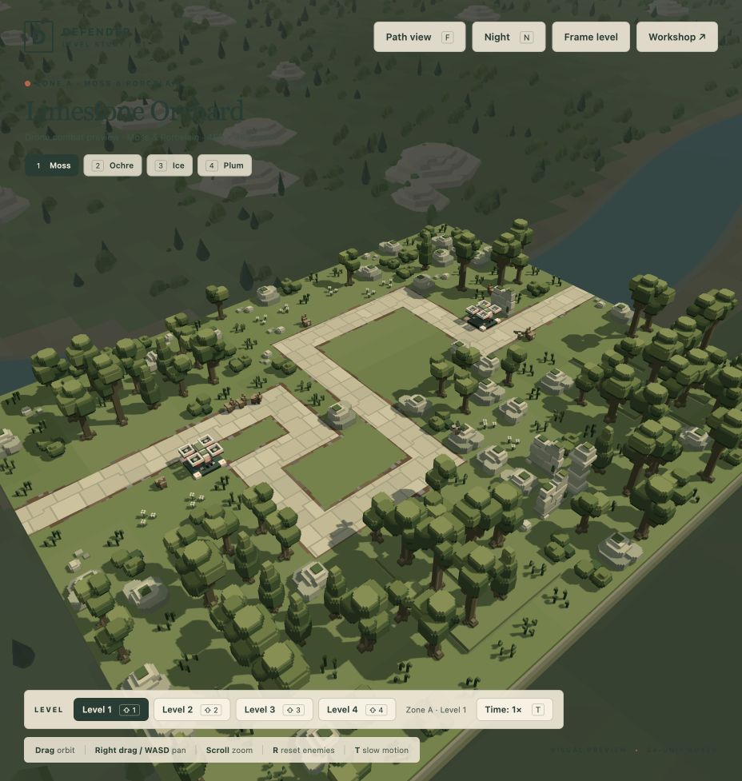

# Defence Drone intelligence — 23 October 2026

The player asks defence Drones to prioritize enemies likely to escape, fall back to potential escapees, and climb over scenery before returning to their operating height. These changes affect combat aircraft in both the campaign and development preview. The spectator camera, economy, weapon damage, flight endurance and recharge timings are unchanged.

## Target selection

Drones distinguish three classes, in this order:

1. **Likely escapees:** an enemy with a known exit and insufficient estimated stationary gun damage before leaving. Unknown or displaced/banking forecasts also become urgent within six seconds of their actual route exit.
2. **Potential escapees:** uncertain routes and enemies with enough possible downstream gun time but no assured lethal commitment. These remain useful fallback targets.
3. **Covered enemies:** other currently validated commitments already cover residual HP with the existing 1.25 margin. Validated lethal incoming missiles remove a Drone candidate entirely.

Within a class, the shared threat/time-to-exit urgency accounts for travel, body turning, gun settling and weapon cooldown. A nearly dead enemy no longer receives a special finish bonus that can steal attention from a higher escape class. A higher class releases an old station after its current valid burst; comparable targets retain the existing hysteresis. Targets that cannot be reached before exiting cannot displace an interceptable fallback. Every actual round still checks current pose, range, pitch and scenery rays. Only one defence ranks per frame.

Possible gun windows are an optimistic risk estimate, **not damage reservations**. Busy guns may not ultimately deliver all of that capacity. Arc side-surface attacks, future missiles, pursuit and uncertain moving aim points make no speculative damage promises. The classes are heuristics, not calibrated escape probabilities or a whole-campaign balance claim.

## Scenery and traffic

Navigation considers a certified entry into each altitude band, instead of attaching the aircraft only to its nearest low node. A reusable indexed Dijkstra heap measures actual horizontal and climbing distances. The ordinary four flight bands remain; a scene with exceptionally tall solid scenery or deployed defences gains one bounded, hull-clear transit band above the tallest obstacle. Existing pad departure validation still uses the original bands.

A route can climb, cross the obstacle and descend to its selected operating station. New wall regressions verify the complete flight and exact resting low endpoint at 30/60/120 Hz. Exact swept hull, rounded-curve, board, live actor and fleet checks remain active throughout ascent and descent. Higher firing stations remain available when the target's height, useful shooting window or clearance requires them.

Native A2 exposed a separate traffic trap: repeated short horizontal evasions followed an approaching Moth until the aircraft ran out of safe space. Emergency selection now considers 26 directions, can climb to the exact ceiling from a fractional altitude, and requires its destination to clear the actor's full one-second forecast. Losing a temporary firing angle cannot prevent an escape. Normal targeting resumes after evasion; neutral pad motion remains vertical and unturned. The tested A2 four-aircraft fleet returns without observed hull overlap at 30/60/120 Hz.

## Verification and limits

The final focused command runs 127 checks in 13 affected files: **125 pass; two existing missile assertions fail**. All defence Drone intelligence, navigation, motion, hull, scenery/actor clearance, finite combat, deployment placement and packaging tests in that command pass. It includes native A1 sorties/reset and native A2 four-aircraft mixed combat at 30/60/120 Hz. The six new target tests and six new navigation tests cover priority/fallback, incoming damage, uncertain routes, burst holds, travel urgency, tall walls, disconnected low entries, weighted climbs and bounded storage.

The failing archived missile scene expects `[2,15,8]` shots and receives `[0,6,6]`; the finite missile test expects incoming damage 200 and receives 300. Both reproduce with the unchanged `d39cf5e` target planner through a Bun preload override. The archived fixture import was repaired from the generated `docs/` location to `project-docs/`; its numerical expectations were not changed. [Focused output](focused-checks.log), [baseline archived comparison](baseline-planner.log), [baseline finite missile comparison](baseline-missile.log).

An additional Engineer run passed 39 navigation/finite-defence/camera checks, including A2/B4/D4 swept spectator clearance and seven native camera openings. This overlaps the focused command and is not additive. The built-in browser review uses a separate `/game/?inspect&level=moss-01` tab, leaving the player's existing `/play` tab untouched. The final reviewed runtime reports 60 real rounds, both aircraft on their second sorties after their first returns, zero emergency stops, no planning failure and no captured warnings/errors. A previous review cycle completed both second returns as well. These browser observations are smoke checks rather than deterministic balance measurements.



## Cost and delivery

On a normal 5,412-node map, navigation adds 80 shared typed bytes and 21,648 heap-index bytes per aircraft (86,672 bytes at four aircraft). The planner adds one reusable byte per candidate slot, initially at least 32 bytes. An exceptional fifth band expands the scene's bounded graph/search/motion capacity by one plane; it adds no GPU resource, image or pass. Local evasion is bounded to 156 directional/distance candidates. Searches occur on the existing scheduled thinking turns.

An isolated empty-world search comparison measured approximately 0.038 → 0.244 ms per search. This is the expected extra cost of weighted, multiple-entry navigation, not a frame-rate result. No whole-frame performance improvement is claimed.

The existing local packager produces 213 files / 122 modules / 16 levels / 66 models / 6 audio files. Source and generated package are committed locally. [Static package validation](static-validation.json) passes exact hashes, MIME and resources at root/repository prefixes, all sixteen native levels and all 64 wave starts. No remote push, publication or active-player reload. The new behavior applies when the player next loads the refreshed package; its feel and campaign usefulness remain available for player review.

Reproduce the focused command from the repository root:

```sh
bun test tests/drone-navigation.test.js tests/drone-intelligence.test.js tests/drone-combat.test.js tests/play-drone-defence.test.js tests/drone-motion.test.js tests/drone-clearance.test.js tests/drone-obstacles.test.js tests/drone-hull.test.js tests/play-drone-placement.test.js tests/target-planner.test.js tests/play-target-commitment.test.js tests/play-mixed-combat.test.js tests/static-deployment.test.js
bun run deploy:local
bun run check:deployment
```
