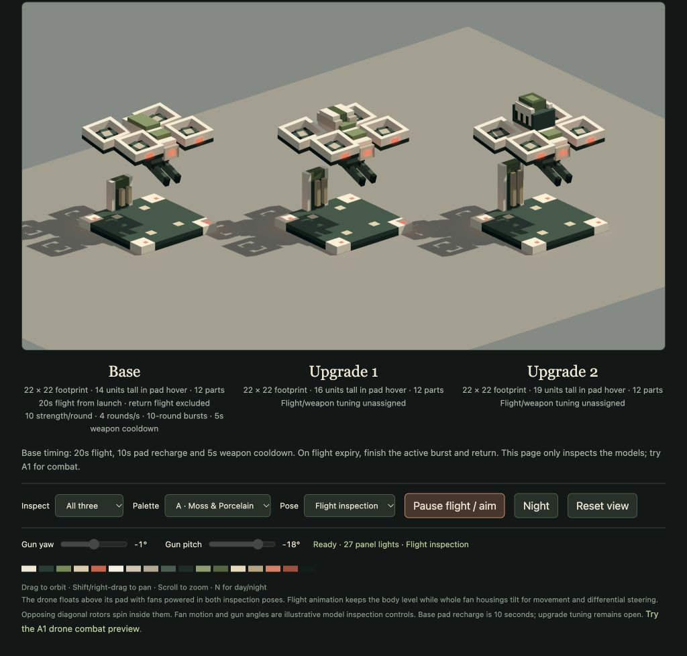

# Drone defence production models

18 October 2026. The user approved the [Moss and Porcelain concept](concepts/drone-defence-moss-porcelain-v1.png) and authorised the base and both endurance-upgrade models. The latest explicit revision **removes every leg/skid, replaces the single barrel with two separated barrels, and keeps the aircraft hovering slightly above its pad while resting**. The concept is a historical precursor where it shows the superseded legs and gun. **The user approved the revised models and authorised an A1 combat test after A4 carving.** The model-only milestone is complete; the subsequent [A1 combat test](a1-drone-test-2026-10-18/README.md) now places two base drones and implements flight, targeting, weapons and recharge. Economy and upgrade statistics remain open. The [design doc](design-doc.md#proposed-drone-defence) records approved behaviour and remaining decisions.

The family retains four square open fan shrouds, a pale stepped fuselage over dark mechanisms and its own low recharge pad with rear charging cabinet. Its underslung machine gun now has two slim, distinct barrels sharing one receiver; no landing appendages remain. Base has a low moss battery; upgrade 1 gains two pale battery shoulders and a dark centre pack; upgrade 2 gains a taller stepped central battery with pale side armour and side recess colouring. These differences communicate endurance. Twin geometry does not multiply strength per round or assign different combat values.

## Fan steering revision (18 October)

The user now requires a level aircraft body and tilting fans for both travel and rotation. All three variants have **12 rigid parts**: the four complete housings are separate `fan-*` gimbals under the aircraft root, and each original `rotor-*` is a spinning child of its housing. The outer ring shapes, battery silhouette, pad and gun sockets remain. For the later stronger-tilt request, the two front fan mounts rise one unit; the footprint and overall model heights are unchanged. The lower chassis is recessed from six to four units wide below Y13 and its dark arm ends are tucked inward to provide mechanical clearance.

Each housing shares its rotor centre as its pivot. The combined pitch/roll vector is limited to **20°**, doubled for the user’s stronger visual-effect request; this is a cone limit, not permission for 20° on both axes simultaneously. Front pivots are Y11.5 and rear pivots remain Y10.5. Enable fan steering only after **6 units of lift** above rest, and return to neutral for pad hover and the neutral vertical lane. Six units clears the tallest upgrade-2 cabinet throughout the wider fan envelope; the older four-unit gun-aim threshold is separate. The complete tilted fan envelope remains inside the existing 16.5-unit flight-clearance radius.

Eight model checks pass with 3,892 assertions, including 291 compound fan poses, 216 simultaneous fan/gun extremes, 210 gun poses, continuous rotor enclosure and conservative whole-angle fan bounds. The model review shows collective translation tilt and opposing yaw steering with a level body. Live review confirms all three stages, neutral pad fans, 27 moving lights, zero overflow and no GPU errors. [Motion integration and evidence](drone-motion-2026-10-18/README.md).

## Flight collision envelope (18 October audit)

The level aircraft uses a validated asymmetric flight envelope: X/Z radius16.5,9units below the body pivot and6/7/10units above for base/upgrade1/upgrade2. This replaces the unnecessarily tall symmetric flight cube; it does not change any model geometry. The base neutral launch/descent envelope remains11units horizontally and5vertically. Continuous bounds cover permitted fan and gun articulation; an independent production-rig check covers3,456poses and24.33million occupied-cell corners. Upgrade combat remains unassigned. See [the geometry proof and limitations](drone-controls-audit-2026-10-18/OBSTACLES.md).

## Sources and rebuild

- Canonical source: `assets/models/drone-defence.json`, model v3, `role: "defence"`, three populated variants.
- Deterministic generator: `scripts/drone-defence.js`; `bun scripts/drone-defence.js --write` explicitly regenerates this source only. Without `--write`, an existing authored source is preserved.
- Shared geometry contract: `shared/drone-model.js`. Its values describe authored pivots and mechanical inspection limits; they are not combat tuning.
- Compile only this family: `bun scripts/compile.js assets/models/drone-defence.json`.
- Targeted validation: `bun test tests/drone-model.test.js`.

The seventeen material slots match the existing arsenal palette, including its per-zone mapping. Ordinary armour, mechanisms and inset contact rails are nonemissive with reflectiveness zero. Only four small pad-corner top faces, four fan-front panels and the front fuselage identifier use red identity material at emission 1 with `castsLight: true`: **nine light clusters per model, 27 for the three-model review**, below the 29-slot model pool. The gun and rotors have no light sources.

## Rig and placement contract

All cells and pivots use shared model bind coordinates. Forward is **negative Z**, Y is up. The occupied pad spans X/Z 1–23 (22×22 units); the aircraft bind bounds are X 1–23, Z 2–22. The authoring canvas is 24×19×24. Individual occupied tops are **14 / 16 / 19**. Pad deck/contact rails are flush at Y2. The neutral gun underside is Y4, retaining an exact **2-unit air gap** in the resting pad-hover pose, without translating the original fuselage or changing its rig pivots.

| Part | Parent | Pivot | Motion / meaning |
| --- | --- | --- | --- |
| `pad` | none | `[12,0,12]` | Fixed ground root; charging-cabinet tops 9/11/13. |
| `drone` | none | `[12,9,12]` | Independent level flying root; shell, battery and recessed support arms. |
| `fan-front-left/right`, `fan-rear-left/right` | `drone` | Matching rotor centre | Whole housing pitch/roll, combined 20° limit. |
| `gun-yaw` | `drone` | `[12,5,9]` | Fine aim around Y, −15°…+15°. |
| `gun-pitch` | `gun-yaw` | `[12,5,9]` | Double-barrel gun around X, −35°…+10°; negative tips both forward muzzles down. |
| `rotor-front-left` | `fan-front-left` | `[5,11.5,6]` | Full Y rotation, positive spin sign. |
| `rotor-front-right` | `fan-front-right` | `[19,11.5,6]` | Full Y rotation, negative spin sign. |
| `rotor-rear-left` | `fan-rear-left` | `[5,10.5,18]` | Full Y rotation, negative spin sign. |
| `rotor-rear-right` | `fan-rear-right` | `[19,10.5,18]` | Full Y rotation, positive spin sign. |

The neutral muzzle centres exported as `DRONE_MODEL.muzzles` are **`[10.5,5,2]` and `[13.5,5,2]`**. Each barrel is 1 unit wide and 2 high, with a 2-unit empty gap between them for their full forward length. Both join the same 4-unit-wide receiver. Each fan has a real 6×6-unit empty shaft inside its 8×8-unit ring. The rotor's complete radius is √5; rotation retains **3−√5 ≈ 0.764 units radial clearance** from the inner walls. There is no solid fan disc or painted fan texture.

Keep gun yaw/pitch neutral during resting pad hover and through the first four units of vertical departure. Full declared fine aim is checked once lift is at least **4 units**. For a complete heading turn above its own pad with the gun neutral, **10 units of additional lift** put the neutral gun underside at Y14, above the tallest cabinet at Y13. That heading-clearance statement is independent of yaw angle and does not authorise simultaneous full pitch at that minimum height. Whole-aircraft yaw can exceed the bind square horizontally; the eventual flight controller must supply obstacle clearance. Flight inspection continues to lift the aircraft12 units. These are mechanical authoring constraints, not assigned flight altitude, speed, range or attack rules.

## Geometry and evidence

| Variant | Rigid parts | Occupied cells | Exposed unit faces | Greedy quads | Vertex/index bytes |
| --- | ---: | ---: | ---: | ---: | ---: |
| Base | 12 | 1,840 | 2,876 | 366 | 73,200 |
| Upgrade 1 | 12 | 1,952 | 3,004 | 396 | 79,200 |
| Upgrade 2 | 12 | 2,112 | 3,122 | 405 | 81,000 |

The source validator rejects duplicate cells, overlapping bind cells, invalid hierarchy/pivots and cells outside the 24-unit footprint. All twelve individual parts are face-connected. The generator reproduces the saved source exactly. The preceding eight-part milestone passed **5,053 assertions**; the latest eight-test fan revision is recorded above and covers canonical data, all-zone palette equality, matte/emissive material policy, exact light counts, finite compiled output, absent landing appendages, the two-unit rest gap, twin barrel separation and exact frozen muzzle centres, complete neutral vertical swept volumes, and fan clearance for **every** spin angle using the enclosing cylinder. It also checks revised twin-gun/casing/fork/pad separation with oriented-cell separating-axis tests at **210 poses** (all three stages, 5° yaw/pitch increments including limits); these are sampled gun poses, not a formal continuous sweep proof. The current family compiles to **1,167 quads**.

The independent [drone review](http://127.0.0.1:4173/tools/drone-review.html) uses production rigid transforms and renderer: all/individual models, Pad hover/Flight inspection, fan/aim animation, fine-yaw/pitch controls, A–D palettes, day/night and orbit/pan/zoom. Flight inspection lifts the aircraft12 units while retaining the fixed pad. Lift fans stay powered in both poses, rotating at an illustrative28 radians/second with opposite diagonal spin signs. This speed is review presentation, not physical RPM or flight tuning. Gun aim is neutral over the pad, with independent optional aiming during flight inspection. Engineer owns this review fixture; Lead owns visual browser verification.

## Visual translation and limits

Illustrated bevels and circular fan/gun details become orthogonal steps and square components. Both slim barrels have dark bore faces rather than hollow sub-unit bores. Legs/skids and the earlier physical docking contact are removed at the user's request; resting now means powered hover. Pad rails remain inset flush surfaces. The charging cabinet remains with the pad during departure. Review motion illustrates articulation only and does not promise final flight behaviour.

The user wants later intelligent interception of enemies near the exit and nearly destroyed enemies outside other defences' range. That future controller must preserve the separate flight/recharge and gun timing cycles. The subsequently approved base data is recorded separately in [`shared/drone.js`](../shared/drone.js): 20 seconds from launch excluding the return trip, base-turret strength (currently 10) per round, ten-round bursts at four rounds/second, and a five-second weapon cooldown after the final actual round. On flight expiry, finish any active valid burst and return without waiting for the weapon cooldown. Recharge is now10 seconds; upgrade tuning remains unset. The subsequent A1 controller implements those mechanics with provisional range 72 and hitscan delivery; costs, upgrade tuning and enhancer interaction remain open. Existing levels, models, A1–A3 approvals and the frozen landscape backup are preserved.

## Earlier eight-part production browser review

The preceding eight-part legless/twin-barrel family passed its built-in-browser review: all three stages and the individual base load; pad-hover preserves the two-unit gap with fans continuously turning in opposing diagonal pairs. Flight inspection lifts the aircraft12 units while every pad matrix remains exact. The gun reaches+15° yaw/−35° pitch with finite transforms; optional aiming animation moves independently. Both day/night and all four palettes show27 lights, zero overflow and no GPU errors.

The all-model scene reports239,600 bytes of geometry/instance data and75 scene buffers. Palette replacement destroys the prior75 before rebuilding. Fan motion reuses scene buffers and uploads12 rotor transforms per frame with gun aim neutral. These are bounded review-fixture observations, not a gameplay benchmark. Six revised-model tests pass with5,053 assertions, including210 sampled twin-gun poses. The existing turret-palette regression also passes. A data compatibility check uses the existing WeaponCycle to emit10 rounds at.25-second intervals (first0,last2.25), then becomes ready at7.25seconds. This checks starting weapon data, not an implemented drone flight controller.

All84 pre-existing JSON assets remain byte-identical. No production level has been changed. The earlier single-barrel/skidded captures are superseded by the current v2 captures below. User model acceptance is pending.

[Flight inspection](screenshots/drone-models-flight-v2.png), [night lighting](screenshots/drone-models-night-v2.png), [twin-barrel gun at the inspected angle limits](screenshots/drone-base-twin-barrel-v2.png). [Structured browser evidence](drone-browser-review.json).
