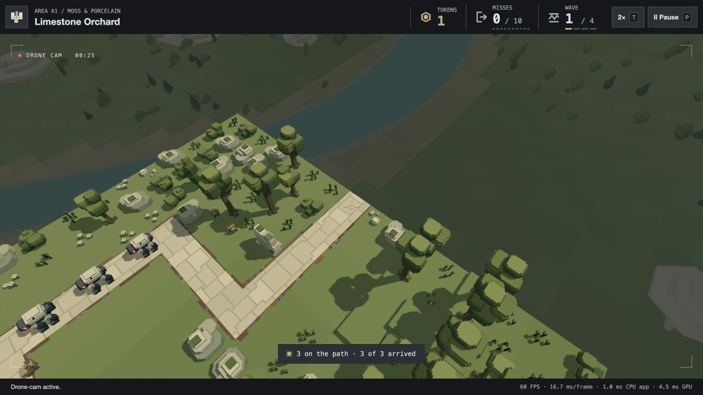
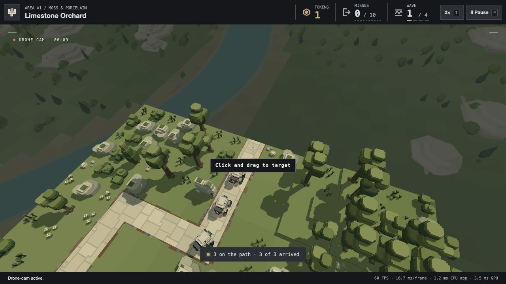
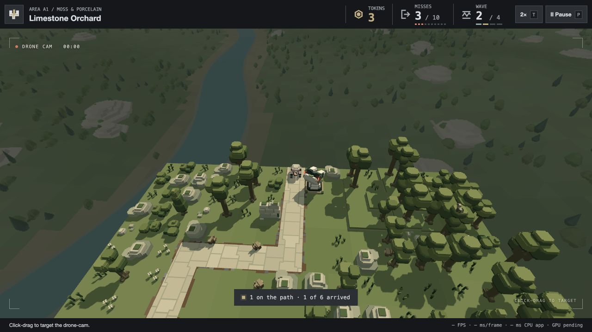
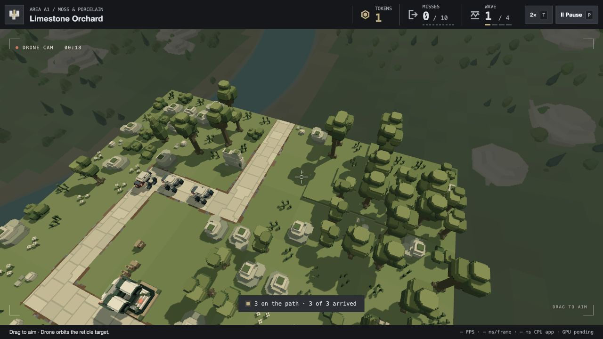

# Reticle-driven Drone camera, 23 October 2026

**Occasional zoom follow-up:** the player requests a slightly narrower lens and occasional closer action views. Default FOV is now **60°** (previously 64°), with a **54–62°** range. After eight simulation seconds at normal width, compact visible action can receive a six-second closer view; another normal hold spaces out later shots. Purposeful fast orbit travel defers close decisions. Quiet scenes return to 60°, and fresh manual aiming postpones close shots by eight seconds.

The fit samples living enemies actually inside the current frustum with clear scenery visibility, plus recently firing participating defences. World-size subject padding and 18% frame headroom discourage clipping; edge pressure cancels a close shot and can ease out to 62°. Off-screen action cannot pull the reticle. An analytic critically damped lens spring carries FOV and velocity through reversals. Pause freezes it; new waves reset to 60°. Target XYZ, high flight, orbit distance and collision rules remain. No new GPU resource/pass or typed array is added; the bounded CPU fit runs once per displayed frame and lens integration follows simulation substeps. Whole-frame performance is unmeasured.

**62 distinct focused checks pass:** 25 camera checks plus 37 lens/input/ownership/compatibility/screenshot/presentation/clearance/packaging checks. They include cadence, pressure/quiet/manual reversal, bounded lens rate/acceleration, 30/60/120 Hz analytical agreement, fixed-centre integration, actual-edge fit beyond the tighter orbit-scoring margin, recent weapon height fallback, seven native openings and native A2/B4/D4 unchanged combat/swept clearance. An Engineer read-only integration review found no blocking issue; its stale initial fit telemetry nit was corrected and lifecycle tests rerun.

Isolated A1 browser review records a 60° opening, a 54.75° close shot, wider recovery, an unchanged [12,24,204] initial anchor and exact paused lens/pose; captured warnings/errors are empty. A separate manual target stays fixed as the lens adapts. [Runtime records](zoom-browser.json). The screenshot shows the wider recovery after the close view, rather than the peak zoom. Local package refreshed; active player untouched, no push. Lens feel awaits player review.

**Centred hint follow-up:** “Click and drag to target” now sits 12 pixels beneath the reticle, centred in the view, with fully opaque light text and a solid dark backing. The first successful drag dismisses it synchronously, before the normal HUD refresh; clicking alone or moving less than four pixels retains it. Dismissal lasts for the page session across wave/level changes, without adding a persisted preference. The hint also hides while input is unavailable, including settling and screenshot mode. Neutral footer status replaces the duplicate instruction. Camera framing/flight/targeting are unchanged.

Thirty focused input/UI/camera-ownership/presentation/packaging checks pass. Native A1 confirms centre alignment (hint centre X640, reticle centre X640), a 12-pixel gap, opacity1, click/retain and drag/hide, with no captured warnings/errors. Local package refreshed; active player untouched, no push.

**Latest player clarification and action-framing follow-up:** the reticle's world point always stays fixed until the next manual click-drag. Action outside the field of view may be ignored; automatic target following is expressly rejected. The viewfinder now says **CLICK-DRAG TO TARGET**, with matching footer and accessible instructions.

The earlier two-neighbour direction comparison could take roughly ninety seconds to reach the opposite side and kept drifting away from a useful view. The new planner captures only currently visible living enemies and recently firing defences participating in those exchanges. Every 0.8 seconds it can score 24 positions around the same orbit, using weighted fighting coverage, foreground depth/placement and projected actor separation. Off-screen enemies, idle/stale weapons and remote impact events are excluded. A useful destination holds for four seconds; angular velocity eases up to 0.12 rad/s during purposeful reframing and settles into a small ±0.035-radian living arc. Empty views retain the accepted gentle survey. Dragging delays composition search for 0.25 seconds so it does not compete with ongoing input.

Reticle XYZ, 144-unit standoff, high altitude/bob, 64° lens, exterior flight and swept collision rules remain. Capture projection derives its basis from the current physical position and fixed anchor, avoiding stale displayed gimbal values between substeps. One reusable 256-byte projection array stores up to sixteen projected subjects for overlap scoring; two lists retain only the finite wave's visible actors and release on leave/rebind. Search work is bounded to 24 candidate positions per plan. No new GPU resources or passes; no frame-performance improvement is claimed for this behavioral change.

56 distinct focused camera/input/UI/ownership/screenshot/presentation/cleanup/packaging checks pass (54 together plus two added review regressions). Coverage includes visible-vs-remote fights, absent weapon Y/stale fire, material composition improvement within twelve seconds, fixed reticle, free and purposeful reversal continuity at 30/60/120 Hz, and native A2/B4/D4 unchanged combat/clearance. Isolated real A1 verifies the explicit instruction, three visible enemies at a held angle with unchanged initial target, later manual click-drag and no captured warnings/errors. [Runtime records](action-framing-browser.json). Height/framing feel remain for player review. Local package refreshed; no active-player reload or push.

The earlier entries below record historical implementation and verification stages.

**Foreground follow-up, 23 October:** the player accepts the reticle behaviour and asks for action in the foreground while orbiting stays smooth. Visible subjects now gain a composition preference below the reticle and nearer than the anchor, with bonuses fading near screen edges. The direction threshold permits a single clearly visible enemy to influence the orbit; the four-second reversal hold remains. Recent impacts fade out over two seconds, and telemetry counts visible enemies separately from impact points. Angular velocity now eases exponentially through reversals; the orbital angle uses the exact integral of that changing velocity and tangent feed-forward uses the same current rate. Target, altitude, radius, physical safety and combat remain unchanged.

The follow-up passes 42 focused checks across camera/input, ownership, former anticipation compatibility, screenshots and packaging, including real foreground/background comparisons, single-enemy direction preference, reversal smoothness at 30/60/120 Hz, all seven native openings and A2/B4/D4 combat identity/swept clearance. Local package refreshed. No new browser visual review or frame-performance claim for this follow-up; the recorded browser screenshot below belongs to the initial reticle delivery. Player review will assess the updated feel.

The player approved implementation after confirming a board-bounded reticle target and an aircraft allowed outside the board. This replaces the automatic director and the earlier click-to-target control. It changes the spectator camera; combat Drone defences retain their gameplay.

Each wave starts near the board centre, looking at the first participating route's entrance. The initial target persists until the player drags either mouse button. A centred reticle marks the exact world anchor. Rotation intersects cached ground/water/bridge surfaces and their raised sides; rays beyond the board clamp to its edge. The gimbal is derived from the same anchor after every movement step, so neither travel nor enemy activity slides it away from the reticle. Clicking alone has no targeting effect.

The aircraft eases toward a **144-unit horizontal orbit**, with a **64-unit protected minimum offset**, rather than flying directly above the target. Slow angular movement is **0.035 rad/s** (about 5 units/s around the settled orbit). Every 0.8 seconds, nearby clockwise/counterclockwise arcs are scored using real projected enemies and static visibility; a material improvement can reverse direction with a four-second hold. Recent weapon impacts contribute modestly. Remote action cannot change the anchor. This is a local visibility preference, not a guarantee that every enemy will fit a view centred on the player's chosen point.

Altitude is provisional: the floor is the greater of **path height + 200** and **highest static geometry + 32**; normal drift spans floor to floor+12. Occupied central starts can raise that floor. The lens stays at 64°. Maximum flight speed remains 68 units/s, acceleration 96 and jerk 384. Simulation-time substeps, swept terrain/water/scenery/live-actor checks and imminent entrance reservations remain. The aircraft has no board-boundary clamp. Its orbit keeps exterior travel local to the bounded anchor.

Pause freezes the exact pose and orbit clock. Settling continues filming; preparation restores overview and clears the manual choice. New waves reacquire an entrance. The viewfinder and reticle are hidden with screenshot mode and inactive Drone views. No new GPU resource/pass is added; old director/framer modules are no longer production dependencies. Their source and tests remain for historical studies.

## Verification

- 63 distinct focused checks pass across camera/input, camera ownership, former anticipation compatibility, combat Drone coexistence, UI, presentation, screenshot/study and static/audio packaging. The main run passed 62; one additional real projection/scenery scoring regression passed separately.
- Seven native frozen study scenes open safely near centre and leave combat state unchanged.
- Native A2/B4/D4 at 30/60/120 Hz retain identical kills, escapes, shot counts and engine steps against camera-off baselines, with swept static/actor clearance, high altitude, finite poses and exact reticle anchor throughout. These runs include manual corner retargeting and no blocked moves.
- Regressions cover board edges/skyward/large mouse deltas, raised dry ground, lower water, bridge tops, exterior orbits, fixed anchors under remote activity, offset recovery, bounded motion, pause, wave resets and disposal.
- Isolated A1 native browser review on port 4308 confirms visible reticle, drag targeting, stable anchor during subsequent travel and exact paused pose. The captured console reports no warnings/errors. [Recorded poses](browser-review.json).
- Local deployment contains 212 files / 121 modules / 16 levels / 66 models / six mono audio files. Static HTTP/package validation checks freshly gathered bytes, MIME types, root/subpath delivery and all wave roster startups.

The active player session was not reloaded. No push/publication. Camera height, distance and feel remain for the player to assess; no whole-frame performance improvement is claimed.

