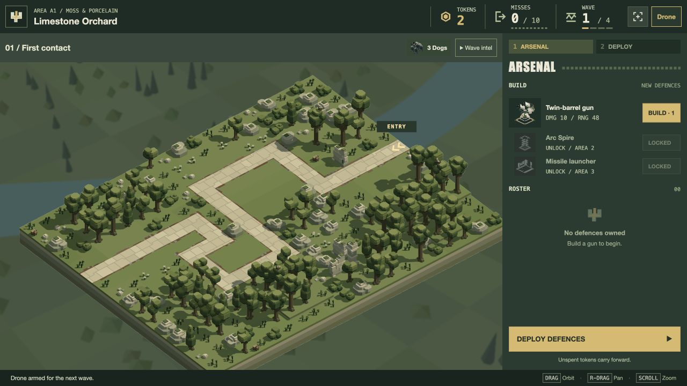
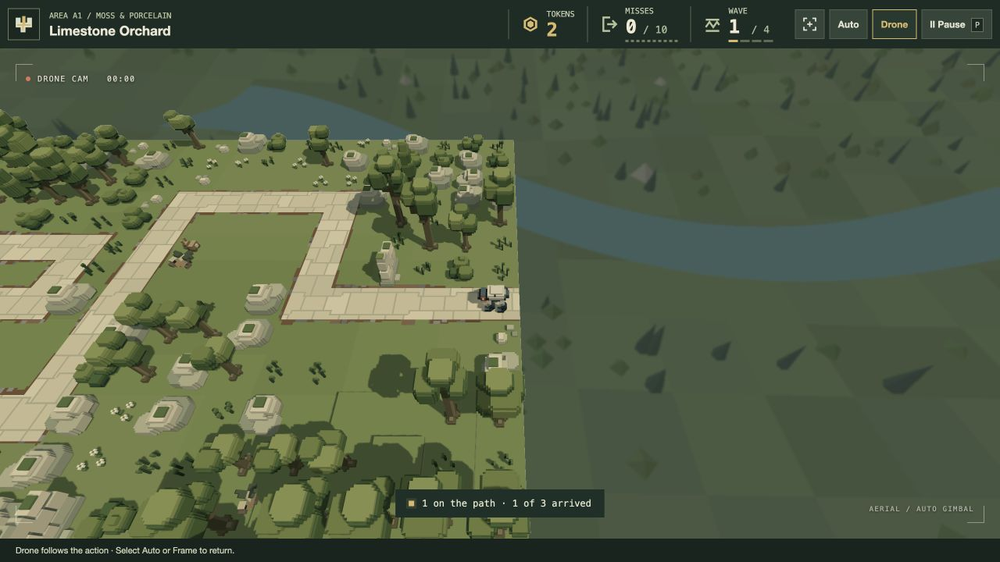
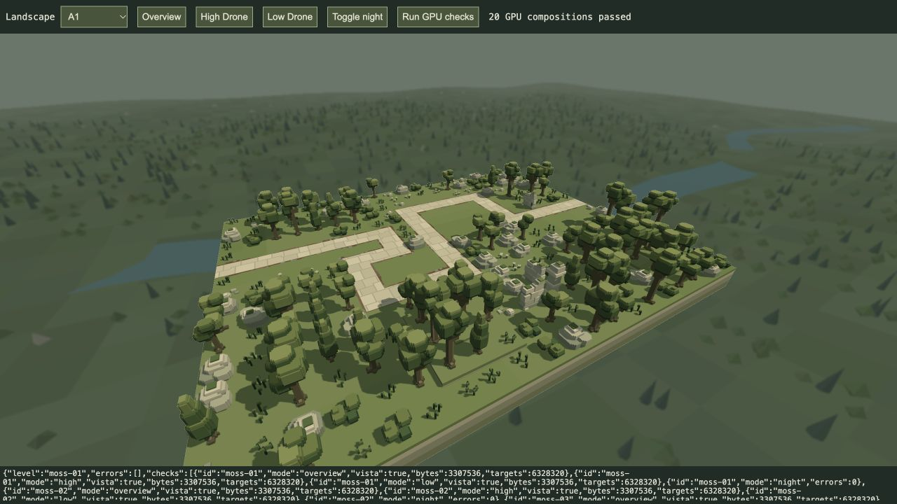

# Sharp default Drone and Zone A vista

20 October 2026. **Implemented for visual review.** User approved the [Zone A concept](../concepts/zone-a-skybox-v1.md) and requested its integration into the engine. Other zones retain their backgrounds.

Drone is armed by default on a new game or fresh retry, activates during waves and settling, and leaves title/preparation in overview. Frame and Auto still select overview; that explicit selection persists between waves and levels until a fresh run. Removed `engine/camera-lens.js`, its renderer API, full-resolution image/settings/pipeline, focus-distance state and retired review tool. Drone movement, anticipation, gimbal and FOV remain intact. The gameplay image is sharp throughout.

`engine/zone-vista.js` produces a deterministic low-poly woodland valley beneath all four production A landscapes in both `/play/` and `/game/`. Faceted hills, broad river, oak-like crowns, cypress spires and restrained limestone outcrops echo the biome. Ground is around Y−560; all vista geometry remains below Y−150. The existing board, terrain and camera navigation coordinates are unchanged. Vista geometry is absent from placement, route clearance, weapon visibility, physics and shadow queries.

The separate background pass has its own depth, a half-resolution linear colour image and a nine-tap filter in the existing display composite. Only uncovered background pixels sample it: gameplay colour/depth and the DOM GUI stay sharp. Perspective provides Drone parallax; the orthographic overview uses a matching focal-distance perspective for its background so the vista recedes. Distance colour reduction is confined to the background, with no fog volume or foreground postprocess. Day/night brightness follows existing lighting without changing it. The vista does not participate in SSR, water simulation or combat lighting.

One immutable vertex buffer is **3,307,536 bytes**. Background images require **8 × ceil(display width/2) × ceil(display height/2) bytes**; at 2560×1236 this is 6,328,320 bytes. Two background draws run only when camera, viewport or lighting changes. Static/paused views reuse the image. Resize, unload and zone changes release buffers/textures; non-A landscapes allocate no vista resources and use the existing flat background. This is bounded rendering evidence, not a GPU frame-time benchmark.

Verification:

- [45 affected tests](tests.log), 1,457,091 assertions, no failures. Includes deterministic/bounded geometry, gameplay separation, cached rendering, relighting, odd-size resize, A→B→A resource cleanup, sharp perspective rendering and camera defaults/manual override/reset. Full suite not run.
- [20 actual GPU compositions](gpu-checks.json): overview/high/low/night across A1–A4 and B1 fallback, no reported GPU errors. [Review tool](/tools/zone-vista-review.html).
- [25 additional GPU display checks](bloom-checks.json) pass after updating the standalone screen binding: zero emission remains byte-for-byte identical; water/particles/bloom and the 511th light still work.
- Fresh ordinary `/play/` preparation shows Drone armed without clicking it; Start Wave activates Drone and P freezes it. [DOM evidence](default-drone.json). Existing user run was not reloaded or reset.

Appearance remains open for the user's review. The low-poly landscape interprets the concept rather than reproducing it as a static image. No source model/level asset, campaign balance, weather default or rolled-back running behaviour changes.
