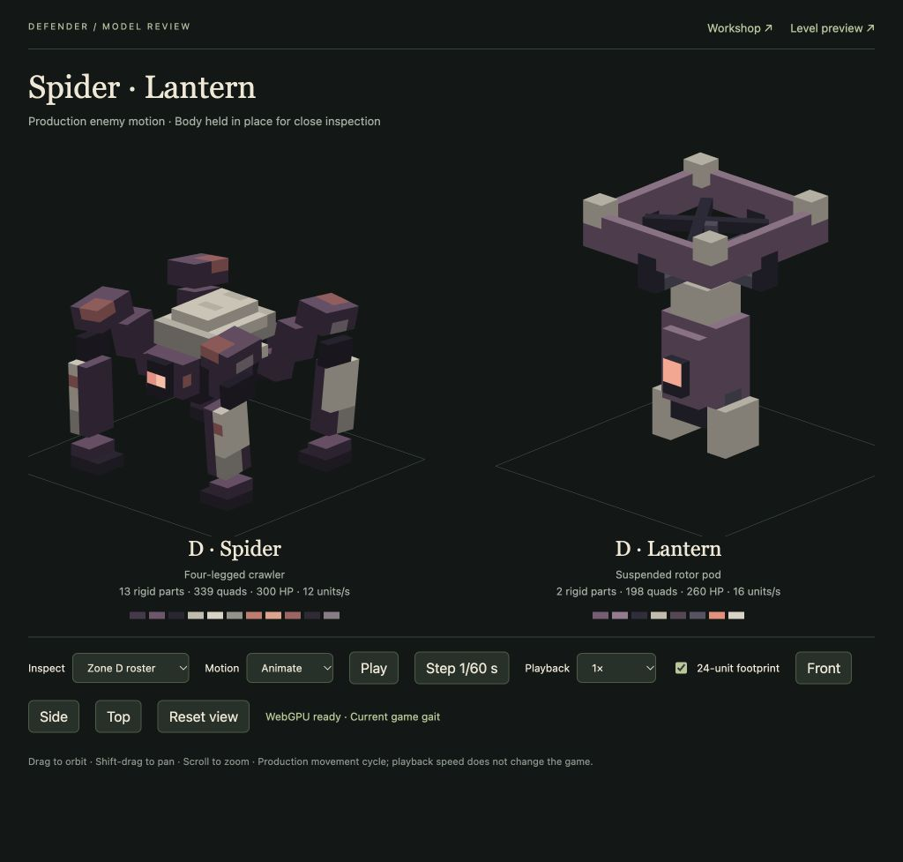
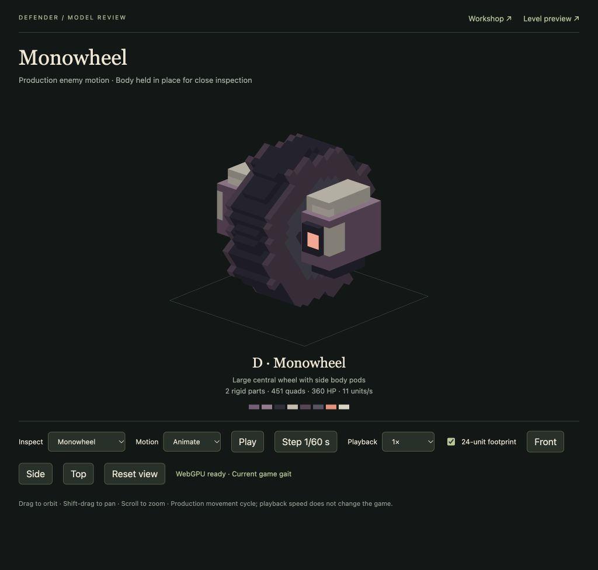
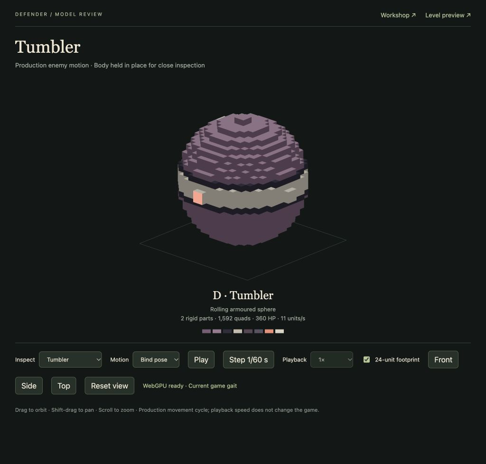
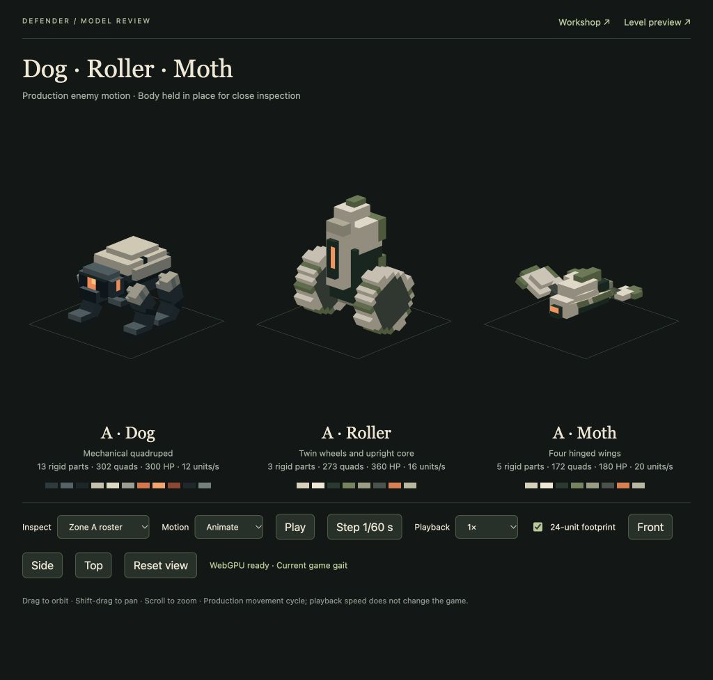
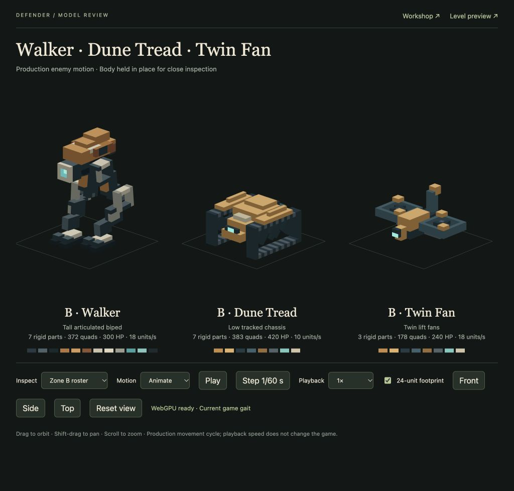
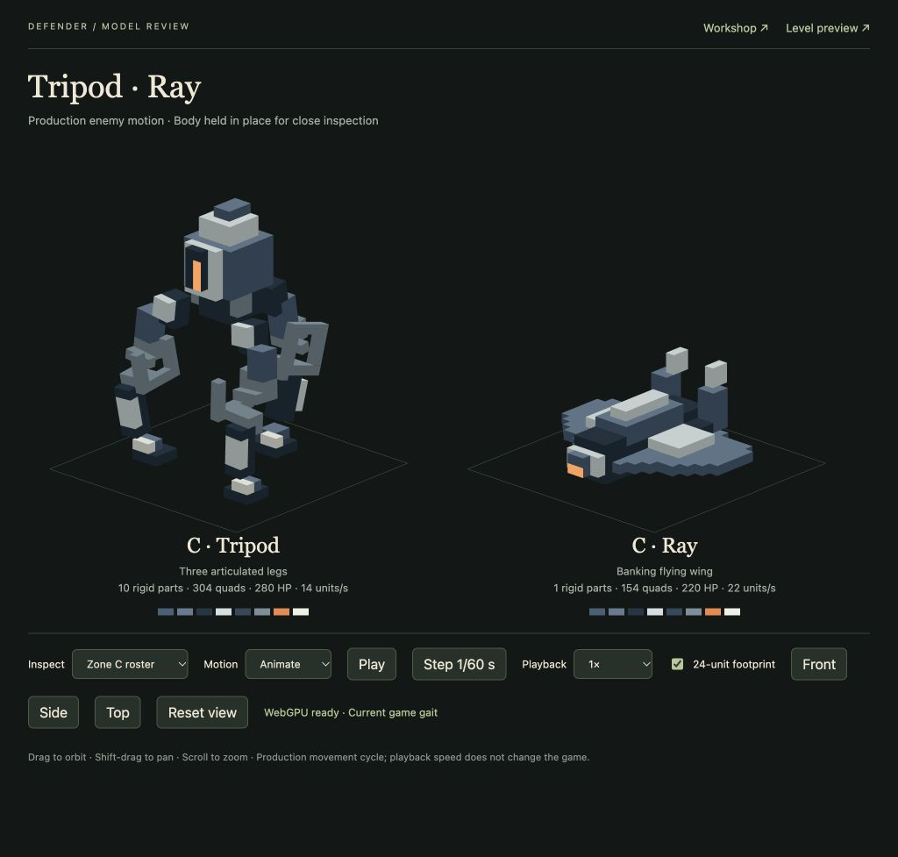

# Additional enemy models and mixed previews

**Smooth flying-enemy corners, 21 October (implemented for review):** Moth, Twin Fan, Ray and Lantern now follow bounded smooth flight curves and visibly bank with their existing caps. Fixed the final body pose overwriting the computed bank; torso aiming uses the combined bank/impact derivatives. Air routes retain authored exit timing and stay separate from ground paths. Placement reserves tight curve slabs; impact/Drone predictions enclose intervening extrema. All136affected tests pass; the frozen mixed army clears64waves/1,084enemies/0escapes. Native samples find no flight scenery/terrain contacts or air-traffic envelope overlaps; all320frozen deployment arrangements remain legal. No asset/stat changes or active-player reload. [Delivery](flying-turns-2026-10-21/README.md).

**TODO 36–41, 21 October (implemented for review):** halved water ripple strength to 0.09, doubled selective bloom to 0.70, and refined six enemy models with balanced sensors/cleaner wheels and guards. Both upgraded Arc tiers now produce a visible one-hop enemy beam at 25% effective strength within half the originating range; compatible outgoing surfaces, two endpoint attachments and separate six-slot primary/secondary banks fix prior suppression. Night light produces quarter-length flat-ground shadows on A4/B4/C4/D4. Missile admission and swept flight now include live defence solids with launcher self-exclusion. All 145 affected tests, 61 GPU shader checks, 16 source checks, actual encounter/water/night comparisons and a 64-wave/1,084-enemy zero-escape mixed replay pass. Appearance awaits review; active player tab was not reloaded. [Delivery, resources and checks](todo-36-41-2026-10-21/README.md).

**20 October follow-up:** see the [eight-note delivery](play-polish-2026-10-20/README.md) for the latest six-wheel Dune Tread, exact other-defence LOS cover, surface bullet sparks, white missile steering jets/turn-rate variation, and revised water/lighting. Earlier corresponding behaviour below is historical where superseded.

The user approved both eight-enemy concept sheets on 18 October 2026 and authorised modelling, sensible default values, and mixing them into existing levels. This extends the accepted Dog (A), Walker (B) and four-legged Spider (D). Those three models are preserved. The rejected Brambleback/Cinderhaul direction remains set aside.

## Zone D ground enemy removed (18 October)

The user requested completely removing the additional D ground enemy while they consider another design. All three D studies now contain only three Spiders and two Lanterns. The `concertina` source and compiled mesh, generation function, rig, health/movement entries and review controls are removed. Neither Monowheel nor its earlier Tumbler/Concertina forms are active. No replacement is assigned. The records below preserve the discarded design trials as history.

**Verification:** 18 affected checks pass (four model, four runtime, ten combat/roster). The removed ID is absent from active data, model generation, asset requests and every roster. [Built-in browser review](zone-d-removal-browser-review.json) confirms five actors in D1/D2/D3 and after R, clean scene unloads, zero light overflow and no errors. The model viewer now offers only Spider/Lantern for D, and the game preview is left on D1 at normal speed.

## Monowheel replacement (18 October)

**Removed trial:** this model and its runtime entries were subsequently removed at the user’s request. The following capture, numbers and checks are historical.

The user requested replacing the ball with **one large central wheel and the body on either side**. The working name is **Monowheel**, retaining source/roster ID `concertina`, 360 HP, speed 11, threat 1 and the two actors in each D1/D2/D3 preview. It uses a thick dark rotating wheel with fixed plum/off-white side housings connected through its hub. A forward coral sensor on a fixed pod emits and casts light; the opposite pod carries cooling details. The housings remain upright as the wheel turns. No abilities or campaign changes are included.

Implemented as two rigid parts (`body` and `wheel`), with 3,106 cells and 451 quads in a 20×22×22 bind envelope. The eight-unit-wide wheel turns about `[12,11,12]` with travel distance divided by `sqrt(122)` and the existing `sqrt(122) − 11` ground offset. Its full swept horizontal radius is at most `sqrt(138)` (11.748 units), while the stationary body stays within 11.181 units. The four-unit hub opening clears the axle by at least 2.585 units through every rotation. Body aim/effects remain centred; sensor light remains on the fixed body. Existing wheel animation handles this without any runtime changes or extra per-frame work.

**Verification:** 21 affected Bun checks pass (five model, six movement/light/support/reset, ten combat/roster). The model checks prove hub and ground clearance for a full revolution. Runtime checks confirm that wheel-only rotation moves neither the housings nor sensor light and causes no light repack. Existing gun, Arc and physical missile hits, death/reset and claims pass. [Browser evidence](monowheel-browser-review.json) verifies D1→D2→D3→D1 with two Monowheels, seven total actors, no light overflow, cleared previous scenes and no errors. Day/night and R were inspected; D1 is left open at 0.1×.

[Current Zone D game capture](screenshots/monowheel-game-d.jpg) · [Night capture](screenshots/monowheel-game-night.jpg)

## Tumbler replacement (18 October)

**Superseded trial:** the user subsequently requested the Monowheel design above. The following model, capture and checks describe the previous ball only.

The user requested replacing D Concertina with an enemy shaped like a rolling ball. Its working name is **Tumbler**; `concertina` remains the source/roster ID so all three existing D studies receive the replacement. It retains 360 HP, speed 11, threat 1 and existing impact/death behaviour. Spider and Lantern are unchanged. The original three-section concept is superseded.

The new shell uses plum armour, Spider-matched off-white bands and a coral emission-1 sensor that casts local light. A small stable core keeps the aim/effect point centred while the spherical shell rolls with travel distance. It adds no attacks or special abilities.

The two-part model contains 1,936 cells and 1,592 quads, with 22×22×22 bind dimensions. The shell rotates about `[12,11,12]` using travel distance divided by `sqrt(122)`; a root offset of `sqrt(122) − 11` keeps every shell corner above the ground. The swept horizontal radius is at most `sqrt(123)` (11.091 units). The small core is separated from the rolling shell by at least 6.267 units. The coral sensor and its one light cluster roll with the shell; aim, smoke and death effects stay centred on the stable core. The obsolete linked-segment animation is removed, with no recurring geometry scans or new effect pools.

**Verification:** 21 affected Bun checks pass: five geometry/material checks, six movement/ground-clearance/light/reset checks and ten existing combat/roster checks. Guns, Arcs and missiles hit the new mesh, and death/reset/claims remain correct. [Built-in browser review](tumbler-browser-review.json) confirms both Tumblers in D1/D2/D3, seven actors per study, clean unloads, no light overflow and no browser errors. The preview is left on D1 at 0.1×; T restores normal time.

[Historical ball-trial game capture](screenshots/tumbler-game-d.jpg)

## Provisional defaults

| Zone | Model | Movement | HP | Speed (units/s) | Threat |
| --- | --- | --- | ---: | ---: | ---: |
| A | Roller | Two rolling wheels | 360 | 16 | 1 |
| A | Moth | Four hinged wings | 180 | 20 | 1 |
| B | Dune Tread | Tracks with moving bogies | 420 | 10 | 1 |
| B | Twin Fan | Two lift fans | 240 | 18 | 1 |
| C | Tripod | Three articulated legs | 280 | 14 | 1 |
| C | Ray | Banking flying wing | 220 | 22 | 1 |
| D | Lantern | Rotor-supported vertical pod | 260 | 16 | 1 |

These values express visible mass and mobility for testing. Threat remains equal because no distinct tactical abilities have been assigned. There are no new resistances, enemy attacks, waves, rewards or flying-only weapon restrictions. Existing Dog/Walker/Spider defaults remain unchanged.

## Geometry and materials

The approved [ground sheet](concepts/enemy-ground-expansion-v1.png) and [airborne sheet](concepts/enemy-airborne-expansion-v1.png) establish silhouettes and zone palettes. Grid models translate their bevels and curves into solid stepped geometry inside a 24×24 footprint. Twin Fan's square fans face upward to provide lift. All models use authored zone colours, matte armour and emission-1 sensors with `castsLight: true`. The user’s production review replaces Concertina/Lantern’s pale mint-blue panels with the Spider’s warm off-white shell colours; their plum armour and coral sensors remain. Pale panels use `#C3BCAE` and edging `#DAD3C4`, matching the Spider source exactly. This overrides the mint panel treatment depicted in the concept sheet.

Sources are the seven remaining matching IDs in `assets/models/`; [the generator](../scripts/enemy-expansion.js) and [rig contracts](../shared/enemy-expansion-rigs.js) keep source pivots, forward direction, motion limits and body effect origins together. `bun run seed:enemy-expansion` creates missing members while preserving authored sources; `bun run seed:enemy-expansion --write` explicitly regenerates this family. Compiled meshes live under ignored `build/models/`.

## Preview movement and combat

Every A/B study retains its three original enemies and adds two instances of the new ground model plus two flyers. C has two Tripods and two Rays. Every D study retains three Spiders and two Lanterns; its additional ground enemy has been removed. The twelve saved level layouts, static scenery and defences retain their placements; [runtime rosters](../shared/enemy-roster.js) load only the selected zone's actors. This is a finite development roster, not campaign wave spawning.

Each actor owns its route time, speed and lap. Path geometry is shared for equal turn settings and movement mode. Airborne actors use smooth curved corners, with visible body banking; ground actors retain the authored centre line. The fixed flyer root altitude is 36 units above the dry path; body height and bank determine actual sensor/impact height. Flight rounds the existing X/Z route within a bounded corridor, preserving its authored time-to-exit; actual speed eases through corners. This adds no free navigation or obstacle-avoidance mechanic. Weapon range remains horizontal, while physical gun pitch, line of sight, Arc surface sampling and missile collision operate in 3D. A gun unable to elevate enough waits or chooses another valid target. Route-centre forecasts cannot certify off-centre or banking aim points: those actors receive no speculative downstream gun credit. Actual target acquisition and validated shots remain active; launched missile claims remain exact. This conservative guard also covers the original Spider’s half-unit forward aim offset.

Damage, death, missile commitments and R reset use the existing systems. All new ground and air actors can be attacked by guns, Arc Spires and silos. New wheeled/tracked units receive guarded whole-body impact displacement; flyers use guarded airborne sway. Existing Dog/Walker/Spider stagger is preserved. No new impact effect is introduced. Death blast/debris sizes use the existing presentation scaled to the new units' visible mass.

The [enemy model viewer](/tools/enemy-review.html?model=zone-A) supports individual models and zone lineups, animation/bind pose, pause, slower playback and stepping. The [game preview](/game/?inspect) uses 1–4 for zones, Shift+1/2/3 for defence studies, T for 0.1× time and R to restore the roster.

## Production review captures

These are captures of the actual animated models. Each new model contributes one eye-light cluster. The seven remaining expansion models total 5,120 cells, 1,662 quads and 31 rigid parts. Removed Monowheel and sphere trials are recorded above as history. No measured frame-rate improvement is claimed.

[Current Zone D game preview after removal](screenshots/zone-d-game-after-removal.jpg). Spider and Lantern are the only active D types.

## Original expansion verification and limitations

Targeted verification passes **136 distinct Bun checks**, covering models/materials, mixed movement, legacy gaits/stagger, real gun/Arc/missile contact, forecasts/claims, health/death/R, asset isolation, renderer uploads/lights and wildlife separation. No full-suite run was made.

- Model checks: five tests / 6,483 assertions; 540 mechanism poses and 768 Tripod poses. Tripod uses a 4.2-unit stride over 0.3 seconds, with connected knee bearings, flat planted feet, maximum body radius 11.881 and sole radius 11.457.
- Runtime checks: seven new tests plus 34 legacy gait/impact checks. Sampled 9,000 airborne route poses across all twelve studies against scenery, terrain and gun/Arc/silo envelopes, and 3,000 new-ground route poses for support/scenery clearance. Mechanism clocks remain continuous across route-loop timing boundaries.
- Combat/planner checks include real damage and kills against all eight meshes, conservative forecast exclusion, one defence thinker per frame, exact missile claims and reset/lifecycle reuse.
- [Production WebGPU light checks](enemy-expansion-light-gpu-review.json): 25 pass, including every affected lighting shader and the final slot in the 77-light uniform. Maximum authored model lights are A1’s 29; the cap rises from 25 to 29. This adds 128 bytes to the fixed GPU light uniform and 256 bytes across the two CPU light arrays, without another lighting pass. Other studies use fewer slots.
- [Built-in browser review](enemy-expansion-browser-review.json): all twelve rosters load with zero light overflow and clean previous-scene buffer/actor release. Normal/0.1× timing, reset, day/night and actual C missile kills are verified without browser/WebGPU errors. The [original D capture](screenshots/enemy-expansion-d.jpg) predates the Tumbler silhouette replacement; current captures appear above.

These are first production interpretations and provisional preview balance. No campaign waves, enemy attacks or special abilities were added. Ground impacts and airborne sway use conservative clearance envelopes, which may reduce visible displacement near obstacles. Flyer flight remains fixed-altitude route following. No whole-game frame-rate or CPU/GPU improvement is claimed.
