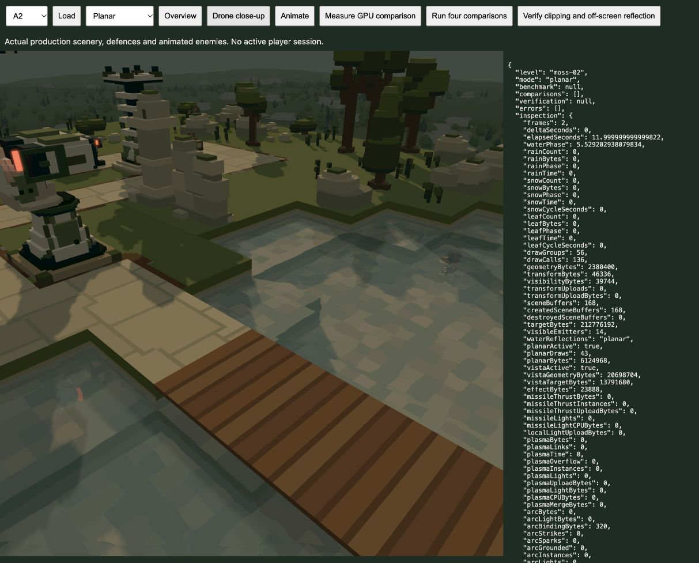

# Engine cleanup and planar water reflections — 21 October 2026

The user authorised the reviewed engine optimisations and the proposed planar-water comparison, including closing/reloading idle tabs. The measured planar path is now the production default for horizontal water. Appearance remains for user review.

## Rendering and water

`engine/planar-reflection.js` owns a lazy application pipeline, a 368-byte mirrored frame uniform and a reusable 368-byte CPU frame. Its two half-width/half-height images belong to the active scene/viewport and are released on scene replacement. All current wet levels have a single water height, so disconnected pools share one capture. A1 is dry. Future mixed-height scenes retain SSR rather than reflecting against the wrong plane.

The reflected view multiplies the existing camera projection by the water-plane reflection, flips winding, reflects the eye/view vector, clips geometry below the plane and reuses the original posed geometry/instance buffers and sky-shadow/local-light bindings. It supports overview, Drone and paused free-camera projections. Solid debris uses the same lighting and stochastic fade in the capture. Small existing ripple slopes distort the sampled capture; 0.09 ripple strength, blue tint, 60% base transmission, refraction and reflection weighting remain. No water image asset, analytic glint, GI or AO is added.

Capture rendering is skipped if the water AABB is outside the main frustum or the viewer is below its plane. Static camera/scene captures are reused while ripple animation continues. Camera, visible poses, visibility, lighting and solid effects invalidate the capture. Changes made while reflections are disabled also invalidate it, preventing stale reuse on reactivation. Filtered silhouette RGB is unpremultiplied before the existing straight-alpha water mix, avoiding double coverage/dark edges.

The capture currently includes local opaque scenery, defences, enemies, wildlife and solid debris. Its transparent background does not reflect the distant vista/sky; translucent particles, Arc channels and blood decals are not drawn into this first capture. Capture misses preserve the accepted water base. Ripple distortion is an approximation over the flat reflection plane. The SSR review/fallback remains available, including existing dry reflective materials; hardware ray tracing and cubemap probes are not introduced.

Dry worlds use two 1×1 inactive water bindings and skip the empty water mask pass. Every shader consumer uses the same dry-depth guard, including bloom, effects, weather and shockwaves. This saves `8 × (width × height − 1)` bytes: 15.82 MiB at 1920×1080. Wet-world water masks retain their previous precision. The new reflection pair adds `8 × ceil(width/2) × ceil(height/2)` bytes when visible: 6,124,968 bytes at the measured 1746×1754 viewport, plus its 368-byte uniform. No geometry/instance/shadow buffers are duplicated. Application pipelines/frame survive level changes; capture images do not.

## Other completed fixes

- Blood effects expose separate solid/decal revisions while preserving the packed buffer and existing revision API. Decal-only fading/removal uploads colour data and refreshes opaque colour, without redrawing camera depth or sky shadows. Solid changes and legacy callers still invalidate conservatively. Producer-to-renderer fade/expiry is covered with actual `DamageEffects`.
- Bloom admission follows visible emissive material instances, independent of whether they cast local light. Hidden actor pools no longer allocate/execute bloom solely because they contain authored lights; transient flashes, blasts, electrical channels and thrust still enable it. Hiding an emitter removes its cached halo.
- Cosmetic Drone anticipation excludes the firing tower from LOS while other defences remain blockers. Native A1 forecasts now begin at 11 seconds, before the first shot at 19 seconds. The obsolete removed-depth-of-field assertion is replaced with the retained sharp, smooth gimbal contract.
- UI and telemetry share a snapshot/engine-stat calculation. Paused screenshot/fade-only telemetry retains the normal five-Hz cadence, with immediate lifecycle updates and final-pose publication. The existing default `dataset.play` diagnostic contract remains available.
- Synchronous missile forecasts cache defence-part broad-phase centres once per forecast and release that snapshot in `finally`; ordinary live queries still read current poses. Segment invariants and fixed radii are reused. Arc checks reject missed part bounds before visiting exact faces, retaining sampling order, edge tolerances, retries and RNG consumption.

## Measured evidence

[Paired whole-frame GPU samples](reflection-gpu.json) alternate SSR, planar and reflections-off at a fixed camera/pose/ripple phase, with 12 warmup and 72 measured frames per condition. The changing condition invalidates camera-space passes in every mode, including the planar capture; static keeps the geometry/capture caches. Each mode has 24 retained samples. Measurements are local/exploratory, not an FPS promise or a hardware-wide guarantee. GPU quantisation and scheduling noise are visible; for example one planar median falls slightly below the off baseline.

| View at 1746×1754 | Changing SSR | Changing planar | Static SSR | Static planar |
|---|---:|---:|---:|---:|
| A2 overview | 7.373 ms | 7.045 ms | 1.933 ms | 1.212 ms |
| A2 close Drone | 17.531 ms | 13.533 ms | 6.357 ms | 3.506 ms |
| B4 overview | 9.896 ms | 9.470 ms | 3.146 ms | 1.999 ms |
| B4 close Drone | 9.798 ms | 8.880 ms | 4.653 ms | 2.654 ms |

These comparisons were recorded before the final silhouette-alpha correction and application-pipeline retention cleanup. Those final corrections passed subsequent GPU compilation/rendering and cache/disposal checks; the table is not a second benchmark of that final revision.

[Exact native CPU traces](defender-collision-comparison.json) match before/after for 20-second A4/B4 samples. Forecast counts and sweeps are unchanged. B4 transformed-centre calculations fall 8,729,456→282,570; A4 673,127→86,671. Four-zone Arc outputs, attempts, normals and RNG consumption match exactly while detailed face visits fall about 60–67%. Added bounded CPU storage is 24 bytes per placed defence part (504 B in B4), plus 48 bytes per distinct Arc shape part per sampler.

[Six alternating-order scoped Bun timings](defender-collision-timing.json), with setup/warmup excluded, show B4 forecast CPU medians of 147.113→111.577 ms per 20 simulated seconds and whole advance workload 181.206→143.367 ms. These are isolated native CPU workloads, not browser/GPU frame timings; one after sample is a high outlier.

## Verification

- **189 distinct affected tests across 22 files pass**; the full suite was not run. [Scope and provenance](test-summary.json), [renderer/planar log](renderer-final-tests.log), [shared effects/weather log](defender-review-shared-tests.log), [collision log](defender-collision-tests.log). Camera and damage specialist checks are recorded in their tool transcripts; their raw logs were not saved.
- **180 production shader/readback checks pass**, covering bloom, smoke/blasts/debris, Arc, rain/snow/leaves, shots, shockwaves and decals. [Results](gpu-checks.json). The dry-water guard reproduces the normal visible-particle value despite an inactive binding containing a nearer depth. The old ripple readback fixture needed the actual nonzero water tint; a black default could not exercise the current tinted ring shader. No production ring appearance changed.
- **64 actual production level/view compositions** across all sixteen levels pass without GPU errors. [Results](all-zone-gpu.json). All five exact MSAA battlefield-edge comparisons also pass. [Results](edge-gpu.json).
- [Live reflection proof](planar-proof.json): all 1,256 above-plane Arc vertices are outside the main camera top clip plane, yet the reflected capture contains 38,766 pixels. Raising the clipping plane above the geometry leaves zero capture pixels.
- [Telemetry probe](telemetry.json): one snapshot/stats read per paint; 199 throttled cosmetic calls create no snapshots; lifecycle publication remains immediate.
- Fresh [mixed production campaign](mixed-campaign.json): 64 waves, 1,084 kills, zero escapes/misses. [Log](mixed-campaign.log).
- Browser bundle: 110 modules, approximately 1.24 MB. [Build](build.log).

The isolated comparison is `/tools/planar-reflection-review.html`; `/tools/water-audit.html` retains its explicitly selected SSR baseline. The original player tab was idle and could be replaced under the user's current instruction.

## Reproduction

Run `bun docs/engine-optimisation-2026-10-21/defender-collision-comparison.mjs` or `defender-collision-timing.mjs` from the same folder for the retained collision baseline versus the working engine. These retain the old query implementations, not a complete old engine; both use current assets and other simulation code. `telemetry-probe.mjs` checks the actual current application functions. The browser comparison page exposes the paired GPU runs and live clipping/off-screen proof through its controls. Saved JSON/logs above are the evidence from this delivery.

## Primary references used for the choice

[Epic planar reflections](https://dev.epicgames.com/documentation/en-us/unreal-engine/planar-reflections-in-unreal-engine) explains mirrored scene rendering, off-screen coverage, normal distortion and geometry cost that does not disappear with reduced resolution. [Three.js Reflector](https://threejs.org/docs/pages/Reflector.html) documents reflection cameras/render targets. [Babylon reflection mapping](https://doc.babylonjs.com/features/featuresDeepDive/materials/using/reflectionTexture/) explains planar mirrors, cubemap parallax approximations and six-face update costs. The implementation is native to this WebGPU engine; no third-party runtime was added.

