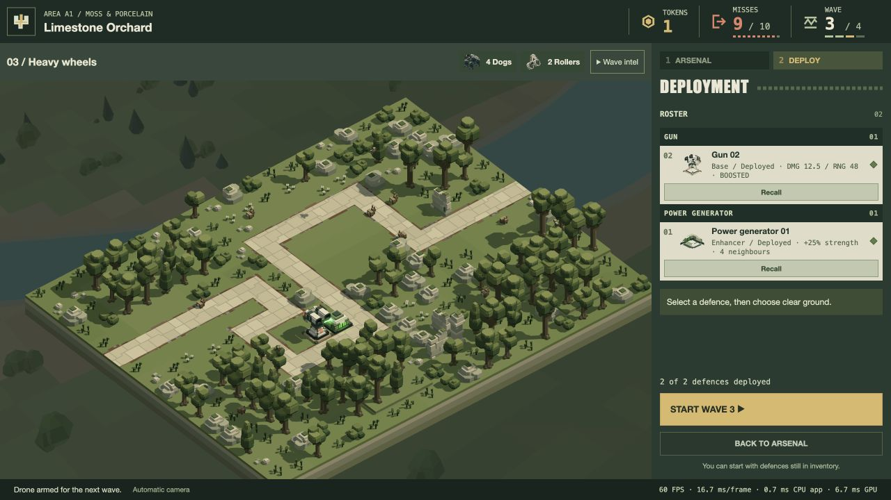

# Power Generator in the campaign — 21 October 2026

The Power Generator is now a **single-version, non-upgradable enhancer** in the campaign arsenal. It costs **4 tokens**, a provisional interpretation of “relatively expensive” above the 1/2/3-token gun/Arc/missile purchases. It is offered from the start when affordable. The normal 2-token opening wallet and +2 wave reward are unchanged.

Its strength bonus is **25%**, applying once to attacking defences in the four edge-sharing placement squares on the same dry path-height ground. Diagonals and distant squares do not qualify; generators do not enhance themselves or each other, and multiple generators do not stack. The approved rate/cooldown modifier fields remain zero. All nine gun/Arc/missile tiers work with the bonus. Missiles capture the effective damage at launch, once, for claims and physical contact.

## Implementation

- Shared enhancer stats contain only the base +25% record. Catalogue validation rejects enhancer upgrades, attack rules, non-25% effects and unsupported variants. Session ownership supports purchase, deployment, recall, movement and level transfer. The generator has no upgrade action or attack-planner state.
- Only base geometry is pooled and shown in the generator review. Previously accepted taller model variants remain historical source geometry because the general model format still requires its three variants; they are not playable upgrades. No accepted model or level geometry was edited.
- Fixed generator solids obey normal ground/scenery/enemy-route/defence and enabled-wildlife clearance and block actual LOS/missiles. Disabled critters still avoid cosmetic habitat work.
- Existing enhancer adjacency is prepared when controllers/deployments change, not searched each simulation tick. Effective strengths reach targeting, gun/Arc damage, Arc chains and missile claims. Reset/disposal restore original strengths; redeployment and ordinary weapon upgrades cannot compound them.
- Existing green plasma links use copied fixed-surface anchors, continuous lit ribbons and the accepted wave tuning. App ownership follows the enhancer controller; links rebuild on deployment/start/next wave/retry and retire on scene release. Pause freezes them. Reflection/bloom graphics switches still govern their existing rendering paths.
- The shop shows price/25%/four neighbours, the generator roster has no upgrade button, and deployed weapons show effective damage plus BOOSTED. Hovering a generator placement highlights its existing edge-adjacent recipients and gives an activation hint. It has no circular weapon range. Placement refresh invalidates its overlay cache so recall cannot leave stale valid-cell polygons.
- Added a model-derived vector portrait using the existing generator; all earlier portraits retain the same source geometry.

## Bounds and resources

The normal campaign offers 128 tokens before its final encounter. At 4 tokens per generator, at most 32 generators can be bought; four possible recipients each gives a conservative 128-link bound before spending on those recipients. The plasma pool is raised from 16 to 128, with an economy regression guarding that bound. Unusual custom configurations still report visual overflow independently of actual damage.

When plasma is active, its existing ribbon and merged tube-light GPU buffers reserve **196,608 + 42,576 = 239,184 bytes**; the CPU plasma pool is **353,296 bytes**, with another 42,576-byte renderer merge array. These are bounded, lazily allocated resources, not a performance saving. Existing Arc resources may also be initialized by the shared pipeline. No new GPU pass, viewport target, dependency or global scene cache was added. Active-frame uploads use only the populated prefix. Idle scenes without links do not allocate the plasma pool/buffers. The portable campaign point-light bound remains unchanged at 410 authored model lights; generators provide four clusters but cost four tokens, so they cannot exceed the cheaper gun's light-per-token peak.

## Fresh verification

**133 distinct affected tests across 17 files pass**, deduplicated across bounded specialist/lead runs:

- Catalogue/data/model/session: 38 tests across enhancer, enhancer preview/integration, power-generator model, play config and session.
- Runtime: 39 tests across play enhancer combat, enhancer preview/integration, play engine, placement and mixed combat (nine tests overlap the catalogue set). Actual gun/Arc hits and launch-captured missile contacts cover every weapon tier; stacked/inactive cases, placement/recall/upgrade/next wave/retry and exact generator-solid LOS are checked.
- Rendering/UI geometry: 60 tests across renderer, plasma pool, plasma anchors, roster and unit highlight. Reused resources, max capacity with combat Arcs, cleanup, no attack range and economy capacity are covered.
- Campaign resource loading and graphics preferences: five checks across campaign integration and graphics options, including per-zone enemy geometry and disabled wildlife.

The runtime resource fixture performs 18 deployment edits and three wave/prepare cycles without allocating additional scene GPU buffers; exact one-time cleanup is verified. This concerns geometry ownership, not the separate lazily active plasma buffers.

Existing four strict wildlife-pose deployment-test failures, documented during the earlier graphics work with a pre-change reproduction, were not modified or rerun. No full suite or full campaign balance replay was requested/run.

Actual [production-shader GPU checks](plasma-gpu.json): **48 pass**, including the final 128th plasma slot, all reserved primary/secondary Arc and plasma lights together, correct bloom/depth/water response and no validation errors. These checks establish functionality, not a GPU timing improvement.

Actual ordinary `/play/?inspect` [purchase/deployment evidence](ui.json): a separate disposable run earns six tokens through two intentionally unarmed waves, buys generator4 + gun1, places them at [11,0,6]/[12,0,6], and shows 12.5 effective damage with one plasma link. Recalling the generator returns the gun to10 and removes the link; replacing it restores12.5. The generator has no visible upgrade control. Spending the last token on the gun's Upgrade I changes its effective damage to15 and keeps one link. Every shop/roster portrait loads; generator hover has no NaN/undefined/Infinity SVG points. This deliberately unarmed setup is a UI witness, not a recommended strategy or balance result. The subsequent [actual A1 wave3](combat.json) clears all six enemies: the client returns to wave4 preparation with completedWaves3, unchanged nine misses, the 15-strength gun and one 32-span plasma link, zero overflow and no reported errors. No full-campaign outcome is inferred.

Browser build: **116 modules, about 1.27 MB**. The user's original B2 playthrough was not reloaded or operated; the changes apply on the next load. Cost and appearance await player review.
