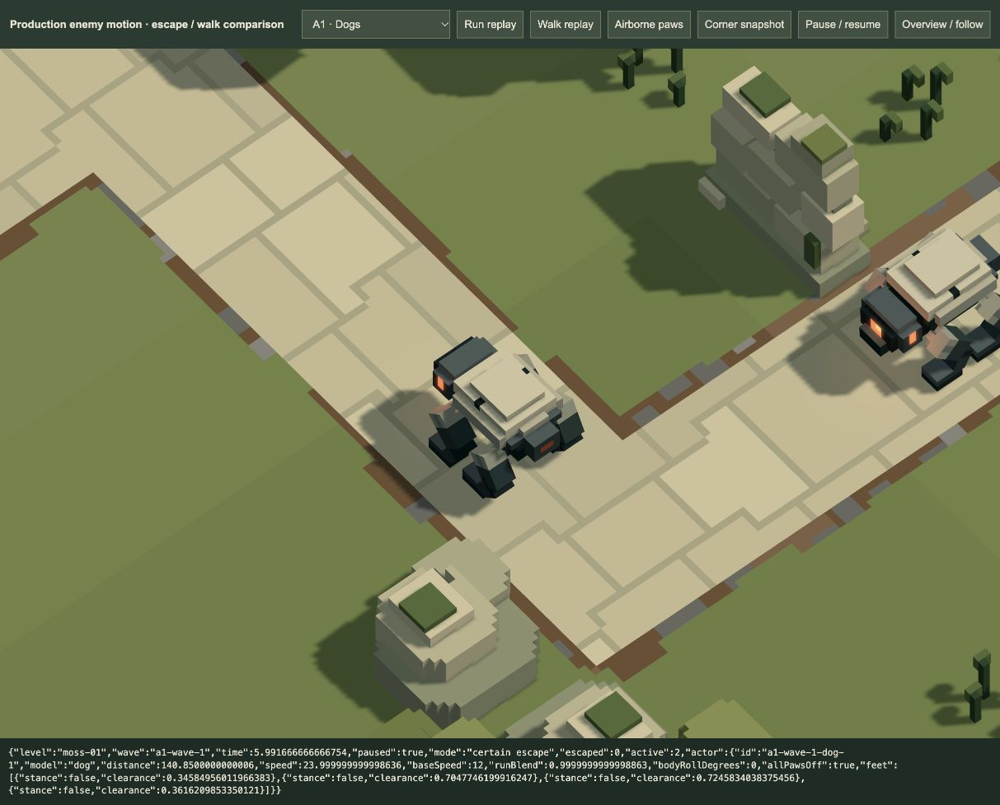

# Certain escapes, running and softer ripples — 20 October 2026

**Running rolled back, 20 October:** the user rejected the later isolated gallop and requested removal of all running work. Escape acceleration, the bounding gait, corner/traffic modifications and run review tooling described here are removed. The softer water ripple changes remain active. Motion tests and screenshots below are historical evidence of the abandoned implementation. [Current rollback record](../run-rollback-2026-10-20/README.md).

The user requests softer water-impact ring edges and faster enemy movement once destruction is impossible, with spacing, actual running legs and smooth cornering. The user confirms **roughly twice normal speed**. Implemented for visual/gameplay review; tuning remains provisional.

## Water

Impact ring peak opacity changes from 0.75 to 0.30. The old near-white crest/very dark trough are replaced by a broad blend within ±12% of the actual water tint. The rings still follow scene lighting and clip to the matching water surface. Radius, lifetime, heavy splash crown, ballistic drops and fragment sinking are unchanged. No new GPU pass, pool, texture or light. [Day](ripples-day.png) · [Night](ripples-night.png).

## Escape decision

`play/escape-motion.js` uses an impossibility proof, not the cooperative target planner's damage forecast:

- Check every remaining segment of the actor's actual route against every deployed weapon's horizontal range, with ten units of allowance for rounded turns and impact displacement. Current LOS, cooldown or a future reservation never exclude a possible later shot. Looping routes can re-enter range.
- Count **all live assigned missile damage**, including passed-aim rounds which can still physically hit even though the targeting planner has released their promise. Equal/greater possible damage blocks running.
- If a future weapon window remains and another same-band actor could queue, the answer is unknown and the enemy keeps ordinary movement. For an isolated actor, a deliberately generous upper damage ceiling can still prove escape: normal-speed remaining journey plus two seconds, instant aim, unlimited ammo/no reload penalty and an extra whole burst for every weapon.

Once proved, the wave cannot add defences, and HP only decreases through the already bounded attacks; the escape decision remains committed. It never declares an escape immediately or withholds a legitimate attack. Unknown cases remain conservative, so some doomed enemies continue walking longer than strictly necessary.

## Movement and animation

Targets accelerate toward 2× speed at 24 units/s² and brake at 48 units/s². Same-band following uses braking distance, with a swept-disc safety check; ground and airborne actors do not queue behind each other. Stable passage ownership at shared merges holds the other approach before the conflict instead of leaving two actors stopped nose to nose. Queues retain living/targetable actors and clear on progress or death. Scheduled spawns, ownership, health, miss accounting and rewards remain ordinary finite gameplay.

A runtime path wrapper rounds each running bend within six units of its original centre, easing to/from the walking route with speed. Canonical route distance, supported route boxes, source paths and endpoints stay unchanged. Physical horizontal movement naturally slows through a bend. Planning credit is disabled while an actor runs, changes speed or waits at a merge; every real attack continues to validate the posed target.

The active legged roster is Dog: front/rear bounding pairs use 24% stance at full run, higher swing, a low body bounce, modest forward pitch and damped inward bank up to about 7°. IK keeps contact paws flat and within the existing 4+4-unit limbs. All four paws genuinely leave the ground. In the actual browser witness their simultaneous clearances are 0.346/0.705/0.725/0.362 units. Rolling mechanisms follow actual travelled distance via the motion clock; Moths fly faster and retain powered wing motion while queueing. Shared `/game/` walking profiles and all model assets stay unchanged; other-zone campaign/gaits are not introduced.

## Verification

- **125 distinct affected tests pass** across locomotion, physical chassis/sole checks, impacts, finite engine, targeting, mixed combat, water and missile flights. [Summary](test-summary.json), [97-check regression log](affected-tests.log), [34 final safety checks](final-safety-tests.log), [zero-delta follow-up](zero-delta-test.log). Overlapping rechecks are counted once. No full suite was run.
- New physical checks verify the production bounding Dog's actual transformed limb cells against its chassis and sole height along A1, plus leg reach, planted paw matrices and genuine airborne phases. This is sampled pose evidence, not a universal continuous physical proof.
- Real A2/A3 run/merge witnesses agree at 30/60/120 host Hz; pause, reset and surviving missile reactions remain valid. Missiles which passed their aim point still block unsafe escape classification until physical retirement.
- [Every authored unarmed wave](all-wave-traffic.json) completes: all 168 enemies are observed escaping, without skipped movement or deadlocked queues. Closest recorded root separations are 36.38 ground / 33.02 air. A1 wave 1 finishes in 45.12 seconds versus an 84-second ordinary-speed last exit. These centre separations certify this witness, not every custom deployment or displaced pose.
- [Mixed investing strategy](mixed-campaign.json) still completes all sixteen waves with 168 kills and zero misses; profiles/economy are unchanged.
- Actual WebGPU day/night ripple snapshots and running/corner poses render. [Motion diagnostics](browser-motion.json) · [Actual player wave](actual-game-run.json) reaches 15.07 seconds, three spawned actors and no reported errors.
- [Browser bundle builds](build.log). [All 85 asset hashes match](preservation.json); accepted sources and frozen backup are untouched. [Implementation hashes](source-hashes.json).

The former motion comparison at `/tools/escape-run-review.html` was removed during rollback. The water fixture remains [available](/tools/water-impact-review.html); the deferred A2 turret setup remains separately recorded.

