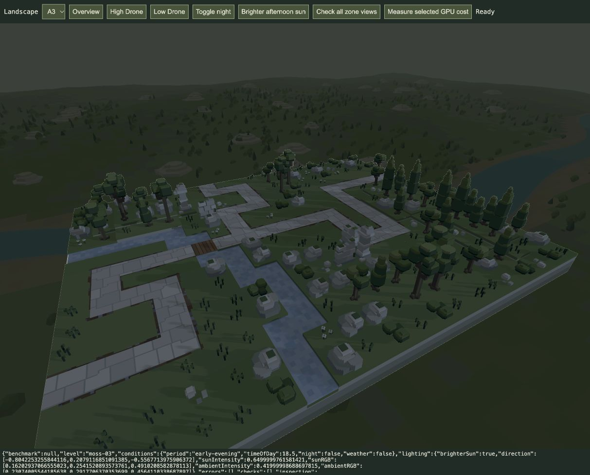

# Low evening sky light — 21 October 2026

Implemented for visual review in A3/B3/C3/D3 through the shared player lighting preset, also used by the vista review tool. The user requests the level-4 light closer to the horizon while preserving existing level-3 ambient lighting.

The direct light is now the same blue `#708ABA` and strength0.65as level4. Its authored horizontal heading remains, with elevation12°above the horizon (level4remains about51.7°). The previous evening key was pink `#E4A1A4` at about0.0895intensity. Ambient colour `#8493B4` and intensity0.42are retained exactly; the flat background policy remains unchanged. This produces a stronger blue side light and readable long shadows while retaining the evening fill. The12°angle is an initial trial value, not visual acceptance.

Only the early-evening override changes. Level2sunlight, level4lighting and all authored sources are preserved. The existing directional shadow map and lighting resources are reused; no extra pass, light, texture or buffer is added. Production `/play/` uses this preset on the next load; no active playthrough was reloaded. `/game/` continues its independent authored lighting policy.

33affected tests pass in `tests/play-conditions.test.js` and `tests/renderer.test.js`, including all-four-zone evening ambient preservation, night-light match, low positive elevation/heading, repeat application, authored-source immutability and renderer relight/shadow invalidation. [Log](targeted-tests.log).

Actual GPU overview loads and High Drone views were checked for all four affected levels, with no captured errors. Overview reports confirm a shadow redraw and equal blue direct/ambient values across all four; [GPU summary](gpu-summary.json). Long shadows are visible on ground/snow, including [A3](A3-after.jpg), [B3](B3-after.jpg), [C3](C3-after.jpg) and [D3](D3-after.jpg). The existing tab is left on A3 High Drone. The retained [before screenshot](A3-before.jpg) uses a different camera framing and is not a pixel-matched comparison; [previous preset source](before-conditions.js) records the exact old values. Appearance awaits user review.

