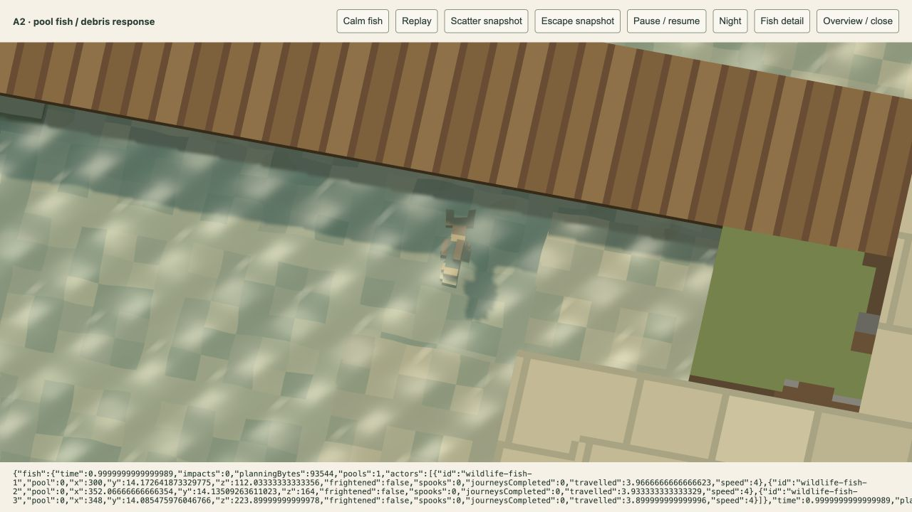

# Deep-pool fish — 20 October 2026

The user requested fish critters in deep pools that scatter when enemy destruction particles land nearby in the water. Implemented in `/play/` and wildlife-enabled `/game/` previews; appearance and density remain for user review.

## Behaviour

Small matte olive/gold fish have an articulated forked tail, gentle vertical movement and autonomous swimming. Three fish occupy each usable pool, with up to four schools per active world. This is provisional cosmetic density, not a gameplay limit.

Deep water currently means at least eight units from bed to surface. Navigation certifies the full rotating fish/tail envelope against terrain, dry banks, bridges and scenery. Connected components need at least twelve safe eight-unit grid nodes and meaningful horizontal extent. Narrow isolated water pockets are rejected. The current campaign has one three-fish school in each of **A2, A4, B4, C1, C4 and D3**. All other levels remain fish-free.

Fish swim at four units/second. Actual downward debris/water crossings create bounded fright events with a size/fall-speed-dependent radius, capped at 64 units. Nearby fish in the same connected water body turn away and swim at eighteen units/second, returning to normal 2.4 seconds after the last detected threat. They may reverse an approaching edge from their current position, without teleporting. If no safe outward step is available, they wait safely. Direct explosions, dry landings and debris stopped by bridges do not frighten fish. Shallow margins can carry a disturbance into their connected deep pool; dry dividers isolate it.

Fish have no health, targeting, damage, income or combat role. Existing assets, terrain, layouts, camera tuning and combat configuration remain unchanged. One new source model is added: `assets/models/wildlife-fish.json`, generated by `scripts/fish-model.js`.

## Integration and bounds

`shared/fish-habitat.js` builds certified nodes, edges and water-body identities once per active world. `game/fish-preview.js` drives ordinary pooled `PoseRig` instances. It shares the existing one-critter thinker rotation with ground animals and birds; accepted movement and poses advance with elapsed simulation time. The existing renderer/water refraction displays the fish underwater. No shader, render target, rendering pass, audio, light or particle type was added.

The two-part model has 53 quads. A2 adds two instanced draw groups and six scene buffers, from 162 to 168 in the isolated review. Its navigation/event typed storage is 93,544 bytes, excluding actor objects, meshes and pose matrices. The eight-slot event queue replaces its oldest event when full. Debris notifications still occur if the splash visual pool is exhausted. Worlds with no suitable pool retain no fish navigation/event buffers or instances.

Fish and their travel survive deployment edits and same-level wave preparation. Pause freezes swimming, tail poses and fear time. Scene release clears fish rigs/navigation/events and the world-scoped debris callback; damage reset drops its callback reference. Source model preloading is limited to levels with potentially deep water, and ordinary editor world construction does not enable fish.

## Verification

- **92 affected tests pass** across ten files, 3,263,478 assertions. Includes new fish, water impacts, existing wildlife/models, world loading, player engine/deployment/conditions, scene loader and renderer. [Combined log](affected-tests.log).
- Final focused follow-up: **seven fish tests pass**, 118,883 assertions, including tiny-pool rejection, a bank splash close to fish across a dry divider, full-envelope underwater journeys, actual debris-triggered outward escape, calm recovery, pause/reset, bounded event storms, bridge precedence, actual six-level loading and same-level continuity. [Final log](fish-tests.log). No full suite run.
- Player and fish-review entries bundle successfully. Only the new fish mesh was compiled.
- The production A2 bridge destruction replay produces 21 actual water entries. Two nearby fish flee at 18 units/second; the distant fish remains calm at four. [Browser measurements](browser.json), [escape screenshot](scatter.png).
- Standard `/game/` A2 displays three independently travelling fish. Switching to shallow A3 releases them and reports zero fish/navigation bytes. [Preview lifecycle](preview-lifecycle.json). Browser warning/error logs are empty.

Use [`/tools/fish-review.html`](../../tools/fish-review.html) for **Calm fish**, **Replay**, **Scatter snapshot**, **Escape snapshot**, **Fish detail**, pause and night review. The developer replay uses actual Dog debris physics; it does not fabricate water-impact locations. The regular player preview has been refreshed.

Finite tests establish the checked paths and lifecycle, not universal clearance for arbitrary future assets. Fish use discrete underwater navigation and cosmetic fear rather than a fluid or schooling simulation.
