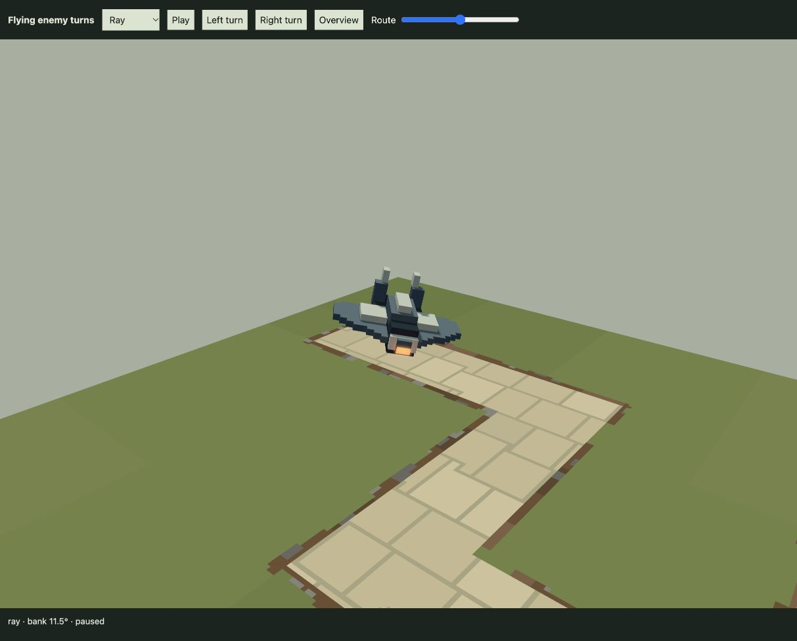

# Smooth flying-enemy corners — 21 October 2026

Implemented the user's request after the [Arc retry fix](../arc-retry-identity-2026-10-21/README.md). Moth, Twin Fan, Ray and Lantern now follow smooth curved turns and visibly bank. Appearance remains for user review.

[Open the flight review](http://127.0.0.1:4173/tools/flying-turns-review.html). Choose a flyer, press Play, scrub the route or jump to left/right turns. Playback is 0.65× for inspection; the campaign uses its normal clock. The separate review tab is retained; the existing player tab was not reloaded.



## What changed

- `FlightPathMotion` integrates smooth tangents over the existing 12 authored units before/after each corner. Position, velocity and acceleration join the straight segments continuously. Air and ground path-cache keys are separate, so the Tripod retains its original centre-line movement.
- The gait already computed a small bank, but the final body pose overwrote it. The body now receives bank plus impact roll, with a smooth bounded response within the existing Moth/Twin Fan/Ray/Lantern caps of 10°/10°/12°/8°.
- Targeting receives actual curve translation and combined yaw/bank/impact torso derivatives. No normalized constant-speed velocity is substituted for the shorter curve.
- Placement uses tight bounded curve slabs with the original per-height bank envelope. A first blanket radius expansion was replaced because it unnecessarily rejected existing courts. Impact recovery and Drone predictions also include extrema between adjacent turns.

The authored route-distance clock, spawn schedule, exit time, configured speeds, altitude, damage, prices and source models remain unchanged. Actual horizontal motion eases through corners, reaching about 70.7% of nominal speed at a right-angle midpoint while covering a shorter geometric curve. There is no new free-flight navigation, running mechanic, shader, draw pass or GPU resource. Scratch storage is retained; the normal motion/query path creates no per-frame arrays.

## Verification

**136 distinct affected tests across 13 files pass**, without a full-suite run:

- [44 curve, body/aim velocity, flight timing, gait, impact and Drone checks](motion-tests.log).
- [67 physical missile, chain, finite combat, generator and placement checks](integration-tests.log).
- [25 Arc and actual Drone camera/anticipation checks](camera-arc-tests.log).

The archived 36-unit-altitude flight check now refines banked part-AABB candidates to occupied voxel OBBs, preventing empty box corners from being reported as physical contact. The Drone scene's old nine-actor expectation now follows the accepted enemy/wildlife population. The unrelated historical missile snapshot failure documented in the Arc report was not changed.

A fresh replay of the **same earned-token mixed army and placements clears all 64 waves and 1,084 enemies with zero escapes**, spending 126 tokens with four left. All 64 useful-damage totals reconcile to scheduled HP. This verifies one retained strategy under the combined Arc correction and flight changes; it does not establish optimality or human difficulty acceptance. [Campaign evidence](mixed-campaign.json).

The independent [Engineer audit](ENGINEER.md) and [109-hash pinned evidence](clearance.json) cover:

- 80,252 sampled flight poses across all 20 current routes and all four models, with no scenery, terrain or boundary contacts.
- 8,383,065 air-related scheduled traffic checks, with no conservative envelope overlap; minimum sampled clearance is 3.318 units at the A3 merge.
- 320 frozen arrangements from five successful policies, comprising 3,846 unit checks, all legal.

Geometry/traffic are finite samples, including additional cross-zone stress cases. The report distinguishes unchanged ground broad-phase candidates and excludes claims about arbitrary authored routes, every mechanism phase, all possible armies or missile-induced traffic displacement.

Four actual WebGPU compositions were visually inspected: [Moth right](moth-right.png), [Twin Fan right](twin-fan-right.png), [Ray left](ray-left.png), [Lantern left](lantern-left.png). Visible bank readings are −9.7°, −9.6°, +11.5° and +7.8° respectively, without a renderer error shown. The review uses the shared production renderer and enemy controller. A 117-module browser build succeeds; no new GPU timing claim is made.

Reproduce from project root:

```sh
bun test tests/flight-path-motion.test.js tests/enemy-expansion-preview.test.js tests/enemy-impact.test.js tests/drone-obstacles.test.js
bun test tests/play-mixed-combat.test.js tests/play-enhancer-combat.test.js tests/enemy-expansion-combat.test.js tests/missile-flight.test.js tests/play-placement.test.js tests/arc-chain.test.js
bun test tests/arc-combat.test.js tests/play-drone-camera.test.js tests/play-camera-anticipation.test.js
bun docs/flying-turns-2026-10-21/clearance-audit.js --pin
bun docs/balance-review-2026-10-21/audit.js --scenario=mixed --replay=docs/balance-review-2026-10-21/mixed.json --output=/private/tmp/flying-mixed.json
```
