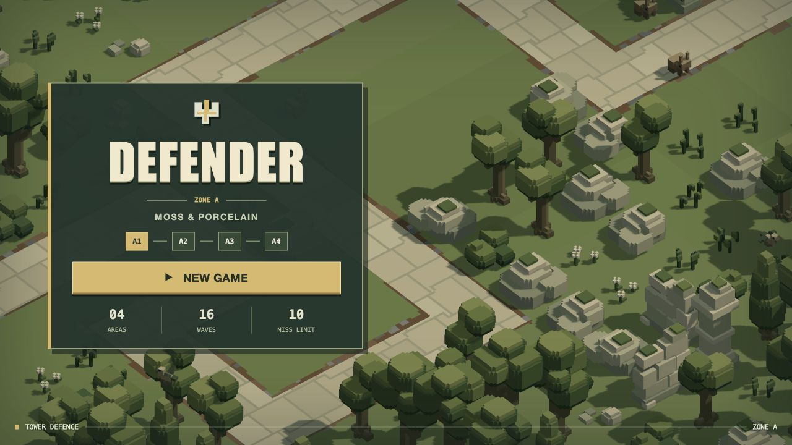
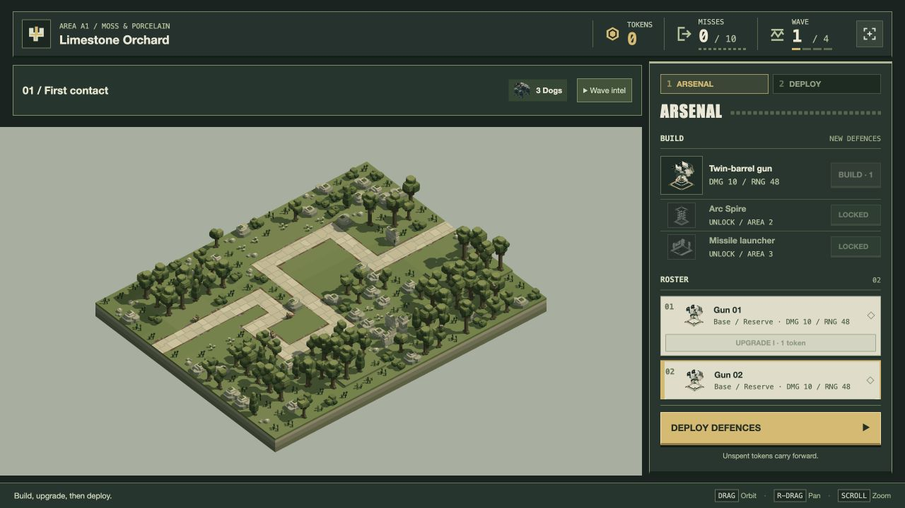

# Game GUI redesign — 20 October 2026

**Camera UI follow-up, 20 October (implemented):** Frame/Auto/Drone selectors, their phase actions/click handlers and obsolete hints are removed for now. Drone remains the run default; title/preparation overview, immediate ownership changes and pause remain. Browser checks cover title, preparation, deploy, wave and pause with no selector elements or renderer errors. [Current delivery](../water-regression-2026-10-20/README.md).

Implemented for user review. The user asks to remove the Live cam option while keeping its functionality, and to redesign the complete game GUI after Researcher gathers references. GPU GUI rendering is permitted if useful.

Researcher supplied the official Defense Grid manual and EA's sidebar account before implementation began, then completed a [four-reference review](../research/game-gui-references-2026-10-20.md), including Bad North and Into the Breach. The reference report distinguishes verified developer statements from original design adaptations and records its image-inspection limits. No reference-game art is copied.

## Delivered direction

The scenic title now has a condensed game wordmark, a path-confluence emblem, one New game command and configuration-derived area/wave/miss counts. The generic serif heading, boxed D, promotional paragraphs and arrow CTA are removed.

Preparation uses a moss command console, porcelain owned-unit faces, amber actions/selection and portraits made from accepted model meshes. A separate incoming-wave strip leaves the build catalogue and owned roster together. Repeated species are summed in that strip; the Wave intel disclosure preserves each route's actual count, HP, speed, arrival interval and Moth altitude. The deployment/start control stays fixed while the roster scrolls. Existing range feedback, selection, world highlighting, prices, unlocks and free repositioning remain.

The combat HUD, pause, completion, defeat, loading and error screens share the new frame/type language. Native controls, focus retention, modal focus containment, P/Escape behaviour, reduced-motion support and a basic narrow layout remain.

The Live cam button is always hidden and disabled in every phase. `LiveCamera`, navigation, film rendering, viewfinder, callbacks and lifecycle integration are retained. No alternative player switch or setting was added.

## Verification

- **37 affected tests pass, 367,584 assertions**: title framing, player session rules, unit/world identification, action camera and retained Live cam behaviour. [Log](affected-tests.log). No full suite was run.
- **40 screen/viewport combinations** pass layout checks: title, empty/full arsenal, deployment, wave, pause, defeat, completion, error and loading at 1280×720, 1024×768, 1920×1080 and 390×844. No horizontal overflow; portraits load; HUD bounds fit; Live cam stays hidden even when fixture data marks it enabled. [Checks](viewport-checks.json).
- A separate real `/play/` run verifies two purchases, consecutive placement, wave start, button and P pause/resume, frozen pause time, Shift+Tab containment, a successful first wave and +2 tokens, then upgrades of both deployed guns. Wave intel expands/collapses. The player tab warning/error list is empty. [Interaction record](interaction-check.json), [placement](deployment.png), [pause](pause.png), [upgrades](upgrades.png), [expanded intel](wave-intel.png).
- Player and developer-review browser bundles build (93 modules). Twelve generated vector portraits are deterministic. [Portrait check](portrait-check.json).
- All **85 asset source hashes** match the preceding delivery. Gameplay, economy, model sources, layouts and frozen backup were not edited. [Preservation](preservation.json).

## Rendering and limits

This delivery uses DOM/CSS/SVG rather than a new GPU GUI renderer. Native controls provide keyboard and accessibility semantics; static vectors supply game-specific imagery without new engine render passes or targets. The 12 portraits cover nine weapon tiers and Dog/Roller/Moth. Regenerate with `bun scripts/game-gui-icons.js`; output is `play/portraits.js` (about 299 KB), using data URLs supported by the existing image CSP. No server policy change, remote font, framework or library was required.

Laptop/desktop remain the priority. The 390px layout is checked for basic containment, not claimed as a completed mobile play experience. Dense inventories scroll, and full wave statistics require opening Wave intel. Local condensed/sans/monospace font fallbacks can vary by platform. Final visual acceptance remains pending.

The developer-only `/tools/game-gui-review.html` displays production UI/renderer composition fixtures, including a 12-unit roster, at selectable viewport sizes. Fixture outcomes are not simulated campaign wins; the separate real interaction run supplies gameplay-flow evidence. Earlier completion/defeat tests remain the underlying outcome evidence. The user's existing game was not reset; the new GUI requires a page load. A separate fresh preparation session is left open for review.
