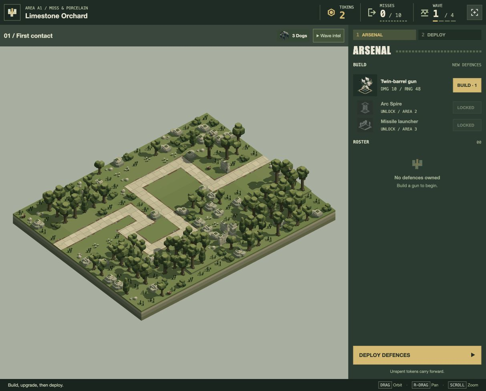

# Borderless GUI panels — 20 October 2026

The user accepts the continuous layout direction and asks to remove doubled panel borders completely, adjusting surface tones to retain separation.

Removed borders from main HUD/intel/console/footer, roster cards and preparation/catalogue rules, plus title, modal, intel popover and status panels. Kept native controls and keyboard-focus outlines. Adjacent roster rows alternate light tones; selection uses amber rather than a border. Panel gutters remain zero. No gameplay, model, level or environment-selection changes.

| Surface | Tone |
| --- | --- |
| HUD | #1b2c25 |
| Wave intel | #35483b |
| Arsenal/deployment | #273c31 |
| Footer | #14241d |
| Roster rows | #e0dcc8 / #d0d3bd |
| Selected row | #e8ce91 |

[40 browser checks](viewport-checks.json) cover ten states at 1280×720, 1024×768, 1920×1080 and 390×844. Every visible panel has zero computed border widths; every measured panel seam is zero. Overflow, HUD bounds, portrait loading and hidden Live cam checks pass. Developer review bundle builds. No new unit tests/full suite for the CSS-only change.

Reloaded the current game with standing user permission and left a fresh A1 preparation. The deferred A2 targeting setup remains [recorded separately](../play-follow-up-2026-10-20/turret-report.md).

[Stocked arsenal fixture](arsenal.png).
