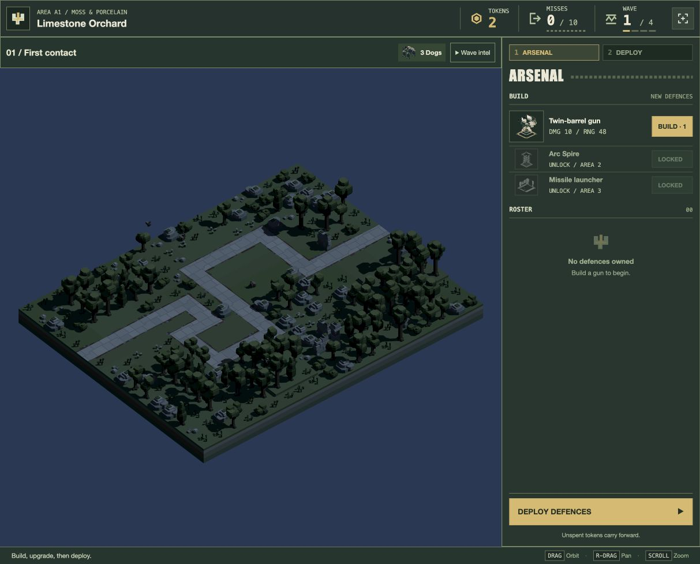

# Continuous game GUI panels — 20 October 2026

The user requests complete removal of panel gaps and authorises reloading the current game for testing. This supersedes the previous eight-pixel gutters.

The HUD, wave-intel strip, battlefield, preparation console and footer now use a zero-gap CSS grid and meet at the viewport edges. Roster cards also meet directly. Desktop preparation keeps its side console; narrow preparation stacks it beneath the battlefield. Grid rows follow actual HUD/intel heights, avoiding fixed offsets. Flat borders, control spacing, panel padding and scrollable ownership remain.

[Forty browser checks](viewport-checks.json) cover title, empty/stocked arsenal, deployment, wave, pause, defeat, completion, error and loading at 1280×720, 1024×768, 1920×1080 and 390×844. Every measured seam is zero; overflow, portrait-loading and HUD bounds checks pass. The developer review bundle builds. No new unit tests or full suite were needed for this CSS/layout change.

Reloaded the user’s game with their explicit permission and left a fresh A1 preparation open. The earlier A2 setup remains [saved separately](../play-follow-up-2026-10-20/turret-report.md). No gameplay, models, level assets, environment choices or frozen backup changed.

[Desktop stocked arsenal](arsenal.png) · [Narrow deployment](narrow-deployment.png).
