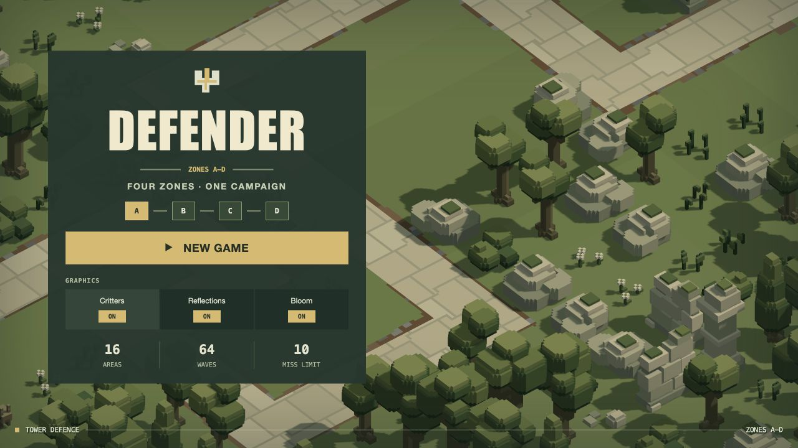

# Title graphics options — 21 October 2026

The main title now has Critters, Reflections and Bloom switches, all on by default. Choices persist in browser-local storage across new games, return-to-title, retries, levels and reloads. Invalid or unavailable storage falls back to on without preventing play. Controls are native labelled keyboard-accessible switches and are disabled while loading. Only the title exposes them.

- **Critters:** a title change rebuilds that scenery safely. Off omits ground animals, birds and fish, their model fetches/geometry, habitat navigation and simulation ticks; it skips cosmetic habitat placement constraints. Enemy combat, scenery and route/defence clearance remain active. No critters means no critter gibs or blood. On restores the existing population on the next title scene build. Source levels are unchanged.
- **Reflections:** off gates opaque/water SSR and skips the planar capture. Tint, 60% base transmission, refraction and moving ripple normals remain. Re-enabling refreshes the capture and reuses retained resources.
- **Bloom:** off skips extraction/filter/composition and viewport allocation on initially disabled loads. Existing lights, emissive surfaces and explosion effects remain. Existing resources may be retained for safe roundtrips; death-effect pipeline preparation still runs during loading.

No dependencies, shader code, extra production GPU passes or textures were added. Preferences use `defender.graphics.v1`. No live playthrough reload was performed; the active B2 preparation remains untouched.

## Verification

- Renderer/planar checks: 42 pass (1,795 assertions), followed by the expanded steady-emitter toggle check passing with 47 assertions. The eight added assertions verify cached bloom returns after off/on without geometry redraw.
- New graphics preference and actual A2 load/lifecycle checks: 2 pass, 30 assertions. Confirm no wildlife/fish asset requests or navigation/ticks when disabled, ordinary enemy spawn/deployment/wave preparation still work, and an ordinary next load restores twelve animals/birds plus fish.
- Existing engine and placement files: all 16 tests pass.
- Four older `play-deployment.test.js` checks fail because they require every wildlife pose to remain identical during a deployment, conflicting with the already accepted safe-respawn behaviour. A temporary reconstructed pre-options engine reproduces the first exact failure (Z186→202). Those existing tests were not weakened or changed. The initial combined run also caught an overly strict new test object assertion; corrected it and reran both new checks successfully. No full suite was run.
- Actual browser [title/default/off/new-game/reload evidence](ui.json) confirms all defaults on, all-off choices carry into a new game and reload, off means zero critter actors/planning bytes, and restoring all-on returns the original title wildlife. All settings were restored to on after review.
- Actual A2 [GPU check](gpu.json): five on/off combinations and roundtrip complete with no reported errors. Reflection-on has 12 planar draws, off has zero. Bloom-on has three filter passes, off has zero. Water material uniforms remain identical in every case. This is functional validation, not a GPU performance benchmark. Reproduce via `/tools/graphics-options-check.html`.
- Browser build: 112 modules, about 1.24 MB.

The four inherited deployment-test failures are unrelated to these preferences; broad campaign rebalance/testing was not performed. Appearance remains for user review on the next game load.
