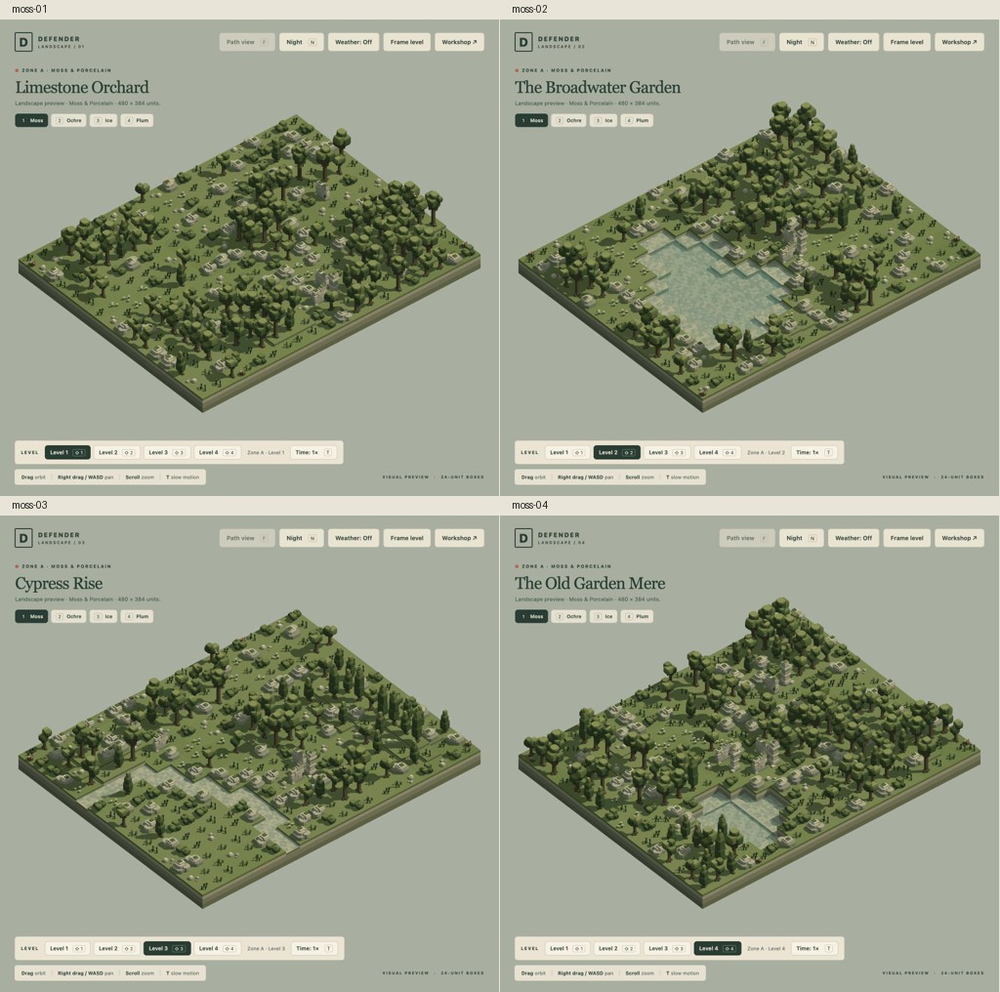
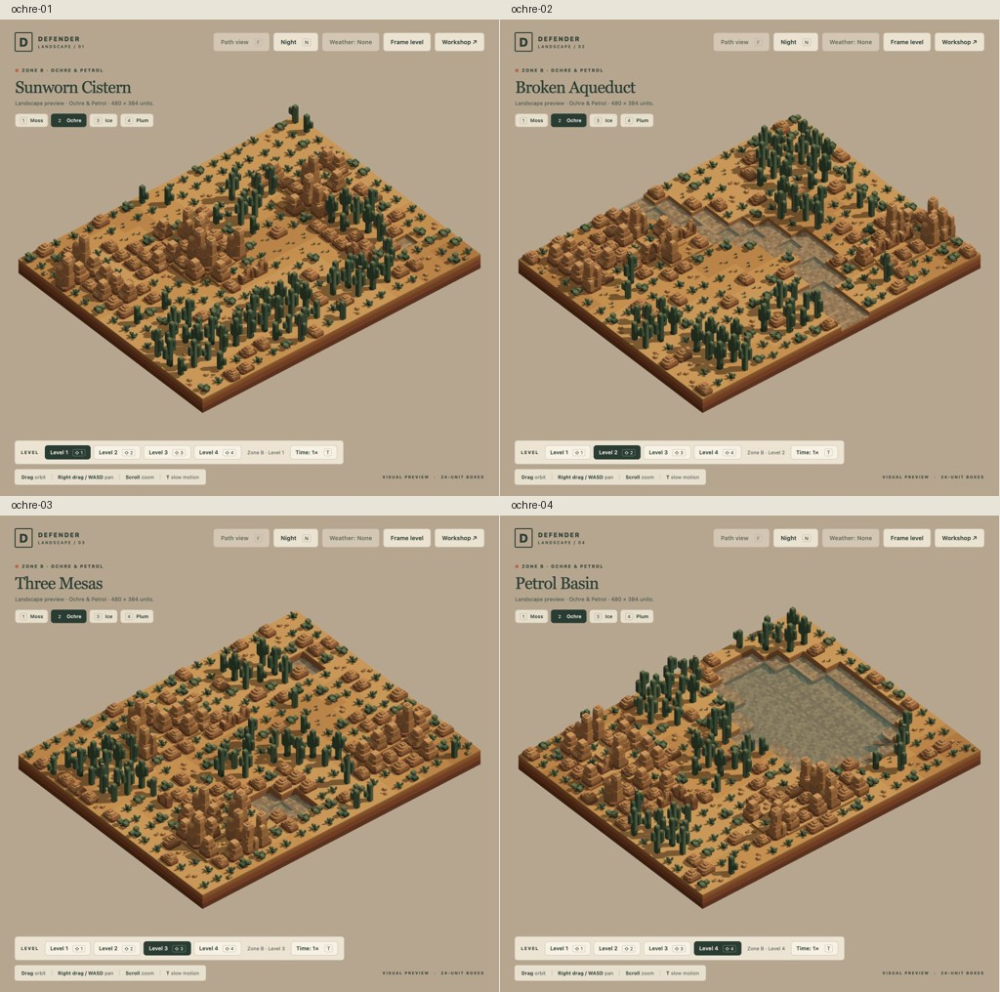
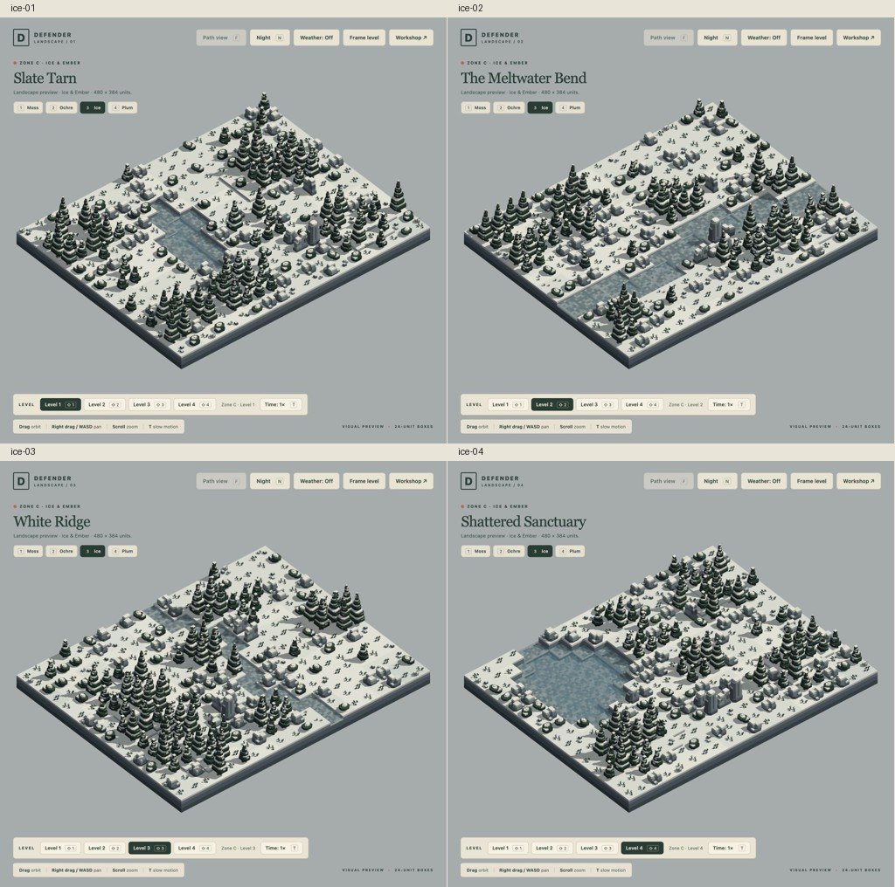
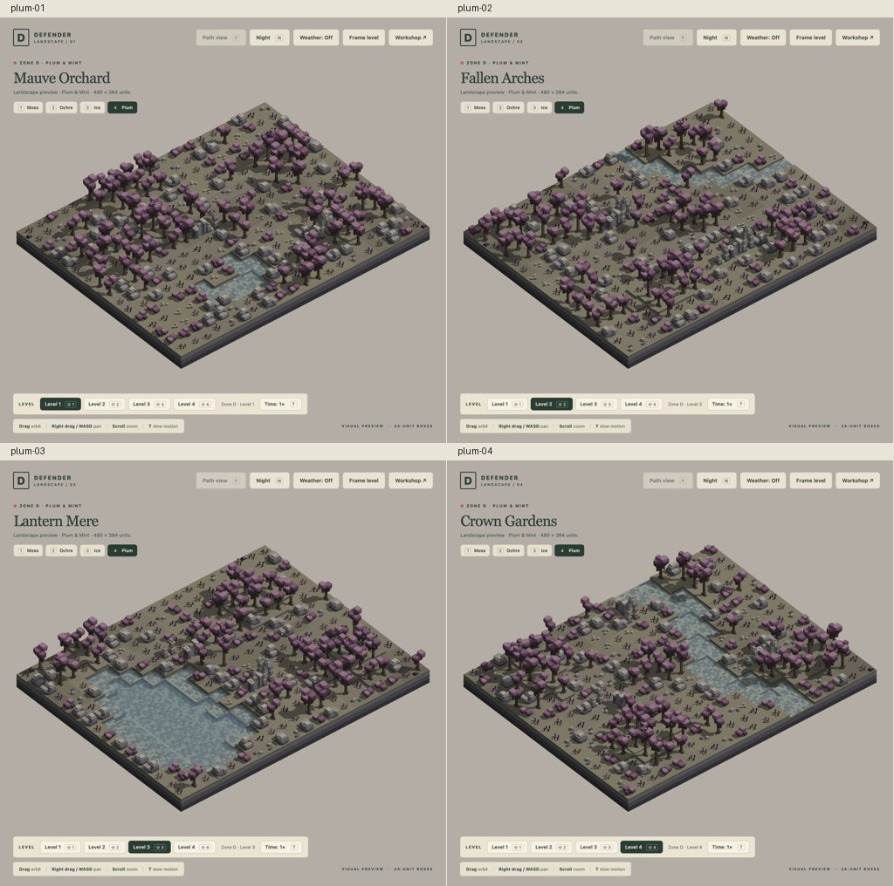

# Fixed-size landscape reset · 18 October 2026

**Latest status, 18 October:** The user approved A3 Cypress Rise / Garden Confluence ("A3 looks good") and wants to work on something else before A4. Preserve approved A1–A3. A4 and further path carving remain deferred until explicitly requested; the next task has not yet been specified.

**Subsequent carving:** user-approved [A1 Southern Hook](../a1-path-carving-2026-10-18/README.md) and [A2 Garden Crossing with its wooden bridge](../a2-path-carving-2026-10-18/README.md) now supersede their active path-free states. A3 [Garden Confluence](../a3-path-carving-2026-10-18/README.md) also now has a carved active source and awaits user review. This record and its captures describe the accepted uncarved baseline; the other thirteen active landscapes remain unchanged. Preserve the verified backup.

All sixteen production previews now use **20×16 placement boxes — 480×384 world units**, matching the user-selected D3/Lantern Mere size. This record describes the original landscape-only stage: **no enemy paths, enemies, defence placements or reserved defence clearings**. Cosmetic wildlife remains. Water variety, accepted scenery and zone palettes are preserved; weather defaults off.

The user liked the landscape art but asked for better future path carving. Tactician's [saved brief](../team/tactician.md) and [comparative carving workflow](../research/path-carving-workflow.md) require genuinely winding journeys through more of each landscape and more useful defence choices. No new paths are implemented here. The earlier carved layouts are archived in `previous-levels/` with [original hashes](previous-level-hashes.json); prior tactical audits describe that historical state only.

**User-accepted appearance and rollback backup:** a separate read-only timestamped snapshot/archive now preserves all16 levels and their51 scenery/wildlife models. [Backup record and restoration instructions](backup.md). Keep it unchanged during future carving.

## Current landscapes

Every row has the same locked footprint. Water counts describe this set, not a design quota. Three ground critters and three birds use safe existing gaps and supported scenery perches; no wildlife clearing was carved.

| Level | Preview | Scenery placements | Water boxes | Evidence |
| --- | --- | --- | --- | --- |
| A1 | [Limestone Orchard](/game/?inspect&level=moss-01) | 320 | 0 | [Source](landscapes/moss-01.json) · [Overview](screenshots/moss-01.png) |
| A2 | [The Broadwater Garden](/game/?inspect&level=moss-02) | 258 | 62 | [Source](landscapes/moss-02.json) · [Overview](screenshots/moss-02.png) |
| A3 | [Cypress Rise](/game/?inspect&level=moss-03) | 301 | 19 | [Source](landscapes/moss-03.json) · [Overview](screenshots/moss-03.png) |
| A4 | [The Old Garden Mere](/game/?inspect&level=moss-04) | 324 | 24 | [Source](landscapes/moss-04.json) · [Overview](screenshots/moss-04.png) |
| B1 | [Sunworn Cistern](/game/?inspect&level=ochre-01) | 319 | 1 | [Source](landscapes/ochre-01.json) · [Overview](screenshots/ochre-01.png) |
| B2 | [Broken Aqueduct](/game/?inspect&level=ochre-02) | 281 | 39 | [Source](landscapes/ochre-02.json) · [Overview](screenshots/ochre-02.png) |
| B3 | [Three Mesas](/game/?inspect&level=ochre-03) | 310 | 10 | [Source](landscapes/ochre-03.json) · [Overview](screenshots/ochre-03.png) |
| B4 | [Petrol Basin](/game/?inspect&level=ochre-04) | 240 | 80 | [Source](landscapes/ochre-04.json) · [Overview](screenshots/ochre-04.png) |
| C1 | [Slate Tarn](/game/?inspect&level=ice-01) | 300 | 20 | [Source](landscapes/ice-01.json) · [Overview](screenshots/ice-01.png) |
| C2 | [The Meltwater Bend](/game/?inspect&level=ice-02) | 275 | 45 | [Source](landscapes/ice-02.json) · [Overview](screenshots/ice-02.png) |
| C3 | [White Ridge](/game/?inspect&level=ice-03) | 298 | 22 | [Source](landscapes/ice-03.json) · [Overview](screenshots/ice-03.png) |
| C4 | [Shattered Sanctuary](/game/?inspect&level=ice-04) | 274 | 46 | [Source](landscapes/ice-04.json) · [Overview](screenshots/ice-04.png) |
| D1 | [Mauve Orchard](/game/?inspect&level=plum-01) | 308 | 12 | [Source](landscapes/plum-01.json) · [Overview](screenshots/plum-01.png) |
| D2 | [Fallen Arches](/game/?inspect&level=plum-02) | 305 | 15 | [Source](landscapes/plum-02.json) · [Overview](screenshots/plum-02.png) |
| D3 | [Lantern Mere](/game/?inspect&level=plum-03) | 249 | 71 | [Source](landscapes/plum-03.json) · [Overview](screenshots/plum-03.png) |
| D4 | [Crown Gardens](/game/?inspect&level=plum-04) | 282 | 38 | [Source](landscapes/plum-04.json) · [Overview](screenshots/plum-04.png) |

## Visual review

All sixteen views were inspected through the existing built-in browser tab. The captures below show the current populated landscapes at a common framed overview; full captures are linked above. The four original level-3 terrain/scenery compositions are unchanged. A4 preserves its original 18×16 landscape and adds two planted eastern columns. Other levels are extended or recomposed without stretching models. [Authoring decisions and validation](ARTIST.md).

## Verification and reproduction

`bun run rebuild:previews` writes the deterministic sixteen-level set and reports. `bun run seed:previews` creates missing sources and refuses different existing sources. `bun run check:landscapes` checks canonical sources and snapshots, exact voxel clearance, supported wildlife seeds/perches and actual world compilation. Artist ran write and check successfully for all 16. See the per-zone [A](a-validation.json), [B](b-validation.json), [C](c-validation.json) and [D](d-validation.json) validation records. Generic workshop and model-review scenes may use other sizes.

Source-aware runtime loading fetches the level before deciding which actor models to request. Main previews load only scenery and six cosmetic actors. Landscape mode rejects combat actors/placements and routes, skips combat/effect simulation, and disables path view. Existing combat mechanics and model sources remain intact. Combat review tools explicitly load archived levels through validated source injection; main game previews use current sources. [Engineer handoff](ENGINEER.md).

Targeted verification passes: 17 landscape/selection/lifecycle checks, 50 representative world/combat/render checks and 6 archived enemy/Arc runtime checks. Existing combat assertions use byte-identical archived fixtures; new tests exercise the actual current sixteen sources. No full suite was run, and these checks do not establish campaign balance or FPS improvements.

[Browser evidence](browser-review.json) records all 16 ready scenes with zero paths, enemies, firing states, missile states, active combat lights, overflow and weather particles; each has six wildlife actors. Previous scene CPU/GPU resource counters clear on every switch. [Controls review](controls-review.json) covers safe F/R no-ops, night and 0.1× time, snowfall on an empty-route scene, and authored weather restoration on switching. All five combat review pages and the matching historical before/after comparison also loaded successfully; [review-tool evidence](review-tools.json). No browser warnings/errors were captured. D3 is left open at normal time/day with weather off.

[Preservation hashes](preservation.json) verify all 16 prior carved sources and all 66 model files remain unchanged. The [archived before/after viewer](/tools/landscape-review.html) still compares historical matching sources, not current landscapes against old carving. Future carving must preserve these new snapshots and document choices, coverage, visibility and scenery changes separately.
