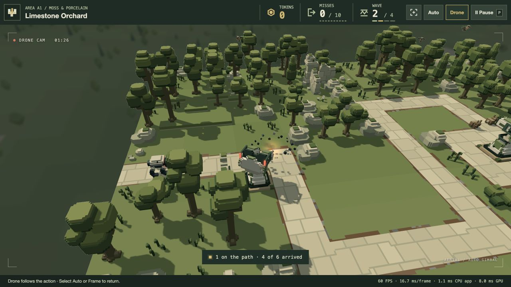

# Latest TODO delivery — 20 October 2026

All active TODOs 14–19 are implemented for review. The user authorised completing the list and closing old/test tabs. The previous game tab was closed; the updated production game was tested through A1 wave1 and into wave2. GI and AO remain removed, with all 23 retired files still absent. Models, authored layouts, economy and the frozen backup are unchanged.

## Result

- **GPU timer / CPU audit:** footer now shows FPS, wall milliseconds/frame, **CPU app** and **GPU** milliseconds. CPU app measures synchronous simulation, cameras, rendering, overlays and scheduled HUD/diagnostics work. Renderer-only cost remains in diagnostics. GPU timestamps enclose the first real render pass through final display/refraction, including vista, bloom, weather and shockwaves when active. Optional feature fallback, stale status and pause/hidden/loading/resize/reset/disposal are bounded and tested. GPU sampling is asynchronous at at most 10 Hz, with three staging slots and no render-loop wait or extra pass.
- **Late-afternoon sunlight:** A2/B2/C2/D2 direct sun is 35% stronger; warm colour, sun angle and ambient fill are retained. The override is idempotent and leaves other periods/saved sources unchanged. [A2 brighter](a2-sun-brighter.png) · [Previous A2 sun](a2-sun-before.png).
- **Wounded motion:** at ≤50% HP a 0.24-second smooth stagger reaches 15% ordinary route speed, followed by at most 1.3× recovery. Expected-position debt is capped at 0.35 seconds of travel. Repeated cycles are around 2.2 seconds apart when recovered. Same-band route gaps/shared-tail reservations constrain recovery; targeting sees actual velocities, and affected constant-speed speculative gun promises yield. Existing ordinary rigs/gaits remain; no escape-running/gallop restoration.
- **Arc chaining:** stage2 consistently means middle tier **Upgrade I**. A successful pulse can chain once to one uniformly random living enemy within 48 units inclusive in 3D torso-centre distance, at 20% current enhanced pulse strength. Ground and air are eligible with exposed physical transfer from the actual primary impact; primary-body/scenery/other-defence clearance is required. No self-hit, recursion or speculative secondary promise. Six existing visual slots prioritise primary bolts; a saturated secondary visual can drop without dropping damage. [Actual chain capture](arc-chain.png) · [Diagnostics](arc-chain.json).
- **Critter remains:** inclusive 3D body-centre radii 24 units from enemy destruction and 36 from missile impact, without an extra blast-occlusion rule. Ground animals, birds and fish gib into 8 model-colour fragments and 16 solid spray droplets. Outward impulses, gravity, swept collisions/support and water drag govern flight/resting; already-submerged fragments do not invent a water-entry splash. Remains persist for the **current wave**, then fade over 2 seconds during the existing 4-second settling. Late settling impacts receive a fresh fade bounded by settlement end. Defeat briefly advances **damage effects alone**, with combat/wildlife/missiles/camera frozen. Dead wildlife hides/stops, releases Drone obstacles and respawns at certified ground/perch/pool locations for next preparation. Rewards and misses are unchanged. [Live remains](gib-live.png) · [Half fade](gib-half-fade.png) · [Cleared remains](gib-faded.json).

Tuning and subjective appearance remain for user playtesting; implementation of an authorised effect does not imply human visual acceptance.

## Validation and measurements

**195 affected tests pass**, 3,163,882 assertions across 21 files. [Test log](affected-tests.log). Five browser bundles build: play, preview, editor and two review tools. [Build log](build.log). No full repository suite was run.

The production mixed campaign completes **64 waves / 1,084 kills with zero escapes/misses**, spending 126 tokens and retaining 4. It uses actual configured controllers, paths, purchases, deployment certification and physical missile contacts at120Hz. [Full replay](mixed-campaign.json) · [Replay log](mixed-campaign.log). This is a finite recovery/regression witness, not a final balance or win-rate claim.

**64 actual GPU biome/camera compositions pass** with no reported error. Combined actual rendering also captures an Upgrade I chain, wounded actors,24persistent critter instances, midpoint fade and zero critter instances after fade. [Biome checks](biome-gpu.json) · [Wounded scene](wounded-gpu.json) · [Live gibs](gib-live.json) · [Faded](gib-faded.json).

The ordinary `/play/` opening cleared wave1 without misses, retained ownership/reward and entered wave2. One moving-combat observation reported **1.10 ms CPU app /0.52 ms renderer /8.32 ms GPU** at about 60 FPS. A preparation observation reported about 0.15 ms CPU app /0.09 ms renderer. These explain why the old 0.5–1.0 ms renderer figure was plausible; they are brief host observations, not controlled benchmarks or promised performance. [Preparation](play-preparation.json) · [Idle](play-idle.json) · [Combat](play-combat.json) · [Paused](play-paused.json). Pause clears every CPU/GPU sample and resume starts a fresh window. GPU feature failure/stale/resize/disposal branches additionally have deterministic tests.

All 86 model/level source files and 73 frozen-backup files retain their captured SHA-256 hashes. [Preservation](preservation.json) · [Verification summary](verification.json).

## Ownership, resource costs and limits

GPU timing requests 64 bytes of buffers (16 resolve + three 16-byte readbacks), one two-entry query set (16bytes nominal results) and 256 bytes of typed CPU rolling samples. CPU renderer history adds 960 bytes. These are requested payloads, not browser/driver allocation totals; timestamp instrumentation cost is unmeasured. GPU measurements exclude earlier uploads/queue waiting, resolve/readback and browser presentation. CPU app excludes separate event handlers, later layout/paint, metric bookkeeping and asynchronous GPU/driver work. Values are rolling means, not percentiles.

Critter capacity reserves 432 cubes for 18 critters alongside 192 enemy cubes: 624 total. The extra 432×80 bytes costs **34,560GPUbytes (33.75KiB)** plus bounded CPU particle records. No new pass, texture or light is introduced. A six-second unsupported/off-board flight guard stops unbounded falling; off-board remains may be out of view. Matched ordered coverage implements opaque/depth/shadow fading. Arc chaining uses a second CPU contact sampler only when Upgrade I exists, plus 6 bytes of visual-priority flags; no GPU pool expansion. Wounded traffic reuses per-wave scratch/order storage and bounded same-band pair checks after the first wound.

Browser tests caught and fixed a timestamp-descriptor spelling mistake, then showed empty compute marker passes produced zero on this backend. The final timer instead stamps the actual first/last render passes and records nonzero GPU durations. The mocked descriptor checks now reject invalid fields. API contract: [GPU render-pass timestamp writes](https://gpuweb.github.io/types/interfaces/GPURenderPassTimestampWrites.html).

The existing deployment renderer mock lacked vista pipeline methods; extending that mock exposed an old total-buffer expectation that omitted the separately owned vista buffer. The fixture now checks no growth against its actual initial allocation count and still requires every buffer to be destroyed exactly once. All seven deployment tests pass.

Separate broader exploration found an archived target-planner missile snapshot expecting older shot counts; the same mismatch reproduces after reverting this delivery's EnemyPreview changes in a temporary module. That unrelated historical expectation was not silently refreshed. An already-existing combat-Drone `stationSight` reference to undefined `state.id` was also reported outside the player inventory/TODO scope and left unchanged. Neither is concealed as a passing full-suite claim.

Review tools: [latest combat/effects](http://127.0.0.1:4173/tools/latest-todo-review.html) and [biome/sun comparison](http://127.0.0.1:4173/tools/zone-vista-review.html). They are independent of the persistent game; all temporary test tabs are closed after verification.
