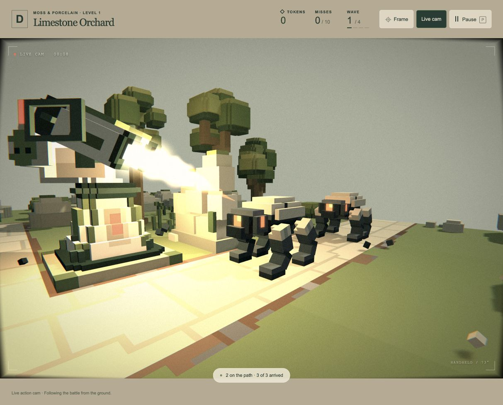
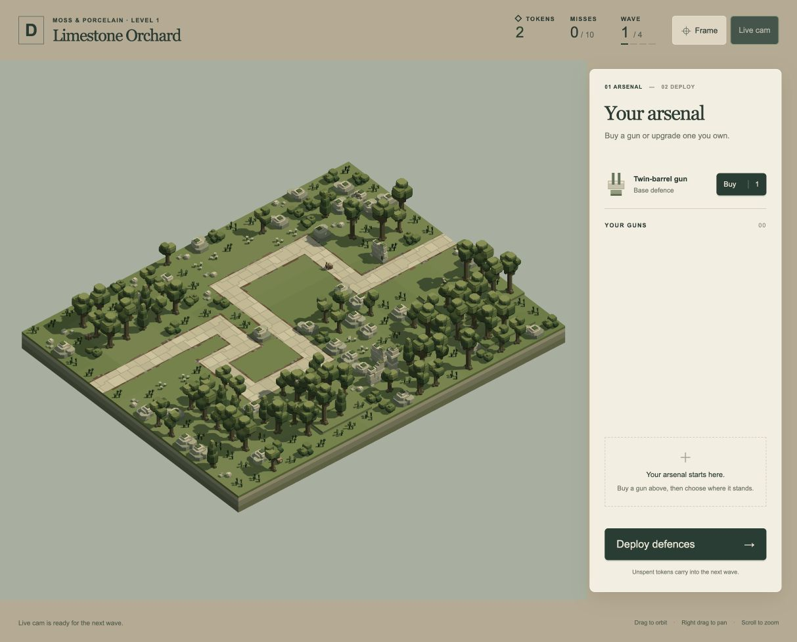

# Live action cam — 19 October 2026

**Follow-up:** distance, zoom and depth of field are now refined in [the lens record](../live-camera-lens-2026-10-19/README.md). The fixed lens and resource figures below describe the initial delivery.

Implemented the user's optional first-person camera and older-camera treatment. The follow-up explicitly requires a cameraman who starts near the area's centre and runs around covering the battle like a news camera operator. Presentation tuning is ready for playtesting; final visual acceptance remains open.

## Using it

Use **Live cam** in the HUD. It can be armed during preparation, or switched during a wave. While enabled, each wave/mode entry starts the operator on the closest safe ground to the area's centre within the largest connected component. In the live A1 check the centre was `[240,192]` and the operator began at `[243,189]`, about 4.24 world units away, with 2,894 reachable navigation nodes.

The operator runs to reachable filming positions, follows active enemies and participating guns, holds a useful shot briefly and changes angles as action moves or a shot lingers. Ground support, conservative body/scenery clearance and turning-gun envelopes constrain its route. Enemy lookahead and wildlife occupancy reject destinations or cause waiting/replanning. Running sway, smooth aim, mild roll and proximity-based explosion flinches supply the handheld feel. There is no rendered human or interaction with combat/wildlife decisions.

The scene has animated grain, slight barrel distortion and colour fringing toward its edges, a soft vignette and restrained colour ageing. A small viewfinder/time readout identifies the mode; the ordinary controls remain crisp. P/visibility suspension freeze motion and footage. Toggle off restores the previous overview; Frame also exits the mode. Preparation restores the landscape overview, retaining the armed preference for the next wave.

## Implementation and bounded work

- [`play/live-camera.js`](../../play/live-camera.js): stable combat subjects, filming goals, short goal commitment, angle changes, bounded motion, event-time flinches, pause and overview continuity. A late entry during settling looks at the latest battle instead of the level entrance.
- [`play/live-camera-navigation.js`](../../play/live-camera-navigation.js): 6-unit supported ground graph, connected components, centre selection, static clearance, reusable BFS/route arrays. A 20×16 map has 5,120 nodes. Ordinary replanning runs every 0.8 seconds; subject changes or blocked movement can request an earlier decision. Candidate scenery rays are capped at 64 per plan.
- [`engine/camera.js`](../../engine/camera.js): external first-person perspective/roll with correct inverse matrices. Eye height is 17 units above path-height ground; FOV is 73°. Provisional operator speed/acceleration are 32 units/s and 60 units/s², with bounded aiming and restrained stride motion.
- [`engine/live-film.js`](../../engine/live-film.js), [`engine/renderer.js`](../../engine/renderer.js): one lazy final scene pass after water, bloom, particles and explosion refraction. It adds one viewport-sized colour image (width × height × 4 bytes), a 32-byte settings buffer, one draw/pass and three colour samples per pixel. The image releases on disable, resize or world release; settings/pipeline reuse lasts until renderer disposal. No film pass or film image is used in the normal view. These are resource descriptions, not measured frame-rate guarantees.
- [`play/app.js`](../../play/app.js), [`play/ui.js`](../../play/ui.js), [`play/index.html`](../../play/index.html), [`play/style.css`](../../play/style.css): guarded toggle, mode ownership, event wiring, viewfinder and pause/phase lifecycle.

## Verification

**59 unique affected tests pass** across camera matrices, renderer/presentation, operator navigation and the playable engine. The [final combined log](final-tests.log) is authoritative. No full-suite run was performed.

Coverage includes both real A1/A2 operator journeys at 30/60/120 Hz; central connected starts; useful travel and scenery-clear supported positions; view opportunities; real nearby blasts; bounded and correctly aged flinches; pause/settling/disable/re-entry; overview restoration; new-scene cleanup; film pass ordering after shockwaves; repeated texture reuse, resize and exact-once destruction; the original overview/path camera; normal-view rendering; complete eight-wave success and ten-miss failure. Combat outcomes remain identical across the sampled frame rates. The operator audit requires a clear subject ray in more than half the sampled frames; this is a regression floor, not a promise of uninterrupted visibility.

The browser bundle succeeds: 82 modules, approximately 0.55 MB. [All 85 model/level source hashes match the prior baseline](preservation.json); no source assets or frozen backup were written.

## Live browser review

Reused the existing title tab, then created a disposable run through ordinary purchases/deployment and manually started the first wave. The upgraded gun was at `[4,0,9]`. The operator started centrally, moved roughly 210 world units by the captured engagement, kept the turret/enemies visible and registered an actual nearby explosion. The production WebGPU film shader rendered with no console warnings/errors.

[Browser observations](browser-review.json) verify:

- Live cam armed during preparation, with the normal placement view retained.
- Eye-height perspective and film image allocation during combat, with the same two scene loads throughout mode changes.
- P freezes operator time, camera pose and wave time; resume continues normally.
- Toggle off returns to overview and releases the film image (`bytes: 0`). Re-entry starts centrally.
- Settlement keeps the mode available, then preparation restores the normal view with the toggle still armed.
- The final module build was reloaded after ending the disposable test run. The tab is left on a fresh A1 preparation screen with two tokens and Live cam armed.

## Practical limits

This is a cosmetic filming mode. It does not export a recorded video, add a physical cameraman, change damage/targeting, or alter model assets. Clear destinations can have partly obscured journeys; the operator may wait or replan around occupancy, and its framing is heuristic rather than a guarantee that every important event is visible. Motion, subject priorities, shot duration and film strength remain provisional for laptop/desktop playtesting. Additional campaign content, audio and mobile polish remain outside this delivery.
