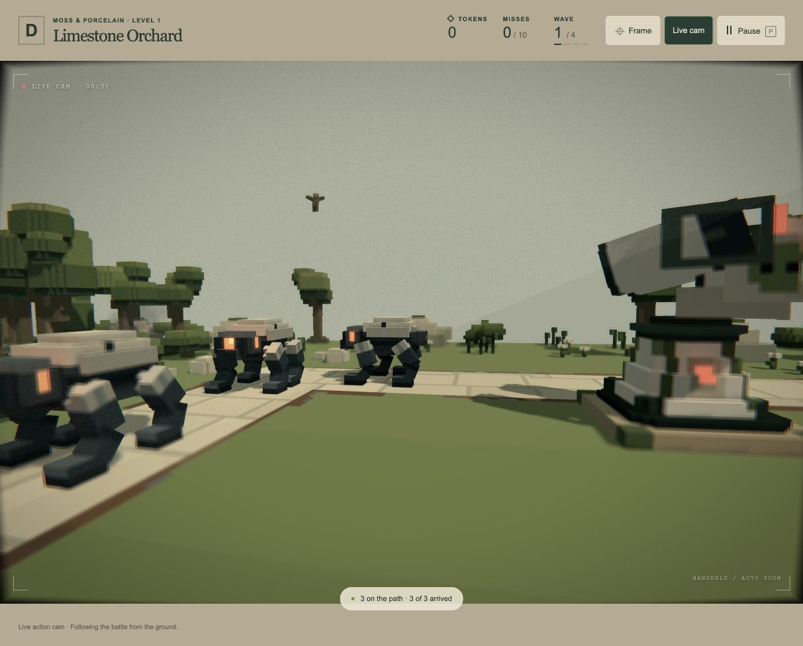

# Calmer Live cam, readable framing and pan tilt — 19 October 2026

The user found the previous camera too restless and distant, with trees obscuring action, and requested subtle tilt on fast pans. This corrects the provisional tuning in [the prior lens delivery](../live-camera-lens-2026-10-19/README.md); visual acceptance remains open.

## Current behaviour

- Holds a readable, safe shot indefinitely while panning/zooming to follow action. It no longer circles because a timer expired or seeks a fresh angle when a shot lingers.
- Walks at 18 units/s, down from 32, with 32-unit/s² acceleration. A bounded 26-unit/s escape is available when crowded. Travel scores favour short walks, and a failed view search no longer sends the operator to the farthest safe point.
- Favours an 86-unit subject distance within a 62–138-unit band, replacing 125 and 90–195. Enemy/gun safety gaps are 54/44 units, replacing 82/64. Actual camera distance depends on usable ground and scenery; moving enemies can encroach.
- Tests a subject envelope, nine foreground rays and overhead canopy rather than one aim ray. A spatially spread 64-candidate shortlist avoids judging only adjacent sites behind the same tree. New destinations need better framing than the threshold for retaining an existing shot. Up to 15 scene rays per candidate are evaluated on periodic plans, with reusable arrays; no new renderer pass or image.
- Retains valid subjects for at least six seconds and weighs proximity/current coverage, reducing unnecessary switches across the level.
- Fast left/right pans produce opposite, damped roll up to 0.03 radians (about 1.7°), settling toward level as panning slows. Combined lean/stride/flinch is capped at 0.075 radians. P freezes it; disabling resets it.

Central connected starts, ordinary scene/body/wildlife clearance, smooth zoom, subject focus and the existing film/depth-of-field treatment remain. No models, levels, weapon/enemy tuning or gameplay outcomes change.

## Verification

**29 affected checks pass, 72,389 assertions** in camera, Live cam, presentation and overview-director tests. [Combined log](tests.log). Tests include foreground canopy/side obstruction despite a clear central ray, indefinite stationary shot holding, both pan directions and settling, pause/exit, nearest-central safe entry, retreat, and real A1/A2 wave-three journeys at 30/60/120 Hz. Combat outcomes are identical across the sampled rates. Supported positions, static body clearance, bounded zoom/roll and standoff checks pass throughout.

The exact two-base-gun A1 opening used in the prior browser review (`[7,0,11]` and `[12,0,7]`) now travels **367.9 units**, holds framing for **68.1%** of the wave, and meets the sampled framing threshold for **92.6%**. The prior browser operator had already travelled 1,013.7 units by 82.8 seconds. This comparison documents the reported scenario, not a universal guarantee.

The short A1 Upgrade-II witness travels about 210 units, versus 366–390 previously. A2 travels 540–552 versus 659–666. Direct subject rays are clear in about 82% of these aggressive witnesses; wide-frame readability is stricter than centre-ray visibility, and necessary travel can still pass scenery. No full-suite run was performed; the complete-game and renderer checks from the prior delivery remain historical, not fresh results here.

The [browser build](build.log) succeeds (82 modules, approximately 0.55 MB). [All 85 asset hashes match](preservation.json); no frozen backup was written. No dependencies or GPU resources were added.

## Browser

Reloaded the fresh, unstarted A1 tab and reproduced the two-base-gun setup. At 9.33 seconds the operator was holding a shot at `[208.84,41,219]`, having travelled 64.12 units. At 31.79 seconds it was **still at that position**, covering enemies and the shooting gun with a clear foreground and 80.82-unit focus depth. Lens/pan changes continued without running another lap; the screenshot shows the action and a small pan lean. [Captured observations](browser-review.json).

Pause freezes camera/lens/lean and engine state. The disposable test wave is left paused with Live cam enabled; press P to resume. Browser console warnings/errors are recorded with the observations. Scenery may still cross the shot during necessary movement; this sampled check cannot promise a clear entire frame in every deployment. The camera remains cosmetic.
