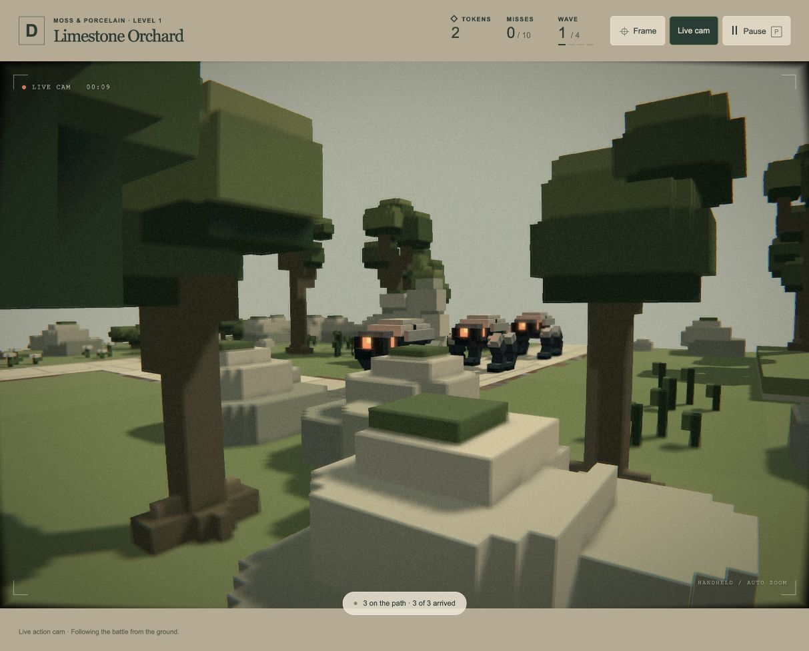

# Live cam distance, zoom and focus — 19 October 2026

**Superseded motion tuning:** the user found this operator too restless/distant and prone to foliage obstruction. [Current composition and pan-tilt correction](../live-camera-composition-2026-10-19/README.md) replaces the distances and walking behaviour below; the lens/film treatment remains.

The user requested more separation from combat, zooming to cover action rather than walking too close, and subtle depth of field. Implemented for playtesting; presentation tuning remains provisional.

The operator favours filming from about 125 world units away (previously 63), selecting viewpoints within 90–195 units. Planning and movement respect 82-unit enemy and 64-unit gun gaps, including 0.75-second enemy lookahead. Routing rejects unsafe approaches and allows retreat when an enemy encroaches. Each activation still begins as close to the area centre as safe connected ground permits. If a crowded scene has no fully safe start, it chooses the safest connected ground; dynamic actors can still approach the operator. These are presentation rules, with no physical cameraman or changes to combat.

A smooth 40–76° lens widens for moving/group coverage and tightens on held shots. Zoom is limited to 10° per second. Focus follows subject depth along the optical axis, with damped, bounded pulls. Nearby scenery does not capture autofocus. P freezes the lens with the existing simulation/camera pause.

The existing film pass now adds subtle depth of field, protecting a ±12% focus band and limiting blur to 2.4 CSS pixels. Depth discontinuity rejection limits foreground silhouette bleeding. It reuses the existing opaque depth image and the same colour image/pass; the settings buffer grows from 32 to 48 bytes. Sharp pixels use three colour samples and one depth read; blurred pixels use at most seven colour samples and five depth reads. Grain/fringing follow filtering and the DOM HUD stays crisp. This is restrained screen-space blur: translucent water/particles inherit underlying opaque depth, and it does not reproduce full optical bokeh.

## Verification

**60 affected tests pass, 68,600 assertions** across six files. [Combined log](tests.log). Coverage includes central safe entry, route standoff/retreat, bounded zoom, subject focus/pause, original camera modes, real A1/A2 journeys at 30/60/120 Hz, film depth binding, resize/reuse/destruction, normal-view rendering, and the full eight-wave game loop. No full-suite run was performed.

| Real wave fixture | Closest enemy | Closest gun | Travel | Clear subject rays |
| --- | --- | --- | --- | --- |
| A1 wave 3, three frame rates | 81.97–81.98 | 65.87–65.88 | 366–390 | 93.6–95.6% |
| A2 wave 3, three frame rates | 104.39–104.83 | 64.20 | 659–666 | 97.9–98.6% |

Enemy motion can cross the nominal gap between render observations; the operator does not teleport away. Camera journeys differ slightly with observation rate; combat outcomes are identical at all three rates. Supported positions and static body clearance pass throughout. These bounded examples are not a promise of uninterrupted visibility or perfect separation for every deployment.

The [browser build](build.log) succeeds (82 modules, approximately 0.55 MB). [All 85 asset hashes remain unchanged](preservation.json), and no frozen backup was written.

With the user's permission, reloaded their A1 wave-2 run to load the new code. A disposable two-gun A1 test rendered the actual WebGPU shader without console warnings/errors, showed changing zoom/focus, froze pose/lens/simulation while paused, and restored the overview with zero film-image bytes when disabled. The captured midwave state used 48.97° FOV and 126.13-unit subject focus. A second capture shows the moving operator at 61.17° with 106.13-unit focus and softer foreground detail. [Browser observations](browser-review.json). Scenery can briefly obscure parts of the frame while travelling; blur strength and shot composition remain provisional.

The test run was ended and the existing game tab left at fresh A1 preparation with two tokens and Live cam armed.
