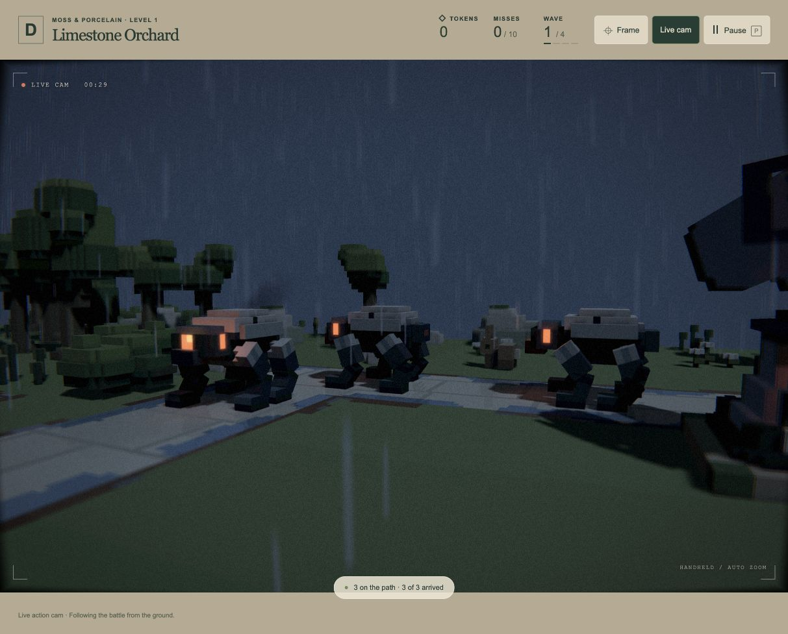

# Live cam night and rain replay — 19 October 2026

**Rolled back after review:** the user accepted this test and requested removal of the night/weather query parameters. Their implementation/helper/test are removed; the observations below are historical. `/play/` uses authored environment settings again.

The user accepts the calmer camera direction and requests the test again with night and weather switched on. Replayed A1 wave one with the same two base guns at `[7,0,11]` and `[12,0,7]`, Live cam enabled.

`/play/?night&weather` enables temporary presentation overrides after each world activation. Night reuses the preview palette (`#708ABA` sky, `#263754` ambient/backdrop), preserving existing light direction, intensity and shadows. Weather enables the level’s assigned effect through the existing renderer; Zone A therefore gets rain and wet paving. Removing the flags restores authored conditions. This does not add player environment controls, a day/night cycle, dynamic weather, or source asset edits.

At 29.74 wave seconds all three enemies were active, the guns had fired 11 rounds and the operator was holding a readable shot with framing score 1, 59.17° FOV and 87.72-unit focus depth. The renderer reports 3,200 rain particles / 102,400 rain seed bytes. Rain, emissive enemy eyes, the wet path, live-film treatment and camera all render in the actual browser without warnings/errors. Pause freezes camera, combat and rain; the test is resumed and left running for the user. [Browser observations](browser-review.json).

**35 affected tests pass, 70,150 assertions** across presentation, Live cam and renderer checks. [Log](tests.log). The new check covers optional overrides/default pass-through; existing checks cover real operator journeys, foreground framing, pan tilt, pause, camera/renderer resources and weather invalidation. This is a live replay through combat, not a claim that a complete night campaign was tested. [Build succeeds](build.log), and [all 85 source asset hashes match](preservation.json); frozen backup untouched.
