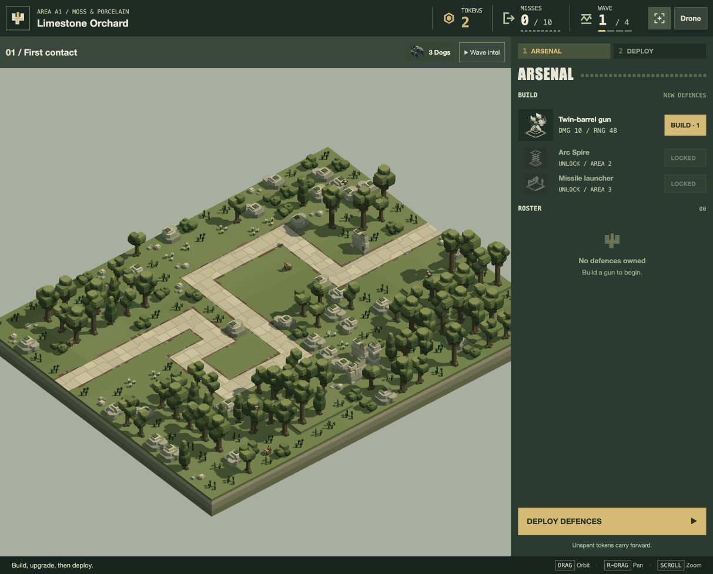

# Path-focused overview — 20 October 2026

The user requests framing the path when present, otherwise the full landscape.

`Camera.setLevel` caches the bounding rectangle of every nonempty route’s complete tiles, with a 12-unit surrounding margin clipped to the landscape edges. `Camera.overviewFrame` centres this rectangle at the path surface and fits it using the current yaw, pitch and canvas aspect ratio, retaining the existing 80-unit vertical allowance and framing safety factor. Empty routes preserve the previous full-landscape calculation exactly.

Frame, initial preparation, preview loading and the automatic return from combat share this calculation. World width/length still describe the landscape for navigation and panning. Level changes/cleanup discard old path bounds. The fixed scenic title retains its explicit composition; combat interest and Drone flight tuning are unchanged.

Verification:

- **38 tests pass, 0 fail**, across camera, automatic action camera, presentation, camera-view coordination and Drone camera suites. [Full output](tests.log).
- New coverage checks off-centre paths, full tile edges, secondary-only routes, merged approaches, different aspect ratios/orientations, stale-bound cleanup, exact pathless fallback, and actual smooth return to the same preparation frame.
- Refreshed the existing in-app `/play/` tab, entered A1 preparation and used Frame. The complete route is visible with surrounding deployment ground; the title and UI load normally. Left the game open in A1 preparation.

The margin is presentation tuning available for user review. This change does not author or rebalance paths, actors or landscapes.

