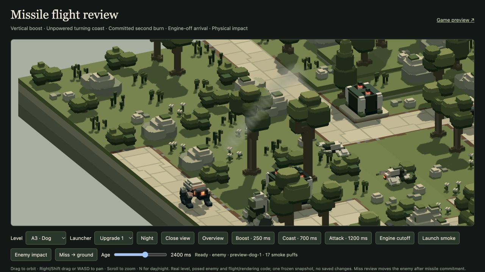

# Placement and presentation follow-up — 20 October 2026

Implemented for review following the user's four notes.

## Entry markers

Removed the line below the ENTRY badge. Badge and ground chevrons are now shown only during initial preparation. The first wave hides them for the rest of that level, including subsequent preparation phases; the next landscape resets the marker lifecycle. In-app checks confirm zero stem paths and a hidden overlay once combat starts. [Preparation](preparation-entry.png), [wave-state check](entry-browser.json).

## Longer missile trails

Trail puffs now last **2 seconds**, up from0.8, begin at radius**3.2**, up from2.5, and use peak opacity**0.90**, up from0.72. Emission still follows the actual powered attack tail at24puffs/second and stops at cutoff; existing puffs continue fading.

The fixed shared smoke pool grows128→384 to support persistence. The existing particle buffer gains12,288GPU bytes; combined debris/particle storage is50,112bytes, allocated lazily. No new shader, pass, light or bloom source. Saturation still drops new puffs without eviction. Renderer ownership/resource checks verify the intentional increase.

The production A3 GPU review retains **17 trail puffs at2.4seconds**, after the missile has hit its enemy, with zero errors. [Measurements](smoke-browser.json), [screenshot](longer-smoke.png).

## Wildlife during deployment

Staging a deployment now identifies obstructing animals, blocked current edges/flights and newly isolated ground actors. It reserves replacement destinations before changing any live state, then commits the defence and affected critter respawns together.

Ground replacements use connected navigation components with at least64 nodes and48units of extent, retain safe separation from other actors and destinations, and start on dry supported ground. Birds use clear supported perches, excluding other birds' reserved trees. Poses update immediately through the existing rigs. Unaffected actors retain poses and valid journeys; all keep identities, random state and simulation time. Future blocked routes still replan. An arrangement with no safe habitat remains invalid atomically.

Native tests place a gun where a real roaming animal is passing, confirm immediate success and safe respawn, then observe further completed journeys. A separate occupied-bird case verifies a supported-perch respawn and subsequent flight. Existing scene/camera/resource preservation checks pass. Fish remain unaffected by dry-ground builds.

## B1 and later placement clearance

The error came from the placement checker treating tall Walkers and Tripods as a full-height12-unit-radius cylinder. It applied their widest lower-limb clearance to their narrower upper bodies, falsely overlapping upgraded gun heads and barrels.

The corrected envelope keeps per-height geometry, analytically sweeps whole limb voxels through bounded joint intervals and accounts for IK feet remaining level. Native pose regressions check complete voxel vertices along every B/C route, including turns and stride phases. The existing broad navigation-radius contract, full defence yaw/pitch/recoil envelopes, occupied paths, scenery, ground and pairwise defence guards remain. Faster per-wave Walker overrides fall back to the broader envelope. No route, model, gait or combat profile was changed.

Individual Upgrade II gun alternatives:

| Level | Before | After |
| --- | ---: | ---: |
| B1 | 1 | 43 |
| B2 | 2 | 38 |
| B3 | 7 | 38 |
| B4 | 8 | 29 |
| C1 | 13 | 45 |
| C2 | 9 | 35 |
| C3 | 8 | 46 |
| C4 | 8 | 46 |

B1 base/Upgrade I choices also rise1→42. Every B–D level and all three tiers/families were surveyed; D counts remain unchanged. These are individually valid alternatives, not simultaneous-placement guarantees. C base-gun choices retain conservative limb-clearance exclusions. [Before survey](before-placement.json), [after survey](after-placement.json), [reproducible survey](placement-survey.mjs), [native pose probe](pose-probe.mjs).

## Verification and limits

**110 distinct affected tests pass, 0 unresolved failures**, across bounded runs. [Latest result per test](verification.json). The main109-test run passed108 and identified one old fixed-byte expectation; the corrected renderer allocation test passes in the31-check recheck. The subsequent three-check route recheck includes an additional faster-wave fallback regression. [Main output](final-tests.log), [renderer/marker/route recheck](recheck.log), [final route check](route-recheck.log).

Affected suites cover deployment, placement, route envelopes, markers, missile flight/effects, damage pools, wildlife, renderer and water impacts. Browser checks use the existing production play and missile-review pages in a temporary in-app tab, which was closed. The user's B1 run was preserved on its loaded version; these source changes require a fresh load. No full suite or64-wave balance replay was repeated. Presentation remains for user review.

