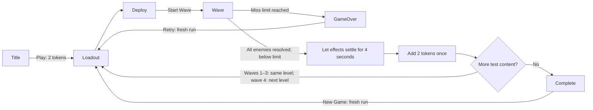

# First playable game — development plan

**19 October 2026 · user-approved for implementation.** The user says the initial plan looks good and requests a working version to test and iterate. The scope and provisional rules below are now authorised; the bounded implementation is complete for gameplay testing; see [evidence and limits](../play-first-2026-10-19/README.md).

The user has accepted all four Zone B layouts and described the first player loop. This plan turns that direction into a bounded first delivery at **`/play/`**, while preserving `/game/` as the development preview. The [design doc](../design-doc.md) records requirements; the [Researcher's TODO](../research/game-readiness-todo-2026-10-19.md) remains the broader backlog. The user's sign-off authorises the first delivery below, not every backlog item. The eight-wave slice and100 affected checks are complete; user gameplay acceptance and balance review are pending.

## Decisions already made by the user

- Show a title screen, then let the player start a new game.
- Start with **2 tokens**, used to purchase or upgrade initial defences.
- Give the player time to place their defences before starting an enemy wave when ready.
- Count enemies reaching their route exit as **misses**. Too many misses end the game.
- After a wave finishes without game over, grant **2 more tokens** for purchases/upgrades and return to preparation for the next wave/level.
- Play **4 waves on each level**. Complete the level before moving to the next level in the area/zone; complete that area before moving to the next zone.
- Keep token awards, defence settings and enemy settings easy to adjust through playtesting. The first priority is a working loop.
- Use the separate player entry `/play/`, retaining `/game/` previews.
- The earlier planning-only gate has been satisfied by the user's sign-off; routine implementation within this plan is authorised.
- **Latest requirements:** use a closer fixed title background; update placed defences without reloading the level; allow four seconds for final-wave effects before continuing. **P toggles pause/resume** during waves and their settling period, displaying/hiding a pause screen.

These decisions replace the earlier unspecified starting budget and wave reward for this loop. Do not also award an extra level-end upgrade grant or invent repair spending. Repairs remain a later design topic.

## Confirmed progression

**User clarification, 19 October:** four waves per level, then the next level in the area, then the next zone after the area's final level. “Area” refers to the existing zone grouping; no additional campaign tier is introduced. This replaces the earlier five-wave rule.

The existing four levels per zone and four zones give **16 levels and 64 waves** for the full campaign. Waves 1–3 return to preparation on the same landscape; successful wave 4 completes the level. The +2 reward still applies to every successful wave, including wave 4, without an extra level/zone reward.

## Approved first delivery

Use **two accepted Zone A landscapes, A1 Southern Hook and A2 Garden Crossing**, as runtime scenery/route compositions. At four waves each, this approved first delivery has **8 waves** and demonstrates both repeat waves and a real change of landscape. Full area/zone content follows later; progression tests should cover the final-level-to-next-zone rule from the outset. Preserve their source JSON and A1's accepted drone test; `/play/` supplies its own player inventory and finite enemy schedule.

Start with the existing **gun turret, base and upgrade 1**, and the **Dog** enemy. The approved gun price is 1 token to buy and 1 for the upgrade, so the initial 2 tokens offer a concrete choice: two base guns or one upgraded gun. Unassigned upgrade 2 and other families stay outside this first delivery. This is the approved first development scope; the eventual arsenal remains broader.

The title follows the accepted [scenery-only direction](../concepts/title-menu-moss-porcelain-v3.md), with a working Play action. The initial player interface includes tokens, misses/limit, level/wave progress, purchase/upgrade controls, owned units, placement feedback, Start Wave, pause/resume, game over, retry and a clear completion screen after the second test level. Settings, credits and final presentation polish can follow; no dead menu actions are presented as working features.

## Approved provisional rules

| Topic | Approved first-delivery rule |
| --- | --- |
| Misses | Each escaped living enemy adds 1. Start at 0; game over immediately at **10 misses**, accumulated across the whole run. Both limit and per-type miss contribution are configuration. Ten is provisional test tuning. |
| Wallet | One token balance pays for purchases/upgrades. Unspent tokens carry through waves and levels. Award +2 exactly once after a successful wave, including the last; no reward on failure and no extra level-clear award. |
| Ownership | Purchased units and their upgrades belong to the run. On a new landscape they return to the deployment inventory for placement; the player does not buy them again. |
| Preparation | A short **loadout → deployment** flow preserves the user's order: buy/upgrade first, then position owned units. Permit returning to loadout before starting. Keep positions between waves on the same map; allow free repositioning during preparation. Unplaced units stay in inventory and do not attack. |
| Active wave | Purchases, upgrades and movement of defences are unavailable until the wave ends. Start Wave commits the current deployment; it can be started without spending every token or placing every unit. |
| Placement | Use visible, flat, dry ground at path height, with complete model movement clearance, including pairwise yaw/pitch/recoil clearance between player units and a supported route for enemy bodies. Reject routes, bridges, water, scenery, out-of-bounds space and conflicting units. Show a placement ghost/range and an understandable invalid reason; cancel spends nothing. No selling, refunds or player-built paths. |
| Wave boundary | A wave finishes after all scheduled enemies have spawned and each has been killed or escaped. An exit is terminal, never a loop back to the entrance. The miss-limit result takes precedence over a simultaneous wave-clear reward. One enemy resolves once. Approved first-delivery event convention: resolve hits and exits in simulation-time order; a killing hit at the same instant as the exit counts as a kill, not both. |
| Pause control | During an active wave, P toggles pause/resume with a visible pause screen. Pause/resume UI remains available. Stop combat/spawn clocks and prevent elapsed paused time from advancing the resumed wave. |
| Time and resets | Combat time/spawns stop during preparation, pause, hidden-tab suspension and results. Before each wave, guns start ready with no inherited partial burst; use the same rule whether or not the player edited a placement. Existing cosmetic wildlife may continue during preparation. New Game/Retry restarts the test run with 2 tokens, 0 misses, no owned units and the first wave. |
| Saving | Keep the first run in memory; reloading returns to the title. Save/resume and full campaign unlocks follow later. |

The four-wave progression above is confirmed user direction. The defaults in this table and first-delivery scope are now approved as provisional gameplay settings.

## Player flow

After waves 1–3, preparation keeps the landscape; after wave 4, advancing to another level loads its landscape and returns owned units to the deployment inventory. The counter, wallet and ownership are run state, separate from the rendered scene.

## Development sequence after sign-off

1. **Create the player entry and run state.** Engineer adds `/play/`, title/start/result flow and explicit preparation/wave/result states. Separate run ownership, wallet, misses and progression from scene resources and preview data. Artist applies the accepted visual direction and a minimal readable HUD. **Done when:** entering, starting, retrying and returning to title work without developer controls; `/game/` still behaves as before.

2. **Make one finite wave resolve correctly.** Engineer adds validated encounter data, scheduled spawning and inactive/active/killed/escaped states. Reuse current movement, animation, health, aiming and effects. Handle large frame deltas and same-frame kill/exit resolution without duplicates; remove escaped enemies from targeting, collision, lights and claims. **Done when:** an undefended fixture reaches game over and a cleared fixture grants exactly one reward and returns to preparation.

3. **Connect purchases, upgrades and deployment.** Engineer implements the wallet and stable owned-unit identities, then scene membership and ground picking. Artist reviews loadout/deployment feedback and keyboard/focus behaviour. A purchase/upgrade commits and spends once only after validation; its success must not depend on a later failed scene load. **Done when:** both initial 2-token strategies can be deployed and fight, invalid actions spend nothing, and upgrades change the actual model and combat stats.

4. **Close the repeat-wave and next-level loop.** Preserve wallet, misses and owned tiers, restore preparation, issue rewards once and transfer inventory to the next landscape. Tactician authors four small, configurable test waves for each of A1 and A2. Verify wave 4 advances the level and the final level of an area advances the zone, with no skipped preparation or duplicate reward. **Done when:** the player can reach A2, redeploy their existing arsenal, finish the test run or lose, and retry cleanly from the title/start flow.

5. **Playtest and hand over for review.** Tactician tunes only the isolated player encounter/configuration values to make the loop testable with the starting budget. Lead and Artist review the actual experience; Engineer verifies affected lifecycle and preview regressions. **Done when:** normal purchases/upgrades, a viable run, deliberate failure, P-key pause-screen/resume and background suspension, repeated starts/retries and scene changes work without console/WebGPU errors or stale actors/resources. Record the fixture, limits and measurements; user gameplay review comes before expanding the arsenal/campaign.

Stages are integration checkpoints within one signed delivery. They do not require a fresh permission request for each routine edit. Completion and verification are still pending.

## Engineering approach and boundaries

**Latest user feedback supersedes the initial preparation-rebuild approach.** Load each landscape once, reserving bounded GPU instance slots for both enabled gun tiers and six Dog actors. Preparation edits validate a candidate then update active gun slots and lighting in place; preserve scenery, water, visibility, camera and live wildlife. Same-level waves rebind the finite Dog slots to new spawn identities without refetching assets or recreating GPU buffers. Load a new scene only for a new run/title or an actual landscape transition. Safe connected wildlife seeds are chosen at initial play composition; later changes retain current safe poses and journeys, replan only invalid paths, and reject edits that overlap an animal or isolate its usable ground. Never charge an uncommitted deployment/upgrade or trap, teleport or delete an animal to permit a build. Independent clearing surveys alone do not certify simultaneous towers.

Keep the player roster/configuration separate from saved preview mode and its guards. Reuse the existing renderer and combat primitives through an explicit play-session adapter; share a primitive only with appropriate regression checks. Player enemy exit handling must not change the intentional looping in `/game/` studies. Build play scenes from cloned scenery/route data, excluding A1’s preview drones and roster. An active-target view must exclude future and escaped actors even if their HP is positive; hiding their meshes is insufficient.

Collect starting/reward tokens, miss limit, prices, enabled tiers, defence combat values, enemy HP/movement and wave schedules in validated, versioned play configuration. Start from approved/current values, then make provisional test adjustments there rather than mutating the accepted preview statistics. Pass resolved play values into controllers; current constructors must not silently fall back to preview constants. Keep enemy speed, gait and threat estimates consistent. Keep values out of UI/event-handler literals. No balance editor is needed yet.

Derive finite entity/light/effect capacity from the **maximum affordable inventory and peak active enemies across the whole test run**, not its first wave. Hidden actors currently consume authored model-light capacity before visibility filtering, so slot allocation and lighting must be reviewed together. The current budget is 29 authored model-light clusters, with 4 per Dog and 3 per gun, so the complete two-level economy needs explicit capacity sizing rather than an assumed fit. Support the approved maximum with a bounded play capacity and regression checks; configuration must be rejected clearly when unsupported; never silently drop paid units, active enemies or their lights. Reuse shared geometry, release replaced scene resources, and measure actual peak work. Do not claim a performance target that has not been agreed.

Key integration points: [server routing](../../server.js), [scene ownership](../../engine/scene-loader.js), [world construction](../../engine/world.js), [renderer](../../engine/renderer.js), [model lights](../../engine/model-lights.js), [preview orchestration](../../game/app.js), [enemy lifecycle](../../game/enemy-preview.js), [defence controllers](../../game/defence-preview.js), [stats/prices](../../shared/defence.js) and [weapon rules](../../shared/arsenal.js). These are dependencies to inspect during implementation, not a request to rewrite them all.

Targeted checks must also cover P during a running wave, visible pause screen, unchanged combat/spawn time while paused, and resume without catch-up. Targeted checks should cover exact-once rewards/misses/spends, invalid actions, finite spawns and exits, actual upgraded damage, same-frame terminal events, hidden-tab time, frame-rate/long-delta consistency (including only time since each actual spawn), full restart/transfer cleanup and preservation of accepted previews. The original planning pass created no gameplay files or runtime tests. The initial delivery is verified; latest feedback and targeted follow-up evidence are recorded in [the refinement record](../play-refinements-2026-10-19/README.md).

## Approved scope boundary

The user has approved the **two-level gun/Dog scope** and the **provisional rules** above for implementation and gameplay testing. The four-wave level/area/zone progression is now confirmed. The 2 starting tokens, +2 successful-wave reward, manual wave start and miss-based game over are also already user direction. Final balance, remaining arsenal, repairs, save/resume, full campaign content and release work remain later stages.

The user has signed off. The team can implement and tune this bounded loop without waiting for remaining landscapes or final balance; unrelated backlog work remains deferred.
