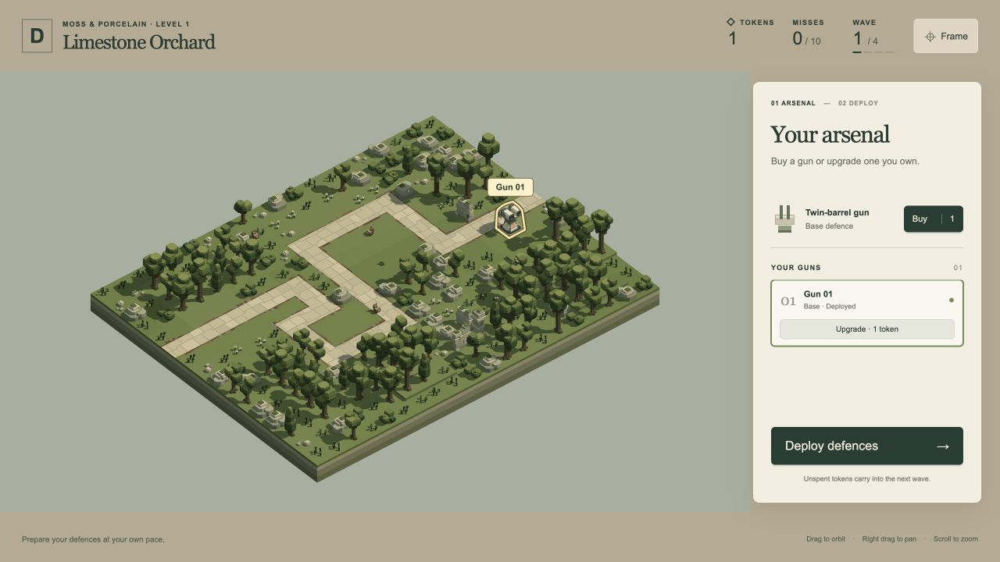
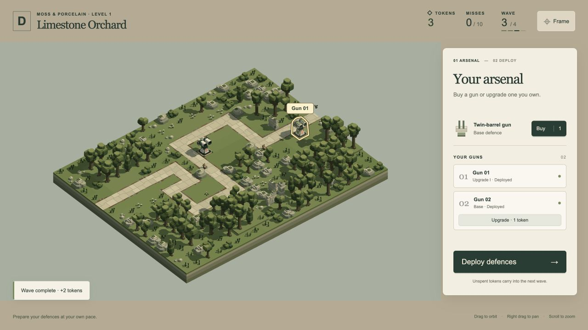
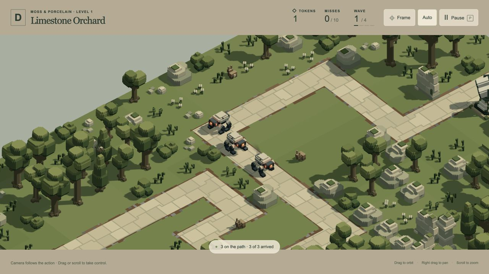

# Arsenal identification and action camera — 19 October 2026

## Delivered for playtesting

The user requests hover identification for owned defences and smooth automatic action framing. `/play/` now outlines the hovered/focused deployed gun with a cream/gold projected envelope and its inventory number. The entire arsenal row participates, including Upgrade. Unplaced inventory has no marker; pointer hover takes precedence over keyboard focus. The overlay is non-interactive, clears outside preparation and follows camera/rig changes, including upgrades.

The camera smoothly follows the current enemy front, guns already firing or near the next three seconds of an active enemy's route, recent shots and destruction. It retains the player's angle, balances spread-out action and uses bounded speed/acceleration. The last combat composition remains through settlement, followed by a smooth overview return. Drag, scroll and movement keys take control for six seconds during a wave; **Auto** disables the director until re-enabled. Preparation input cancels any return without postponing the next wave. **P** freezes camera/event time with the simulation.

The user explicitly prioritises laptop/desktop play. Mobile-specific polish and additional narrow-screen work are deferred. Exact camera pacing/weights remain provisional for user testing.

## Verification

- **12 camera tests pass, 3,075 assertions**. [Raw final output](camera-tests.log). Includes bounded motion, pause/event ageing, phase/scene ownership, manual takeover and 30/60/120 Hz consistency. The desktop integration regression runs real animated A1 base wave 1 at 1500×1000, A1 upgrade wave 4 at 1920×1080 and A2 upgrade wave 4 at 1500×1000. All scheduled Dogs are killed with zero misses; firing/engaged gun meshes remain within the frame, and each run achieves at least 15% tighter zoom than overview.
- **4 outline tests pass, 295,702 assertions**, reported by Artist. Actual base/upgrade articulated mesh vertices remain within the projected hull; cache invalidation, hover/focus priority, absent units and lifecycle/disposal checks pass. This report is a transcription of the completed run, not a retained raw log.
- Final browser bundle: 79 modules, 0.51 MB, successful. No full-suite rerun or hardware frame-time claim.
- Live desktop review confirms base hover over Upgrade, upgraded-unit hover, tighter combat framing, P freezing camera/engine time, Auto off retaining the manual view while combat continues, manual drag temporarily handing back control, settlement and preparation return. The first two defended waves finish with zero misses. Placement/upgrades/wave changes keep the scene-load count unchanged. [Recorded browser observations](browser-review.json).
- [Preservation verification](preservation.json): all 85 active source hashes and 69 frozen snapshot files match; frozen archive SHA256 remains `d3d8ae77ce5e70b0a0bac22183ecc4712aee4830871afc9955cceb8976d2098b`.

## Evidence and limits

The SVG follows the convex projected envelope of the model, spanning small gaps such as between barrels; it is not a pixel-exact or depth-tested silhouette. The director pans and zooms at the existing angle; it does not promise to eliminate scenery occlusion. Finite current A1/A2 desktop tests do not establish all future layouts/rosters or arbitrary manual camera orientations. Accepted landscapes, models, combat configuration, preview controls and renderer/light capacity are unchanged.

Implementation: `play/action-camera.js`, `play/unit-highlight.js`, `play/app.js`, `play/ui.js`, `play/index.html`, `play/style.css`; focused checks in `tests/play-action-camera.test.js` and `tests/play-unit-highlight.test.js`.
