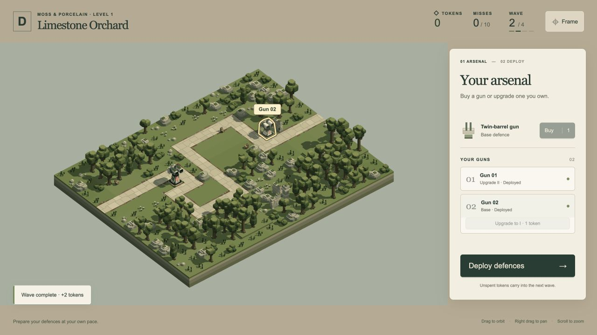
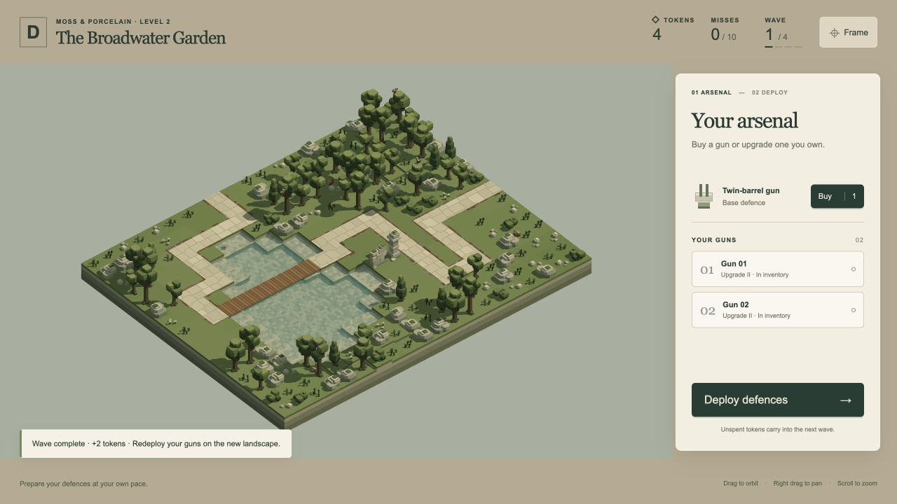
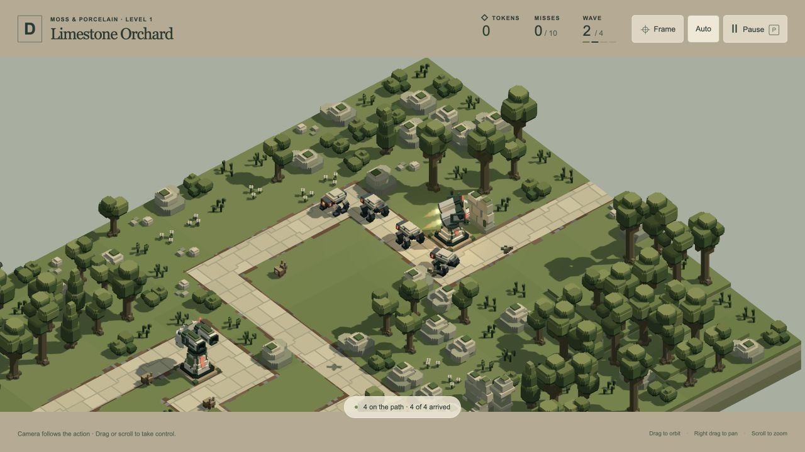

# Deployment, upgrades, camera and difficulty — 19 October 2026

Implemented the user's five gameplay notes for the existing A1/A2 `/play/` slice. These changes are ready for another desktop/laptop playtest; final balance and presentation acceptance remain open.

## Behaviour

- Successful placement selects the next unplaced owned gun, wrapping through inventory order. Once every gun is deployed, selection clears. Failed placement retains the selected gun.
- Guns support Base → Upgrade I → Upgrade II. Each step costs one token, and preparation permits consecutive steps whenever the wallet allows. An Upgrade I gun carried into the next landscape can still receive Upgrade II. The UI names the next step and stops offering upgrades at the maximum tier.
- Upgrade II reuses the accepted third model with a provisional play-only attack: 14 damage, range 96, five hitscan pulses separated by at least 0.12 seconds, then a one-second cooldown after the last actual pulse. Shared preview stats/firing defaults are unchanged.
- The closest automatic camera radius increases from 88 to 116, giving about 32% more horizontal/vertical ground span. Smooth movement, manual takeover, Auto, P pause and the settling hold remain active.
- Researcher and Tactician tuned the existing eight waves to 100→240 HP, 12→15 speed and 3→9 Dogs. See the [exact profiles and strategy comparisons](../play-balance-2026-10-19/README.md) and [research rationale](../research/play-difficulty-2026-10-19.md). The two-token start, two-token wave reward, costs and ten cumulative misses are unchanged.

The upgrade bug came from the first slice only enabling Base and Upgrade I; there was no active third-tier purchase or attack profile. The ordered tier chain now drives state, offers, placement validation and runtime pools consistently. There is no per-wave upgrade cap.

## Verification

**49 unique affected tests pass, with 13,360 assertions and no failures.** No full-suite run was needed.

| Check | Result | Evidence |
| --- | --- | --- |
| Session, configuration, placement, deployment and engine | 37 tests / 10,277 assertions. Consecutive upgrades, carried Upgrade II, guarded spending, next selection, full articulated clearance, 120 in-place edits, live wildlife continuity, per-wave reset/reuse, real success and defeat. | [Raw gameplay log](gameplay-tests.log) |
| Action camera | 12 tests / 3,083 assertions. Minimum radius, smooth/manual/paused behaviour and real A1/A2 fights on 1500×1000 and 1920×1080 frames; engaged/firing gun meshes remain within frame. | [Raw camera log](camera-tests.log) |
| Final campaign audit | 51 wave attempts across seven strategies using native `PLAY_CONFIG`, ordinary geometry/LOS/aiming and actual economy. Old strategy: five misses. Two Upgrade II guns: all 48 kills, zero misses, six tokens spent, 12 final tokens. Two-base and one-upgraded openings remain viable; undefended play fails at ten misses without a failing-wave reward. | [Audit and reproduction command](../play-balance-2026-10-19/README.md) |
| Browser bundle | `bun build play/app.js --outdir /tmp/defender-play-feedback-build --target browser` succeeds: 79 modules, approximately 0.52 MB. | Build observed locally |
| Preservation | All 85 active asset sources, 69 frozen snapshot files and the frozen archive hash match the baseline. | [Preservation report](preservation.json) |

Current bounded player capacity is 16 affordable owned guns, nine Dog slots, 84 model-light clusters and 132 combined point-light slots. This is resource correctness evidence, not a frame-rate guarantee. Preview capacities remain unchanged.

## Browser review

The [DOM observation record](browser-review.json) contains both the UI regression run and the reloaded final-tuning run. The first run began before the new enemy profiles were integrated: it verifies automatic selection, two consecutive upgrades, four-wave level transfer and an Upgrade I → II purchase after reaching A2. It is not evidence for final enemy difficulty. The actual upgrade after transfer changes the wallet from five to four tokens, retains both owned IDs, and leaves the scene load count at three.

The final reload verifies the 84-light build, successful two-base opening at `[13,0,9]` and `[4,0,9]`, zero misses, exactly two reward tokens and no additional scene load. A passing animal temporarily rejects placement without losing selection; the clear alternative succeeds and selects the remaining inventory gun. The same final build accepts Base → I → II in one preparation, with no scene reload, and displays the third model firing during the next wave. The captured action camera radius is 116. No console warnings or errors were observed.

## Limits and next playtest

This is a moderate introductory difficulty increase. The earlier two-Upgrade-I strategy still completes with five misses, and a clean solution need not spend the entire wallet. These witnesses are finite examples, not proof of an optimal strategy or final player satisfaction. Remaining campaign levels, other defence/enemy families, audio, saves, mobile polish and further balance remain separate work. Accepted landscapes, models, wildlife behaviour and `/game/` previews are preserved. Reload `/play/` and start a fresh run to use the new configuration; an already-open run retains its loaded module configuration.
