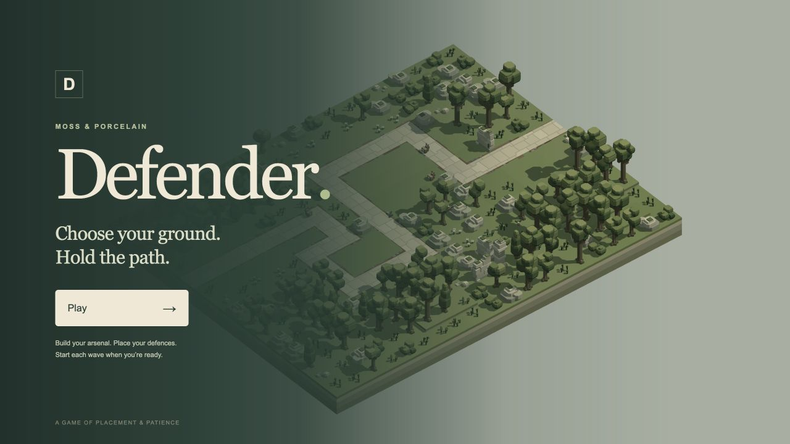
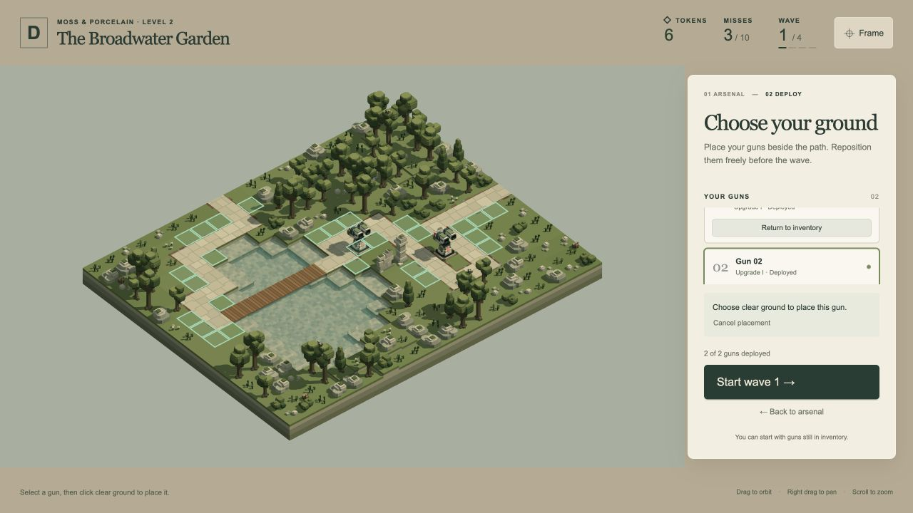
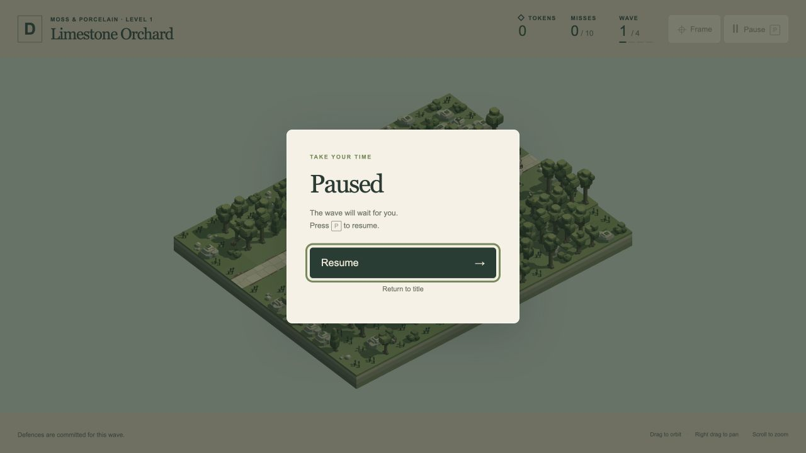
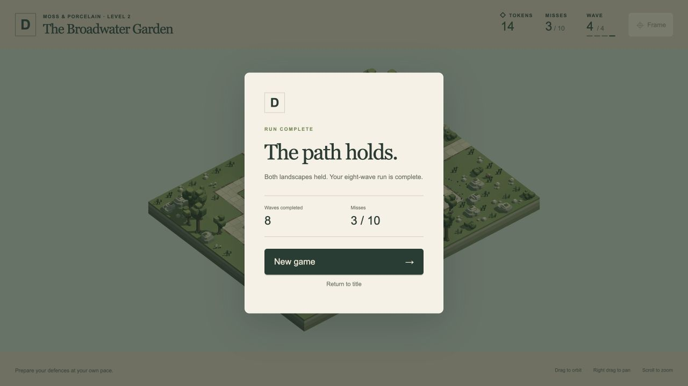
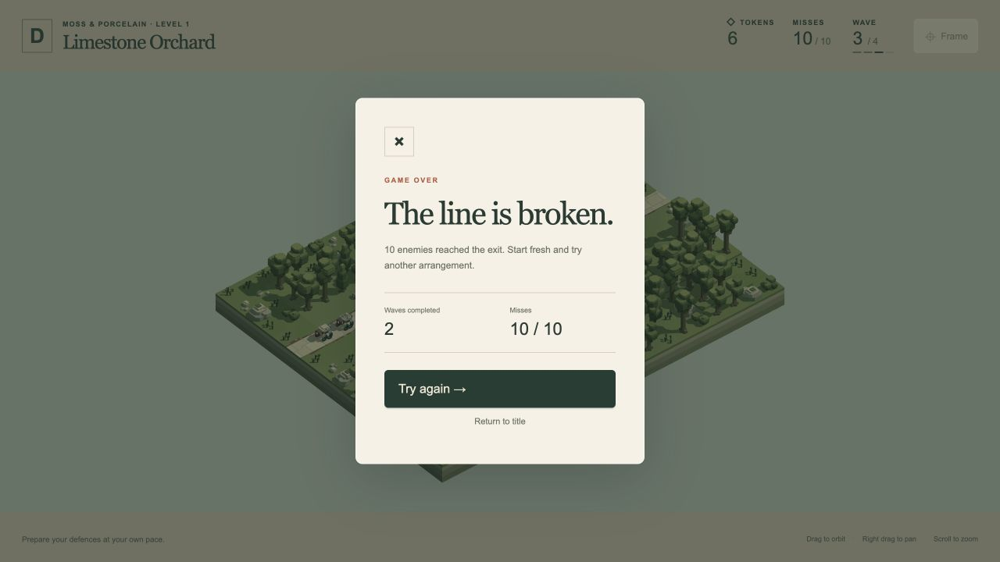

# First playable loop — 19 October 2026

The signed [development plan](../plans/first-playable-game-2026-10-19.md) is implemented at **[/play/](http://127.0.0.1:4173/play/)**. This is the first gameplay test slice: A1 Southern Hook and A2 Garden Crossing, four finite waves each, base/upgrade1 guns and Dogs. Final balance and broader campaign content remain future work. User gameplay acceptance is still pending.

## Playing

Choose Play, buy guns or upgrade owned guns, then choose Deploy. Select a gun and click highlighted ground. The footprint and dotted range ring provide placement feedback; invalid ground explains its restriction. Arrow keys move the placement cursor when the landscape has focus; Enter places, Escape cancels. Free repositioning and returning a gun to inventory are available before starting a wave. You may leave tokens unspent or units undeployed.

Start Wave commits the current arrangement. **P toggles the pause screen and resumes**, as do the Pause/Resume buttons; Escape also toggles during a wave. Drag orbits, right drag pans, scroll zooms and Frame restores the overview. Development path-view, reset, zone switching, slow motion and weather controls are absent from the player entry.

Start with 2 tokens; buying/upgrading a gun costs 1 token. Every successful wave gives 2 tokens exactly once, including the final wave. Living enemies that reach the exit each add 1 miss; reaching 10 cumulative misses ends the run immediately without a failed-wave reward. Same-level placements persist. A new landscape keeps ownership, upgrades and the wallet, but returns guns to inventory for redeployment. Completion follows the eighth wave. Retry/New Game restores 2 tokens, zero misses and an empty arsenal; reload returns to the title. Runs are in memory only.

## Implementation

- [Session](../../play/session.js) owns tokens, inventory, phase, progression and exactly-once outcomes. Scene-changing transactions fork the state and commit only after activation.
- [Configuration](../../play/config.js) contains versioned validated prices, rewards, miss limit, enabled tiers, combat values and all eight spawn schedules. Current provisional Dog tuning is 80 HP at 12 units/second; waves contain 3/4/5/6 Dogs. Preview Dog HP and weapon defaults are unchanged.
- [Runtime](../../play/engine.js) composes cloned scenery/routes and current-wave actors. Scheduled, active, killed and escaped states control targeting, health, rendering and effects. Fixed 1/120-second ticks split spawn/exit boundaries, retain long-frame backlog and resolve killing hits before tied exits. Guns start ready and neutral each wave.
- [Placement](../../play/placement.js) checks visible dry full footprints, route/scenery clearance, complete gun yaw/pitch/recoil envelopes, simultaneous pairwise clearance, Dog route clearance and connected wildlife navigation. Committed changes rebuild with verified wildlife seeds; same-level wave rebuilds retain safe seeds.
- [Application](../../play/app.js) owns the single frame loop, scene teardown, effects, input and pause/results. Paused/hidden frames reset the clock baseline. Preparation animates wildlife without advancing combat. Errors retain the authoritative run and expose retry.
- Opt-in renderer capacity supports 16 affordable guns plus 6 current-wave Dogs: 72 model light clusters and 120 combined point-light slots. Strict overflow fails clearly. Preview defaults remain 29/77. CPU light storage is 2,320 bytes; the combined GPU light uniform is 3,856 bytes. This is a bounded capacity proof, not a cross-device frame-rate guarantee.

## Verification

**100 affected tests pass, 30,644 assertions across 13 files.** [Full output](tests.txt). No full-suite run was performed. Coverage includes transaction/phase guards, exact-once terminal/reward handling, all eight real waves, no-defence failure, ownership transfer, generic final-level-to-next-zone catalogue progression, same-level rebuilds, stale requests/cleanup, clock pause/resume, actual upgraded damage, spawn timing, 30/60/120 Hz agreement, retained long-frame work, placement envelopes, actual wildlife journeys and preview rendering/combat regressions.

The real-engine success witness buys two base guns at A1 `[2,0,7]` and `[9,0,10]`, upgrades both after the first reward, then redeploys those same upgraded guns at A2 `[5,0,5]` and `[8,0,8]`. It clears all 36 Dogs with zero misses, eight rewards and 14 final tokens. The undefended integration run loses at 10 misses during A1 wave 3, with only the first two rewards and 6 tokens. Both choices for the initial 2-token wallet also have measured successful first-wave placements. [Placement/tuning details](placement-and-tuning.json).

Built-in browser checks cover title/start, buying both guns, upgrades that change actual models/combat, legal and rejected placement, rewards, same-map retention, A2 transfer/redeployment and P pause/resume. The paused wave clock and shot count remain exactly unchanged between observations. The current 120-slot shader variants compile and render without reported errors or light overflow. The live run completed all eight waves with 3 misses (from the initial placement experiment) and 14 tokens. A separate undefended run stopped at 10 misses with 6 tokens; Retry and New Game both restored the fresh state. No browser warnings/errors were reported. After repeated scene replacements, created minus destroyed GPU scene buffers exactly equalled the 87 active buffers. The A1 drone preview also loads cleanly with its original 944-byte model-light and 2,480-byte combined uniform storage. [Browser review](browser-review.json).

The browser review uses the desktop 1280×720 view. Shared-clock tests cover stop/resume and hidden-time catch-up prevention; a synthetic hidden-tab transition was not forced through the browser. Narrow-screen CSS exists, but mobile/touch gameplay and broad device support have not been accepted. Load failure and stale-request recovery are covered by unit tests and guarded UI code, not a deliberately broken production asset server.

## Preservation

All 85 source asset JSON files match the before-work hashes: [asset check](asset-preservation.json). All 69 frozen snapshot checksums and the frozen archive hash also match: [backup check](backup-preservation.json). No source level/model, approved route, A1 drone test or frozen backup was edited. `/game/` remains the separate development preview.

## Captures

