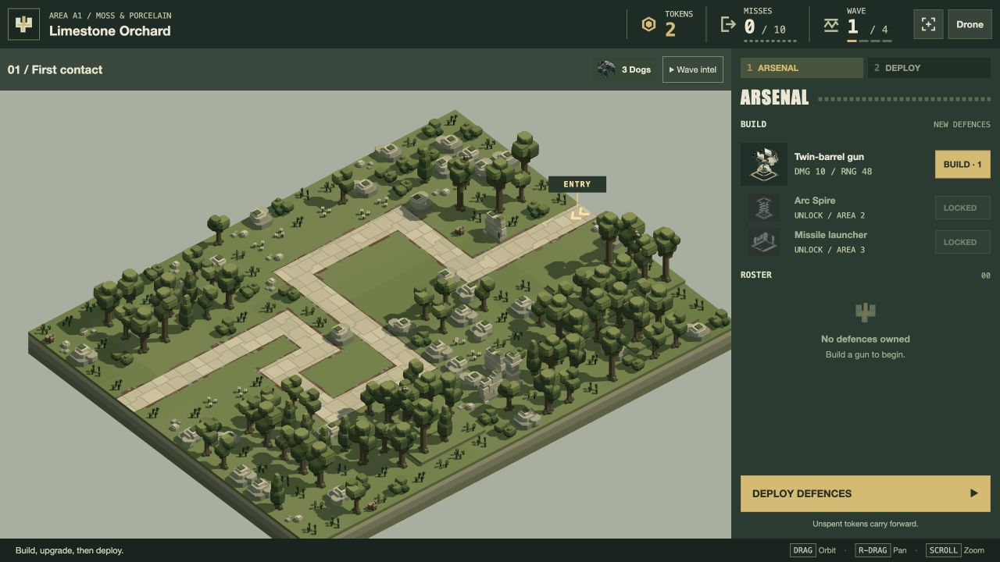
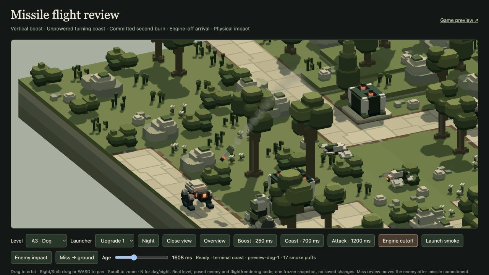

# Player notes — 20 October 2026

Implemented for user review following five player notes.

- **Gun price:** 1 token for purchase and each upgrade step was intentional existing tuning in `play/config.js` and the Zone A design. No price change. Arc steps remain 2 and missile steps 3.
- **Drone:** choose a varied safe opening station around the initial action. A cosmetic seed varies between level compositions; subsequent activations choose another angle. A readable shot holds for 5–8 seconds before seeking a station at least 64 horizontal units away and 0.4 radians around its subject, aiming for roughly 60° of change. Height choices cycle more often. Committed smooth travel, swept scenery/actor clearance, higher/farther bands, gimbal/lens easing, pause and anticipation remain. Insufficient safe alternatives can extend a hold.
- **Entrances:** projected ENTRY badges and paired chevrons point into every distinct route start in play preparation/combat overviews. Multiple starts are numbered; common starts are deduplicated. Markers follow camera motion and hide in title/results/Drone views. No source scenery or solid model is added.
- **Missile clearance:** eligibility forecasts the next loaded round from its actual socket using the production boost/coast/homing integrator and whole-model swept scenery sphere. A blocked shot spends no ammo or readiness. Reused scratch state and a same-frame aim/velocity/socket cache avoid repeated work. A low obstruction can be cleared by the lofted flight. Actual swept collisions still apply: forecasts use current velocity, so later enemy turns/death can still change flight outcomes. This addresses predictable blocked launches, without claiming immunity to every later collision.
- **Missile trails:** the powered final attack emits 24 puffs/second from the interpolated real tail. Grey puffs expand from radius 2.5 and fade over 0.8 seconds. Engine cutoff stops new emission. The fixed 128-smoke pool, sorting, lighting, opaque occlusion, shaders and GPU buffers are reused; saturated pools drop puffs without evicting existing smoke. Production play, preview and missile review wire the callback. Reset/unload clear trail state.

## Verification

**84 affected tests pass, 0 fail** across ten suites: missile flight/effects/integration, play engine/campaign integration/config, Drone/camera coordination/anticipation, and entrance markers. [Output](tests.log). Following the final smoke-readability and allocation/cache cleanup, **36 missile checks pass again**, 0 fail. [Final output](final-missile-tests.log). No full suite or fresh 64-wave balance audit was run; prices, waves and damage profiles are unchanged.

New checks cover:

- Repeat angle changes around a stationary subject, varied and clear opening stations, existing rate/acceleration limits and 30/60/120 Hz actual A1–A4 flights with finite combat.
- Entrance positions/directions on all sixteen campaign levels, merged approaches, shared-start deduplication, camera projection, phase hiding and scene cleanup.
- A tall wall rejects a launch while preserving its round/deadline, a low wall admits a real hit, repeated queries cache and changed aim rechecks.
- Actual tail emission, identical smoke counts at 30/60/120 Hz, no boost/coast emission, terminal cutoff, fixed storage exhaustion, expiry and colour/state cleanup on reuse.

Browser/GPU checks used an isolated in-app test tab, preserving the user's existing B1 preparation/run:

- A1 preparation displays the ENTRY badge and inward route chevrons. [Screenshot](entry.png).
- A live unarmed A1 Drone run travelled 204 units and performed an additional timed relocation within 19.7 simulation seconds, with readable quality 1 and no blocked moves in the sampled record. [Measurements](drone-browser.json), [later view](drone.png).
- Production A3 missile review renders ten trail puffs at 1.35 seconds with zero errors/collisions. The terminal snapshot retains the visible fading trail after the flame stops. A following actual enemy-surface contact applies one hit with zero scenery collisions. [Flight](missile-browser.json), [impact](missile-impact-browser.json).
- The temporary tab was closed. The original B1 tab retains its loaded version and run; a fresh load is required for these source changes.

Visual tuning remains for the user's review. No source model, landscape, economy profile or enemy schedule was edited.

